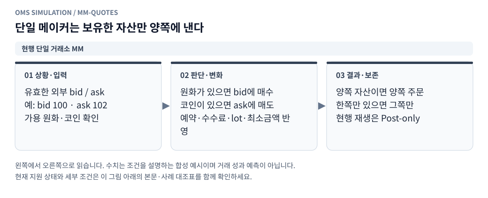
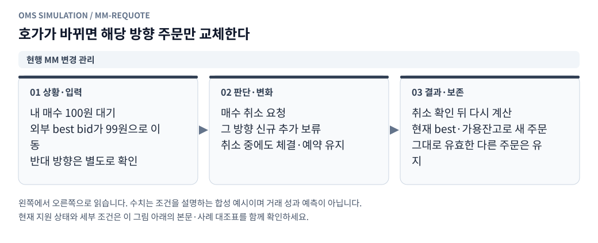

# 빗썸 최우선 호가 단순 MM 전략

[그림으로 보는 문서 안내](visual_guide.ko.md)

작성일: 2026-10-26 KST\
전략 ID: `bithumb_simple_mm`\
현재 구현: [시작 입력·전략 코어](../oms_client/strategies/simple_mm.py), [검증 테스트](../tests/test_simple_mm.py)\
실행 연결: [재생 모듈](../oms_client/replay/README.md)에 실행별 독립 가상계좌, 원본 호가·틱, maker 지정가 매칭, 체결별 손익, 빠른 실행·1~32배속, 호가창·틱 UI를 연결했다. 전략 코어는 계속 주문 의도만 계산하고 실행기는 잔고 예약·주문·체결을 담당한다. 별도 가상계좌 템플릿 revision 관리와 OKX 거래는 후속 구현이다.

## 1. 이번 전략의 범위

첫 실험은 빗썸 한 거래소·사용자가 선택한 KRW 종목 하나로 한다. 다른 거래소 기준가격, OKX 헤지, 이동평균, 예측, 재고 목표 비율 없이 가용 원화와 코인으로 최우선 호가를 낸다.

```text
원화 가용잔고가 신규 주문 최소금액 이상 → best bid에 지정가 매수
코인 가용잔고가 신규 주문 최소수량·금액 이상 → best ask에 지정가 매도
양쪽 자산이 있으면 매수·매도 동시에 유지
```

매수는 **최우선 매수호가**, 매도는 **최우선 매도호가**를 사용한다. 스프레드 안쪽으로 한 tick 개선하지 않는다. 기본 주문 조건은 GTC다. 순수 maker만 허용하는 Post-only는 별도 프로필로 추가할 수 있으며 현재 코어는 GTC 의도를 반환한다. 현재 `replay` 실행 프로필은 도착 시 반대 호가와 교차하는 주문을 거절하는 maker 전용 조건을 추가 적용한다.

매수·매도에 모두 쓸 잔고가 있으면 양쪽 주문을 낸다. 한쪽이 없으면 가능한 쪽만 낸다. 원화를 강제로 코인으로 먼저 바꾸거나, 공매도·차입·자동 환전으로 양쪽 잔고를 만들지 않는다.

## 2. 시작할 때 입력받을 값

| 항목 | 입력 방식 | 기본 제안 |
|---|---|---|
| 종목 | 사용자가 선택하는 필수값 | CT 등 특정 종목 강제 안 함 |
| 초기 원화 | 사용자가 수정 가능 | 1,000,000원 프리셋 |
| 초기 코인 수량 | 사용자가 수정 가능 | 0개 프리셋, 보유량 입력 가능 |

100만원은 초기 **원화**의 기본 입력값이다. 코인도 입력하면 그 평가액이 시작 총자산에 추가된다. 초기 총자산을 강제로100만원으로 맞추는 자동 매매를 하지 않는다.

시작 입력 예시:

```json
{
  "ticker": "사용자가 선택한 종목 코드",
  "initial_krw": "1000000",
  "initial_coin": "0"
}
```

위 ticker는 설명용 자리표시자다. 실제 입력은 `BTC` 같은 영문/숫자 코인 코드이며 거래 가능 여부·데이터 존재·종목 규격은 실행 준비에서 확인한다. 수량·금액은 Decimal 문자열로 받는다. 미입력·음수·NaN·Infinity·boolean·과도한 정밀도는 검증한다.

`StartInputs.from_payload()`는 이 입력을 검증한다. `account_seed(name)`은 [가상계좌 생성 계약](point2_virtual_accounts.ko.md)에 맞는 빗썸 단일 계좌 payload를 만든다. 실제 저장 API 호출은 수행하지 않는다.

초기 코인이 있으면 원가는 기본 `start_mark` 정책으로 둔다. 시작 이전의 마지막 유효 평가가격으로 초기 원가·평가액을 고정해, 기존 보유손익이 이번 전략 수익으로 계산되지 않게 한다. 초기 원가 정책을 바꾸는 기능은 가상계좌 revision에 기록한다.

## 3. 주문 가격과 수량

<!-- diagram: mm-quotes -->



**그림 읽기 · 현행 단일 거래소 MM:** 매수로 코인을 미리 확보하거나 공매도·차입으로 매도 물량을 만들지 않는다. 기존 예약금은 신규 주문 예산이 아니다. [수정용 Mermaid 원본](figures/mm-quotes.mmd).

### 3.1 가격

```text
buy_price  = external_best_bid
sell_price = external_best_ask
```

여기서 external book은 내 가상 주문을 합성하기 전의 외부 호가다. 내 주문을 포함한 best를 다시 기준가격으로 삼아 스스로 가격을 끌어올리거나 내리지 않는다. 실행 어댑터가 해당 가격의 종목 tick 유효성을 검증한다.

### 3.2 수량

새 매수에는 현재 가용 원화를 전부 사용할 수 있는 범위의 최대 lot 수량을 낸다. 새 매도에는 현재 가용 코인을 lot 단위로 내림한 수량을 낸다.

```text
fee_reserve_rate = max(0, maker_fee_bps, taker_fee_bps) / 10000

buy_qty = 가용 KRW 안에서
          qty*bid + 수수료 예약액 <= free_krw를 만족하는 최대 lot 수량

sell_qty = lot_floor(free_coin)
```

GTC는 전송 후 도착할 때 가격이 바뀌어 taker가 될 수 있으므로 매수 예약에는 적용 가능한 maker/taker 비용의 보수적 상한을 사용한다. 수수료 quantum 단위로 올림한 예약액까지 포함해 현금을 넘지 않게 계산한다. 리베이트가 있어도 아직 받지 않은 비용 환급을 새 자금으로 사용하지 않는다.

`MMConfig`의 수량 단위·최소수량·최소금액·maker/taker 비용·수수료 quantum은 검증된 실행 설정에서 주입한다. 현재 실제 종목 규격이나 수수료를 임의 기본값으로 채우지 않는다. 거래소의 최대 주문수량·가격 제한·최종 도착 잔고 검증은 실행 어댑터가 수행해야 한다.

최소수량·최소금액은 새 주문에만 적용한다. 이미 유효하게 제출된 주문이 부분체결로 작아졌다고 자동 취소하지 않는다. 최소금액 미만의 새 가용 자금은 누적 대기한다.

## 4. 기존 주문 관리

<!-- diagram: mm-requote -->



**그림 읽기 · 현행 MM 변경 관리:** 기존 주문 가격이 목표와 같으면 순번을 유지한다. 같은 가격에 새 가용잔고가 생기면 별도 주문을 뒤에 추가할 수 있다. [수정용 Mermaid 원본](figures/mm-requote.mmd).

| 현재 상태 | 처리 |
|---|---|
| 목표 가격과 같은 live 주문 | 순번을 유지하며 계속 대기 |
| 같은 가격 주문이 있고 새 가용 자금도 생김 | 기존 주문 유지＋새 가용분으로 추가 주문1개 |
| 매수 주문 가격이 best bid와 달라짐 | 해당 매수 주문 취소 요청, 매수 재주문은 확인 후 |
| 매도 주문 가격이 best ask와 달라짐 | 해당 매도 주문 취소 요청, 매도 재주문은 확인 후 |
| 해당 side에 취소 진행 또는 전송 중 주문 존재 | 그 side의 신규 추가 보류 |
| 한쪽은 교체 중이고 다른 쪽은 유효 | 다른 쪽은 독립 평가하되 자기 교차 검사 |
| free가0이고 기존 잔량은 잠겨 있음 | 기존 주문 유지, 잠금액을 신규 예산으로 쓰지 않음 |

최우선 가격에서 새 가용잔고를 계속 추가할 수 있으므로 한 방향에 같은 가격 주문이 여러 개 쌓일 수 있다. 각 order_id의 FIFO·부분체결·취소는 공통 지정가 엔진이 관리한다.

이 전략이 소유한 주문만 자동 취소한다. 같은 계좌의 다른 전략 주문은 취소하지 않지만, 반대 주문과의 교차 검사는 모두 포함한다.

### 4.1 취소 지연 중 자기 교차

```text
기존 내 매도101원이 살아 있음
외부 best가102/103으로 상승
매도101 취소를 요청했지만 아직 효력 전
→ 새 매수102는 내 매도101과 교차하므로 보류
→ 매도 취소/체결이 관측에 반영된 뒤 다시 평가
```

live·in-flight·cancel-pending 반대 주문 모두 검사한다. 다른 owner의 주문도 같은 계좌·종목이면 검사한다. 정상 종료된 주문은 입력 working 목록에서 제거한다. 가격 없는 미확인 주문이 있으면 실행 어댑터가 동기화 미완료로 표시하고 신규를 보류한다.

## 5. 전략 입력·출력 계약

| 객체 | 핵심 내용 |
|---|---|
| `MMConfig` | 종목·lot·최소수량/금액·비용·수수료 quantum·호가 최대 나이 |
| `QuoteView` | 종목·호가버전·external bid/ask·desktopTime |
| `AccountView` | 실행 계좌ID·관측 projection 버전·예약을 제외한 free KRW/coin·준비상태 |
| `WorkingOrder` | 같은 실행 계좌/종목의 모든 owner 주문·가격·잔량·진행 상태 |
| `MMPlan` | 유지ID·취소요청ID·새 지정가 의도·보류 사유 |

`SimpleMM.plan()`은 관측 계좌와 주문의 일관된 상태만 읽는다. 아직 통지되지 않은 truth fill, 예상 매도대금, 취소 요청만 보낸 잠금 반환액을 새 자금으로 쓰지 않는다.

working 주문은 호출자가 선택 계좌·빗썸·선택 종목으로 범위를 맞춰 제공한다. 전체 owner 목록을 누락하면 자기 교차 검사가 불완전해진다. 계좌/주문 정보가 서로 다른 projection이거나 U가 있으면 account readiness를 false로 제공한다.

출력은 **명시적 행동 목록**이다. 반환 keep 목록에 없다고 기존 주문을 자동 취소하지 않는다. 취소는 cancel_order_ids에 있는 주문만 요청한다. 계좌 미준비 상태에서는 신규·취소 의도를 모두 내지 않는다.

의도 ID는 계좌·관측/호가 버전·가격·수량으로 결정적으로 만든다. 그러나 ID만으로 자금 예약의 원자성이 보장되지는 않는다. 실행기는 다음 평가 전에 신규 의도를 현지 예약·in-flight 목록에 등록해야 한다.

```text
일관된 observed snapshot 읽기
 → plan 계산
 → 같은 이벤트 경계에서 취소 요청 기록·신규 예약·in-flight 등록
 → 주문 도착 이벤트 예약
 → 이후 이벤트에서 다음 plan 평가
```

## 6. 호가 이상·주문 지연·체결

- 호가 bid/ask가 유효하지 않거나 spread가0 이하, 미래 시각, 최대 나이 초과이면 신규를 보류하고 이 전략의 알려진 live 주문을 취소 요청한다.
- 호가 최대 나이는 초기 코어 기본1,000ms이며 변경 가능한 재생 정책이다. 거래소 실측 지연이나 규정이라는 뜻이 아니다.
- 이 stale 취소 정책은 이번 단순 MM 프로필이다. 기존 point2의 stale 때 주문 유지 정책과 구분한다.
- 신규·취소의20/40ms 등 지연은 공통 엔진에서 처리하며 코어는 전송시점 체결을 가정하지 않는다.
- 매수는 반대 매도 주도 tick, 매도는 반대 매수 주도 tick과 대기열로 체결을 판정한다. quote touch만으로 가상 체결을 만들지 않는다.
- 취소 도착 전 부분체결은 유지하고 잔량만 취소한다. fill 중복 통지는 계좌·헤지에 재반영하지 않는다.

## 7. 예시

수치·규격은 합성 설명용이다.

```text
외부 best bid100 / ask102
가용 KRW1,000 / 코인0
lot1, 비용예약20bp
→ 매수100원×9개, 예약901.8원
→ 매도 없음

매수 중2개가 체결돼 가용 코인2가 생김
→ 기존 매수의 미체결 잔량은 계속 유지
→ 매도102원×2개 신규

매도 일부가 체결돼 가용 KRW가 신규 최소금액 이상 누적됨
→ 같은 가격 기존 매수 유지＋새 가용분만 추가 매수
```

가격이 내려가 매수만 계속 체결되면 원화가 코인으로 바뀌며 방향 노출이 커질 수 있다. 가격이 올라 매도만 체결되면 코인이 줄고 원화가 늘어난다. 별도 재고 목표·손절·헤지는 이번 최소 전략에 포함하지 않는다. 스프레드 수익과 함께 수수료·미체결·보유자산 평가손익을 보고 결과를 판단한다.

## 8. 구현 상태와 검증

구현된 부분은 시작 입력 검증, 가상계좌 seed payload 생성, 순수 주문 계획 코어다. 현재 paper 서비스는 매수 ask·매도 bid 즉시체결이므로 이 계획을 그 API에 바로 넣으면 전략 의미가 달라진다. 가상계좌 저장/시작 화면/원본 데이터 재생/지정가 매칭은 별도 연결 단계다.

검증은 다음 명령으로 수행한다.

```bash
python3 -m unittest discover -s tests -p 'test_simple_mm.py' -v
```

기준 작업 디렉터리는 OMS_CLIENT다. 테스트는 현금/코인/양쪽 보유, 수수료·lot·경계 반올림, 같은가격 유지·추가, 최소금액 아래 잔량 유지, 취소 대기, 전체 owner 자기 교차, stale, 관측 미확인, 시작 입력, 결정성을 확인한다.

후속 실행 연결은 [가상계좌 계약](point2_virtual_accounts.ko.md), [지정가 체결142개 사례](point2_limit_fill_cases.ko.md), [공통 모듈 명세](point2_replay_modules.ko.md)를 따른다. 주문 조건의 native 매핑 기준은 [빗썸 주문 요청](https://apidocs.bithumb.com/reference/주문-요청)이다.

## 체결별 거래·손익 보고 요구사항

<!-- diagram: account-settlement -->


**그림 읽기 · 현행 정산·보고:** 화면 새로고침은 체결을 다시 만들지 않는다. 저장 실패는 현재 저장 계약에 따라 마지막 확정 결과와 구분한다. [수정용 Mermaid 원본](figures/account-settlement.mmd).

모든 체결과 부분체결에 고유 `fill_id`, 동일 시각의 순서를 구분하는 `fill_sequence`를 부여한다. 주문 1개가 여러 번 체결되면 체결마다 별도 행을 기록하고 주문 ID로 묶는다. 취소 요청·미체결 주문을 거래 내역에 가짜 체결로 추가하지 않는다. fill·현금·보유량·원가·손익 스냅샷을 한 번만 원자적으로 반영한다.

| 기록 | 의미 |
|---|---|
| 실행·계좌·주문·체결 ID, 체결 순번 | 실행과 체결을 재현하고 중복 반영 방지 |
| 체결 시각, 방향, 가격, 수량, 수수료 | 개별 체결 원본 |
| 이번 실현손익 | 이번에 처분한 수량의 순매도대금−취득 원가 |
| 누적 실현손익 | 실행 시작 후 실현손익 누계 |
| 시장가 미실현손익 | 체결 직후 남은 수량×(시장 평가가격−평균 원가) |
| 이론가 미실현손익 | 남은 수량×(당시 이론가−평균 원가) |
| 시장가·이론가 총손익 | 각각 실현손익 + 해당 기준 미실현손익 |
| 체결 전·후 현금, 수량, 평균 원가, 평가액 | 거래 결과 대사 |
| 평가가격·이론가·환율·괴리 기준과 시각 | 계산 근거와 그 시점에 알 수 있었는지 검증 |
| 평가 상태·누락 사유·괴리 표본 충족률 | 평가 불가를 0으로 오인하지 않도록 구분 |

현재 현물 원가 모형은 매수 수수료를 평균 원가에 포함하고 매도 수수료를 실현손익에서 차감한다. 수수료 누계는 별도 진단값이며 총손익에서 다시 차감하지 않는다. 시장가 미실현과 이론가 미실현은 대안 평가값이므로 서로 더하지 않는다. 초기 코인을 가진 새 MM 실행은 시작 평가손익을 별도로 고정해 실행 전 보유손익과 실행 성과를 구분한다.

보고서는 체결 당시 알고 있던 데이터만으로 고정한다. 나중에 가격·괴리 평균이 바뀌어도 과거 행을 덮어쓰지 않는다. 지연 통지는 보관된 같은 보고서를 참조하며, 누락된 평가값을 미래 데이터로 채우지 않는다. 체결 사이의 현재 평가는 별도 최신 상태로 표시한다.

현재 구현 범위는 `paper_trading/service.py`의 기존 모의 시장가 체결과 `backtesting/engine.py`의 구간 평균 체결에 대한 보고이다. 기존 백테스트는 내부 `theory_provider(timestamp,exchange,ticker)`로 해당 시점에 유효했던 이론가를 공급할 수 있으며, 미연결 시 보유분 이론가 손익은 null이다. 오늘 집계한 7일 괴리를 과거 백테스트에 주입하지 않는다. `SimpleMM.plan()`에는 체결 엔진·원장이 아직 연결되지 않았으며, 이후 자동 MM 연결 시 위 보고 계약을 부분체결 단위로 적용한다.
