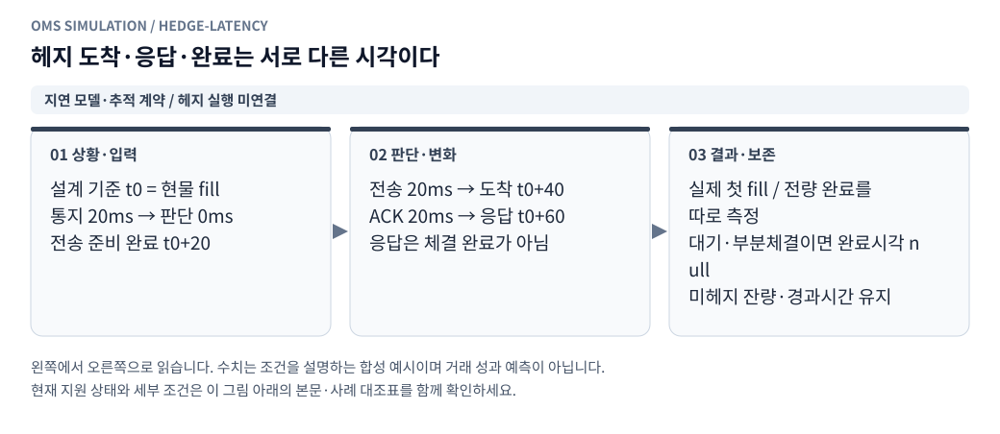
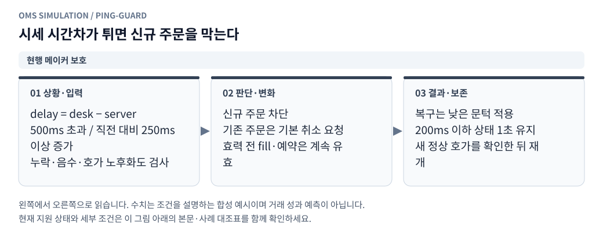

# 헤지 소요 시간과 시세 지연 주문 차단

[그림으로 보는 문서 안내](visual_guide.ko.md)

작성일: 2026-10-27 KST

## 적용 범위

빗썸 단일 메이커 재생에는 **신규 주문 차단·기존 주문 취소 요청·정상화 후 재개**가 연결되어 있다. 자동 MM과 수동 주문에 같은 보호 조건을 적용한다. Point에는 헤지 단계별 지연 설정과 예상 시간 미리보기를 등록하고, 실제 단계·부분체결을 기록할 `HedgeTimingTrace`를 준비했다.

**Point/OKX 헤지 실행 어댑터는 아직 연결 전이다.** 이번 변경으로 OKX 주문이나 가상 헤지 체결을 생성하지 않는다. 메이커 결과의 `hedge_timing`은 `null`이다. 등록 화면의 예상 도착 시간은 설정값의 합이며 측정한 체결 성과가 아니다.

## 1. 헤지가 들어가기까지의 시간

<!-- diagram: hedge-latency -->



**그림 읽기 · 지연 모델·추적 계약 / 헤지 실행 미연결:** 값은 설정 예시다. 현재 Point/OKX 실행 어댑터는 연결 전이며, 통지가 늦으면 과거 예정 시각으로 소급 주문할 수 없다. [수정용 Mermaid 원본](figures/hedge-latency.mmd).

기준점 `t0`는 원래 현물 주문의 개별 부분체결 시각이다. 향후 실행 어댑터는 원체결 ID별 추적기를 만들고 실제 가상 시각의 사건을 전달해야 한다. 여러 원체결을 합쳐 헤지할 경우에는 별도의 수량 배분 연결이 필요하다.

| 단계 | 설정 키 | 임시 기본값 | 의미 |
|---|---|---:|---|
| 빗썸 체결 → 체결 통지 수신 | `hedge_fill_notice_ms` | 20ms | 체결 수신기가 체결을 알기까지의 지연 |
| 체결 통지 수신 → OKX 헤지 로직 전달 | `hedge_signal_transfer_ms` | 0ms | 프로세스·서버 사이 전달, 메시지 큐 등 추가 전달 구간 |
| 헤지 로직 수신 → 헤지 주문 전송 | `hedge_decision_ms` | 0ms | 노출 계산·전략 판단·전송 준비 |
| 주문 전송 → 헤지 거래소 도착 | `hedge_submit_ms` | 20ms | 전송 구간 지연 |
| 도착 → 접수 응답 수신 | `hedge_ack_ms` | 20ms | 접수 결과 확인 지연 |
| 원체결 → 헤지 전체 완료 제한 | `hedge_timeout_ms` | 1000ms | 미헤지 지속 시간 경보 기준 |

기본값에서는 통지 수신·헤지 로직 전달 20ms, 주문 전송 20ms, 거래소 도착 40ms, 응답 60ms다. 각 지연은 0~60000ms 정수이며 완료 제한은 1~60000ms이고 다섯 단계의 합 이상이어야 한다. 거래소에서 측정한 수치가 아니라 사용자가 바꿀 수 있는 시뮬레이션 입력이다.

사용자의 “빗썸 체결 사실을 OKX에 알리는 시간”은 **빗썸 체결 → 통지 수신기 → OKX 주문을 담당하는 헤지 로직**까지의 누적 시간으로 기록한다. OKX 거래소에는 이후 헤지 주문이 도착한다. 거래소 간 직접 체결 알림 API를 가정하지 않는다. 기존 통지 지연에 전체 전달 시간을 이미 포함했다면 추가 전달은 0ms로 두어 중복 합산을 피한다.

```text
t_notice = t_bithumb_fill + hedge_fill_notice_ms
t_signal = t_notice       + hedge_signal_transfer_ms
t_send   = t_signal       + hedge_decision_ms
t_okx    = t_send         + hedge_submit_ms
t_ack    = t_okx          + hedge_ack_ms
```

예를 들어 통지 20ms·추가 전달 30ms·판단 0ms·주문 전송 20ms·응답 20ms이면, 빗썸 체결 이후 **헤지 로직 수신 50ms → OKX 도착 70ms → 응답 90ms**다. 위 그림은 이 예시를 사용한다. 추가 전달 기본값은 기존 동작을 보존하는 0ms이며 실제 네트워크 지연이 0이라는 의미는 아니다.

`HedgeTimingModel.plan(t0)`은 예정 시각만 계산한다. 실제 통지가 늦어지면 그 시각부터 전달·판단·전송 지연을 다시 지켜야 한다. 위 예시에서 통지를 100ms에 받았다면 헤지 로직 수신은 빨라도 130ms, OKX 도착은 150ms다. 소급 주문은 허용하지 않는다. 모든 시간은 재생의 가상 시각으로 계산하며 빠른 모드·1×·32×는 기다리는 실제 시간만 바꾼다.

추적 단계는 `noticed → signal_received → submitted → arrived → acknowledged`다. 추가 전달이 양수이면 실제 `signal_received`를 기록하기 전에는 주문을 전송할 수 없다. 0ms인 구버전 호출만 `noticed` 시각을 신호 수신으로 간주하여 기존 호출 순서를 보존한다. 이 경우 `milestones`에 가짜 사건을 넣지 않으며, 이미 전송한 주문과 모순되는 신호 시각을 나중에 기록할 수 없다. 계획의 `signal_due_ms`, `planned_signal_latency_ms`, `planned_signal_transfer_ms`는 각각 예정 수신 시각·원체결부터 누적 지연·추가 전달 지연이다.

| 결과 키 | 정의 |
|---|---|
| `fill_notice_latency_ms` | 실제 체결 통지 수신 시각 − 빗썸 원체결 시각 |
| `signal_received_at_ms` | OKX 헤지 로직이 체결 사실을 전달받은 실제 가상 시각 |
| `signal_latency_ms` | 실제 헤지 로직 수신 시각 − 빗썸 원체결 시각 |
| `signal_transfer_latency_ms` | 실제 헤지 로직 수신 시각 − 실제 체결 통지 수신 시각 |
| `entry_latency_ms` | 실제 헤지 거래소 도착 시각 − 원체결 시각 |
| `ack_latency_ms` | 실제 접수 응답 시각 − 원체결 시각 |
| `first_fill_latency_ms` | 첫 헤지 체결 시각 − 원체결 시각 |
| `completion_latency_ms` | 대상 수량 전체 체결 시각 − 원체결 시각 |
| `unhedged_duration_ms` | 전체 완료 전에는 현재까지, 완료 후에는 완료까지의 경과 시간 |
| `remaining_quantity` | 아직 체결되지 않은 헤지 대상 수량 |
| `timeout_exceeded` | 전체 완료가 제한보다 늦었거나 미완료 상태로 제한을 초과했는지 |

접수 응답은 체결이 아니다. 지정가 주문이 대기하거나 부분체결 상태이면 전체 완료 시간은 `null`이고 남은 수량·미헤지 시간이 계속 남는다. 주문 도착 뒤에는 응답 전에 첫 체결이 발생할 수도 있다. 동일 체결 ID 재수신은 같은 내용이면 중복 반영하지 않고, 내용 변경·대상 수량 초과·단계 역전은 거절한다. 제한을 넘겨 나중에 완료해도 시간 초과 사실은 유지한다.

`unhedged_duration_ms`는 완전 헤지까지의 시간이며 수량 가중 노출 지표가 아니다. 부분체결 도중의 금액 위험, 선물 계약 승수·수량 반올림, 취소/재전송, 실패·재시도·미헤지 잔고 정책은 향후 OKX 원장 및 실행 어댑터와 연결해야 한다.

## 2. 현재 핑 보호에 쓰는 관측값

<!-- diagram: ping-guard -->



**그림 읽기 · 현행 메이커 보호:** 기본 설정 예시이며 desk−server는 RTT가 아니다. 처음 유효 호가가 정상인 경우와 차단 후 복구 조건을 구분한다. [수정용 Mermaid 원본](figures/ping-guard.mmd).

현재 저장 호가에서 계산 가능한 값은 `delay = desktopTime − serverTime`이다. 이것은 서버 시세 생성부터 데스크톱 기록까지의 시간차로, **네트워크 왕복 RTT가 아니다.** 송신·응답 쌍이 없으므로 RTT나 순수 네트워크 전송시간을 복원하지 않는다. 서버/데스크톱 시계 오차나 수집 지연도 섞일 수 있다.

실행 가능한 메이커는 주문 거래소인 빗썸 호가만 보호 입력으로 쓴다. 선택적인 OKX 참조 화면의 지연으로 빗썸 주문을 차단하지 않는다. 향후 Point는 주문 거래소·기준가격·환산가격 입력의 신선도와 각 주문 경로 상태를 별도로 합성해야 한다. 단일 메이커 보호 상태를 두 거래소 전체의 정상 판정으로 재사용하면 안 된다.

| 설정 | 기본값 | 적용 |
|---|---|---|
| `ping_guard_mode` | `enabled` | 차단 기능 사용 |
| `max_feed_delay_ms` | 500 | 시간차가 **500ms 초과**이면 차단 |
| `feed_delay_spike_ms` | 250 | 직전 유효한 비음수 시간차 대비 **250ms 이상 증가**하면 차단 |
| `feed_delay_resume_ms` | 200 | 차단 후에는 **200ms 이하**여야 정상 구간으로 인정 |
| `feed_delay_stable_ms` | 1000 | 정상 호가 관측이 1초간 이어진 뒤 새 정상 관측으로 재개 |
| `ping_existing_orders` | `cancel` | 차단 중 기존 미체결 주문에 취소 요청. `keep`이면 유지 |

재개 기준은 차단 상한 이하여야 한다. 시각 누락·단위 미확인·음수 시간차도 차단한다. 호가 갱신이 전략의 `max_quote_age_ms`(기본 1000ms)를 초과하면 차단하고 복구 대기를 초기화한다. 정상화 도중 재개 기준을 넘거나 호가가 끊기면 안정 구간을 다시 시작한다.

초기 첫 유효 호가가 상한 이내이면 바로 시작할 수 있다. 한번 차단된 이후에는 더 낮은 재개 기준과 안정 유지 시간을 적용한다. 시간만 지났다고 재개하지 않고 확인용 정상 호가가 필요하다. 재개 후 200~500ms여도 급증 기준에 걸리지 않으면 계속 허용한다. 경계에서 차단/재개가 반복되는 것을 줄이기 위한 차이다.

### 주문 및 잔고 처리

1. 자동 MM은 차단 중 신규 의도를 내지 않는다. 수동 주문 요청은 잔고 예약 전에 거절한다.
2. 기본 정책은 자동·수동 소유자를 구분하지 않고 기존 미체결 주문에 취소를 요청한다. MM 중지 상태에서도 보호 취소는 작동한다.
3. **이미 전송한 주문을 로컬에서 회수할 수는 없다.** 핑 급등 전에 전송한 주문은 이후 거래소에 도착할 수 있으며, 취소 확인 전에는 체결될 수 있다.
4. 취소는 기존 실행 설정의 `latency_ms`를 적용한다. 취소 중 예약 잔고를 유지하고 체결된 부분을 원장에 반영한 뒤 나머지만 취소 확정 시 해제한다.
5. `keep`을 선택해도 신규 주문은 계속 차단한다. 사용자의 취소 요청은 어느 정책에서나 허용한다.
6. 체결은 당시 보호 상태와 함께 저장된다. 보호가 켜졌다는 이유로 이미 가능한 체결을 지우거나 손익을 다시 쓰지 않는다.

차단된 수동 요청은 기존 API의 입력 오류 응답으로 반환된다. `blocked_submissions`는 거절한 주문 요청 횟수이며 자동 MM이 생략한 평가 주기 수나 취소 수는 아니다. 오류 직후 저장 체크포인트 전까지 화면 카운터가 늦게 반영될 수 있다.

## 3. 표시·저장·버전

- 전략 관리: 모든 유형에 보호 설정, Point에 헤지 단계 설정 및 예상 도착/응답 시간을 표시한다.
- 재생 화면: 신규 주문 허용/차단, 사유, 시간차·증가량, 안정 확인 잔여 시간, 거절 요청 수를 표시한다. 차단 시 주문 버튼은 비활성화하고 취소 버튼은 유지한다.
- 실행 스냅샷 `order_guard`: 현재 조건·상태·차단 시작·복구 시작·차단 구간 수를 저장한다.
- `guard_events`: 최근 100개 상태/사유 전환을 보관한다. 전체 전환 로그를 무제한 보관하지는 않는다.
- 체결 보고의 `order_guard`: 당시 값을 고정하며 전체 결과 JSON과 저장 체결 API에서 확인한다. CSV의 기존 손익 열은 유지한다.
- 이전 실행 및 불변 전략 버전은 보존한다. 보호 설정이 없는 구버전은 비활성으로 실행하며 화면에 이전 버전임을 안내한다.
- 수정하지 않은 기본 전략 v1에만 새 기본값을 담은 v2를 추가한다. 사용자 생성 전략과 편집한 기본 전략은 자동 변경하지 않는다. 새 버전을 저장하면 보호 설정이 포함된다.
- 추가 전달 설정이 없는 기존 헤지 지연 버전은 미리보기에서 0ms로 해석한다. 저장된 정의는 변경하지 않으며, 사용자가 새 버전을 저장할 때 명시적인 전달 설정이 포함된다. 새 화면이 구버전 서버의 입력 스키마를 받으면 없는 필드는 전송하지 않는다.

## 4. 미결정 정책과 향후 연결

임시 설정은 [미결정 사항의 Q-006~Q-008](strategy_registration_queries.ko.md)에 기록했다. 실제 RTT 수집, 관측 지연에 따른 주문/취소 전송 지연 변화, 확률 분포·패킷 유실, 헤지 경로별 장애 판정은 이번 모형에서 자동 추정하지 않는다.

추가 전달 구간과 기본값 보정은 같은 문서의 Q-014에 남겼다. 신호 수신 지연이 아직 관측되지 않았으면 보고값은 `null`이다. 별도 전달 메시지의 중복·재시도, 연결 단절 후 재전달 정책은 향후 어댑터 구현 범위다.

Point 프로필의 잠정 정책은 핑 보호가 작동하면 헤지도 새 주문으로 차단하고 미헤지 수량·경과 시간을 남기는 것이다. 제한 초과를 이유로 가짜 체결이나 자동 시장가 예외를 사용하지 않는다. 실제 실행 연결 시에는 차단 해제 후 재평가·동일 원체결 중복 헤지 방지·취소 중 노출을 함께 구현해야 한다.

## 5. 검증

추가 전달에 대해서는 지연 합계·완료 제한 경계, 필수 수신 단계 누락 거절, 실제 수신 지연의 후속 전파, 잘못된 기록 거절 시 상태 보존, 0ms 구버전 호출 호환성을 검증한다. 전략 저장·재시작·불변 과거 버전과 새 버전 저장도 함께 확인한다.

`tests/test_execution_controls.py`는 절대 상한·급증·누락/음수·호가 노후·복구 중 재악화·새 호가 없는 시간 경과, 신규 주문 거절과 이미 전송한 주문의 취소 경쟁, 잔고 예약·부분체결, 보호 유지/비활성, 불변 버전 업그레이드, 빠른/1×/32×의 체결·손익 동일성을 검증한다. 헤지 측정기는 단계 지연 전파, 응답 전 부분체결, 중복 체결 방지, 미완료 `null`, 시간 초과 후 완료를 검증한다.
