# A. 접수·규격·자금·거래소 구성 — 사례별 설명 그림

[그림 안내](../visual_guide.ko.md) · [원본 사례 목록](../point2_limit_fill_cases.ko.md) · [현재 실행 범위](../limit_execution_coverage.ko.md)

각 그림은 해당 조건에서의 흐름을 설명한다. **설계 제안·현재 실행 미지원** 표시는 향후 동작이며, 부분 지원은 전체 동작의 구현을 뜻하지 않는다. 원본 제안과 현행 동작이 다르면 그림 아래 구분을 따른다.

모든 수치 예시는 명시한 선행 물량 외에 더 우선한 물량이 없고, 별도 언급이 없으면 지연·수수료·규격 제한을 생략한 합성 상황이다. 실제 체결 확률이나 성과 예측이 아니다.

[A01](#a01) | [A02](#a02) | [A03](#a03) | [A04](#a04) | [A05](#a05) | [A06](#a06) | [A07](#a07) | [A08](#a08) | [A09](#a09) | [A10](#a10)

## A01 · 규격·자금·선택 거래소가 모두 유효

**현재 상태: 실행·차단 연결**

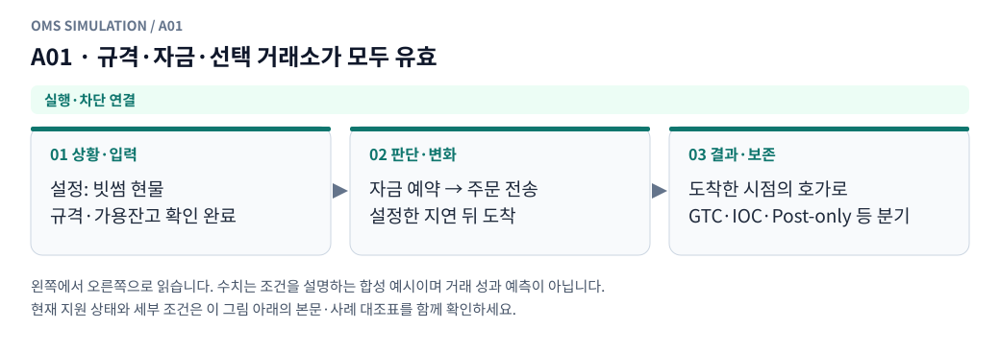

**그림 읽기:** 설정: 빗썸 현물 / 규격·가용잔고 확인 완료 → 자금 예약 → 주문 전송 / 설정한 지연 뒤 도착 → 도착한 시점의 호가로 / GTC·IOC·Post-only 등 분기.

**원본 처리 제안:** 전송→도착→주문 조건별 판단

**현행 범위:** 현재 현물 재생기에 해당 분기 또는 명시적 사전 차단을 연결했습니다. 거래소 선물까지 지원한다는 뜻은 아닙니다. 세부 정책은 [실행 범위 본문](../limit_execution_coverage.ko.md)을 따른다.

A01 Mermaid 원본 보기

## A02 · 여러 매수가 같은 현금을 중복 사용하려 함

**현재 상태: 실행·차단 연결**

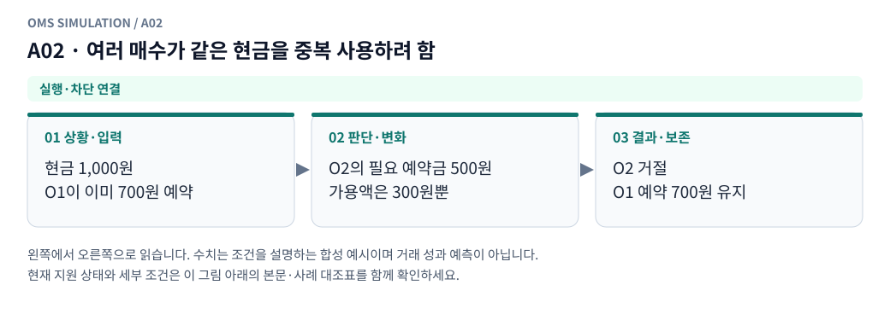

**그림 읽기:** 현금 1,000원 / O1이 이미 700원 예약 → O2의 필요 예약금 500원 / 가용액은 300원뿐 → O2 거절 / O1 예약 700원 유지.

**원본 처리 제안:** 전송 중 예약 포함 검사, 초과 의도 거절

**현행 범위:** 현재 현물 재생기에 해당 분기 또는 명시적 사전 차단을 연결했습니다. 거래소 선물까지 지원한다는 뜻은 아닙니다. 세부 정책은 [실행 범위 본문](../limit_execution_coverage.ko.md)을 따른다.

A02 Mermaid 원본 보기

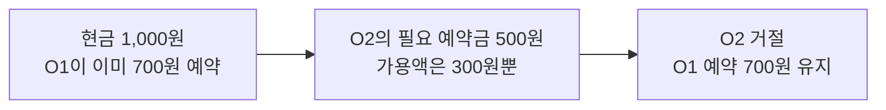

## A03 · 현물 복수 매도의 합계가 가용 코인 초과

**현재 상태: 실행·차단 연결**

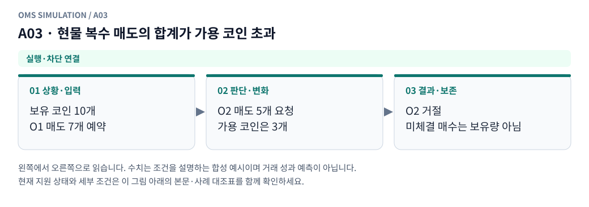

**그림 읽기:** 보유 코인 10개 / O1 매도 7개 예약 → O2 매도 5개 요청 / 가용 코인은 3개 → O2 거절 / 미체결 매수는 보유량 아님.

**원본 처리 제안:** 과매도 거절, 미체결 매수 예정량을 보유량으로 쓰지 않음

**현행 범위:** 현재 현물 재생기에 해당 분기 또는 명시적 사전 차단을 연결했습니다. 거래소 선물까지 지원한다는 뜻은 아닙니다. 세부 정책은 [실행 범위 본문](../limit_execution_coverage.ko.md)을 따른다.

A03 Mermaid 원본 보기

## A04 · OKX 증가 주문에 담보 부족

**현재 상태: 설계 제안 · 현재 실행 미지원**

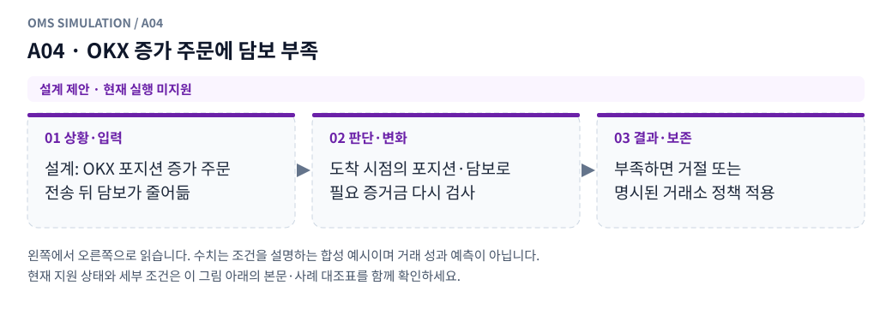

**그림 읽기:** 설계: OKX 포지션 증가 주문 / 전송 뒤 담보가 줄어듦 → 도착 시점의 포지션·담보로 / 필요 증거금 다시 검사 → 부족하면 거절 또는 / 명시된 거래소 정책 적용.

**원본 처리 제안:** 도착 시 truth 담보 재검사, 거절 또는 명시 프로필 처리

**현행 범위:** 별도 거래소·선물·통지·특수 주문 모형이 필요합니다. 해당 주문/제어 입력은 지원하지 않으며 대신 체결하지 않습니다. 세부 정책은 [실행 범위 본문](../limit_execution_coverage.ko.md)을 따른다.

A04 Mermaid 원본 보기

## A05 · tick·lot·단위·부호가 잘못됨

**현재 상태: 부분 지원 · 설계와 현행 범위 구분**

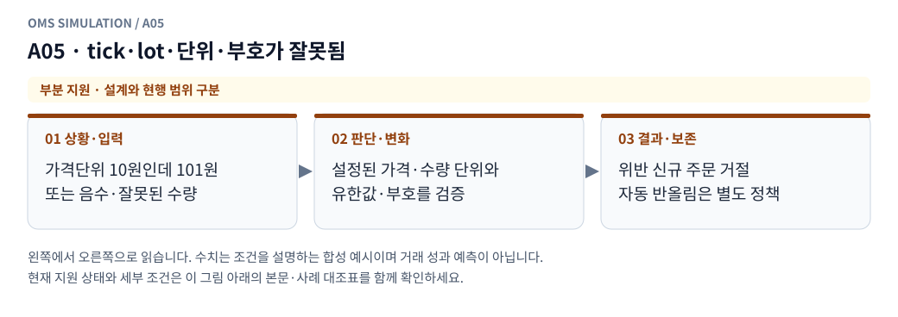

**그림 읽기:** 가격단위 10원인데 101원 / 또는 음수·잘못된 수량 → 설정된 가격·수량 단위와 / 유한값·부호를 검증 → 위반 신규 주문 거절 / 자동 반올림은 별도 정책.

**원본 처리 제안:** 체결 전 거절, 자동 반올림 허용 여부는 사전 명시

**현행 범위:** 현재 현물 모형의 일부 분기만 지원합니다. native 정정·수신 역전 복원·미관측 데이터는 구현으로 간주하지 않습니다. 세부 정책은 [실행 범위 본문](../limit_execution_coverage.ko.md)을 따른다.

A05 Mermaid 원본 보기

## A06 · 주문 종류별 최소/최대 수량·금액 위반

**현재 상태: 부분 지원 · 설계와 현행 범위 구분**

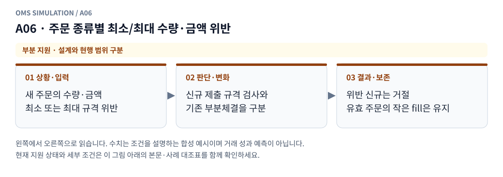

**그림 읽기:** 새 주문의 수량·금액 / 최소 또는 최대 규격 위반 → 신규 제출 규격 검사와 / 기존 부분체결을 구분 → 위반 신규는 거절 / 유효 주문의 작은 fill은 유지.

**원본 처리 제안:** 해당 주문 거절. 유효 제출 후 작은 부분체결은 유지

**현행 범위:** 현재 현물 모형의 일부 분기만 지원합니다. native 정정·수신 역전 복원·미관측 데이터는 구현으로 간주하지 않습니다. 세부 정책은 [실행 범위 본문](../limit_execution_coverage.ko.md)을 따른다.

A06 Mermaid 원본 보기

## A07 · 거래 중단·종목 상태·가격 보호에 걸림

**현재 상태: 설계 제안 · 현재 실행 미지원**

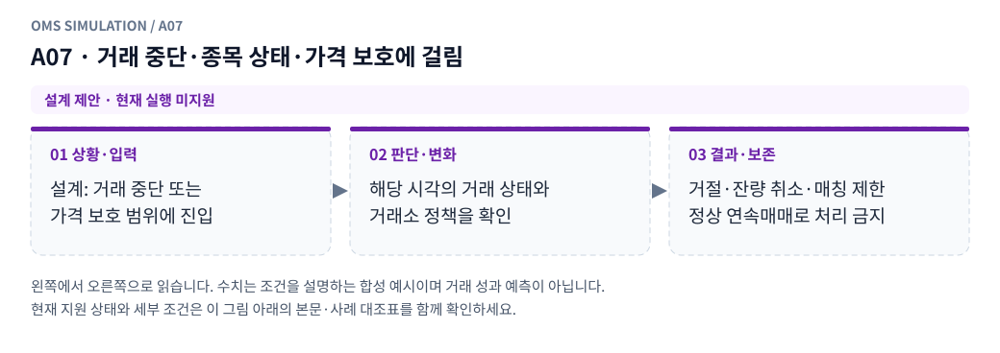

**그림 읽기:** 설계: 거래 중단 또는 / 가격 보호 범위에 진입 → 해당 시각의 거래 상태와 / 거래소 정책을 확인 → 거절·잔량 취소·매칭 제한 / 정상 연속매매로 처리 금지.

**원본 처리 제안:** 거래소 상태 프로필에 따라 거절/취소/제한, 정상 연속매칭 금지

**현행 범위:** 별도 거래소·선물·통지·특수 주문 모형이 필요합니다. 해당 주문/제어 입력은 지원하지 않으며 대신 체결하지 않습니다. 세부 정책은 [실행 범위 본문](../limit_execution_coverage.ko.md)을 따른다.

A07 Mermaid 원본 보기

## A08 · 선택되지 않은 거래소·종목으로 주문/입력 전달

**현재 상태: 실행·차단 연결**

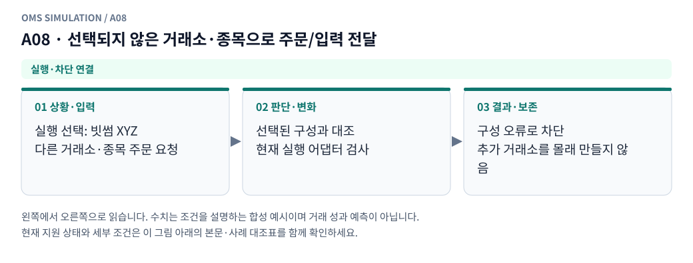

**그림 읽기:** 실행 선택: 빗썸 XYZ / 다른 거래소·종목 주문 요청 → 선택된 구성과 대조 / 현재 실행 어댑터 검사 → 구성 오류로 차단 / 추가 거래소를 몰래 만들지 않음.

**원본 처리 제안:** 구성 검증 오류. 암묵적으로 세 번째 거래소 생성 금지

**현행 범위:** 현재 현물 재생기에 해당 분기 또는 명시적 사전 차단을 연결했습니다. 거래소 선물까지 지원한다는 뜻은 아닙니다. 세부 정책은 [실행 범위 본문](../limit_execution_coverage.ko.md)을 따른다.

A08 Mermaid 원본 보기

## A09 · 한 실행에 거래소 3개 이상 설정

**현재 상태: 실행·차단 연결**

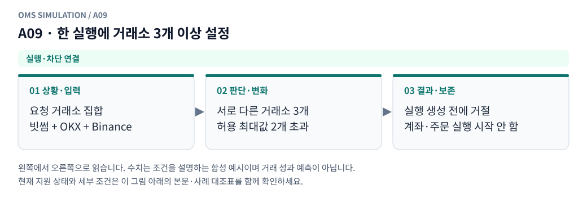

**그림 읽기:** 요청 거래소 집합 / 빗썸 + OKX + Binance → 서로 다른 거래소 3개 / 허용 최대값 2개 초과 → 실행 생성 전에 거절 / 계좌·주문 실행 시작 안 함.

**원본 처리 제안:** 실행 전 최대 2개 제한 오류

**현행 범위:** 현재 현물 재생기에 해당 분기 또는 명시적 사전 차단을 연결했습니다. 거래소 선물까지 지원한다는 뜻은 아닙니다. 세부 정책은 [실행 범위 본문](../limit_execution_coverage.ko.md)을 따른다.

A09 Mermaid 원본 보기

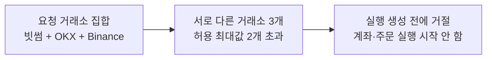

## A10 · 거래소 ID 중복 또는 동일 멱등 키의 상충 요청

**현재 상태: 실행·차단 연결**

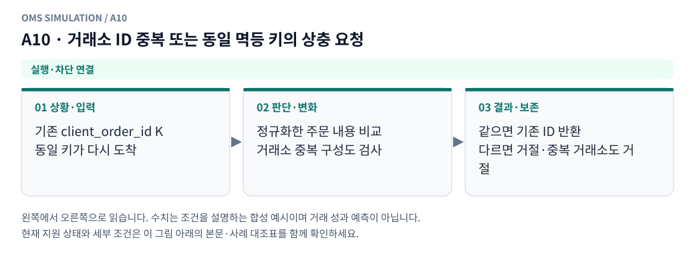

**그림 읽기:** 기존 client_order_id K / 동일 키가 다시 도착 → 정규화한 주문 내용 비교 / 거래소 중복 구성도 검사 → 같으면 기존 ID 반환 / 다르면 거절·중복 거래소도 거절.

**원본 처리 제안:** 거래소 중복 구성은 거절. 같은 요청 재전달은 기존 주문 반환, 상충 요청 거절

**현행 범위:** 현재 현물 재생기에 해당 분기 또는 명시적 사전 차단을 연결했습니다. 거래소 선물까지 지원한다는 뜻은 아닙니다. 세부 정책은 [실행 범위 본문](../limit_execution_coverage.ko.md)을 따른다.

A10 Mermaid 원본 보기

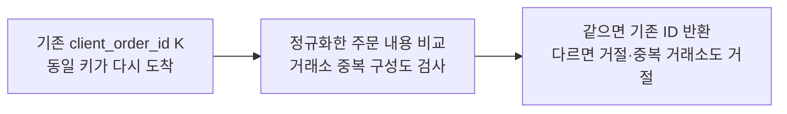

