# B. 도착 가격·즉시 체결 — 사례별 설명 그림

[그림 안내](../visual_guide.ko.md) · [원본 사례 목록](../point2_limit_fill_cases.ko.md) · [현재 실행 범위](../limit_execution_coverage.ko.md)

각 그림은 해당 조건에서의 흐름을 설명한다. **설계 제안·현재 실행 미지원** 표시는 향후 동작이며, 부분 지원은 전체 동작의 구현을 뜻하지 않는다. 원본 제안과 현행 동작이 다르면 그림 아래 구분을 따른다.

모든 수치 예시는 명시한 선행 물량 외에 더 우선한 물량이 없고, 별도 언급이 없으면 지연·수수료·규격 제한을 생략한 합성 상황이다. 실제 체결 확률이나 성과 예측이 아니다.

[B01](#b01) | [B02](#b02) | [B03](#b03) | [B04](#b04) | [B05](#b05) | [B06](#b06) | [B07](#b07) | [B08](#b08) | [B09](#b09) | [B10](#b10) | [B11](#b11) | [B12](#b12)

## B01 · 매수 limit<ask / 매도 limit>bid, GTC

**현재 상태: 실행·차단 연결**

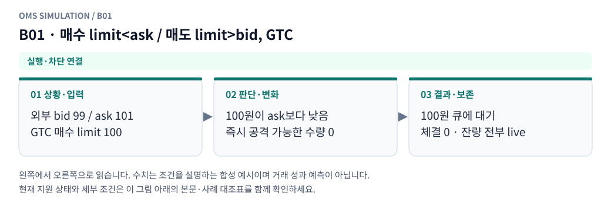

**그림 읽기:** 외부 bid 99 / ask 101 / GTC 매수 limit 100 → 100원이 ask보다 낮음 / 즉시 공격 가능한 수량 0 → 100원 큐에 대기 / 체결 0 · 잔량 전부 live.

**원본 처리 제안:** 공격 체결 없이 해당 가격 큐에 접수

**현행 범위:** 현재 현물 재생기에 해당 분기 또는 명시적 사전 차단을 연결했습니다. 거래소 선물까지 지원한다는 뜻은 아닙니다. 세부 정책은 [실행 범위 본문](../limit_execution_coverage.ko.md)을 따른다.

B01 Mermaid 원본 보기

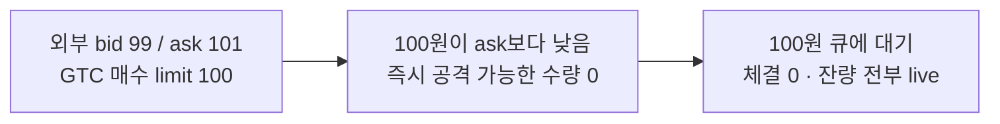

## B02 · limit이 상대 best와 정확히 같음

**현재 상태: 실행·차단 연결**

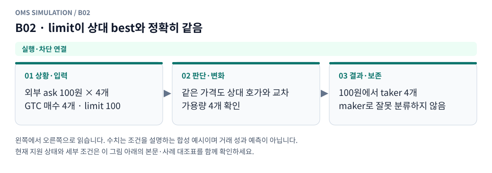

**그림 읽기:** 외부 ask 100원 × 4개 / GTC 매수 4개 · limit 100 → 같은 가격도 상대 호가와 교차 / 가용량 4개 확인 → 100원에서 taker 4개 / maker로 잘못 분류하지 않음.

**원본 처리 제안:** 해당 가격의 실제 가용량만 체결, “같은 가격이므로 maker”로 분류하지 않음

**현행 범위:** 현재 현물 재생기에 해당 분기 또는 명시적 사전 차단을 연결했습니다. 거래소 선물까지 지원한다는 뜻은 아닙니다. 세부 정책은 [실행 범위 본문](../limit_execution_coverage.ko.md)을 따른다.

B02 Mermaid 원본 보기

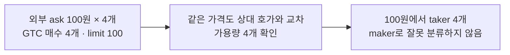

## B03 · 상대 best보다 공격적인 limit, 한 호가로 전량 가능

**현재 상태: 실행·차단 연결**

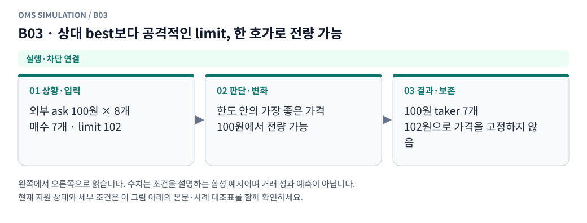

**그림 읽기:** 외부 ask 100원 × 8개 / 매수 7개 · limit 102 → 한도 안의 가장 좋은 가격 / 100원에서 전량 가능 → 100원 taker 7개 / 102원으로 가격을 고정하지 않음.

**원본 처리 제안:** 상대 가격에서 전량 taker, 한도가로 불리하게 고정하지 않음

**현행 범위:** 현재 현물 재생기에 해당 분기 또는 명시적 사전 차단을 연결했습니다. 거래소 선물까지 지원한다는 뜻은 아닙니다. 세부 정책은 [실행 범위 본문](../limit_execution_coverage.ko.md)을 따른다.

B03 Mermaid 원본 보기

## B04 · 여러 상대 호가를 써야 전량 가능

**현재 상태: 실행·차단 연결**

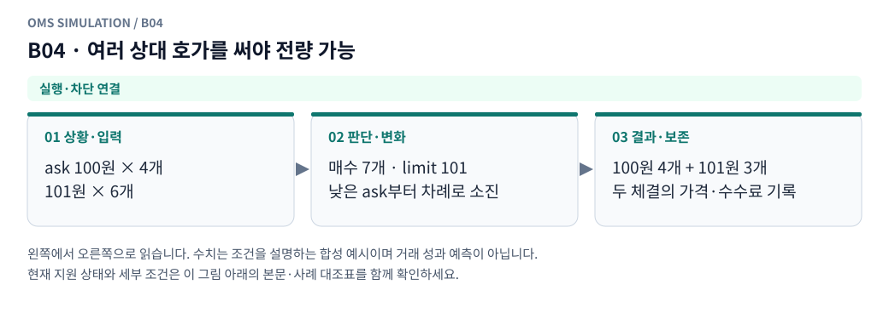

**그림 읽기:** ask 100원 × 4개 / 101원 × 6개 → 매수 7개 · limit 101 / 낮은 ask부터 차례로 소진 → 100원 4개 + 101원 3개 / 두 체결의 가격·수수료 기록.

**원본 처리 제안:** 가격 우선 소진, fill별 가격·역할·수량 보존

**현행 범위:** 현재 현물 재생기에 해당 분기 또는 명시적 사전 차단을 연결했습니다. 거래소 선물까지 지원한다는 뜻은 아닙니다. 세부 정책은 [실행 범위 본문](../limit_execution_coverage.ko.md)을 따른다.

B04 Mermaid 원본 보기

## B05 · GTC 일부만 즉시 가능, 뒤 가격은 limit 밖으로 확인됨

**현재 상태: 실행·차단 연결**

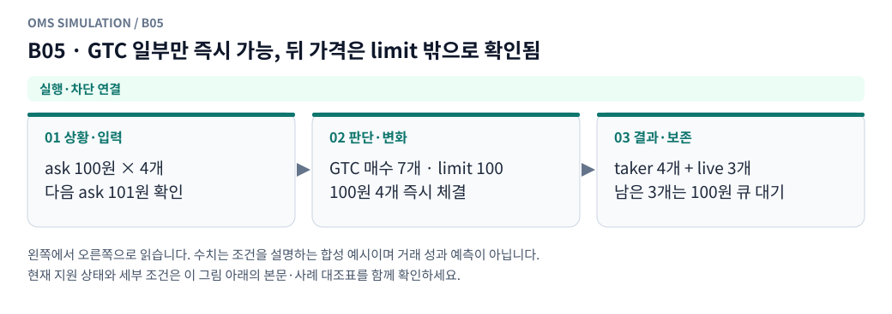

**그림 읽기:** ask 100원 × 4개 / 다음 ask 101원 확인 → GTC 매수 7개 · limit 100 / 100원 4개 즉시 체결 → taker 4개 + live 3개 / 남은 3개는 100원 큐 대기.

**원본 처리 제안:** 일부 taker+확정 잔량 대기

**현행 범위:** 현재 현물 재생기에 해당 분기 또는 명시적 사전 차단을 연결했습니다. 거래소 선물까지 지원한다는 뜻은 아닙니다. 세부 정책은 [실행 범위 본문](../limit_execution_coverage.ko.md)을 따른다.

B05 Mermaid 원본 보기

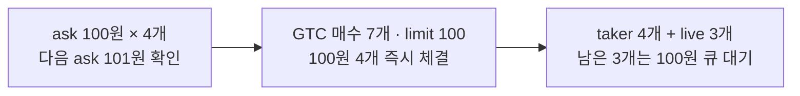

## B06 · IOC 일부만 즉시 가능, 뒤 가격은 limit 밖으로 확인됨

**현재 상태: 실행·차단 연결**

**그림 읽기:** ask 100원 × 4개 / 다음 ask 101원 확인 → IOC 매수 7개 · limit 100 / 100원 4개 즉시 체결 → taker 4개 + 취소 3개 / live 잔량은 만들지 않음.

**원본 처리 제안:** 일부 taker+확정 잔량 취소

**현행 범위:** 현재 현물 재생기에 해당 분기 또는 명시적 사전 차단을 연결했습니다. 거래소 선물까지 지원한다는 뜻은 아닙니다. 세부 정책은 [실행 범위 본문](../limit_execution_coverage.ko.md)을 따른다.

B06 Mermaid 원본 보기

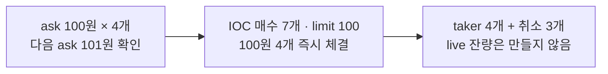

## B07 · IOC 즉시 가능량 0

**현재 상태: 실행·차단 연결**

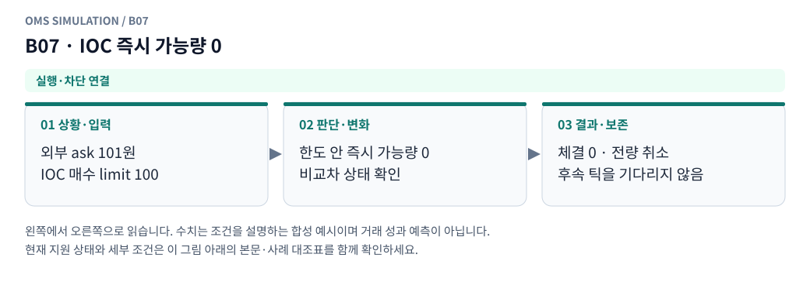

**그림 읽기:** 외부 ask 101원 / IOC 매수 limit 100 → 한도 안 즉시 가능량 0 / 비교차 상태 확인 → 체결 0 · 전량 취소 / 후속 틱을 기다리지 않음.

**원본 처리 제안:** 체결 없이 전량 취소, 대기 주문 생성 안 함

**현행 범위:** 현재 현물 재생기에 해당 분기 또는 명시적 사전 차단을 연결했습니다. 거래소 선물까지 지원한다는 뜻은 아닙니다. 세부 정책은 [실행 범위 본문](../limit_execution_coverage.ko.md)을 따른다.

B07 Mermaid 원본 보기

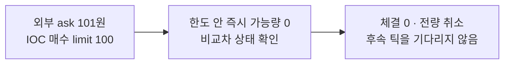

## B08 · Post-only가 도착 때 교차

**현재 상태: 실행·차단 연결**

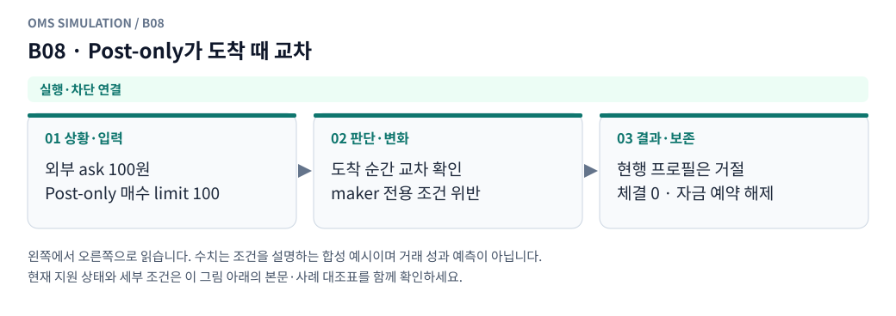

**그림 읽기:** 외부 ask 100원 / Post-only 매수 limit 100 → 도착 순간 교차 확인 / maker 전용 조건 위반 → 현행 프로필은 거절 / 체결 0 · 자금 예약 해제.

**원본 처리 제안:** 체결 없이 조건 취소/프로필의 거절 매핑

**현행 범위:** 현재 현물 재생기에 해당 분기 또는 명시적 사전 차단을 연결했습니다. 거래소 선물까지 지원한다는 뜻은 아닙니다. 세부 정책은 [실행 범위 본문](../limit_execution_coverage.ko.md)을 따른다.

B08 Mermaid 원본 보기

## B09 · Post-only가 도착 때 비교차

**현재 상태: 실행·차단 연결**

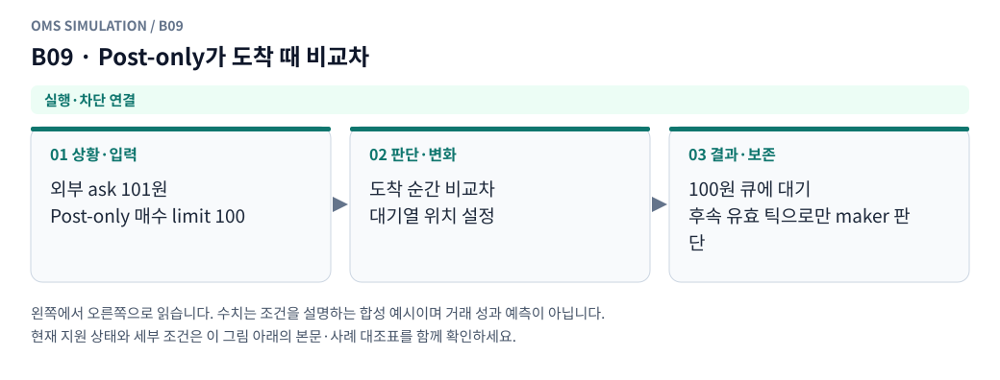

**그림 읽기:** 외부 ask 101원 / Post-only 매수 limit 100 → 도착 순간 비교차 / 대기열 위치 설정 → 100원 큐에 대기 / 후속 유효 틱으로만 maker 판단.

**원본 처리 제안:** 전량 큐 대기, 후속 maker 체결 후보

**현행 범위:** 현재 현물 재생기에 해당 분기 또는 명시적 사전 차단을 연결했습니다. 거래소 선물까지 지원한다는 뜻은 아닙니다. 세부 정책은 [실행 범위 본문](../limit_execution_coverage.ko.md)을 따른다.

B09 Mermaid 원본 보기

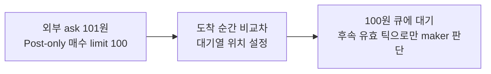

## B10 · top-N 소진 후 limit 안의 더 깊은 잔량 미관측

**현재 상태: 실행·차단 연결**

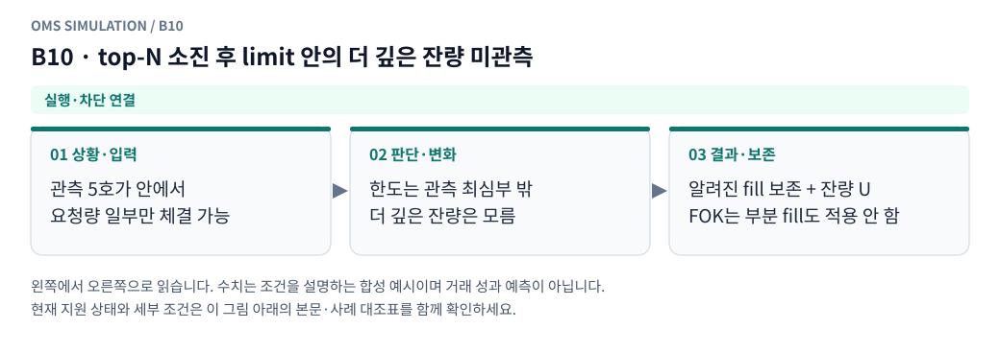

**그림 읽기:** 관측 5호가 안에서 / 요청량 일부만 체결 가능 → 한도는 관측 최심부 밖 / 더 깊은 잔량은 모름 → 알려진 fill 보존 + 잔량 U / FOK는 부분 fill도 적용 안 함.

**원본 처리 제안:** 알려진 부분만 확정, 잔량 U. 마지막 가격 무제한 체결 금지

**현행 범위:** 현재 현물 재생기에 해당 분기 또는 명시적 사전 차단을 연결했습니다. 거래소 선물까지 지원한다는 뜻은 아닙니다. 세부 정책은 [실행 범위 본문](../limit_execution_coverage.ko.md)을 따른다.

B10 Mermaid 원본 보기

## B11 · raw best는 교차하나 self/public 소진 부채로 유효량 0

**현재 상태: 명시적 모형 가정**

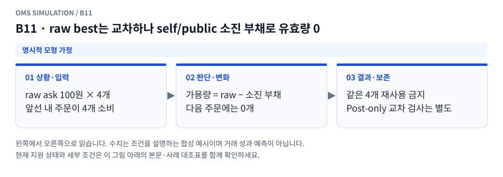

**그림 읽기:** raw ask 100원 × 4개 / 앞선 내 주문이 4개 소비 → 가용량 = raw − 소진 부채 / 다음 주문에는 0개 → 같은 4개 재사용 금지 / Post-only 교차 검사는 별도.

**원본 처리 제안:** 소진 잔량 재사용 금지. 교차 판정과 유동성 정합의 근거/품질 기록

**현행 범위:** 설정한 합성 현물 프로필의 가정으로 처리합니다. 실제 거래소의 과거 규칙이나 순서를 확인했다는 뜻이 아닙니다. 세부 정책은 [실행 범위 본문](../limit_execution_coverage.ko.md)을 따른다.

B11 Mermaid 원본 보기

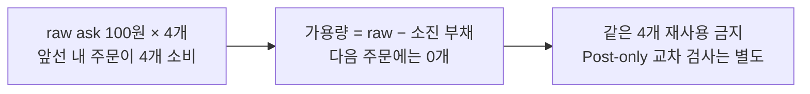

## B12 · 전송→도착 사이 호가 개선·악화·소멸

**현재 상태: 명시적 모형 가정**

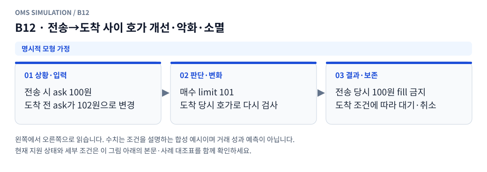

**그림 읽기:** 전송 시 ask 100원 / 도착 전 ask가 102원으로 변경 → 매수 limit 101 / 도착 당시 호가로 다시 검사 → 전송 당시 100원 fill 금지 / 도착 조건에 따라 대기·취소.

**원본 처리 제안:** 도착 이전 시장 사건 먼저 반영, 전송 당시 가격·수량으로 체결하지 않음

**현행 범위:** 설정한 합성 현물 프로필의 가정으로 처리합니다. 실제 거래소의 과거 규칙이나 순서를 확인했다는 뜻이 아닙니다. 세부 정책은 [실행 범위 본문](../limit_execution_coverage.ko.md)을 따른다.

B12 Mermaid 원본 보기

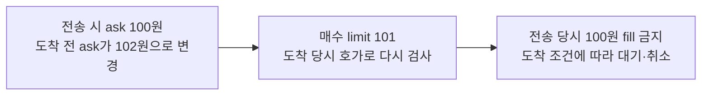

