# C. 대기 지정가·외부 대기열 — 사례별 설명 그림

[그림 안내](../visual_guide.ko.md) · [원본 사례 목록](../point2_limit_fill_cases.ko.md) · [현재 실행 범위](../limit_execution_coverage.ko.md)

각 그림은 해당 조건에서의 흐름을 설명한다. **설계 제안·현재 실행 미지원** 표시는 향후 동작이며, 부분 지원은 전체 동작의 구현을 뜻하지 않는다. 원본 제안과 현행 동작이 다르면 그림 아래 구분을 따른다.

모든 수치 예시는 명시한 선행 물량 외에 더 우선한 물량이 없고, 별도 언급이 없으면 지연·수수료·규격 제한을 생략한 합성 상황이다. 실제 체결 확률이나 성과 예측이 아니다.

[C01](#c01) | [C02](#c02) | [C03](#c03) | [C04](#c04) | [C05](#c05) | [C06](#c06) | [C07](#c07) | [C08](#c08) | [C09](#c09) | [C10](#c10) | [C11](#c11) | [C12](#c12) | [C13](#c13) | [C14](#c14) | [C15](#c15) | [C16](#c16) | [C17](#c17) | [C18](#c18)

## C01 · 주문가격까지 유효한 반대 체결이 오지 않음

**현재 상태: 실행·차단 연결**

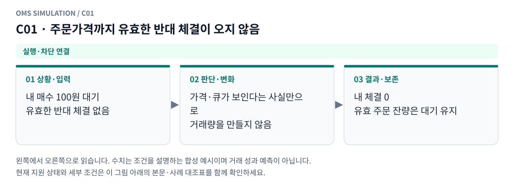

**그림 읽기:** 내 매수 100원 대기 / 유효한 반대 체결 없음 → 가격·큐가 보인다는 사실만으로 / 거래량을 만들지 않음 → 내 체결 0 / 유효 주문 잔량은 대기 유지.

**원본 처리 제안:** 미체결 대기 유지

**현행 범위:** 현재 현물 재생기에 해당 분기 또는 명시적 사전 차단을 연결했습니다. 거래소 선물까지 지원한다는 뜻은 아닙니다. 세부 정책은 [실행 범위 본문](../limit_execution_coverage.ko.md)을 따른다.

C01 Mermaid 원본 보기

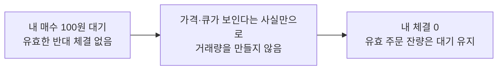

## C02 · best quote가 내 가격에 닿았으나 trade tick 없음

**현재 상태: 실행·차단 연결**

**그림 읽기:** 내 매수 100원 / best ask가 100원에 닿음 → 호가 touch 관측 / 반대 체결 틱은 없음 → maker 체결 생성 안 함 / 대기 상태·시세 품질 확인.

**원본 처리 제안:** touch만으로 maker fill 생성 안 함

**현행 범위:** 현재 현물 재생기에 해당 분기 또는 명시적 사전 차단을 연결했습니다. 거래소 선물까지 지원한다는 뜻은 아닙니다. 세부 정책은 [실행 범위 본문](../limit_execution_coverage.ko.md)을 따른다.

C02 Mermaid 원본 보기

## C03 · 상대 quote가 내 대기가격을 넘어왔으나 tick 없음

**현재 상태: 실행·차단 연결**

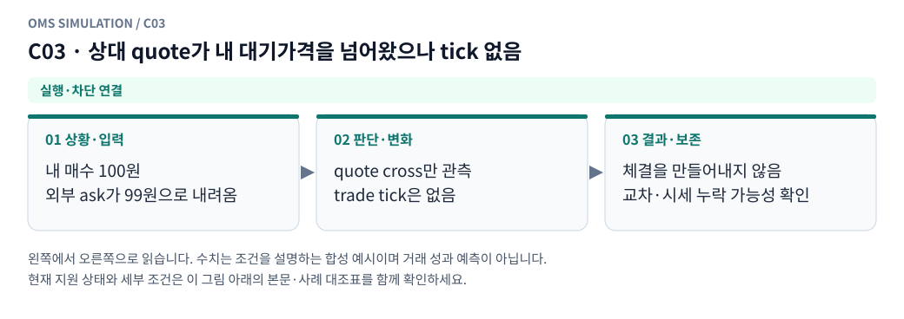

**그림 읽기:** 내 매수 100원 / 외부 ask가 99원으로 내려옴 → quote cross만 관측 / trade tick은 없음 → 체결을 만들어내지 않음 / 교차·시세 누락 가능성 확인.

**원본 처리 제안:** crossed/stale/누락 가능성 기록. 대기 주문을 자동 taker나 전량 maker로 바꾸지 않음

**현행 범위:** 현재 현물 재생기에 해당 분기 또는 명시적 사전 차단을 연결했습니다. 거래소 선물까지 지원한다는 뜻은 아닙니다. 세부 정책은 [실행 범위 본문](../limit_execution_coverage.ko.md)을 따른다.

C03 Mermaid 원본 보기

## C04 · 내 매수에 매수 주도 tick / 내 매도에 매도 주도 tick

**현재 상태: 실행·차단 연결**

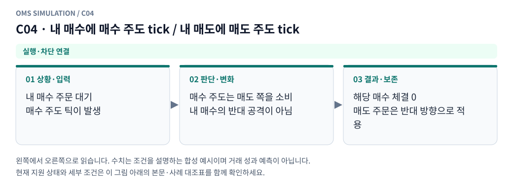

**그림 읽기:** 내 매수 주문 대기 / 매수 주도 틱이 발생 → 매수 주도는 매도 쪽을 소비 / 내 매수의 반대 공격이 아님 → 해당 매수 체결 0 / 매도 주문은 반대 방향으로 적용.

**원본 처리 제안:** 그 주문의 passive fill 근거로 사용하지 않음

**현행 범위:** 현재 현물 재생기에 해당 분기 또는 명시적 사전 차단을 연결했습니다. 거래소 선물까지 지원한다는 뜻은 아닙니다. 세부 정책은 [실행 범위 본문](../limit_execution_coverage.ko.md)을 따른다.

C04 Mermaid 원본 보기

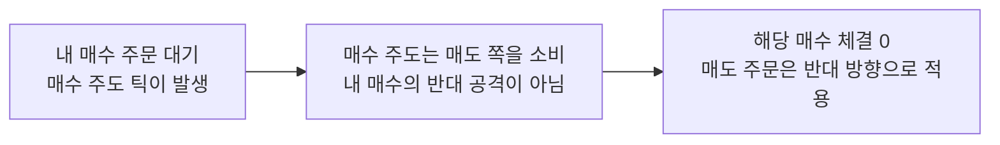

## C05 · 반대 주도 tick이지만 가격이 내 주문에 도달하지 않음

**현재 상태: 실행·차단 연결**

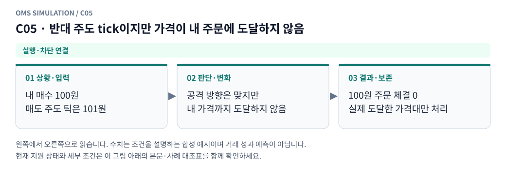

**그림 읽기:** 내 매수 100원 / 매도 주도 틱은 101원 → 공격 방향은 맞지만 / 내 가격까지 도달하지 않음 → 100원 주문 체결 0 / 실제 도달한 가격대만 처리.

**원본 처리 제안:** 해당 주문 미체결

**현행 범위:** 현재 현물 재생기에 해당 분기 또는 명시적 사전 차단을 연결했습니다. 거래소 선물까지 지원한다는 뜻은 아닙니다. 세부 정책은 [실행 범위 본문](../limit_execution_coverage.ko.md)을 따른다.

C05 Mermaid 원본 보기

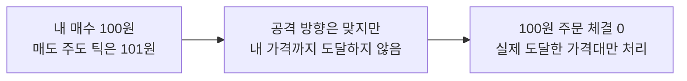

## C06 · 반대 tick 수량이 내 앞 물량보다 작음

**현재 상태: 실행·차단 연결**

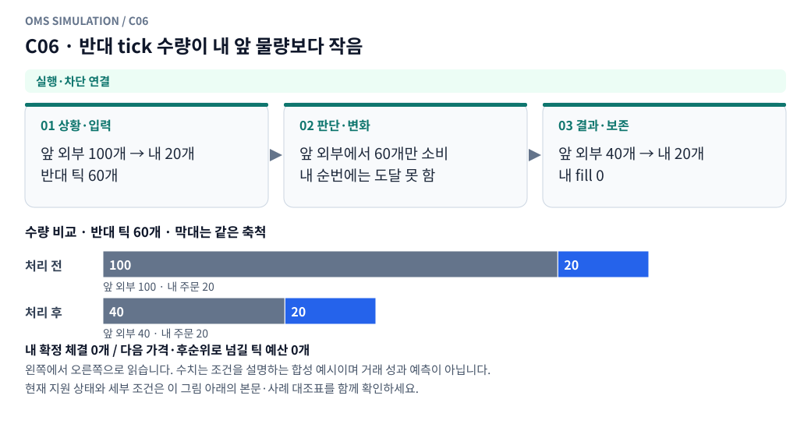

**그림 읽기:** 앞 외부 100개 → 내 20개 / 반대 틱 60개 → 앞 외부에서 60개만 소비 / 내 순번에는 도달 못 함 → 앞 외부 40개 → 내 20개 / 내 fill 0.

**원본 처리 제안:** 앞 물량만 줄고 내 체결 0

**현행 범위:** 현재 현물 재생기에 해당 분기 또는 명시적 사전 차단을 연결했습니다. 거래소 선물까지 지원한다는 뜻은 아닙니다. 세부 정책은 [실행 범위 본문](../limit_execution_coverage.ko.md)을 따른다.

C06 Mermaid 원본 보기

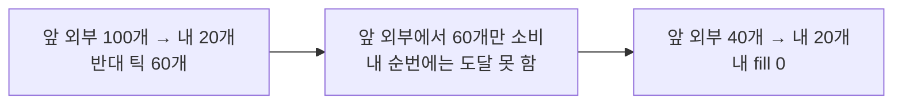

## C07 · 반대 tick 수량이 내 앞 물량과 정확히 같음

**현재 상태: 실행·차단 연결**

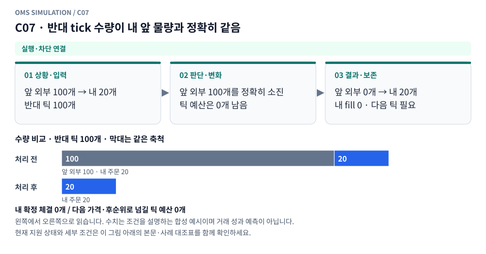

**그림 읽기:** 앞 외부 100개 → 내 20개 / 반대 틱 100개 → 앞 외부 100개를 정확히 소진 / 틱 예산은 0개 남음 → 앞 외부 0개 → 내 20개 / 내 fill 0 · 다음 틱 필요.

**원본 처리 제안:** 내 체결 0, 이후 거래부터 체결 가능

**현행 범위:** 현재 현물 재생기에 해당 분기 또는 명시적 사전 차단을 연결했습니다. 거래소 선물까지 지원한다는 뜻은 아닙니다. 세부 정책은 [실행 범위 본문](../limit_execution_coverage.ko.md)을 따른다.

C07 Mermaid 원본 보기

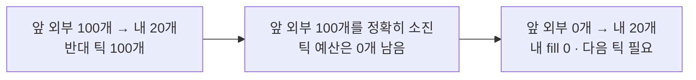

## C08 · 반대 tick이 앞 물량을 초과하나 내 잔량 전체에는 부족

**현재 상태: 실행·차단 연결**

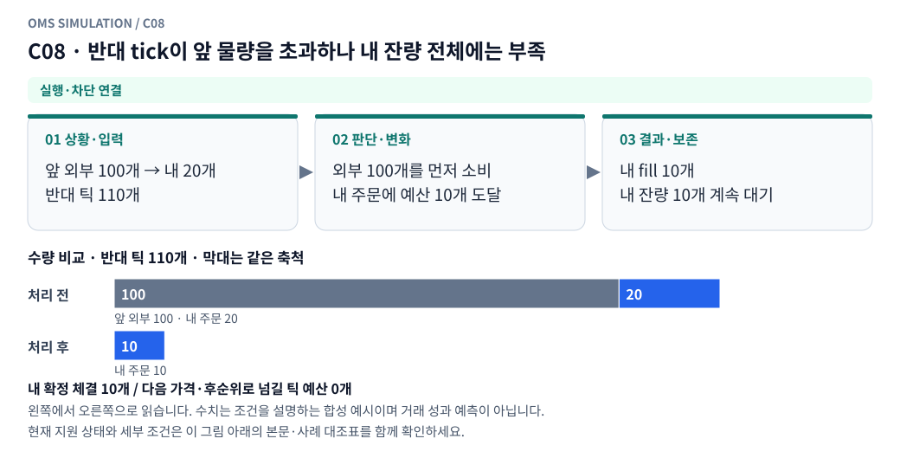

**그림 읽기:** 앞 외부 100개 → 내 20개 / 반대 틱 110개 → 외부 100개를 먼저 소비 / 내 주문에 예산 10개 도달 → 내 fill 10개 / 내 잔량 10개 계속 대기.

**원본 처리 제안:** 초과분만 내 부분체결

**현행 범위:** 현재 현물 재생기에 해당 분기 또는 명시적 사전 차단을 연결했습니다. 거래소 선물까지 지원한다는 뜻은 아닙니다. 세부 정책은 [실행 범위 본문](../limit_execution_coverage.ko.md)을 따른다.

C08 Mermaid 원본 보기

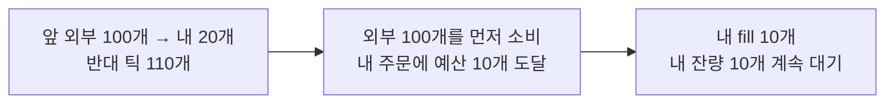

## C09 · 앞 물량+내 잔량을 정확히 소진

**현재 상태: 실행·차단 연결**

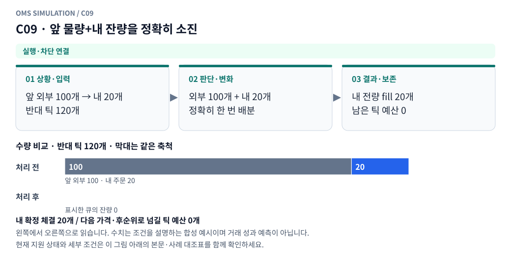

**그림 읽기:** 앞 외부 100개 → 내 20개 / 반대 틱 120개 → 외부 100개 + 내 20개 / 정확히 한 번 배분 → 내 전량 fill 20개 / 남은 틱 예산 0.

**원본 처리 제안:** 내 전량체결

**현행 범위:** 현재 현물 재생기에 해당 분기 또는 명시적 사전 차단을 연결했습니다. 거래소 선물까지 지원한다는 뜻은 아닙니다. 세부 정책은 [실행 범위 본문](../limit_execution_coverage.ko.md)을 따른다.

C09 Mermaid 원본 보기

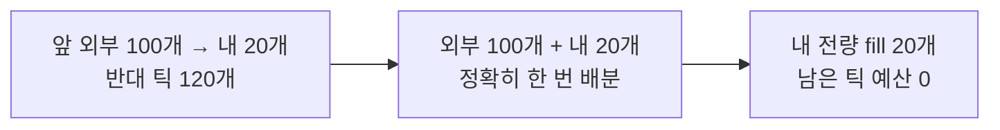

## C10 · 앞 물량+내 잔량보다 많은 tick

**현재 상태: 실행·차단 연결**

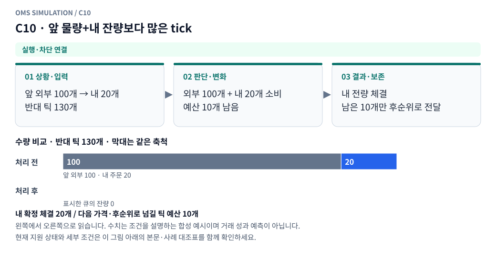

**그림 읽기:** 앞 외부 100개 → 내 20개 / 반대 틱 130개 → 외부 100개 + 내 20개 소비 / 예산 10개 남음 → 내 전량 체결 / 남은 10개만 후순위로 전달.

**원본 처리 제안:** 내 전량체결 후 남은 예산을 후순위에 한 번 배분

**현행 범위:** 현재 현물 재생기에 해당 분기 또는 명시적 사전 차단을 연결했습니다. 거래소 선물까지 지원한다는 뜻은 아닙니다. 세부 정책은 [실행 범위 본문](../limit_execution_coverage.ko.md)을 따른다.

C10 Mermaid 원본 보기

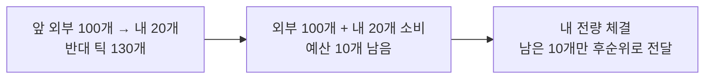

## C11 · 내 주문보다 불리한 원본 가격까지 반대 tick이 관통

**현재 상태: 부분 지원 · 설계와 현행 범위 구분**

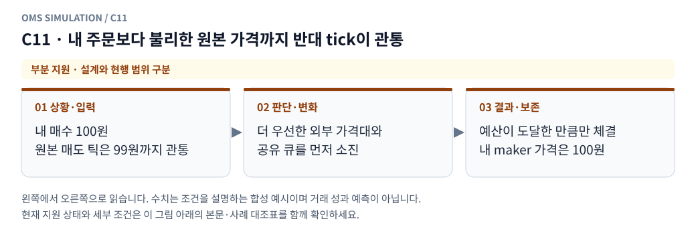

**그림 읽기:** 내 매수 100원 / 원본 매도 틱은 99원까지 관통 → 더 우선한 외부 가격대와 / 공유 큐를 먼저 소진 → 예산이 도달한 만큼만 체결 / 내 maker 가격은 100원.

**원본 처리 제안:** 내 가격이 우선했을 후보량만 배분, maker 가격은 내 지정가, 관측량 초과 금지

**현행 범위:** 현재 현물 모형의 일부 분기만 지원합니다. native 정정·수신 역전 복원·미관측 데이터는 구현으로 간주하지 않습니다. 세부 정책은 [실행 범위 본문](../limit_execution_coverage.ko.md)을 따른다.

C11 Mermaid 원본 보기

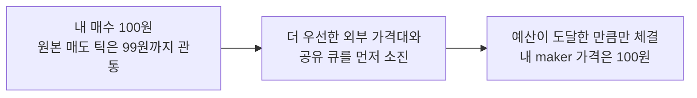

## C12 · 스프레드 안쪽에 내 지정가가 존재

**현재 상태: 실행·차단 연결**

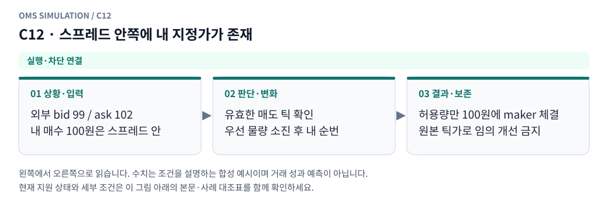

**그림 읽기:** 외부 bid 99 / ask 102 / 내 매수 100원은 스프레드 안 → 유효한 매도 틱 확인 / 우선 물량 소진 후 내 순번 → 허용량만 100원에 maker 체결 / 원본 틱가로 임의 개선 금지.

**원본 처리 제안:** 알려진 더 우선한 외부·내 주문 이후 배분. 원본 체결가로 임의 가격 개선 금지

**현행 범위:** 현재 현물 재생기에 해당 분기 또는 명시적 사전 차단을 연결했습니다. 거래소 선물까지 지원한다는 뜻은 아닙니다. 세부 정책은 [실행 범위 본문](../limit_execution_coverage.ko.md)을 따른다.

C12 Mermaid 원본 보기

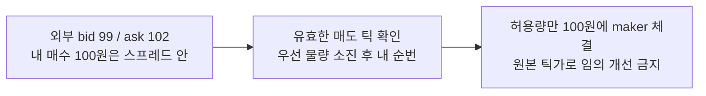

## C13 · 앞쪽 외부 취소 후보가 확인됨

**현재 상태: 명시적 모형 가정**

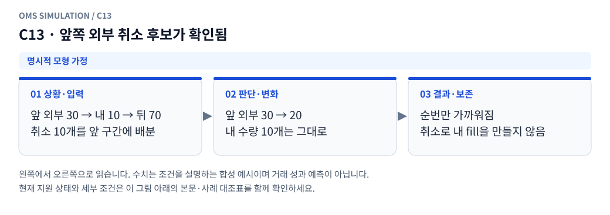

**그림 읽기:** 앞 외부 30 → 내 10 → 뒤 70 / 취소 10개를 앞 구간에 배분 → 앞 외부 30 → 20 / 내 수량 10개는 그대로 → 순번만 가까워짐 / 취소로 내 fill을 만들지 않음.

**원본 처리 제안:** 취소 모형에서 순번만 전진, 취소 자체로 fill 생성 안 함

**현행 범위:** 설정한 합성 현물 프로필의 가정으로 처리합니다. 실제 거래소의 과거 규칙이나 순서를 확인했다는 뜻이 아닙니다. 세부 정책은 [실행 범위 본문](../limit_execution_coverage.ko.md)을 따른다.

C13 Mermaid 원본 보기

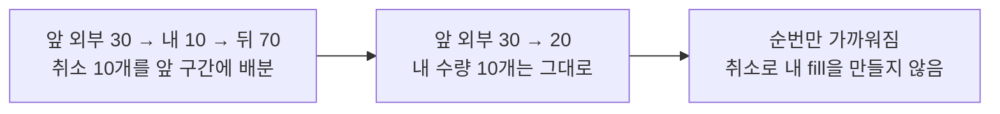

## C14 · 뒤쪽 외부 취소만 발생

**현재 상태: 명시적 모형 가정**

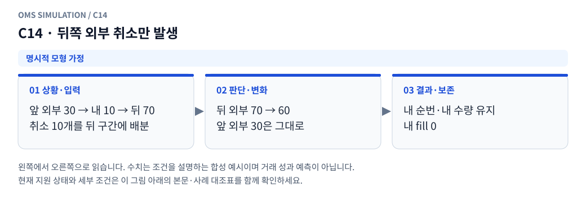

**그림 읽기:** 앞 외부 30 → 내 10 → 뒤 70 / 취소 10개를 뒤 구간에 배분 → 뒤 외부 70 → 60 / 앞 외부 30은 그대로 → 내 순번·내 수량 유지 / 내 fill 0.

**원본 처리 제안:** 내 앞 물량 유지

**현행 범위:** 설정한 합성 현물 프로필의 가정으로 처리합니다. 실제 거래소의 과거 규칙이나 순서를 확인했다는 뜻이 아닙니다. 세부 정책은 [실행 범위 본문](../limit_execution_coverage.ko.md)을 따른다.

C14 Mermaid 원본 보기

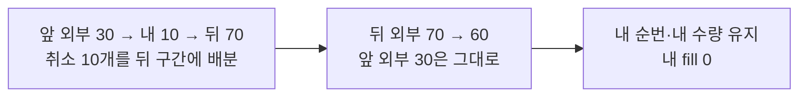

## C15 · 같은 가격 신규 외부 잔량 증가

**현재 상태: 명시적 모형 가정**

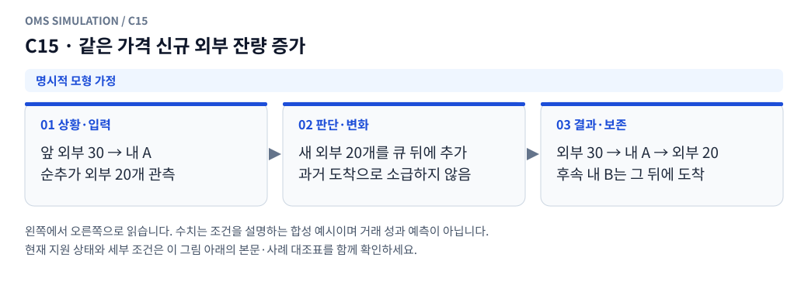

**그림 읽기:** 앞 외부 30 → 내 A / 순추가 외부 20개 관측 → 새 외부 20개를 큐 뒤에 추가 / 과거 도착으로 소급하지 않음 → 외부 30 → 내 A → 외부 20 / 후속 내 B는 그 뒤에 도착.

**원본 처리 제안:** 확인된 현재 시각의 기존 내 주문 뒤로 배치하는 모형, 과거 위치 소급 변경 금지

**현행 범위:** 설정한 합성 현물 프로필의 가정으로 처리합니다. 실제 거래소의 과거 규칙이나 순서를 확인했다는 뜻이 아닙니다. 세부 정책은 [실행 범위 본문](../limit_execution_coverage.ko.md)을 따른다.

C15 Mermaid 원본 보기

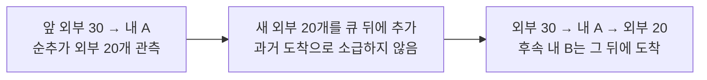

## C16 · snapshot 감소만 있고 대응 tick 없음

**현재 상태: 명시적 모형 가정**

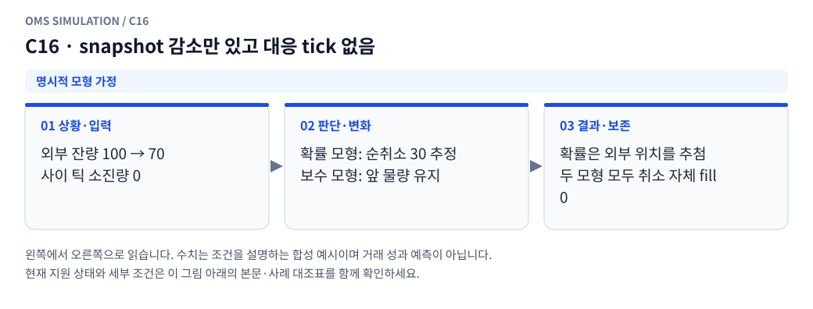

**그림 읽기:** 외부 잔량 100 → 70 / 사이 틱 소진량 0 → 확률 모형: 순취소 30 추정 / 보수 모형: 앞 물량 유지 → 확률은 외부 위치를 추첨 / 두 모형 모두 취소 자체 fill 0.

**원본 처리 제안:** 취소/체결 구분 불가. trade_only는 앞 물량 자동 축소 안 함

**현행 범위:** 설정한 합성 현물 프로필의 가정으로 처리합니다. 실제 거래소의 과거 규칙이나 순서를 확인했다는 뜻이 아닙니다. 세부 정책은 [실행 범위 본문](../limit_execution_coverage.ko.md)을 따른다.

C16 Mermaid 원본 보기

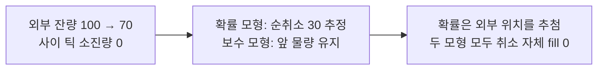

## C17 · tick→snapshot 또는 snapshot→tick 순서 역전

**현재 상태: 부분 지원 · 설계와 현행 범위 구분**

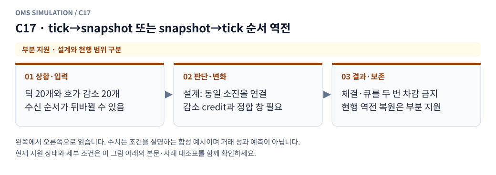

**그림 읽기:** 틱 20개와 호가 감소 20개 / 수신 순서가 뒤바뀔 수 있음 → 설계: 동일 소진을 연결 / 감소 credit과 정합 창 필요 → 체결·큐를 두 번 차감 금지 / 현행 역전 복원은 부분 지원.

**원본 처리 제안:** public 부채·감소 credit으로 한 번만 정합

**현행 범위:** 현재 현물 모형의 일부 분기만 지원합니다. native 정정·수신 역전 복원·미관측 데이터는 구현으로 간주하지 않습니다. 세부 정책은 [실행 범위 본문](../limit_execution_coverage.ko.md)을 따른다.

C17 Mermaid 원본 보기

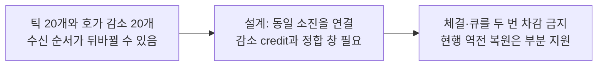

## C18 · 반복 snapshot 또는 top-N 이탈 후 복귀

**현재 상태: 부분 지원 · 설계와 현행 범위 구분**

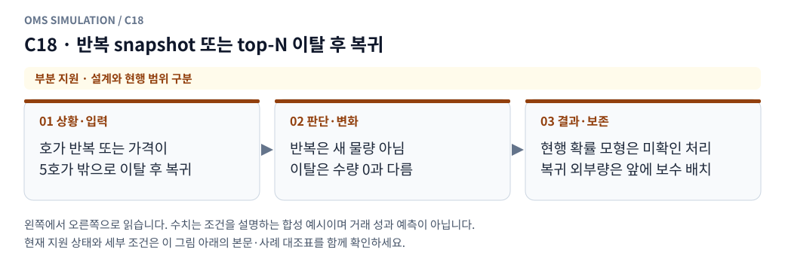

**그림 읽기:** 호가 반복 또는 가격이 / 5호가 밖으로 이탈 후 복귀 → 반복은 새 물량 아님 / 이탈은 수량 0과 다름 → 현행 확률 모형은 미확인 처리 / 복귀 외부량은 앞에 보수 배치.

**원본 처리 제안:** 새 유동성·새 큐로 초기화하지 않고 생명주기·미관측 상태 보존

**현행 범위:** 현재 현물 모형의 일부 분기만 지원합니다. native 정정·수신 역전 복원·미관측 데이터는 구현으로 간주하지 않습니다. 세부 정책은 [실행 범위 본문](../limit_execution_coverage.ko.md)을 따른다.

C18 Mermaid 원본 보기

