# D. 복수 가격·복수 주문 — 사례별 설명 그림

[그림 안내](../visual_guide.ko.md) · [원본 사례 목록](../point2_limit_fill_cases.ko.md) · [현재 실행 범위](../limit_execution_coverage.ko.md)

각 그림은 해당 조건에서의 흐름을 설명한다. **설계 제안·현재 실행 미지원** 표시는 향후 동작이며, 부분 지원은 전체 동작의 구현을 뜻하지 않는다. 원본 제안과 현행 동작이 다르면 그림 아래 구분을 따른다.

모든 수치 예시는 명시한 선행 물량 외에 더 우선한 물량이 없고, 별도 언급이 없으면 지연·수수료·규격 제한을 생략한 합성 상황이다. 실제 체결 확률이나 성과 예측이 아니다.

[D01](#d01) | [D02](#d02) | [D03](#d03) | [D04](#d04) | [D05](#d05) | [D06](#d06) | [D07](#d07) | [D08](#d08) | [D09](#d09) | [D10](#d10) | [D11](#d11) | [D12](#d12)

## D01 · 같은 가격 O1→O2, 예산이 O1에도 도달 못 함

**현재 상태: 실행·차단 연결**

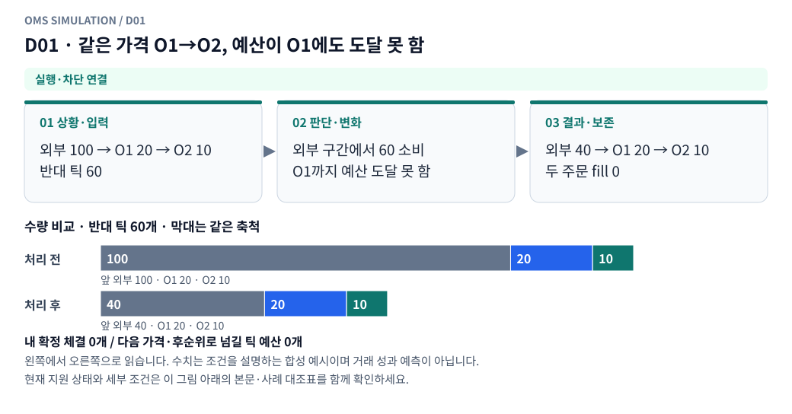

**그림 읽기:** 외부 100 → O1 20 → O2 10 / 반대 틱 60 → 외부 구간에서 60 소비 / O1까지 예산 도달 못 함 → 외부 40 → O1 20 → O2 10 / 두 주문 fill 0.

**원본 처리 제안:** 두 주문 모두 미체결, 선행 외부 물량만 감소

**현행 범위:** 현재 현물 재생기에 해당 분기 또는 명시적 사전 차단을 연결했습니다. 거래소 선물까지 지원한다는 뜻은 아닙니다. 세부 정책은 [실행 범위 본문](../limit_execution_coverage.ko.md)을 따른다.

D01 Mermaid 원본 보기

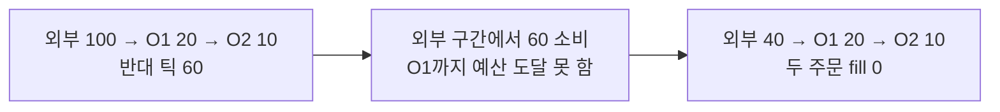

## D02 · 같은 가격 O1 일부체결

**현재 상태: 실행·차단 연결**

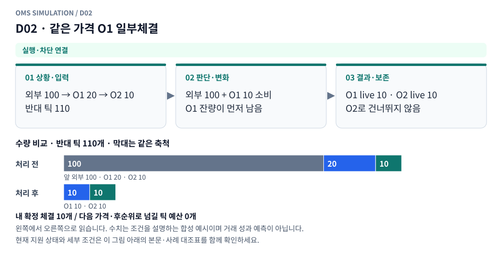

**그림 읽기:** 외부 100 → O1 20 → O2 10 / 반대 틱 110 → 외부 100 + O1 10 소비 / O1 잔량이 먼저 남음 → O1 live 10 · O2 live 10 / O2로 건너뛰지 않음.

**원본 처리 제안:** O1 잔량이 남으면 O2로 건너뛰지 않음

**현행 범위:** 현재 현물 재생기에 해당 분기 또는 명시적 사전 차단을 연결했습니다. 거래소 선물까지 지원한다는 뜻은 아닙니다. 세부 정책은 [실행 범위 본문](../limit_execution_coverage.ko.md)을 따른다.

D02 Mermaid 원본 보기

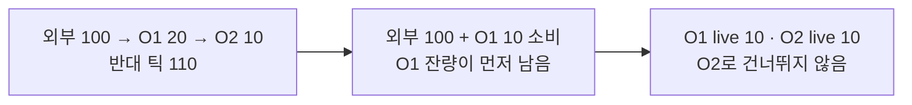

## D03 · 같은 가격 O1 전량, O2 일부/전량

**현재 상태: 실행·차단 연결**

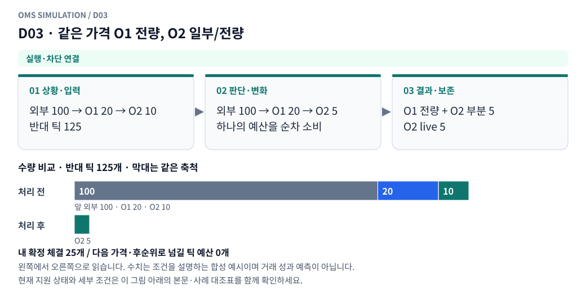

**그림 읽기:** 외부 100 → O1 20 → O2 10 / 반대 틱 125 → 외부 100 → O1 20 → O2 5 / 하나의 예산을 순차 소비 → O1 전량 + O2 부분 5 / O2 live 5.

**원본 처리 제안:** 접수순 FIFO, 같은 tick을 주문마다 재생성하지 않음

**현행 범위:** 현재 현물 재생기에 해당 분기 또는 명시적 사전 차단을 연결했습니다. 거래소 선물까지 지원한다는 뜻은 아닙니다. 세부 정책은 [실행 범위 본문](../limit_execution_coverage.ko.md)을 따른다.

D03 Mermaid 원본 보기

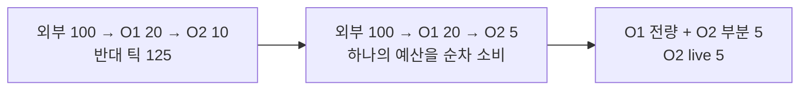

## D04 · 다른 가격 여러 매수

**현재 상태: 실행·차단 연결**

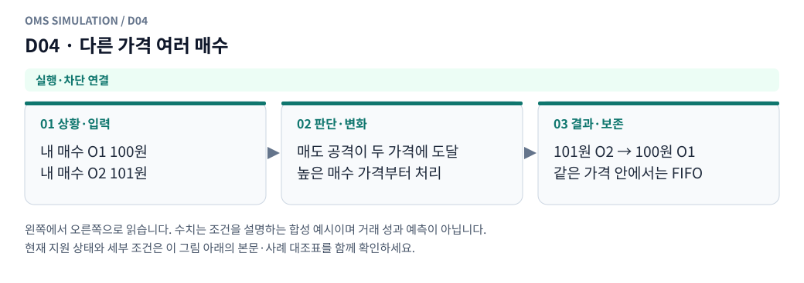

**그림 읽기:** 내 매수 O1 100원 / 내 매수 O2 101원 → 매도 공격이 두 가격에 도달 / 높은 매수 가격부터 처리 → 101원 O2 → 100원 O1 / 같은 가격 안에서는 FIFO.

**원본 처리 제안:** 높은 가격부터, 같은 가격 안에서는 FIFO

**현행 범위:** 현재 현물 재생기에 해당 분기 또는 명시적 사전 차단을 연결했습니다. 거래소 선물까지 지원한다는 뜻은 아닙니다. 세부 정책은 [실행 범위 본문](../limit_execution_coverage.ko.md)을 따른다.

D04 Mermaid 원본 보기

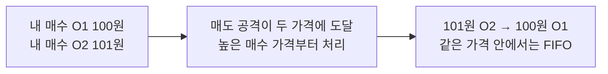

## D05 · 다른 가격 여러 매도

**현재 상태: 실행·차단 연결**

**그림 읽기:** 내 매도 O1 102원 / 내 매도 O2 101원 → 매수 공격이 두 가격에 도달 / 낮은 매도 가격부터 처리 → 101원 O2 → 102원 O1 / 같은 가격 안에서는 FIFO.

**원본 처리 제안:** 낮은 가격부터, 같은 가격 안에서는 FIFO

**현행 범위:** 현재 현물 재생기에 해당 분기 또는 명시적 사전 차단을 연결했습니다. 거래소 선물까지 지원한다는 뜻은 아닙니다. 세부 정책은 [실행 범위 본문](../limit_execution_coverage.ko.md)을 따른다.

D05 Mermaid 원본 보기

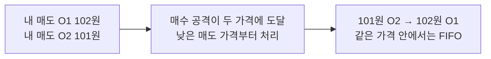

## D06 · 내 주문 없는 더 우선한 외부 가격대가 존재

**현재 상태: 실행·차단 연결**

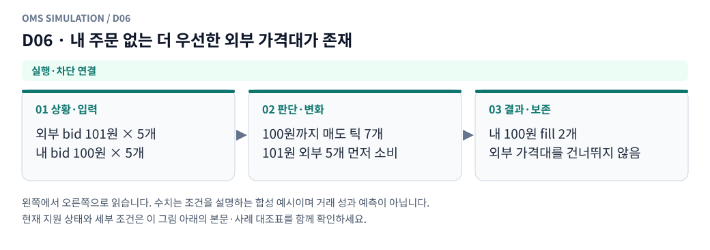

**그림 읽기:** 외부 bid 101원 × 5개 / 내 bid 100원 × 5개 → 100원까지 매도 틱 7개 / 101원 외부 5개 먼저 소비 → 내 100원 fill 2개 / 외부 가격대를 건너뛰지 않음.

**원본 처리 제안:** 외부 물량도 먼저 예산 소비

**현행 범위:** 현재 현물 재생기에 해당 분기 또는 명시적 사전 차단을 연결했습니다. 거래소 선물까지 지원한다는 뜻은 아닙니다. 세부 정책은 [실행 범위 본문](../limit_execution_coverage.ko.md)을 따른다.

D06 Mermaid 원본 보기

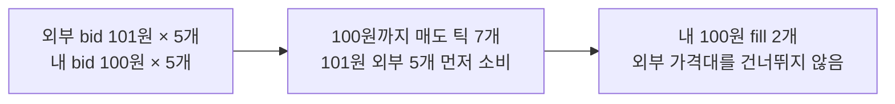

## D07 · 한 tick이 여러 내 주문을 채움

**현재 상태: 실행·차단 연결**

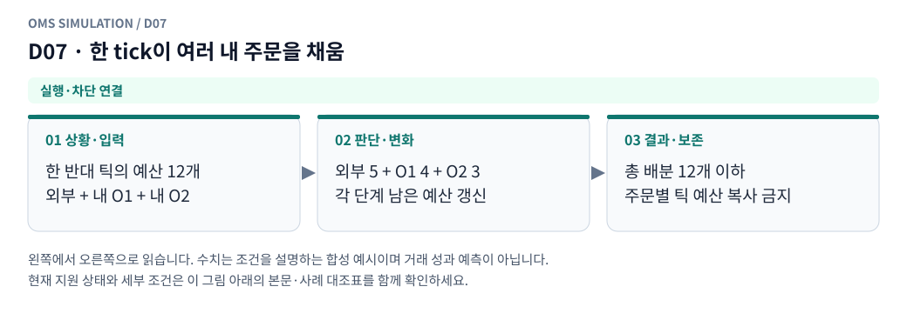

**그림 읽기:** 한 반대 틱의 예산 12개 / 외부 + 내 O1 + 내 O2 → 외부 5 + O1 4 + O2 3 / 각 단계 남은 예산 갱신 → 총 배분 12개 이하 / 주문별 틱 예산 복사 금지.

**원본 처리 제안:** 외부·내 전체 배분 합계가 원본 tick 양 이내

**현행 범위:** 현재 현물 재생기에 해당 분기 또는 명시적 사전 차단을 연결했습니다. 거래소 선물까지 지원한다는 뜻은 아닙니다. 세부 정책은 [실행 범위 본문](../limit_execution_coverage.ko.md)을 따른다.

D07 Mermaid 원본 보기

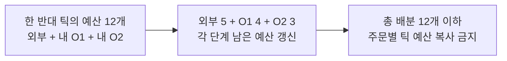

## D08 · 여러 공격 주문이 같은 상대 잔량을 노림

**현재 상태: 실행·차단 연결**

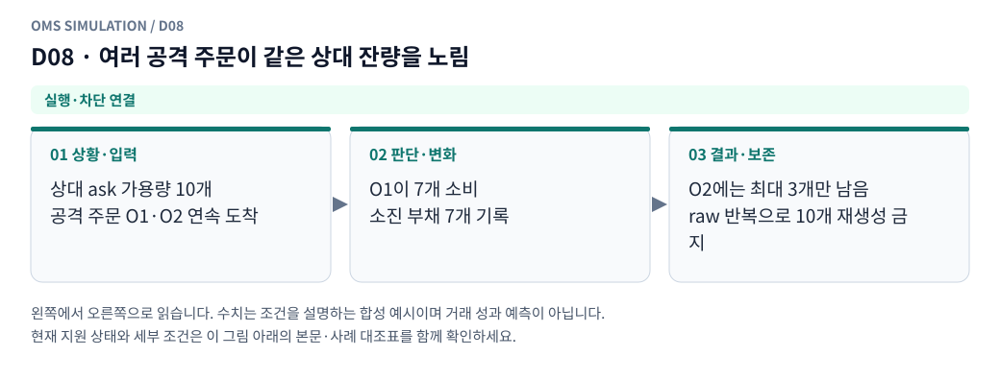

**그림 읽기:** 상대 ask 가용량 10개 / 공격 주문 O1·O2 연속 도착 → O1이 7개 소비 / 소진 부채 7개 기록 → O2에는 최대 3개만 남음 / raw 반복으로 10개 재생성 금지.

**원본 처리 제안:** 먼저 사용한 execution depth는 후속 주문이 재사용하지 못함

**현행 범위:** 현재 현물 재생기에 해당 분기 또는 명시적 사전 차단을 연결했습니다. 거래소 선물까지 지원한다는 뜻은 아닙니다. 세부 정책은 [실행 범위 본문](../limit_execution_coverage.ko.md)을 따른다.

D08 Mermaid 원본 보기

## D09 · 매수만 체결 / 매도만 체결

**현재 상태: 실행·차단 연결**

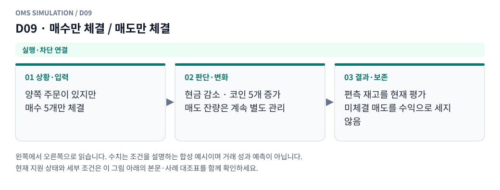

**그림 읽기:** 양쪽 주문이 있지만 / 매수 5개만 체결 → 현금 감소 · 코인 5개 증가 / 매도 잔량은 계속 별도 관리 → 편측 재고를 현재 평가 / 미체결 매도를 수익으로 세지 않음.

**원본 처리 제안:** 편측 재고·미헤지·담보 변화를 각각 반영

**현행 범위:** 현재 현물 재생기에 해당 분기 또는 명시적 사전 차단을 연결했습니다. 거래소 선물까지 지원한다는 뜻은 아닙니다. 세부 정책은 [실행 범위 본문](../limit_execution_coverage.ko.md)을 따른다.

D09 Mermaid 원본 보기

## D10 · 양쪽이 순차 체결 / 양쪽 일부 체결

**현재 상태: 실행·차단 연결**

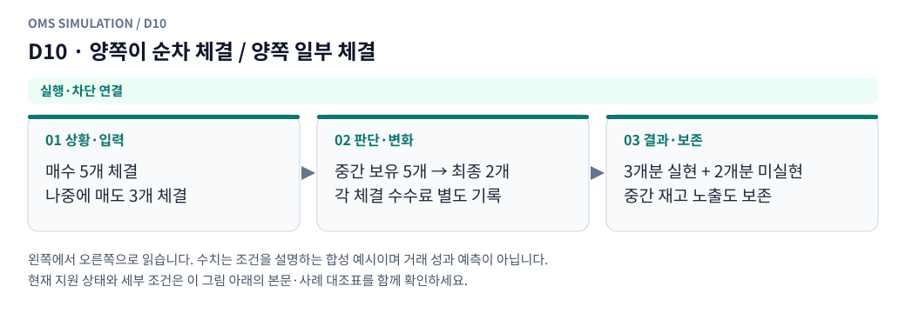

**그림 읽기:** 매수 5개 체결 / 나중에 매도 3개 체결 → 중간 보유 5개 → 최종 2개 / 각 체결 수수료 별도 기록 → 3개분 실현 + 2개분 미실현 / 중간 재고 노출도 보존.

**원본 처리 제안:** 중간 노출·왕복 비용·실현손익까지 보존

**현행 범위:** 현재 현물 재생기에 해당 분기 또는 명시적 사전 차단을 연결했습니다. 거래소 선물까지 지원한다는 뜻은 아닙니다. 세부 정책은 [실행 범위 본문](../limit_execution_coverage.ko.md)을 따른다.

D10 Mermaid 원본 보기

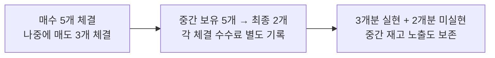

## D11 · 같은 ms의 여러 child 도착 또는 일부 child 거절

**현재 상태: 부분 지원 · 설계와 현행 범위 구분**

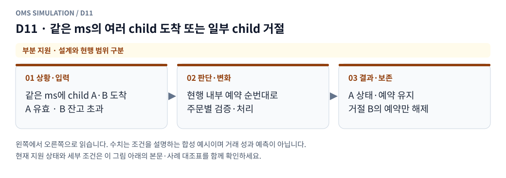

**그림 읽기:** 같은 ms에 child A·B 도착 / A 유효 · B 잔고 초과 → 현행 내부 예약 순번대로 / 주문별 검증·처리 → A 상태·예약 유지 / 거절 B의 예약만 해제.

**원본 처리 제안:** 고정 sequence로 개별 처리, 거절 child의 예약만 해제

**현행 범위:** 현재 현물 모형의 일부 분기만 지원합니다. native 정정·수신 역전 복원·미관측 데이터는 구현으로 간주하지 않습니다. 세부 정책은 [실행 범위 본문](../limit_execution_coverage.ko.md)을 따른다.

D11 Mermaid 원본 보기

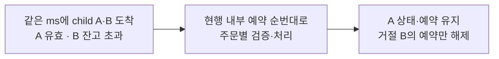

## D12 · 한 슬롯 취소/교체 중 다른 슬롯 주문은 유효

**현재 상태: 실행·차단 연결**

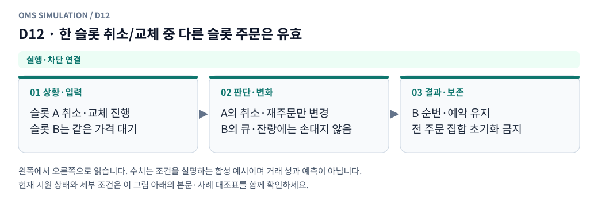

**그림 읽기:** 슬롯 A 취소·교체 진행 / 슬롯 B는 같은 가격 대기 → A의 취소·재주문만 변경 / B의 큐·잔량에는 손대지 않음 → B 순번·예약 유지 / 전 주문 집합 초기화 금지.

**원본 처리 제안:** 다른 주문의 순번·부분체결·예약 유지

**현행 범위:** 현재 현물 재생기에 해당 분기 또는 명시적 사전 차단을 연결했습니다. 거래소 선물까지 지원한다는 뜻은 아닙니다. 세부 정책은 [실행 범위 본문](../limit_execution_coverage.ko.md)을 따른다.

D12 Mermaid 원본 보기

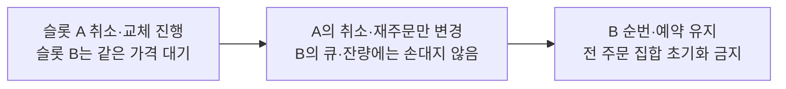

