# E. 취소와 체결 경합 — 사례별 설명 그림

[그림 안내](../visual_guide.ko.md) · [원본 사례 목록](../point2_limit_fill_cases.ko.md) · [현재 실행 범위](../limit_execution_coverage.ko.md)

각 그림은 해당 조건에서의 흐름을 설명한다. **설계 제안·현재 실행 미지원** 표시는 향후 동작이며, 부분 지원은 전체 동작의 구현을 뜻하지 않는다. 원본 제안과 현행 동작이 다르면 그림 아래 구분을 따른다.

모든 수치 예시는 명시한 선행 물량 외에 더 우선한 물량이 없고, 별도 언급이 없으면 지연·수수료·규격 제한을 생략한 합성 상황이다. 실제 체결 확률이나 성과 예측이 아니다.

[E01](#e01) | [E02](#e02) | [E03](#e03) | [E04](#e04) | [E05](#e05) | [E06](#e06) | [E07](#e07) | [E08](#e08) | [E09](#e09) | [E10](#e10) | [E11](#e11) | [E12](#e12)

## E01 · 무체결 상태에서 취소가 먼저 효력 발생

**현재 상태: 실행·차단 연결**

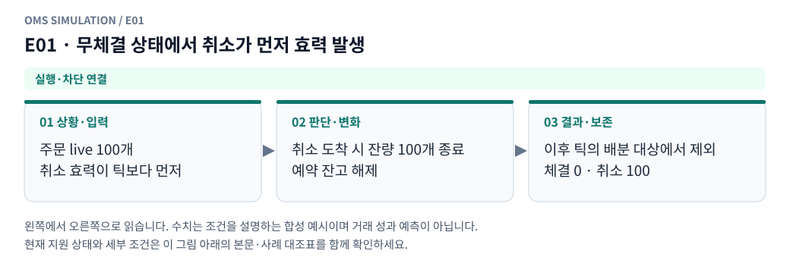

**그림 읽기:** 주문 live 100개 / 취소 효력이 틱보다 먼저 → 취소 도착 시 잔량 100개 종료 / 예약 잔고 해제 → 이후 틱의 배분 대상에서 제외 / 체결 0 · 취소 100.

**원본 처리 제안:** 전량 취소, 이후 tick으로 새 fill 없음

**현행 범위:** 현재 현물 재생기에 해당 분기 또는 명시적 사전 차단을 연결했습니다. 거래소 선물까지 지원한다는 뜻은 아닙니다. 세부 정책은 [실행 범위 본문](../limit_execution_coverage.ko.md)을 따른다.

E01 Mermaid 원본 보기

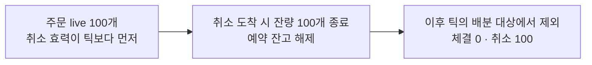

## E02 · 취소 요청 전에 일부 체결

**현재 상태: 실행·차단 연결**

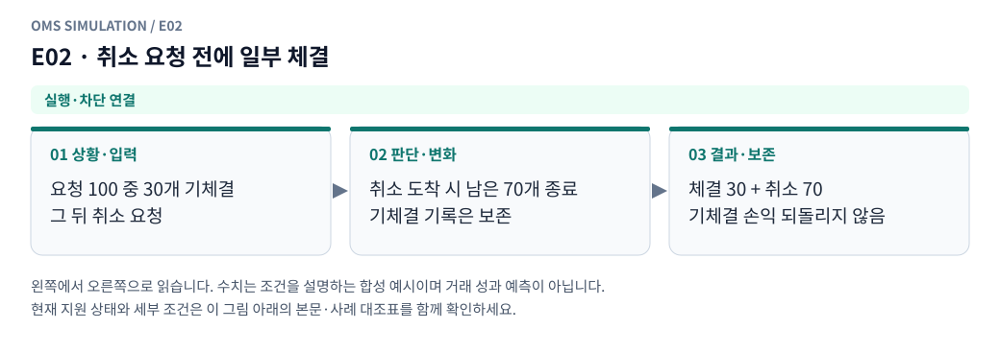

**그림 읽기:** 요청 100 중 30개 기체결 / 그 뒤 취소 요청 → 취소 도착 시 남은 70개 종료 / 기체결 기록은 보존 → 체결 30 + 취소 70 / 기체결 손익 되돌리지 않음.

**원본 처리 제안:** 기존 fill 유지, 남은 양만 취소

**현행 범위:** 현재 현물 재생기에 해당 분기 또는 명시적 사전 차단을 연결했습니다. 거래소 선물까지 지원한다는 뜻은 아닙니다. 세부 정책은 [실행 범위 본문](../limit_execution_coverage.ko.md)을 따른다.

E02 Mermaid 원본 보기

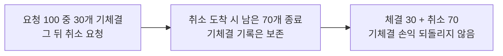

## E03 · 취소 전송→도착 사이 추가 부분체결

**현재 상태: 실행·차단 연결**

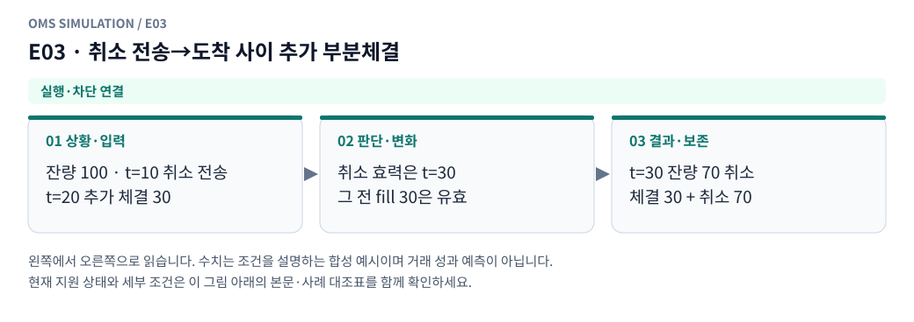

**그림 읽기:** 잔량 100 · t=10 취소 전송 / t=20 추가 체결 30 → 취소 효력은 t=30 / 그 전 fill 30은 유효 → t=30 잔량 70 취소 / 체결 30 + 취소 70.

**원본 처리 제안:** 추가 fill도 유효, 도착 때 실제 잔량 취소

**현행 범위:** 현재 현물 재생기에 해당 분기 또는 명시적 사전 차단을 연결했습니다. 거래소 선물까지 지원한다는 뜻은 아닙니다. 세부 정책은 [실행 범위 본문](../limit_execution_coverage.ko.md)을 따른다.

E03 Mermaid 원본 보기

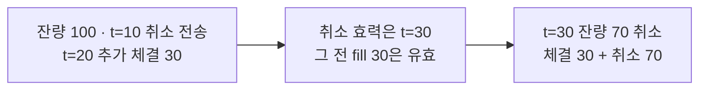

## E04 · 취소 전송→도착 사이 전량체결

**현재 상태: 실행·차단 연결**

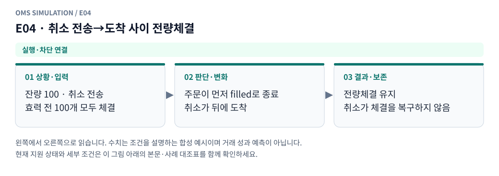

**그림 읽기:** 잔량 100 · 취소 전송 / 효력 전 100개 모두 체결 → 주문이 먼저 filled로 종료 / 취소가 뒤에 도착 → 전량체결 유지 / 취소가 체결을 복구하지 않음.

**원본 처리 제안:** 전량체결 유지, 취소는 no-op/실패 응답

**현행 범위:** 현재 현물 재생기에 해당 분기 또는 명시적 사전 차단을 연결했습니다. 거래소 선물까지 지원한다는 뜻은 아닙니다. 세부 정책은 [실행 범위 본문](../limit_execution_coverage.ko.md)을 따른다.

E04 Mermaid 원본 보기

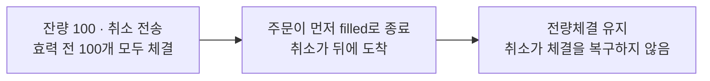

## E05 · 전량체결 뒤 취소 요청

**현재 상태: 실행·차단 연결**

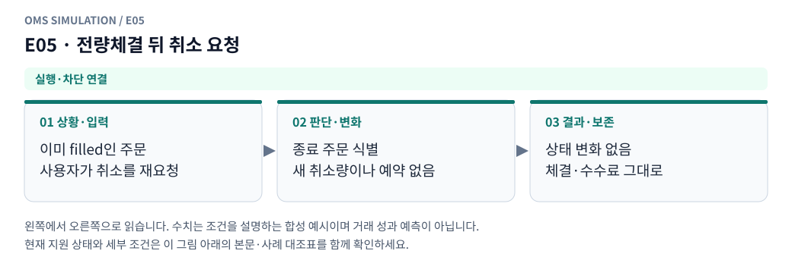

**그림 읽기:** 이미 filled인 주문 / 사용자가 취소를 재요청 → 종료 주문 식별 / 새 취소량이나 예약 없음 → 상태 변화 없음 / 체결·수수료 그대로.

**원본 처리 제안:** 체결 되돌림 없이 이미 종료된 주문으로 응답

**현행 범위:** 현재 현물 재생기에 해당 분기 또는 명시적 사전 차단을 연결했습니다. 거래소 선물까지 지원한다는 뜻은 아닙니다. 세부 정책은 [실행 범위 본문](../limit_execution_coverage.ko.md)을 따른다.

E05 Mermaid 원본 보기

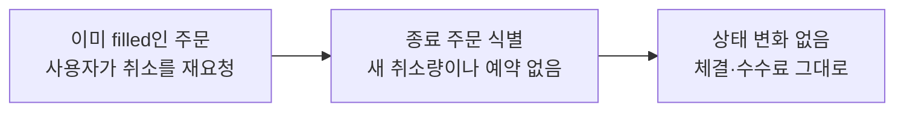

## E06 · cancel arrival과 tick이 같은 ms

**현재 상태: 명시적 모형 가정**

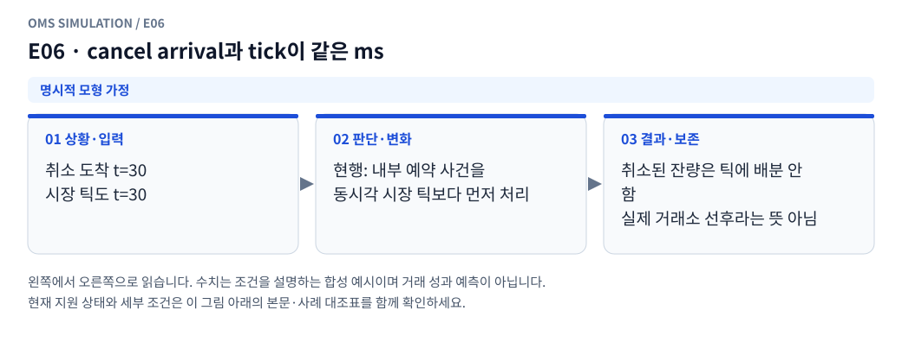

**그림 읽기:** 취소 도착 t=30 / 시장 틱도 t=30 → 현행: 내부 예약 사건을 / 동시각 시장 틱보다 먼저 처리 → 취소된 잔량은 틱에 배분 안 함 / 실제 거래소 선후라는 뜻 아님.

**원본 처리 제안:** 고정 priority/sequence로 처리, 대체 순서 민감도 비교

**현행 범위:** 설정한 합성 현물 프로필의 가정으로 처리합니다. 실제 거래소의 과거 규칙이나 순서를 확인했다는 뜻이 아닙니다. 세부 정책은 [실행 범위 본문](../limit_execution_coverage.ko.md)을 따른다.

E06 Mermaid 원본 보기

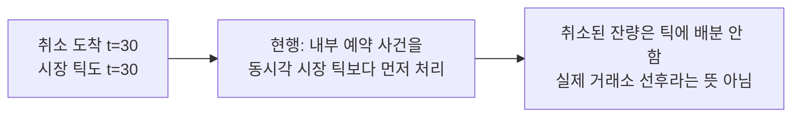

## E07 · 취소 효력 후 새로운 거래량 발생

**현재 상태: 실행·차단 연결**

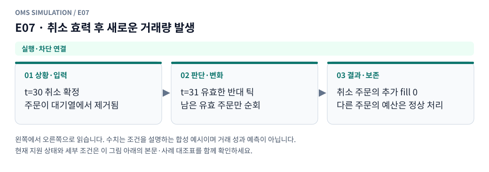

**그림 읽기:** t=30 취소 확정 / 주문이 대기열에서 제거됨 → t=31 유효한 반대 틱 / 남은 유효 주문만 순회 → 취소 주문의 추가 fill 0 / 다른 주문의 예산은 정상 처리.

**원본 처리 제안:** 해당 주문은 배분 대상에서 제외

**현행 범위:** 현재 현물 재생기에 해당 분기 또는 명시적 사전 차단을 연결했습니다. 거래소 선물까지 지원한다는 뜻은 아닙니다. 세부 정책은 [실행 범위 본문](../limit_execution_coverage.ko.md)을 따른다.

E07 Mermaid 원본 보기

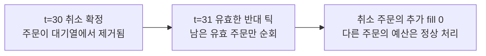

## E08 · 취소 통지 후 과거 fill 통지 도착

**현재 상태: 설계 제안 · 현재 실행 미지원**

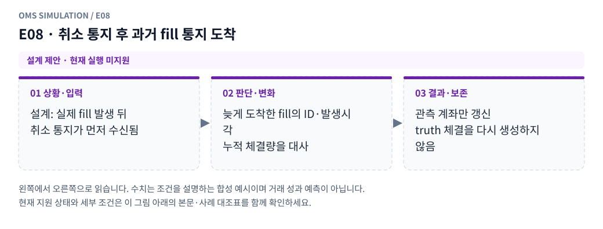

**그림 읽기:** 설계: 실제 fill 발생 뒤 / 취소 통지가 먼저 수신됨 → 늦게 도착한 fill의 ID·발생시각 / 누적 체결량을 대사 → 관측 계좌만 갱신 / truth 체결을 다시 생성하지 않음.

**원본 처리 제안:** 관측 갱신·헤지 연결 처리, truth 재체결 금지

**현행 범위:** 별도 거래소·선물·통지·특수 주문 모형이 필요합니다. 해당 주문/제어 입력은 지원하지 않으며 대신 체결하지 않습니다. 세부 정책은 [실행 범위 본문](../limit_execution_coverage.ko.md)을 따른다.

E08 Mermaid 원본 보기

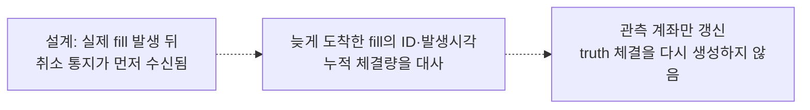

## E09 · 주문 ACK 전 취소 요청

**현재 상태: 실행·차단 연결**

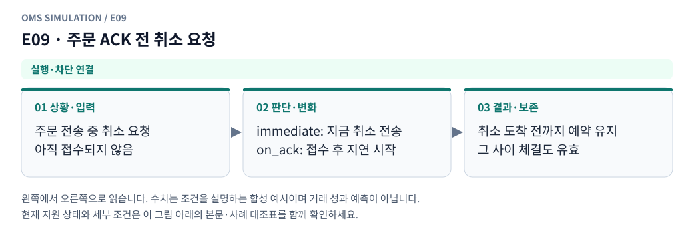

**그림 읽기:** 주문 전송 중 취소 요청 / 아직 접수되지 않음 → immediate: 지금 취소 전송 / on_ack: 접수 후 지연 시작 → 취소 도착 전까지 예약 유지 / 그 사이 체결도 유효.

**원본 처리 제안:** 기본 cancel_on_ack에 따라 ACK 후 취소 전송 지연 시작

**현행 범위:** 현재 현물 재생기에 해당 분기 또는 명시적 사전 차단을 연결했습니다. 거래소 선물까지 지원한다는 뜻은 아닙니다. 세부 정책은 [실행 범위 본문](../limit_execution_coverage.ko.md)을 따른다.

E09 Mermaid 원본 보기

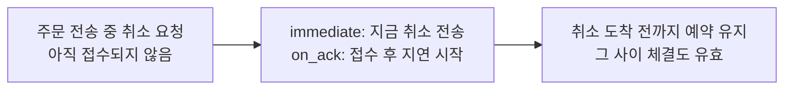

## E10 · 취소 요청 거절/전달 실패

**현재 상태: 설계 제안 · 현재 실행 미지원**

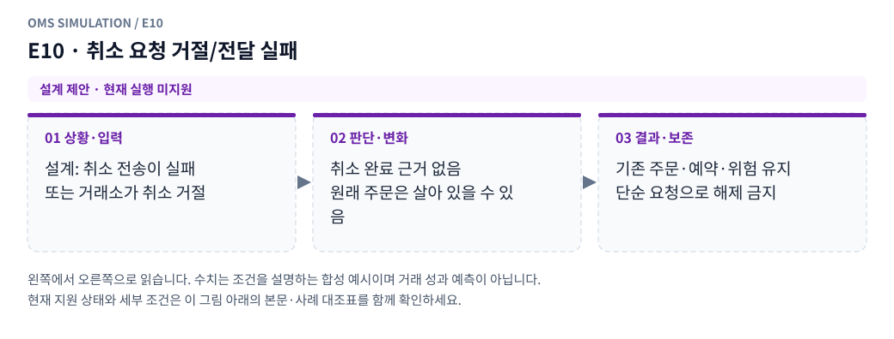

**그림 읽기:** 설계: 취소 전송이 실패 / 또는 거래소가 취소 거절 → 취소 완료 근거 없음 / 원래 주문은 살아 있을 수 있음 → 기존 주문·예약·위험 유지 / 단순 요청으로 해제 금지.

**원본 처리 제안:** 기존 주문·예약·위험 유지, 취소 완료로 가정하지 않음

**현행 범위:** 별도 거래소·선물·통지·특수 주문 모형이 필요합니다. 해당 주문/제어 입력은 지원하지 않으며 대신 체결하지 않습니다. 세부 정책은 [실행 범위 본문](../limit_execution_coverage.ko.md)을 따른다.

E10 Mermaid 원본 보기

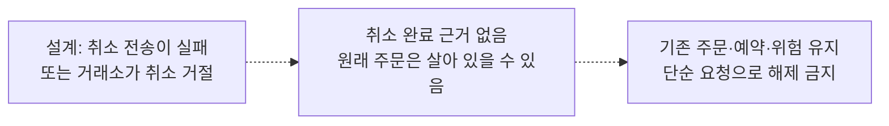

## E11 · 여러 주문 일괄 취소 중 일부만 완료

**현재 상태: 부분 지원 · 설계와 현행 범위 구분**

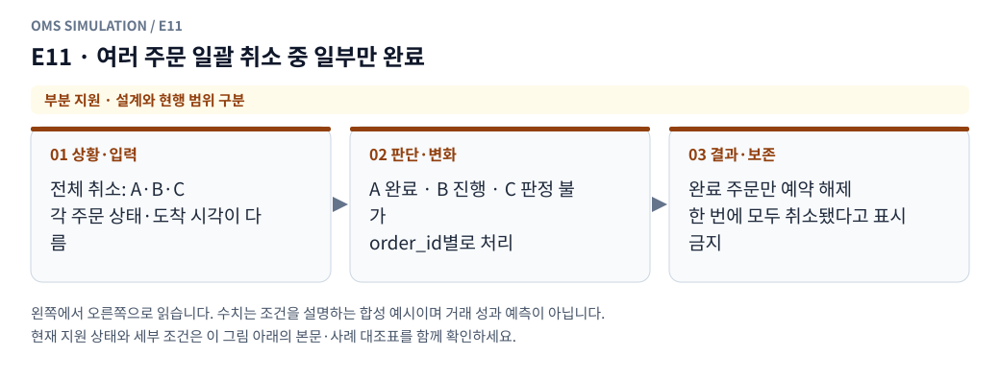

**그림 읽기:** 전체 취소: A·B·C / 각 주문 상태·도착 시각이 다름 → A 완료 · B 진행 · C 판정 불가 / order_id별로 처리 → 완료 주문만 예약 해제 / 한 번에 모두 취소됐다고 표시 금지.

**원본 처리 제안:** order_id별 완료·진행·실패를 분리

**현행 범위:** 현재 현물 모형의 일부 분기만 지원합니다. native 정정·수신 역전 복원·미관측 데이터는 구현으로 간주하지 않습니다. 세부 정책은 [실행 범위 본문](../limit_execution_coverage.ko.md)을 따른다.

E11 Mermaid 원본 보기

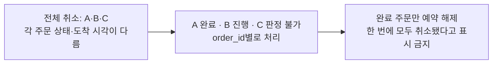

## E12 · 취소 대기 중 반대 주문 또는 교체 주문 전송

**현재 상태: 실행·차단 연결**

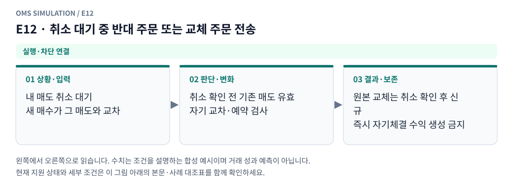

**그림 읽기:** 내 매도 취소 대기 / 새 매수가 그 매도와 교차 → 취소 확인 전 기존 매도 유효 / 자기 교차·예약 검사 → 원본 교체는 취소 확인 후 신규 / 즉시 자기체결 수익 생성 금지.

**원본 처리 제안:** 양쪽 약정·STP·담보 검사. 원본 교체 정책은 해당 슬롯 취소 확인 후 신규

**현행 범위:** 현재 현물 재생기에 해당 분기 또는 명시적 사전 차단을 연결했습니다. 거래소 선물까지 지원한다는 뜻은 아닙니다. 세부 정책은 [실행 범위 본문](../limit_execution_coverage.ko.md)을 따른다.

E12 Mermaid 원본 보기

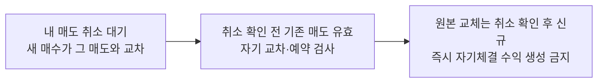

