# F. 정정·교체·재주문 — 사례별 설명 그림

[그림 안내](../visual_guide.ko.md) · [원본 사례 목록](../point2_limit_fill_cases.ko.md) · [현재 실행 범위](../limit_execution_coverage.ko.md)

각 그림은 해당 조건에서의 흐름을 설명한다. **설계 제안·현재 실행 미지원** 표시는 향후 동작이며, 부분 지원은 전체 동작의 구현을 뜻하지 않는다. 원본 제안과 현행 동작이 다르면 그림 아래 구분을 따른다.

모든 수치 예시는 명시한 선행 물량 외에 더 우선한 물량이 없고, 별도 언급이 없으면 지연·수수료·규격 제한을 생략한 합성 상황이다. 실제 체결 확률이나 성과 예측이 아니다.

[F01](#f01) | [F02](#f02) | [F03](#f03) | [F04](#f04) | [F05](#f05) | [F06](#f06) | [F07](#f07) | [F08](#f08) | [F09](#f09) | [F10](#f10) | [F11](#f11) | [F12](#f12)

## F01 · 같은 주문을 같은 가격·같은 잔량으로 유지

**현재 상태: 실행·차단 연결**

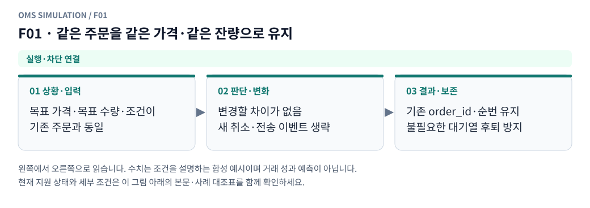

**그림 읽기:** 목표 가격·목표 수량·조건이 / 기존 주문과 동일 → 변경할 차이가 없음 / 새 취소·전송 이벤트 생략 → 기존 order_id·순번 유지 / 불필요한 대기열 후퇴 방지.

**원본 처리 제안:** 불필요한 취소 없이 순번 보존

**현행 범위:** 현재 현물 재생기에 해당 분기 또는 명시적 사전 차단을 연결했습니다. 거래소 선물까지 지원한다는 뜻은 아닙니다. 세부 정책은 [실행 범위 본문](../limit_execution_coverage.ko.md)을 따른다.

F01 Mermaid 원본 보기

## F02 · 같은 가격에 별도 order_id/슬롯으로 추가

**현재 상태: 실행·차단 연결**

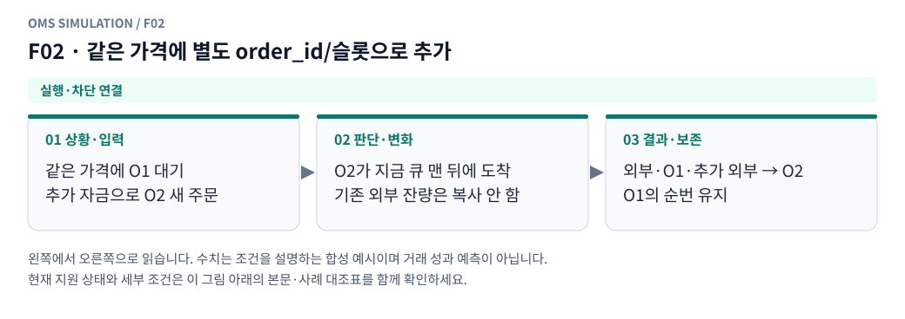

**그림 읽기:** 같은 가격에 O1 대기 / 추가 자금으로 O2 새 주문 → O2가 지금 큐 맨 뒤에 도착 / 기존 외부 잔량은 복사 안 함 → 외부·O1·추가 외부 → O2 / O1의 순번 유지.

**원본 처리 제안:** 신규 주문은 기존 큐 뒤, 기존 외부 물량 중복 초기화 금지

**현행 범위:** 현재 현물 재생기에 해당 분기 또는 명시적 사전 차단을 연결했습니다. 거래소 선물까지 지원한다는 뜻은 아닙니다. 세부 정책은 [실행 범위 본문](../limit_execution_coverage.ko.md)을 따른다.

F02 Mermaid 원본 보기

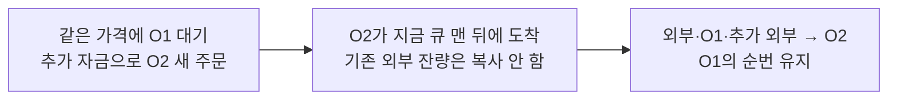

## F03 · 가격 변경을 취소 후 신규로 구현

**현재 상태: 실행·차단 연결**

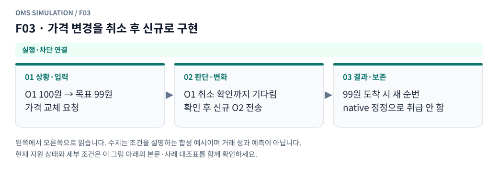

**그림 읽기:** O1 100원 → 목표 99원 / 가격 교체 요청 → O1 취소 확인까지 기다림 / 확인 후 신규 O2 전송 → 99원 도착 시 새 순번 / native 정정으로 취급 안 함.

**원본 처리 제안:** 구 주문 취소 확인 후 신규 가격·새 순번

**현행 범위:** 현재 현물 재생기에 해당 분기 또는 명시적 사전 차단을 연결했습니다. 거래소 선물까지 지원한다는 뜻은 아닙니다. 세부 정책은 [실행 범위 본문](../limit_execution_coverage.ko.md)을 따른다.

F03 Mermaid 원본 보기

## F04 · 신규 가격이 도착 때 상대와 교차

**현재 상태: 실행·차단 연결**

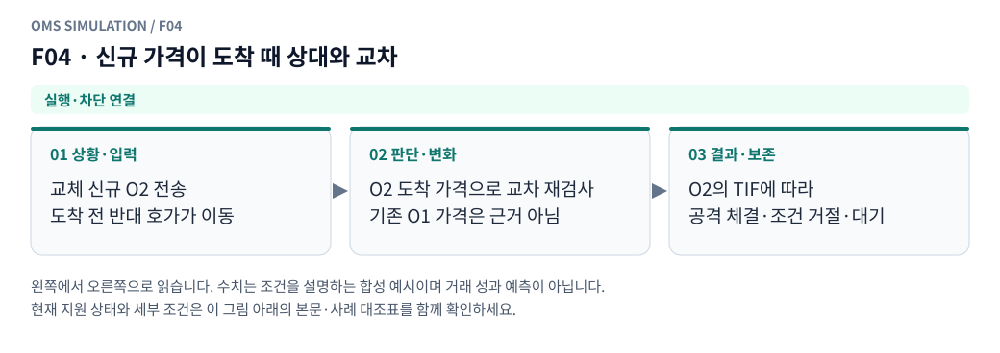

**그림 읽기:** 교체 신규 O2 전송 / 도착 전 반대 호가가 이동 → O2 도착 가격으로 교차 재검사 / 기존 O1 가격은 근거 아님 → O2의 TIF에 따라 / 공격 체결·조건 거절·대기.

**원본 처리 제안:** 새 주문의 TIF에 따라 taker/조건 취소/잔량 처리

**현행 범위:** 현재 현물 재생기에 해당 분기 또는 명시적 사전 차단을 연결했습니다. 거래소 선물까지 지원한다는 뜻은 아닙니다. 세부 정책은 [실행 범위 본문](../limit_execution_coverage.ko.md)을 따른다.

F04 Mermaid 원본 보기

## F05 · 수량 증가 native 정정

**현재 상태: 설계 제안 · 현재 실행 미지원**

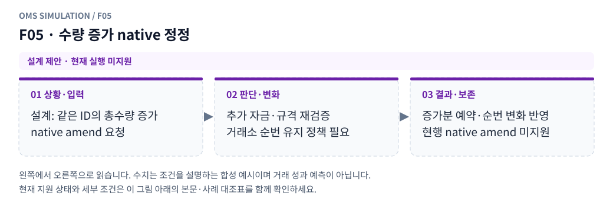

**그림 읽기:** 설계: 같은 ID의 총수량 증가 / native amend 요청 → 추가 자금·규격 재검증 / 거래소 순번 유지 정책 필요 → 증가분 예약·순번 변화 반영 / 현행 native amend 미지원.

**원본 처리 제안:** 자금·규격 재검증, 순번 유지 여부는 프로필

**현행 범위:** 별도 거래소·선물·통지·특수 주문 모형이 필요합니다. 해당 주문/제어 입력은 지원하지 않으며 대신 체결하지 않습니다. 세부 정책은 [실행 범위 본문](../limit_execution_coverage.ko.md)을 따른다.

F05 Mermaid 원본 보기

## F06 · 수량 감소 native 정정

**현재 상태: 설계 제안 · 현재 실행 미지원**

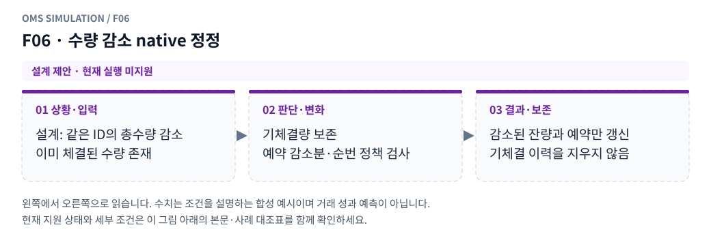

**그림 읽기:** 설계: 같은 ID의 총수량 감소 / 이미 체결된 수량 존재 → 기체결량 보존 / 예약 감소분·순번 정책 검사 → 감소된 잔량과 예약만 갱신 / 기체결 이력을 지우지 않음.

**원본 처리 제안:** 이미 체결된 양 유지, 예약 차이 반환, 순번 정책 명시

**현행 범위:** 별도 거래소·선물·통지·특수 주문 모형이 필요합니다. 해당 주문/제어 입력은 지원하지 않으며 대신 체결하지 않습니다. 세부 정책은 [실행 범위 본문](../limit_execution_coverage.ko.md)을 따른다.

F06 Mermaid 원본 보기

## F07 · 기체결40·총수량100에서 new total50

**현재 상태: 부분 지원 · 설계와 현행 범위 구분**

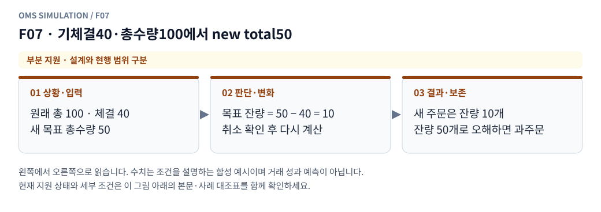

**그림 읽기:** 원래 총 100 · 체결 40 / 새 목표 총수량 50 → 목표 잔량 = 50 − 40 = 10 / 취소 확인 후 다시 계산 → 새 주문은 잔량 10개 / 잔량 50개로 오해하면 과주문.

**원본 처리 제안:** 총수량 계약이면 목표 잔량10. remaining50 계약과 혼동 금지

**현행 범위:** 현재 현물 모형의 일부 분기만 지원합니다. native 정정·수신 역전 복원·미관측 데이터는 구현으로 간주하지 않습니다. 세부 정책은 [실행 범위 본문](../limit_execution_coverage.ko.md)을 따른다.

F07 Mermaid 원본 보기

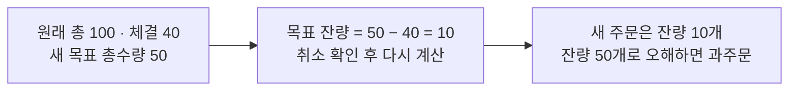

## F08 · 정정 수량이 이미 체결된 양 이하

**현재 상태: 부분 지원 · 설계와 현행 범위 구분**

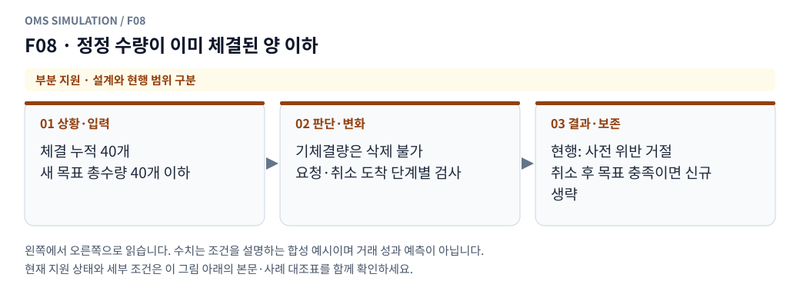

**그림 읽기:** 체결 누적 40개 / 새 목표 총수량 40개 이하 → 기체결량은 삭제 불가 / 요청·취소 도착 단계별 검사 → 현행: 사전 위반 거절 / 취소 후 목표 충족이면 신규 생략.

**원본 처리 제안:** 프로필상 거절/잔량 종료/축소 처리, 과거 fill 삭제 금지

**현행 범위:** 현재 현물 모형의 일부 분기만 지원합니다. native 정정·수신 역전 복원·미관측 데이터는 구현으로 간주하지 않습니다. 세부 정책은 [실행 범위 본문](../limit_execution_coverage.ko.md)을 따른다.

F08 Mermaid 원본 보기

## F09 · 정정 전송→도착 사이 추가체결

**현재 상태: 부분 지원 · 설계와 현행 범위 구분**

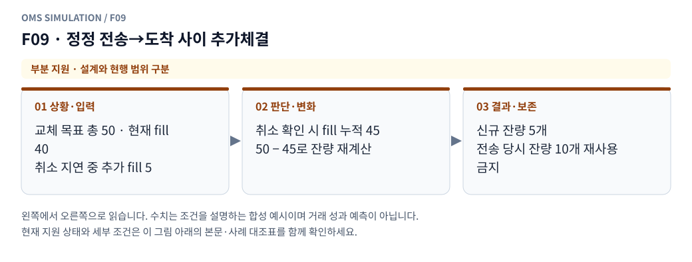

**그림 읽기:** 교체 목표 총 50 · 현재 fill 40 / 취소 지연 중 추가 fill 5 → 취소 확인 시 fill 누적 45 / 50 − 45로 잔량 재계산 → 신규 잔량 5개 / 전송 당시 잔량 10개 재사용 금지.

**원본 처리 제안:** 도착 시 누적체결·잔량 기준으로 정정 재검증

**현행 범위:** 현재 현물 모형의 일부 분기만 지원합니다. native 정정·수신 역전 복원·미관측 데이터는 구현으로 간주하지 않습니다. 세부 정책은 [실행 범위 본문](../limit_execution_coverage.ko.md)을 따른다.

F09 Mermaid 원본 보기

## F10 · 정정 실패·cxlOnFail 등 부가 정책

**현재 상태: 부분 지원 · 설계와 현행 범위 구분**

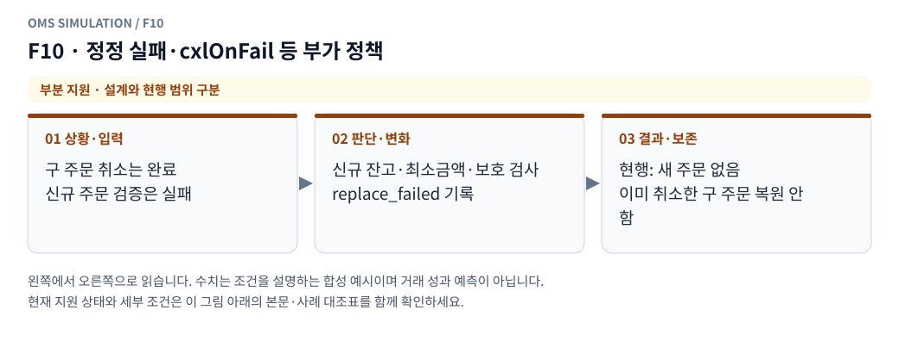

**그림 읽기:** 구 주문 취소는 완료 / 신규 주문 검증은 실패 → 신규 잔고·최소금액·보호 검사 / replace_failed 기록 → 현행: 새 주문 없음 / 이미 취소한 구 주문 복원 안 함.

**원본 처리 제안:** 기존 주문 유지/취소 여부를 해당 프로필로 처리

**현행 범위:** 현재 현물 모형의 일부 분기만 지원합니다. native 정정·수신 역전 복원·미관측 데이터는 구현으로 간주하지 않습니다. 세부 정책은 [실행 범위 본문](../limit_execution_coverage.ko.md)을 따른다.

F10 Mermaid 원본 보기

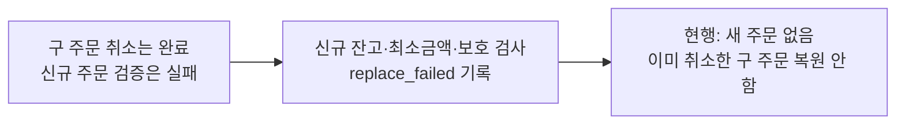

## F11 · 오래된 revision의 정정/취소 응답 도착

**현재 상태: 설계 제안 · 현재 실행 미지원**

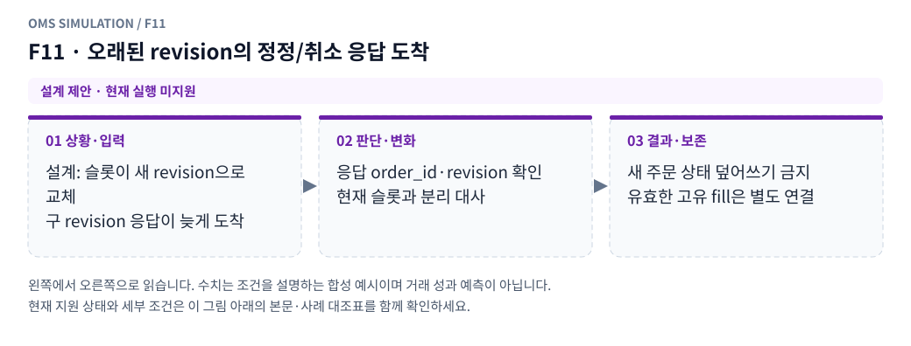

**그림 읽기:** 설계: 슬롯이 새 revision으로 교체 / 구 revision 응답이 늦게 도착 → 응답 order_id·revision 확인 / 현재 슬롯과 분리 대사 → 새 주문 상태 덮어쓰기 금지 / 유효한 고유 fill은 별도 연결.

**원본 처리 제안:** 새 슬롯 주문·새 revision을 덮어쓰지 않음

**현행 범위:** 별도 거래소·선물·통지·특수 주문 모형이 필요합니다. 해당 주문/제어 입력은 지원하지 않으며 대신 체결하지 않습니다. 세부 정책은 [실행 범위 본문](../limit_execution_coverage.ko.md)을 따른다.

F11 Mermaid 원본 보기

## F12 · 취소 후 신규 사이 구 주문의 잔량·헤지 목표가 바뀜

**현재 상태: 부분 지원 · 설계와 현행 범위 구분**

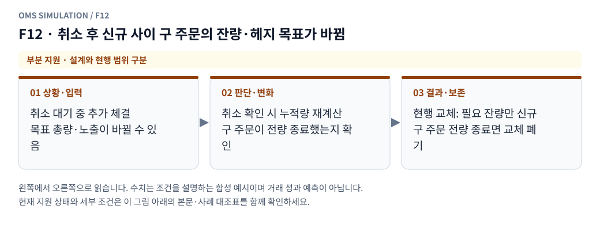

**그림 읽기:** 취소 대기 중 추가 체결 / 목표 총량·노출이 바뀔 수 있음 → 취소 확인 시 누적량 재계산 / 구 주문이 전량 종료했는지 확인 → 현행 교체: 필요 잔량만 신규 / 구 주문 전량 종료면 교체 폐기.

**원본 처리 제안:** 신규 수량 재계산, 기존 목표량 전체를 다시 보내지 않음

**현행 범위:** 현재 현물 모형의 일부 분기만 지원합니다. native 정정·수신 역전 복원·미관측 데이터는 구현으로 간주하지 않습니다. 세부 정책은 [실행 범위 본문](../limit_execution_coverage.ko.md)을 따른다.

F12 Mermaid 원본 보기

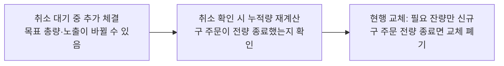

