# G. 자기체결 방지·매칭 제한 — 사례별 설명 그림

[그림 안내](../visual_guide.ko.md) · [원본 사례 목록](../point2_limit_fill_cases.ko.md) · [현재 실행 범위](../limit_execution_coverage.ko.md)

각 그림은 해당 조건에서의 흐름을 설명한다. **설계 제안·현재 실행 미지원** 표시는 향후 동작이며, 부분 지원은 전체 동작의 구현을 뜻하지 않는다. 원본 제안과 현행 동작이 다르면 그림 아래 구분을 따른다.

모든 수치 예시는 명시한 선행 물량 외에 더 우선한 물량이 없고, 별도 언급이 없으면 지연·수수료·규격 제한을 생략한 합성 상황이다. 실제 체결 확률이나 성과 예측이 아니다.

[G01](#g01) | [G02](#g02) | [G03](#g03) | [G04](#g04) | [G05](#g05) | [G06](#g06) | [G07](#g07) | [G08](#g08) | [G09](#g09) | [G10](#g10)

## G01 · 내 신규 매수가 내 대기 매도와 교차

**현재 상태: 실행·차단 연결**

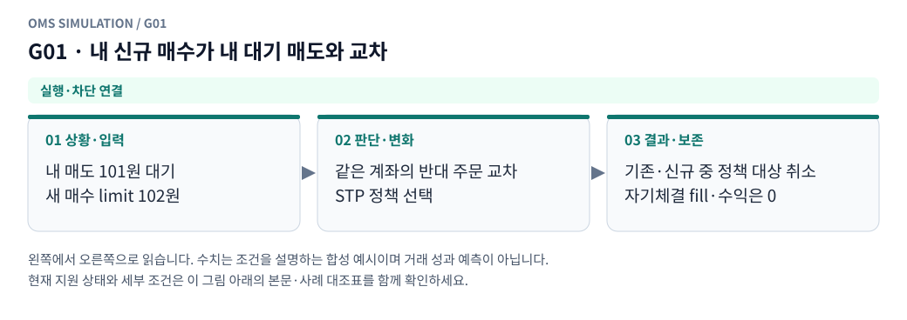

**그림 읽기:** 내 매도 101원 대기 / 새 매수 limit 102원 → 같은 계좌의 반대 주문 교차 / STP 정책 선택 → 기존·신규 중 정책 대상 취소 / 자기체결 fill·수익은 0.

**원본 처리 제안:** STP 프로필 적용, 자기 체결 수익 생성 금지

**현행 범위:** 현재 현물 재생기에 해당 분기 또는 명시적 사전 차단을 연결했습니다. 거래소 선물까지 지원한다는 뜻은 아닙니다. 세부 정책은 [실행 범위 본문](../limit_execution_coverage.ko.md)을 따른다.

G01 Mermaid 원본 보기

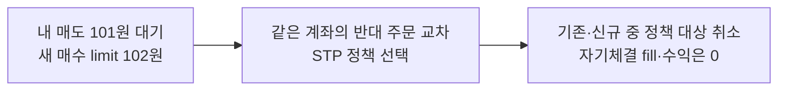

## G02 · 내 신규 매도가 내 대기 매수와 교차

**현재 상태: 실행·차단 연결**

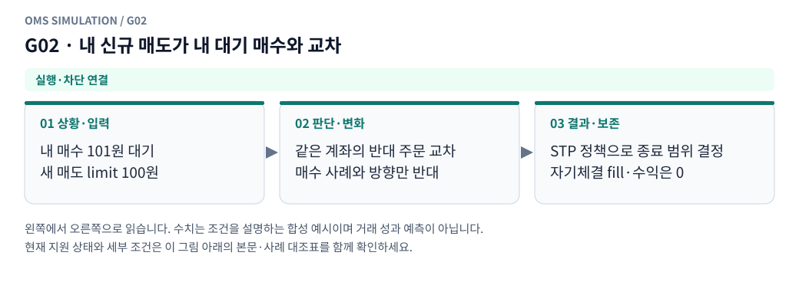

**그림 읽기:** 내 매수 101원 대기 / 새 매도 limit 100원 → 같은 계좌의 반대 주문 교차 / 매수 사례와 방향만 반대 → STP 정책으로 종료 범위 결정 / 자기체결 fill·수익은 0.

**원본 처리 제안:** G01의 대칭 처리

**현행 범위:** 현재 현물 재생기에 해당 분기 또는 명시적 사전 차단을 연결했습니다. 거래소 선물까지 지원한다는 뜻은 아닙니다. 세부 정책은 [실행 범위 본문](../limit_execution_coverage.ko.md)을 따른다.

G02 Mermaid 원본 보기

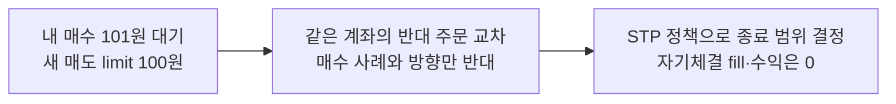

## G03 · STP cancel_maker 모드

**현재 상태: 명시적 모형 가정**

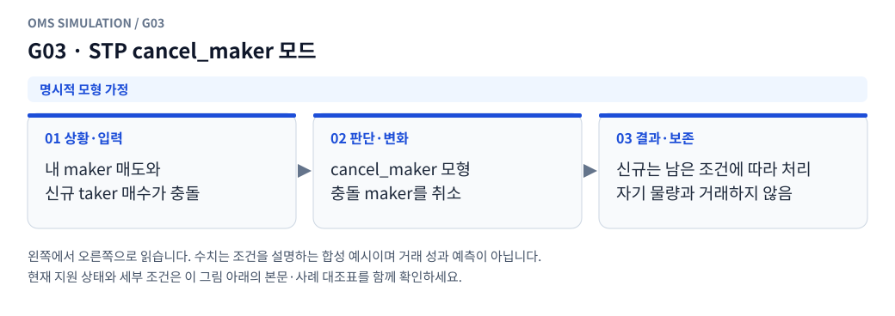

**그림 읽기:** 내 maker 매도와 / 신규 taker 매수가 충돌 → cancel_maker 모형 / 충돌 maker를 취소 → 신규는 남은 조건에 따라 처리 / 자기 물량과 거래하지 않음.

**원본 처리 제안:** 해당 maker 취소·신규 주문의 후속 처리 범위를 프로필로 고정

**현행 범위:** 설정한 합성 현물 프로필의 가정으로 처리합니다. 실제 거래소의 과거 규칙이나 순서를 확인했다는 뜻이 아닙니다. 세부 정책은 [실행 범위 본문](../limit_execution_coverage.ko.md)을 따른다.

G03 Mermaid 원본 보기

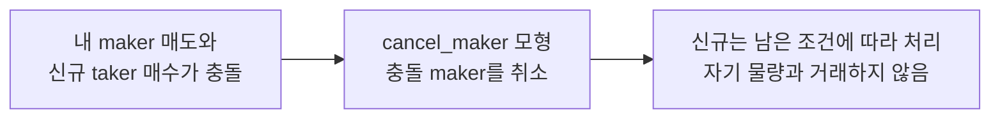

## G04 · STP cancel_taker 모드

**현재 상태: 명시적 모형 가정**

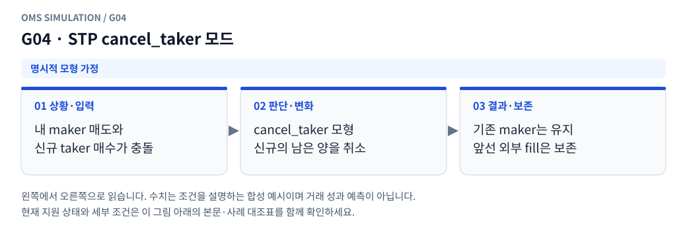

**그림 읽기:** 내 maker 매도와 / 신규 taker 매수가 충돌 → cancel_taker 모형 / 신규의 남은 양을 취소 → 기존 maker는 유지 / 앞선 외부 fill은 보존.

**원본 처리 제안:** 충돌 시 신규 잔량의 취소 범위를 프로필로 고정

**현행 범위:** 설정한 합성 현물 프로필의 가정으로 처리합니다. 실제 거래소의 과거 규칙이나 순서를 확인했다는 뜻이 아닙니다. 세부 정책은 [실행 범위 본문](../limit_execution_coverage.ko.md)을 따른다.

G04 Mermaid 원본 보기

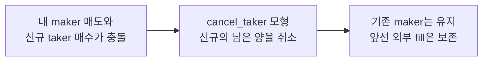

## G05 · STP cancel_both 모드

**현재 상태: 명시적 모형 가정**

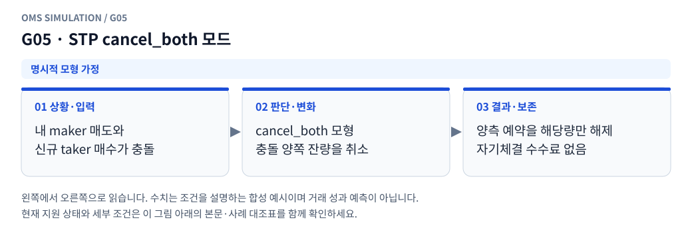

**그림 읽기:** 내 maker 매도와 / 신규 taker 매수가 충돌 → cancel_both 모형 / 충돌 양쪽 잔량을 취소 → 양측 예약을 해당량만 해제 / 자기체결 수수료 없음.

**원본 처리 제안:** 충돌 양측 처리·남은 큐 영향을 프로필로 고정

**현행 범위:** 설정한 합성 현물 프로필의 가정으로 처리합니다. 실제 거래소의 과거 규칙이나 순서를 확인했다는 뜻이 아닙니다. 세부 정책은 [실행 범위 본문](../limit_execution_coverage.ko.md)을 따른다.

G05 Mermaid 원본 보기

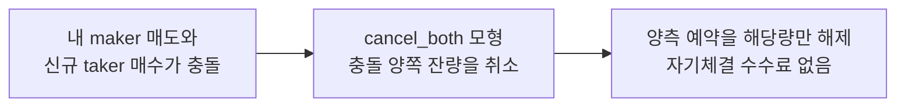

## G06 · 외부 물량 일부 체결 후 내 반대 주문과 충돌

**현재 상태: 명시적 모형 가정**

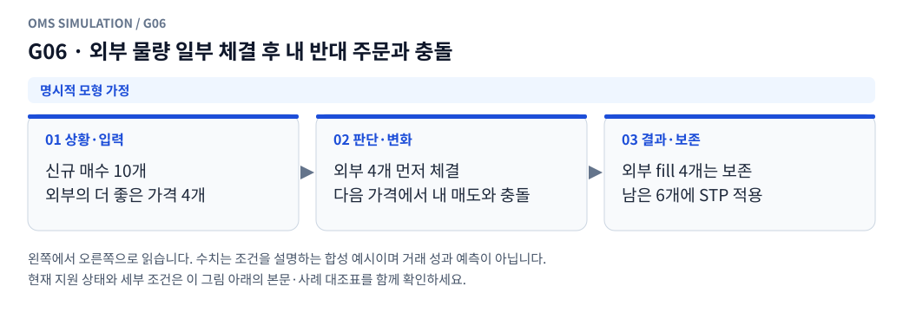

**그림 읽기:** 신규 매수 10개 / 외부의 더 좋은 가격 4개 → 외부 4개 먼저 체결 / 다음 가격에서 내 매도와 충돌 → 외부 fill 4개는 보존 / 남은 6개에 STP 적용.

**원본 처리 제안:** 이미 외부와 체결된 부분 유지, 나머지 STP 처리

**현행 범위:** 설정한 합성 현물 프로필의 가정으로 처리합니다. 실제 거래소의 과거 규칙이나 순서를 확인했다는 뜻이 아닙니다. 세부 정책은 [실행 범위 본문](../limit_execution_coverage.ko.md)을 따른다.

G06 Mermaid 원본 보기

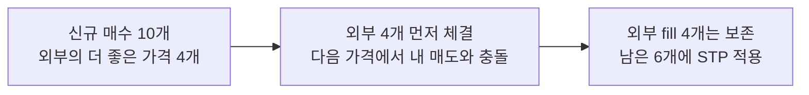

## G07 · 같은 전략/다른 전략의 주문이 같은 계좌에서 충돌

**현재 상태: 실행·차단 연결**

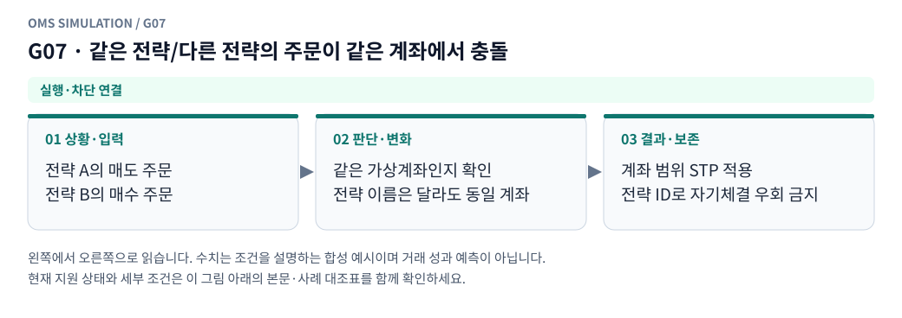

**그림 읽기:** 전략 A의 매도 주문 / 전략 B의 매수 주문 → 같은 가상계좌인지 확인 / 전략 이름은 달라도 동일 계좌 → 계좌 범위 STP 적용 / 전략 ID로 자기체결 우회 금지.

**원본 처리 제안:** 전략 ID가 다르다고 STP 회피하지 않음, 계좌 범위 고정

**현행 범위:** 현재 현물 재생기에 해당 분기 또는 명시적 사전 차단을 연결했습니다. 거래소 선물까지 지원한다는 뜻은 아닙니다. 세부 정책은 [실행 범위 본문](../limit_execution_coverage.ko.md)을 따른다.

G07 Mermaid 원본 보기

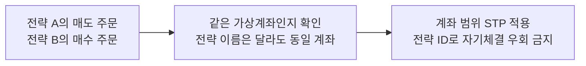

## G08 · 가격 보호·체결 제한 때문에 유효 limit 안에서도 추가 매칭 중단

**현재 상태: 설계 제안 · 현재 실행 미지원**

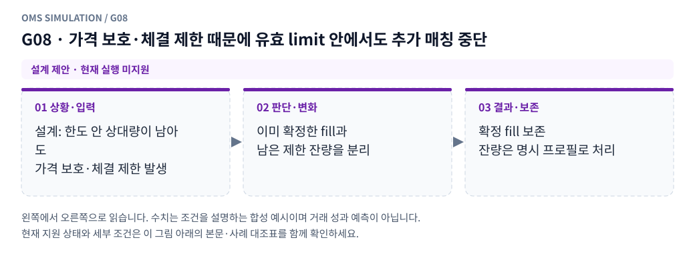

**그림 읽기:** 설계: 한도 안 상대량이 남아도 / 가격 보호·체결 제한 발생 → 이미 확정한 fill과 / 남은 제한 잔량을 분리 → 확정 fill 보존 / 잔량은 명시 프로필로 처리.

**원본 처리 제안:** 확정 fill 유지, 잔량은 프로필상 대기 또는 제한 사유를 기록한 취소. 신규/정정 요청 거절은 별도 기록

**현행 범위:** 별도 거래소·선물·통지·특수 주문 모형이 필요합니다. 해당 주문/제어 입력은 지원하지 않으며 대신 체결하지 않습니다. 세부 정책은 [실행 범위 본문](../limit_execution_coverage.ko.md)을 따른다.

G08 Mermaid 원본 보기

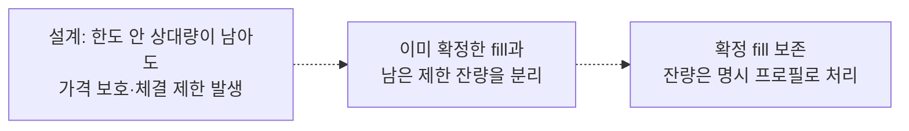

## G09 · 내 숨은 대기열 여유량·queue multiplier가 있음

**현재 상태: 설계 제안 · 현재 실행 미지원**

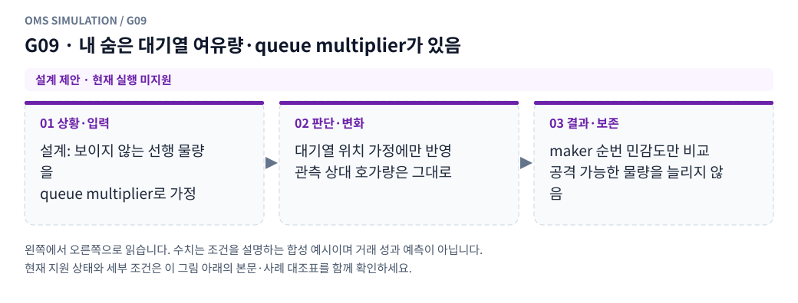

**그림 읽기:** 설계: 보이지 않는 선행 물량을 / queue multiplier로 가정 → 대기열 위치 가정에만 반영 / 관측 상대 호가량은 그대로 → maker 순번 민감도만 비교 / 공격 가능한 물량을 늘리지 않음.

**원본 처리 제안:** 큐 위치 가정에만 사용, 공격 유동성·visible 수량 증가 금지

**현행 범위:** 별도 거래소·선물·통지·특수 주문 모형이 필요합니다. 해당 주문/제어 입력은 지원하지 않으며 대신 체결하지 않습니다. 세부 정책은 [실행 범위 본문](../limit_execution_coverage.ko.md)을 따른다.

G09 Mermaid 원본 보기

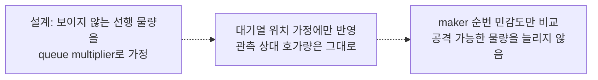

## G10 · 거래소별 STP/매칭 규칙을 과거 시점에 확인 못 함

**현재 상태: 명시적 모형 가정**

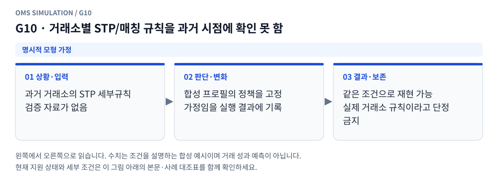

**그림 읽기:** 과거 거래소의 STP 세부규칙 / 검증 자료가 없음 → 합성 프로필의 정책을 고정 / 가정임을 실행 결과에 기록 → 같은 조건으로 재현 가능 / 실제 거래소 규칙이라고 단정 금지.

**원본 처리 제안:** 공통 기본값을 실제 규칙으로 단정하지 않고 가정/미지원 표시

**현행 범위:** 설정한 합성 현물 프로필의 가정으로 처리합니다. 실제 거래소의 과거 규칙이나 순서를 확인했다는 뜻이 아닙니다. 세부 정책은 [실행 범위 본문](../limit_execution_coverage.ko.md)을 따른다.

G10 Mermaid 원본 보기

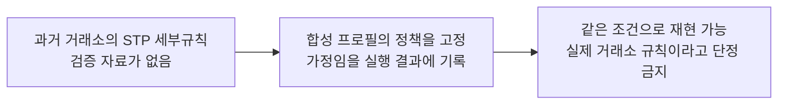

