# H. OKX 선물·포지션·담보 — 사례별 설명 그림

[그림 안내](../visual_guide.ko.md) · [원본 사례 목록](../point2_limit_fill_cases.ko.md) · [현재 실행 범위](../limit_execution_coverage.ko.md)

각 그림은 해당 조건에서의 흐름을 설명한다. **설계 제안·현재 실행 미지원** 표시는 향후 동작이며, 부분 지원은 전체 동작의 구현을 뜻하지 않는다. 원본 제안과 현행 동작이 다르면 그림 아래 구분을 따른다.

모든 수치 예시는 명시한 선행 물량 외에 더 우선한 물량이 없고, 별도 언급이 없으면 지연·수수료·규격 제한을 생략한 합성 상황이다. 실제 체결 확률이나 성과 예측이 아니다.

[H01](#h01) | [H02](#h02) | [H03](#h03) | [H04](#h04) | [H05](#h05) | [H06](#h06) | [H07](#h07) | [H08](#h08) | [H09](#h09) | [H10](#h10) | [H11](#h11) | [H12](#h12)

## H01 · 지정가 체결이 기존 포지션과 같은 방향

**현재 상태: 설계 제안 · 현재 실행 미지원**

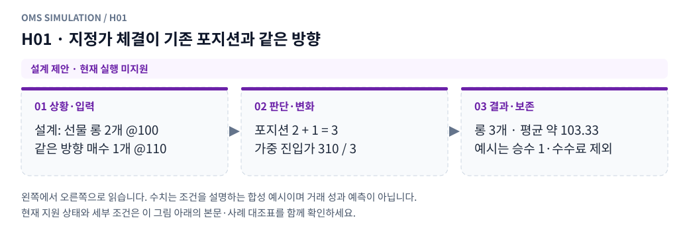

**그림 읽기:** 설계: 선물 롱 2개 @100 / 같은 방향 매수 1개 @110 → 포지션 2 + 1 = 3 / 가중 진입가 310 / 3 → 롱 3개 · 평균 약 103.33 / 예시는 승수 1·수수료 제외.

**원본 처리 제안:** 포지션 절댓값·네이티브 계약 증가, 평균진입가는 수량 가중평균으로 갱신

**현행 범위:** 별도 거래소·선물·통지·특수 주문 모형이 필요합니다. 해당 주문/제어 입력은 지원하지 않으며 대신 체결하지 않습니다. 세부 정책은 [실행 범위 본문](../limit_execution_coverage.ko.md)을 따른다.

H01 Mermaid 원본 보기

## H02 · 반대방향 fill이 기존 포지션 일부만 줄임

**현재 상태: 설계 제안 · 현재 실행 미지원**

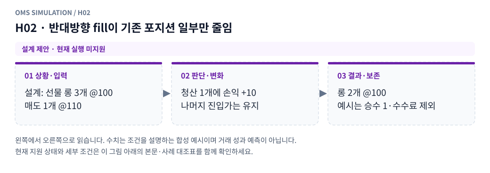

**그림 읽기:** 설계: 선물 롱 3개 @100 / 매도 1개 @110 → 청산 1개에 손익 +10 / 나머지 진입가는 유지 → 롱 2개 @100 / 예시는 승수 1·수수료 제외.

**원본 처리 제안:** 청산분 실현손익, 잔여 평균진입가 유지

**현행 범위:** 별도 거래소·선물·통지·특수 주문 모형이 필요합니다. 해당 주문/제어 입력은 지원하지 않으며 대신 체결하지 않습니다. 세부 정책은 [실행 범위 본문](../limit_execution_coverage.ko.md)을 따른다.

H02 Mermaid 원본 보기

## H03 · 반대방향 fill이 정확히 전량 청산

**현재 상태: 설계 제안 · 현재 실행 미지원**

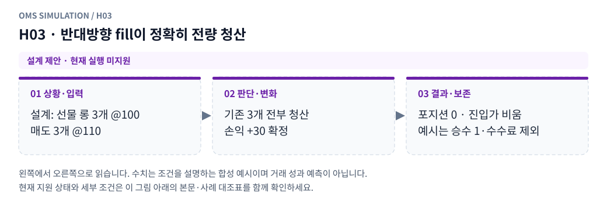

**그림 읽기:** 설계: 선물 롱 3개 @100 / 매도 3개 @110 → 기존 3개 전부 청산 / 손익 +30 확정 → 포지션 0 · 진입가 비움 / 예시는 승수 1·수수료 제외.

**원본 처리 제안:** 포지션0·평균진입가 비움·실현손익·비용

**현행 범위:** 별도 거래소·선물·통지·특수 주문 모형이 필요합니다. 해당 주문/제어 입력은 지원하지 않으며 대신 체결하지 않습니다. 세부 정책은 [실행 범위 본문](../limit_execution_coverage.ko.md)을 따른다.

H03 Mermaid 원본 보기

## H04 · 일반 반대 주문이 기존 포지션보다 많이 체결

**현재 상태: 설계 제안 · 현재 실행 미지원**

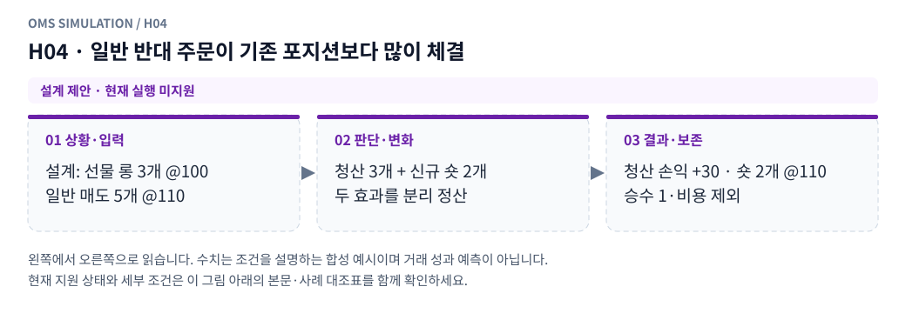

**그림 읽기:** 설계: 선물 롱 3개 @100 / 일반 매도 5개 @110 → 청산 3개 + 신규 숏 2개 / 두 효과를 분리 정산 → 청산 손익 +30 · 숏 2개 @110 / 승수 1·비용 제외.

**원본 처리 제안:** 청산분과 반전 신규분 분리, 신규 평균가는 해당 fill 가격

**현행 범위:** 별도 거래소·선물·통지·특수 주문 모형이 필요합니다. 해당 주문/제어 입력은 지원하지 않으며 대신 체결하지 않습니다. 세부 정책은 [실행 범위 본문](../limit_execution_coverage.ko.md)을 따른다.

H04 Mermaid 원본 보기

## H05 · reduce-only가 현재 포지션을 유효하게 줄임

**현재 상태: 설계 제안 · 현재 실행 미지원**

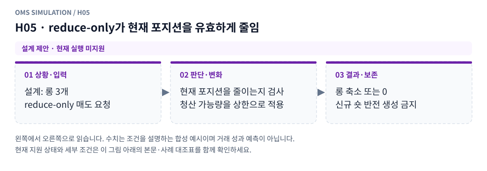

**그림 읽기:** 설계: 롱 3개 / reduce-only 매도 요청 → 현재 포지션을 줄이는지 검사 / 청산 가능량을 상한으로 적용 → 롱 축소 또는 0 / 신규 숏 반전 생성 금지.

**원본 처리 제안:** 해당 범위에서만 축소, 반전 신규분 생성 금지

**현행 범위:** 별도 거래소·선물·통지·특수 주문 모형이 필요합니다. 해당 주문/제어 입력은 지원하지 않으며 대신 체결하지 않습니다. 세부 정책은 [실행 범위 본문](../limit_execution_coverage.ko.md)을 따른다.

H05 Mermaid 원본 보기

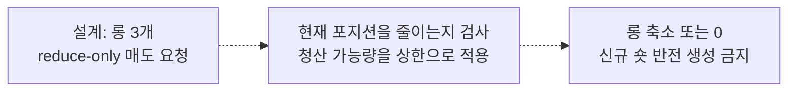

## H06 · reduce-only 도착/실행 전에 다른 주문이 이미 청산

**현재 상태: 설계 제안 · 현재 실행 미지원**

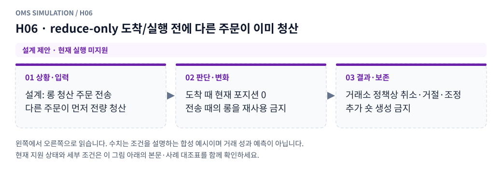

**그림 읽기:** 설계: 롱 청산 주문 전송 / 다른 주문이 먼저 전량 청산 → 도착 때 현재 포지션 0 / 전송 때의 롱을 재사용 금지 → 거래소 정책상 취소·거절·조정 / 추가 숏 생성 금지.

**원본 처리 제안:** 현재 포지션 재검사, 수량 조정/취소/거절의 프로필 적용

**현행 범위:** 별도 거래소·선물·통지·특수 주문 모형이 필요합니다. 해당 주문/제어 입력은 지원하지 않으며 대신 체결하지 않습니다. 세부 정책은 [실행 범위 본문](../limit_execution_coverage.ko.md)을 따른다.

H06 Mermaid 원본 보기

## H07 · 여러 reduce-only가 같은 청산 가능량을 약정

**현재 상태: 설계 제안 · 현재 실행 미지원**

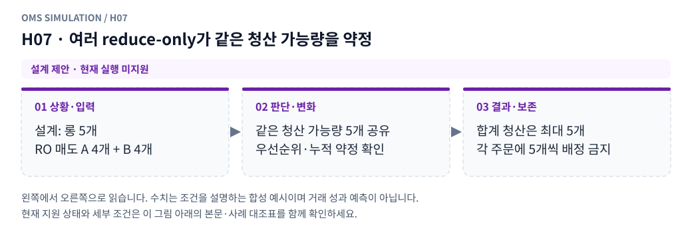

**그림 읽기:** 설계: 롱 5개 / RO 매도 A 4개 + B 4개 → 같은 청산 가능량 5개 공유 / 우선순위·누적 약정 확인 → 합계 청산은 최대 5개 / 각 주문에 5개씩 배정 금지.

**원본 처리 제안:** 누적 약정·가격/접수 우선·실행 한도 검사

**현행 범위:** 별도 거래소·선물·통지·특수 주문 모형이 필요합니다. 해당 주문/제어 입력은 지원하지 않으며 대신 체결하지 않습니다. 세부 정책은 [실행 범위 본문](../limit_execution_coverage.ko.md)을 따른다.

H07 Mermaid 원본 보기

## H08 · 전송 때 담보 충분, 도착 때 부족

**현재 상태: 설계 제안 · 현재 실행 미지원**

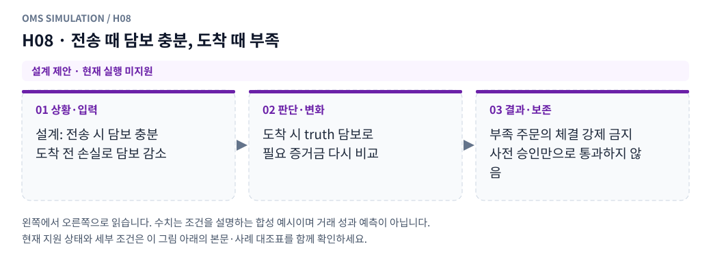

**그림 읽기:** 설계: 전송 시 담보 충분 / 도착 전 손실로 담보 감소 → 도착 시 truth 담보로 / 필요 증거금 다시 비교 → 부족 주문의 체결 강제 금지 / 사전 승인만으로 통과하지 않음.

**원본 처리 제안:** truth 기준 도착 검증, 사전 승인만으로 체결 강제 금지

**현행 범위:** 별도 거래소·선물·통지·특수 주문 모형이 필요합니다. 해당 주문/제어 입력은 지원하지 않으며 대신 체결하지 않습니다. 세부 정책은 [실행 범위 본문](../limit_execution_coverage.ko.md)을 따른다.

H08 Mermaid 원본 보기

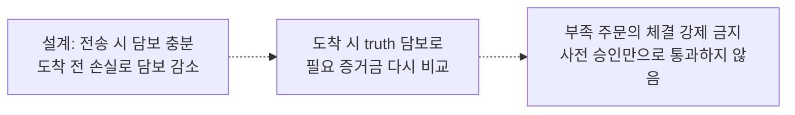

## H09 · 접수 뒤 포지션·담보·거래 상태 변화

**현재 상태: 설계 제안 · 현재 실행 미지원**

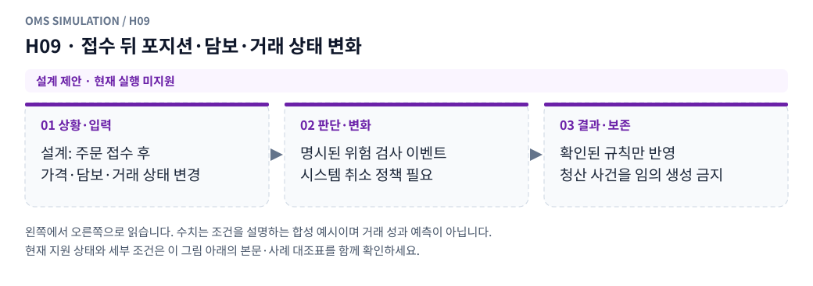

**그림 읽기:** 설계: 주문 접수 후 / 가격·담보·거래 상태 변경 → 명시된 위험 검사 이벤트 / 시스템 취소 정책 필요 → 확인된 규칙만 반영 / 청산 사건을 임의 생성 금지.

**원본 처리 제안:** 명시된 위험 재검사·시스템 취소 모형. 근거 없는 정밀 청산 금지

**현행 범위:** 별도 거래소·선물·통지·특수 주문 모형이 필요합니다. 해당 주문/제어 입력은 지원하지 않으며 대신 체결하지 않습니다. 세부 정책은 [실행 범위 본문](../limit_execution_coverage.ko.md)을 따른다.

H09 Mermaid 원본 보기

## H10 · 지정가 max_q와 시장가 max_q·lot가 다름

**현재 상태: 설계 제안 · 현재 실행 미지원**

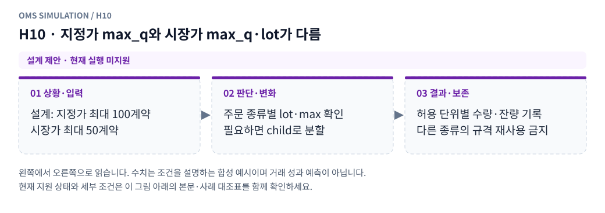

**그림 읽기:** 설계: 지정가 최대 100계약 / 시장가 최대 50계약 → 주문 종류별 lot·max 확인 / 필요하면 child로 분할 → 허용 단위별 수량·잔량 기록 / 다른 종류의 규격 재사용 금지.

**원본 처리 제안:** 주문 종류별 규격 적용, child 분할·반올림 잔량 추적

**현행 범위:** 별도 거래소·선물·통지·특수 주문 모형이 필요합니다. 해당 주문/제어 입력은 지원하지 않으며 대신 체결하지 않습니다. 세부 정책은 [실행 범위 본문](../limit_execution_coverage.ko.md)을 따른다.

H10 Mermaid 원본 보기

## H11 · OKX GTC가 일부 taker 후 여러 번 maker 체결

**현재 상태: 설계 제안 · 현재 실행 미지원**

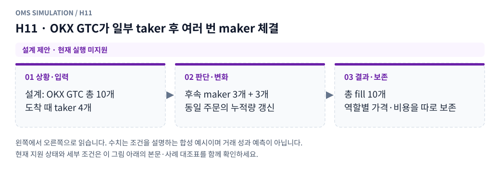

**그림 읽기:** 설계: OKX GTC 총 10개 / 도착 때 taker 4개 → 후속 maker 3개 + 3개 / 동일 주문의 누적량 갱신 → 총 fill 10개 / 역할별 가격·비용을 따로 보존.

**원본 처리 제안:** fill별 역할·가격·수수료, 동일 order_id 누적량

**현행 범위:** 별도 거래소·선물·통지·특수 주문 모형이 필요합니다. 해당 주문/제어 입력은 지원하지 않으며 대신 체결하지 않습니다. 세부 정책은 [실행 범위 본문](../limit_execution_coverage.ko.md)을 따른다.

H11 Mermaid 원본 보기

## H12 · 대기 중 확정 펀딩 또는 평가환율 변화

**현재 상태: 설계 제안 · 현재 실행 미지원**

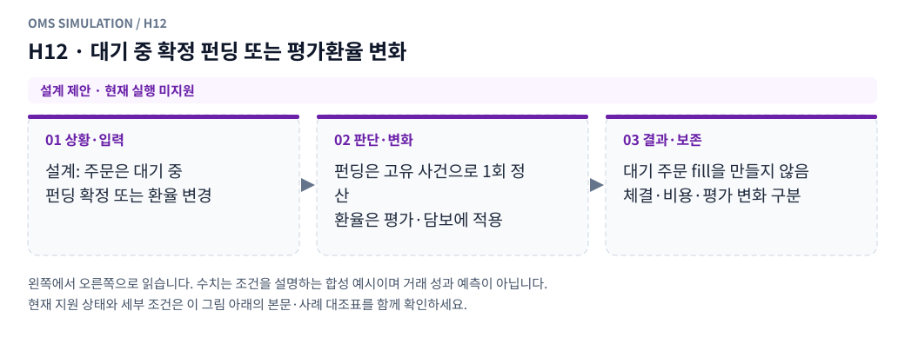

**그림 읽기:** 설계: 주문은 대기 중 / 펀딩 확정 또는 환율 변경 → 펀딩은 고유 사건으로 1회 정산 / 환율은 평가·담보에 적용 → 대기 주문 fill을 만들지 않음 / 체결·비용·평가 변화 구분.

**원본 처리 제안:** 정산은 원장에 한 번, 평가·담보 변화와 체결은 분리

**현행 범위:** 별도 거래소·선물·통지·특수 주문 모형이 필요합니다. 해당 주문/제어 입력은 지원하지 않으며 대신 체결하지 않습니다. 세부 정책은 [실행 범위 본문](../limit_execution_coverage.ko.md)을 따른다.

H12 Mermaid 원본 보기

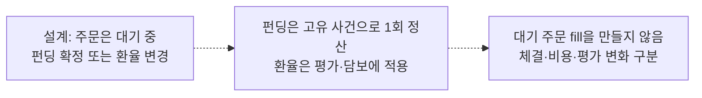

