# I. 두 거래소·헤지 경로 — 사례별 설명 그림

[그림 안내](../visual_guide.ko.md) · [원본 사례 목록](../point2_limit_fill_cases.ko.md) · [현재 실행 범위](../limit_execution_coverage.ko.md)

각 그림은 해당 조건에서의 흐름을 설명한다. **설계 제안·현재 실행 미지원** 표시는 향후 동작이며, 부분 지원은 전체 동작의 구현을 뜻하지 않는다. 원본 제안과 현행 동작이 다르면 그림 아래 구분을 따른다.

모든 수치 예시는 명시한 선행 물량 외에 더 우선한 물량이 없고, 별도 언급이 없으면 지연·수수료·규격 제한을 생략한 합성 상황이다. 실제 체결 확률이나 성과 예측이 아니다.

[I01](#i01) | [I02](#i02) | [I03](#i03) | [I04](#i04) | [I05](#i05) | [I06](#i06) | [I07](#i07) | [I08](#i08) | [I09](#i09) | [I10](#i10) | [I11](#i11) | [I12](#i12)

## I01 · 거래소1개 선택·그 거래소용 유효 프로필

**현재 상태: 실행·차단 연결**

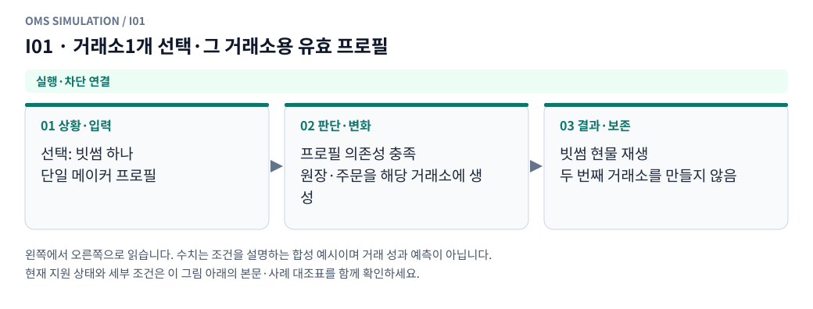

**그림 읽기:** 선택: 빗썸 하나 / 단일 메이커 프로필 → 프로필 의존성 충족 / 원장·주문을 해당 거래소에 생성 → 빗썸 현물 재생 / 두 번째 거래소를 만들지 않음.

**원본 처리 제안:** 단일 거래소 주문/원장 실행, 자동 두 번째 거래소 생성 안 함

**현행 범위:** 현재 현물 재생기에 해당 분기 또는 명시적 사전 차단을 연결했습니다. 거래소 선물까지 지원한다는 뜻은 아닙니다. 세부 정책은 [실행 범위 본문](../limit_execution_coverage.ko.md)을 따른다.

I01 Mermaid 원본 보기

## I02 · 거래소1개 선택·point2 양 거래소 의존 프로필

**현재 상태: 실행·차단 연결**

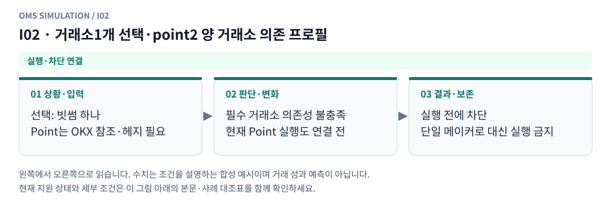

**그림 읽기:** 선택: 빗썸 하나 / Point는 OKX 참조·헤지 필요 → 필수 거래소 의존성 불충족 / 현재 Point 실행도 연결 전 → 실행 전에 차단 / 단일 메이커로 대신 실행 금지.

**원본 처리 제안:** 기준가격/헤지 의존성 검증 실패로 실행 전 차단

**현행 범위:** 현재 현물 재생기에 해당 분기 또는 명시적 사전 차단을 연결했습니다. 거래소 선물까지 지원한다는 뜻은 아닙니다. 세부 정책은 [실행 범위 본문](../limit_execution_coverage.ko.md)을 따른다.

I02 Mermaid 원본 보기

## I03 · 두 거래소가 같은 ms에 체결

**현재 상태: 설계 제안 · 현재 실행 미지원**

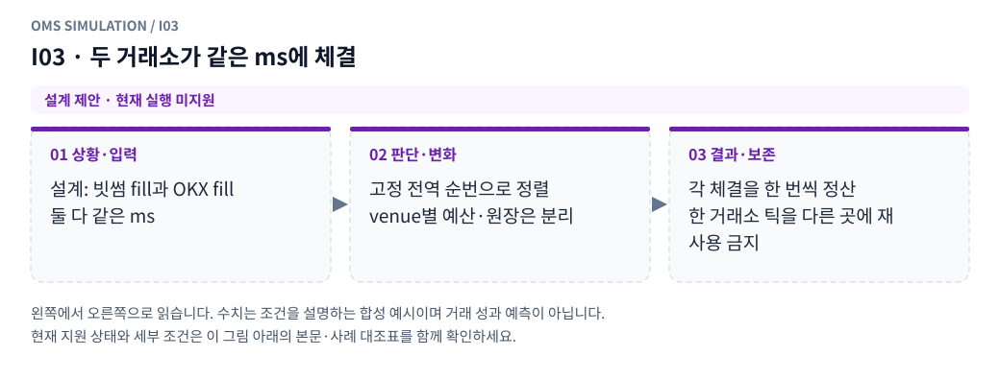

**그림 읽기:** 설계: 빗썸 fill과 OKX fill / 둘 다 같은 ms → 고정 전역 순번으로 정렬 / venue별 예산·원장은 분리 → 각 체결을 한 번씩 정산 / 한 거래소 틱을 다른 곳에 재사용 금지.

**원본 처리 제안:** 고정 전역 순서, 거래량·대기열·원장·통지는 venue별 분리

**현행 범위:** 별도 거래소·선물·통지·특수 주문 모형이 필요합니다. 해당 주문/제어 입력은 지원하지 않으며 대신 체결하지 않습니다. 세부 정책은 [실행 범위 본문](../limit_execution_coverage.ko.md)을 따른다.

I03 Mermaid 원본 보기

## I04 · 빗썸 매수 일부/전량, OKX 매도 지정가 미체결

**현재 상태: 설계 제안 · 현재 실행 미지원**

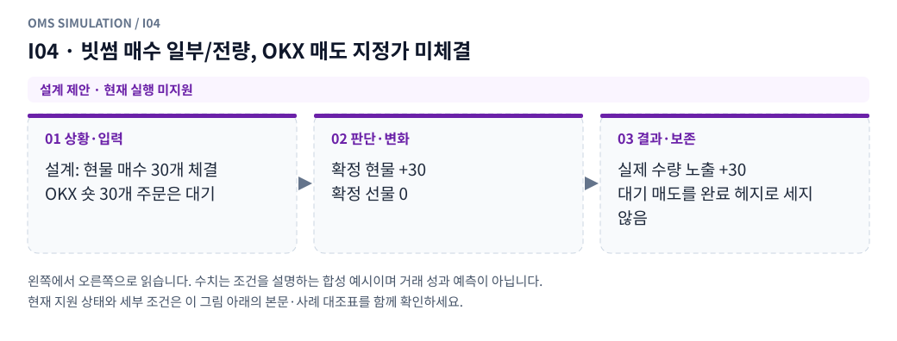

**그림 읽기:** 설계: 현물 매수 30개 체결 / OKX 숏 30개 주문은 대기 → 확정 현물 +30 / 확정 선물 0 → 실제 수량 노출 +30 / 대기 매도를 완료 헤지로 세지 않음.

**원본 처리 제안:** 현물만 증가, 실제 미헤지 유지

**현행 범위:** 별도 거래소·선물·통지·특수 주문 모형이 필요합니다. 해당 주문/제어 입력은 지원하지 않으며 대신 체결하지 않습니다. 세부 정책은 [실행 범위 본문](../limit_execution_coverage.ko.md)을 따른다.

I04 Mermaid 원본 보기

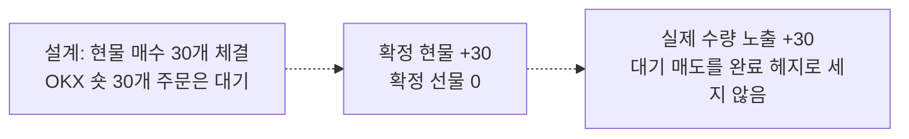

## I05 · 빗썸 매수 일부/전량, OKX 매도 일부체결

**현재 상태: 설계 제안 · 현재 실행 미지원**

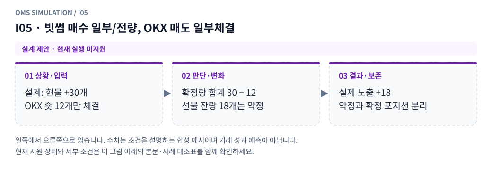

**그림 읽기:** 설계: 현물 +30개 / OKX 숏 12개만 체결 → 확정량 합계 30 − 12 / 선물 잔량 18개는 약정 → 실제 노출 +18 / 약정과 확정 포지션 분리.

**원본 처리 제안:** 수량 차이만큼 미헤지, 진행 잔량은 확정 포지션으로 세지 않음

**현행 범위:** 별도 거래소·선물·통지·특수 주문 모형이 필요합니다. 해당 주문/제어 입력은 지원하지 않으며 대신 체결하지 않습니다. 세부 정책은 [실행 범위 본문](../limit_execution_coverage.ko.md)을 따른다.

I05 Mermaid 원본 보기

## I06 · 빗썸 매수와 OKX 매도가 목표량만큼 완료

**현재 상태: 설계 제안 · 현재 실행 미지원**

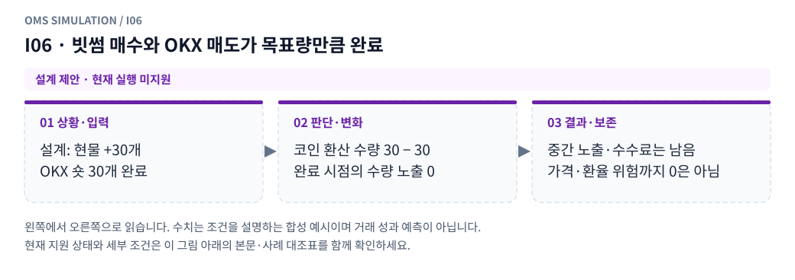

**그림 읽기:** 설계: 현물 +30개 / OKX 숏 30개 완료 → 코인 환산 수량 30 − 30 / 완료 시점의 수량 노출 0 → 중간 노출·수수료는 남음 / 가격·환율 위험까지 0은 아님.

**원본 처리 제안:** 그 시점 수량 기준 헤지 일치, 중간 노출·비용 별도

**현행 범위:** 별도 거래소·선물·통지·특수 주문 모형이 필요합니다. 해당 주문/제어 입력은 지원하지 않으며 대신 체결하지 않습니다. 세부 정책은 [실행 범위 본문](../limit_execution_coverage.ko.md)을 따른다.

I06 Mermaid 원본 보기

## I07 · 빗썸 매도 체결, 기존 OKX 숏의 매수 청산이 미체결

**현재 상태: 설계 제안 · 현재 실행 미지원**

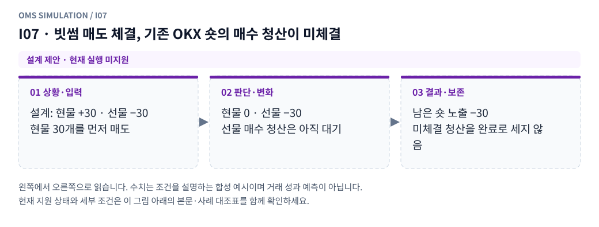

**그림 읽기:** 설계: 현물 +30 · 선물 −30 / 현물 30개를 먼저 매도 → 현물 0 · 선물 −30 / 선물 매수 청산은 아직 대기 → 남은 숏 노출 −30 / 미체결 청산을 완료로 세지 않음.

**원본 처리 제안:** 현물 감소 뒤 남는 숏 노출 추적

**현행 범위:** 별도 거래소·선물·통지·특수 주문 모형이 필요합니다. 해당 주문/제어 입력은 지원하지 않으며 대신 체결하지 않습니다. 세부 정책은 [실행 범위 본문](../limit_execution_coverage.ko.md)을 따른다.

I07 Mermaid 원본 보기

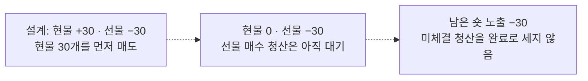

## I08 · 여러 현물 fill을 여러 OKX 가격에 분산

**현재 상태: 설계 제안 · 현재 실행 미지원**

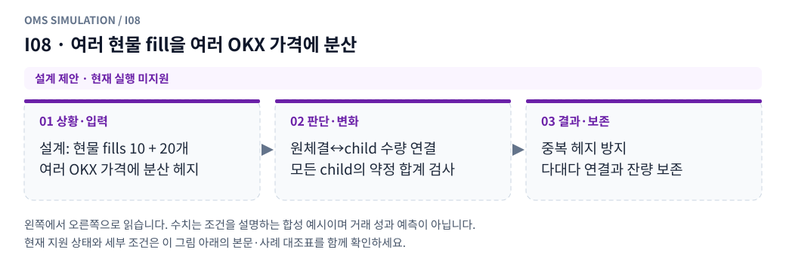

**그림 읽기:** 설계: 현물 fills 10 + 20개 / 여러 OKX 가격에 분산 헤지 → 원체결↔child 수량 연결 / 모든 child의 약정 합계 검사 → 중복 헤지 방지 / 다대다 연결과 잔량 보존.

**원본 처리 제안:** 목표 배분·모든 child 약정·다대다 인과 연결 보존

**현행 범위:** 별도 거래소·선물·통지·특수 주문 모형이 필요합니다. 해당 주문/제어 입력은 지원하지 않으며 대신 체결하지 않습니다. 세부 정책은 [실행 범위 본문](../limit_execution_coverage.ko.md)을 따른다.

I08 Mermaid 원본 보기

## I09 · OKX fill 통지 지연 중 현물 추가체결

**현재 상태: 설계 제안 · 현재 실행 미지원**

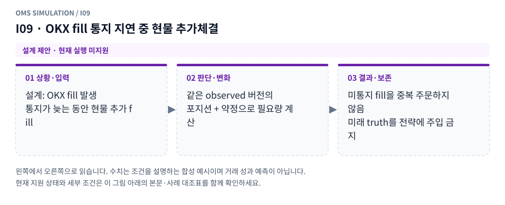

**그림 읽기:** 설계: OKX fill 발생 / 통지가 늦는 동안 현물 추가 fill → 같은 observed 버전의 / 포지션 + 약정으로 필요량 계산 → 미통지 fill을 중복 주문하지 않음 / 미래 truth를 전략에 주입 금지.

**원본 처리 제안:** 같은 observed projection의 포지션+전체 약정으로 추가량 계산

**현행 범위:** 별도 거래소·선물·통지·특수 주문 모형이 필요합니다. 해당 주문/제어 입력은 지원하지 않으며 대신 체결하지 않습니다. 세부 정책은 [실행 범위 본문](../limit_execution_coverage.ko.md)을 따른다.

I09 Mermaid 원본 보기

## I10 · 현물 매수30→OKX 매도30 대기→현물 매도30으로 목표0

**현재 상태: 설계 제안 · 현재 실행 미지원**

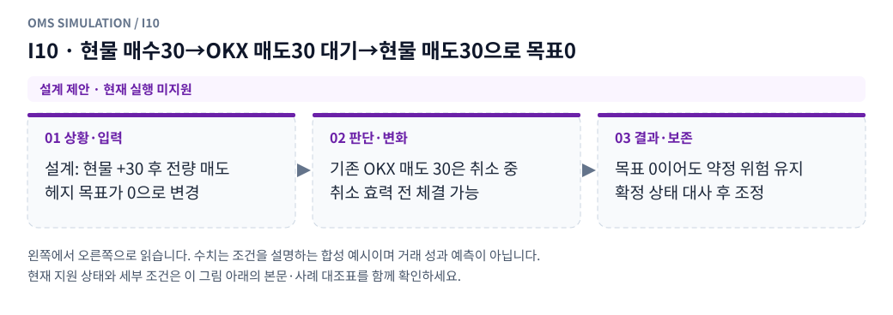

**그림 읽기:** 설계: 현물 +30 후 전량 매도 / 헤지 목표가 0으로 변경 → 기존 OKX 매도 30은 취소 중 / 취소 효력 전 체결 가능 → 목표 0이어도 약정 위험 유지 / 확정 상태 대사 후 조정.

**원본 처리 제안:** 기존 매도 취소 효력 전 체결 가능성 유지, 필요 조정을 대사 후 생성

**현행 범위:** 별도 거래소·선물·통지·특수 주문 모형이 필요합니다. 해당 주문/제어 입력은 지원하지 않으며 대신 체결하지 않습니다. 세부 정책은 [실행 범위 본문](../limit_execution_coverage.ko.md)을 따른다.

I10 Mermaid 원본 보기

## I11 · 목표0 후 기존 매도 fill과 반대 매수 조정이 엇갈림

**현재 상태: 설계 제안 · 현재 실행 미지원**

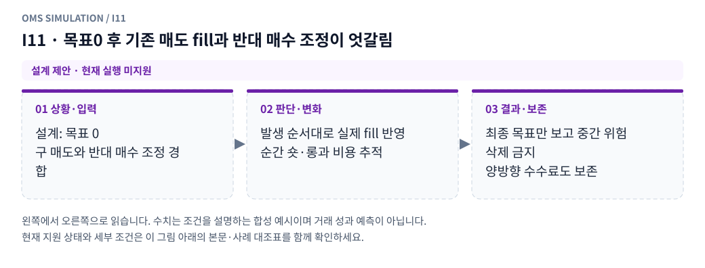

**그림 읽기:** 설계: 목표 0 / 구 매도와 반대 매수 조정 경합 → 발생 순서대로 실제 fill 반영 / 순간 숏·롱과 비용 추적 → 최종 목표만 보고 중간 위험 삭제 금지 / 양방향 수수료도 보존.

**원본 처리 제안:** 체결 순서별 실제 포지션·약정·수수료 계산, 목표값만으로 위험 제거 금지

**현행 범위:** 별도 거래소·선물·통지·특수 주문 모형이 필요합니다. 해당 주문/제어 입력은 지원하지 않으며 대신 체결하지 않습니다. 세부 정책은 [실행 범위 본문](../limit_execution_coverage.ko.md)을 따른다.

I11 Mermaid 원본 보기

## I12 · 한 거래소 자료 공백/거절/거래 중단, 다른 쪽은 정상

**현재 상태: 설계 제안 · 현재 실행 미지원**

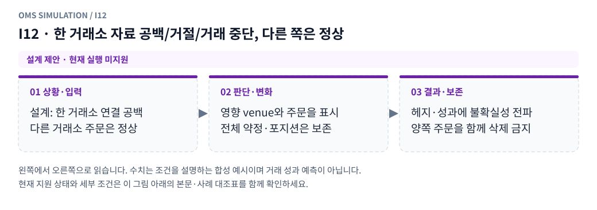

**그림 읽기:** 설계: 한 거래소 연결 공백 / 다른 거래소 주문은 정상 → 영향 venue와 주문을 표시 / 전체 약정·포지션은 보존 → 헤지·성과에 불확실성 전파 / 양쪽 주문을 함께 삭제 금지.

**원본 처리 제안:** 주문·계좌 상태를 함께 삭제하지 않음, 영향을 헤지·성과 품질에 전파

**현행 범위:** 별도 거래소·선물·통지·특수 주문 모형이 필요합니다. 해당 주문/제어 입력은 지원하지 않으며 대신 체결하지 않습니다. 세부 정책은 [실행 범위 본문](../limit_execution_coverage.ko.md)을 따른다.

I12 Mermaid 원본 보기

