# J. ACK·체결·계좌 통지 — 사례별 설명 그림

[그림 안내](../visual_guide.ko.md) · [원본 사례 목록](../point2_limit_fill_cases.ko.md) · [현재 실행 범위](../limit_execution_coverage.ko.md)

각 그림은 해당 조건에서의 흐름을 설명한다. **설계 제안·현재 실행 미지원** 표시는 향후 동작이며, 부분 지원은 전체 동작의 구현을 뜻하지 않는다. 원본 제안과 현행 동작이 다르면 그림 아래 구분을 따른다.

모든 수치 예시는 명시한 선행 물량 외에 더 우선한 물량이 없고, 별도 언급이 없으면 지연·수수료·규격 제한을 생략한 합성 상황이다. 실제 체결 확률이나 성과 예측이 아니다.

[J01](#j01) | [J02](#j02) | [J03](#j03) | [J04](#j04) | [J05](#j05) | [J06](#j06) | [J07](#j07) | [J08](#j08) | [J09](#j09) | [J10](#j10)

## J01 · ACK→fill→account 순서 정상

**현재 상태: 부분 지원 · 설계와 현행 범위 구분**

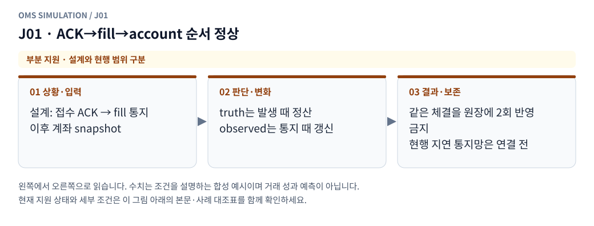

**그림 읽기:** 설계: 접수 ACK → fill 통지 / 이후 계좌 snapshot → truth는 발생 때 정산 / observed는 통지 때 갱신 → 같은 체결을 원장에 2회 반영 금지 / 현행 지연 통지망은 연결 전.

**원본 처리 제안:** truth는 fill 발생 때 한 번, observed는 통지 때 갱신

**현행 범위:** 현재 현물 모형의 일부 분기만 지원합니다. native 정정·수신 역전 복원·미관측 데이터는 구현으로 간주하지 않습니다. 세부 정책은 [실행 범위 본문](../limit_execution_coverage.ko.md)을 따른다.

J01 Mermaid 원본 보기

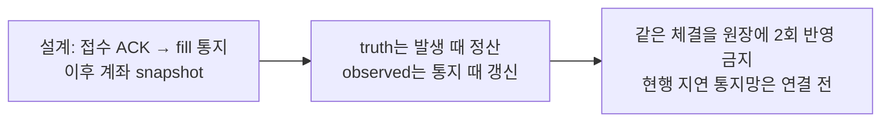

## J02 · fill 통지가 ACK보다 먼저 도착

**현재 상태: 설계 제안 · 현재 실행 미지원**

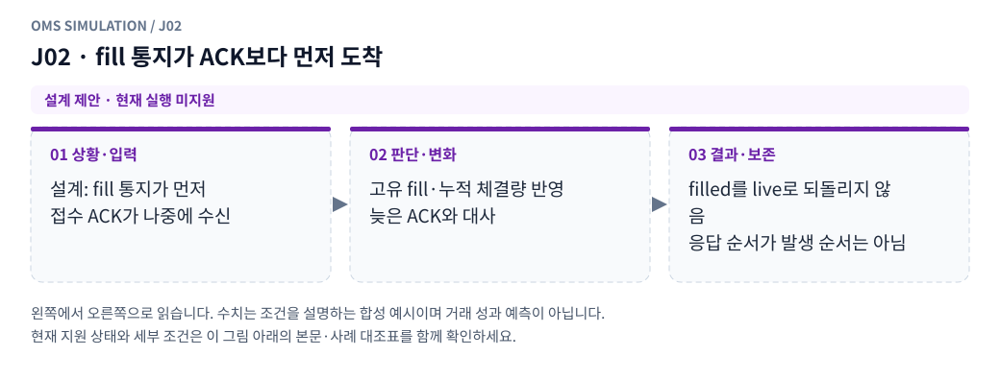

**그림 읽기:** 설계: fill 통지가 먼저 / 접수 ACK가 나중에 수신 → 고유 fill·누적 체결량 반영 / 늦은 ACK와 대사 → filled를 live로 되돌리지 않음 / 응답 순서가 발생 순서는 아님.

**원본 처리 제안:** 누적체결·고유 fill 처리, 뒤 ACK로 LIVE 복원 금지

**현행 범위:** 별도 거래소·선물·통지·특수 주문 모형이 필요합니다. 해당 주문/제어 입력은 지원하지 않으며 대신 체결하지 않습니다. 세부 정책은 [실행 범위 본문](../limit_execution_coverage.ko.md)을 따른다.

J02 Mermaid 원본 보기

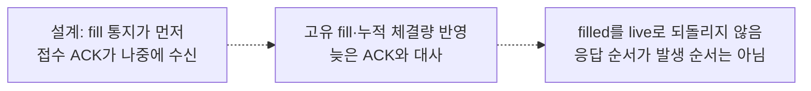

## J03 · 최신 ACK 뒤 낮은 버전의 고유 fill 도착

**현재 상태: 설계 제안 · 현재 실행 미지원**

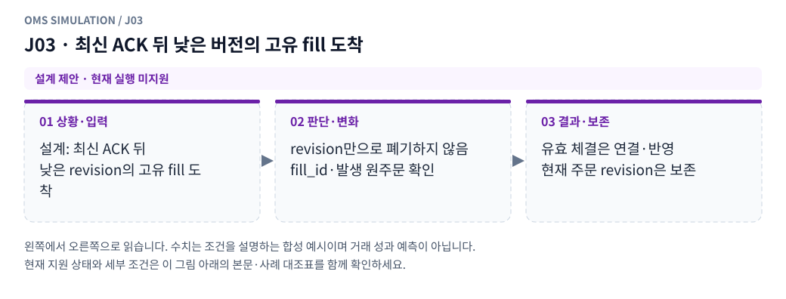

**그림 읽기:** 설계: 최신 ACK 뒤 / 낮은 revision의 고유 fill 도착 → revision만으로 폐기하지 않음 / fill_id·발생 원주문 확인 → 유효 체결은 연결·반영 / 현재 주문 revision은 보존.

**원본 처리 제안:** 전역 버전만 보고 fill을 버리지 않음

**현행 범위:** 별도 거래소·선물·통지·특수 주문 모형이 필요합니다. 해당 주문/제어 입력은 지원하지 않으며 대신 체결하지 않습니다. 세부 정책은 [실행 범위 본문](../limit_execution_coverage.ko.md)을 따른다.

J03 Mermaid 원본 보기

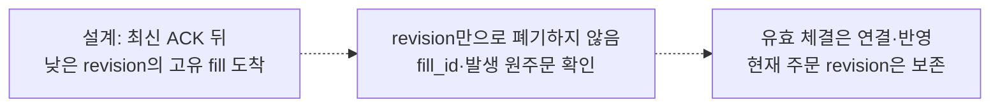

## J04 · 같은 fill 통지 중복

**현재 상태: 설계 제안 · 현재 실행 미지원**

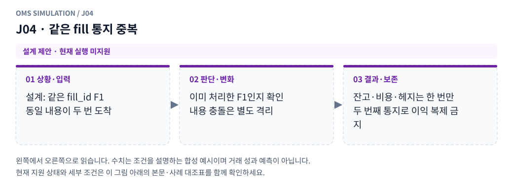

**그림 읽기:** 설계: 같은 fill_id F1 / 동일 내용이 두 번 도착 → 이미 처리한 F1인지 확인 / 내용 충돌은 별도 격리 → 잔고·비용·헤지는 한 번만 / 두 번째 통지로 이익 복제 금지.

**원본 처리 제안:** fill_id coverage로 잔고·헤지·비용 중복 반영 금지

**현행 범위:** 별도 거래소·선물·통지·특수 주문 모형이 필요합니다. 해당 주문/제어 입력은 지원하지 않으며 대신 체결하지 않습니다. 세부 정책은 [실행 범위 본문](../limit_execution_coverage.ko.md)을 따른다.

J04 Mermaid 원본 보기

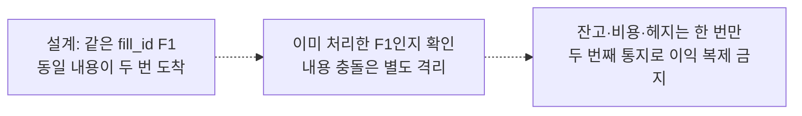

## J05 · account snapshot이 fill을 먼저 포함

**현재 상태: 설계 제안 · 현재 실행 미지원**

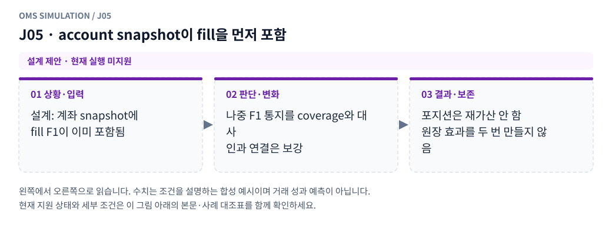

**그림 읽기:** 설계: 계좌 snapshot에 / fill F1이 이미 포함됨 → 나중 F1 통지를 coverage와 대사 / 인과 연결은 보강 → 포지션은 재가산 안 함 / 원장 효과를 두 번 만들지 않음.

**원본 처리 제안:** 후속 fill은 인과 연결하되 포지션 재가산 금지

**현행 범위:** 별도 거래소·선물·통지·특수 주문 모형이 필요합니다. 해당 주문/제어 입력은 지원하지 않으며 대신 체결하지 않습니다. 세부 정책은 [실행 범위 본문](../limit_execution_coverage.ko.md)을 따른다.

J05 Mermaid 원본 보기

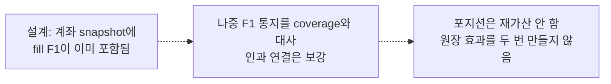

## J06 · 취소 통지가 fill 통지보다 먼저 도착

**현재 상태: 설계 제안 · 현재 실행 미지원**

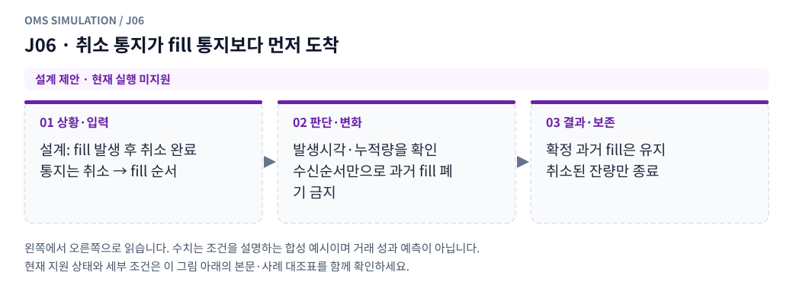

**그림 읽기:** 설계: fill 발생 후 취소 완료 / 통지는 취소 → fill 순서 → 발생시각·누적량을 확인 / 수신순서만으로 과거 fill 폐기 금지 → 확정 과거 fill은 유지 / 취소된 잔량만 종료.

**원본 처리 제안:** 발생시각·누적량으로 대사, 과거 유효 fill 유지

**현행 범위:** 별도 거래소·선물·통지·특수 주문 모형이 필요합니다. 해당 주문/제어 입력은 지원하지 않으며 대신 체결하지 않습니다. 세부 정책은 [실행 범위 본문](../limit_execution_coverage.ko.md)을 따른다.

J06 Mermaid 원본 보기

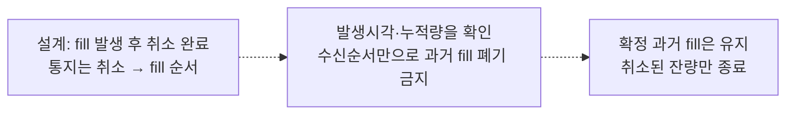

## J07 · 일부 child 통지만 늦거나 빠짐

**현재 상태: 설계 제안 · 현재 실행 미지원**

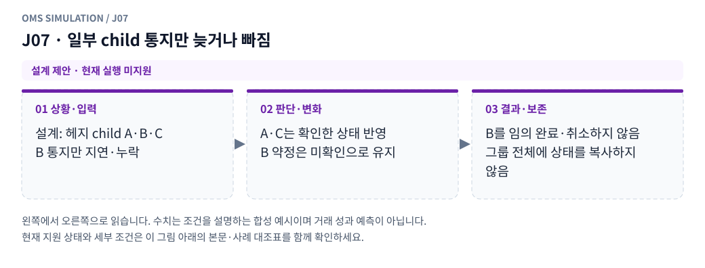

**그림 읽기:** 설계: 헤지 child A·B·C / B 통지만 지연·누락 → A·C는 확인한 상태 반영 / B 약정은 미확인으로 유지 → B를 임의 완료·취소하지 않음 / 그룹 전체에 상태를 복사하지 않음.

**원본 처리 제안:** 해당 그룹 미확인 약정 유지, 다른 child 상태와 혼합 금지

**현행 범위:** 별도 거래소·선물·통지·특수 주문 모형이 필요합니다. 해당 주문/제어 입력은 지원하지 않으며 대신 체결하지 않습니다. 세부 정책은 [실행 범위 본문](../limit_execution_coverage.ko.md)을 따른다.

J07 Mermaid 원본 보기

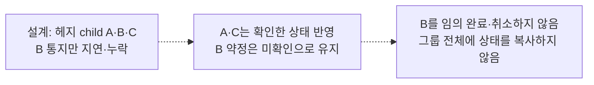

## J08 · truth 일부체결, observed는 여전히 전체 약정

**현재 상태: 설계 제안 · 현재 실행 미지원**

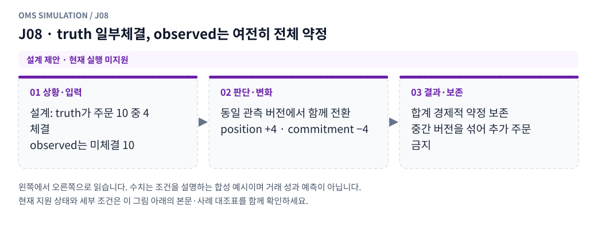

**그림 읽기:** 설계: truth가 주문 10 중 4 체결 / observed는 미체결 10 → 동일 관측 버전에서 함께 전환 / position +4 · commitment −4 → 합계 경제적 약정 보존 / 중간 버전을 섞어 추가 주문 금지.

**원본 처리 제안:** position/commitment를 같은 projection에서 함께 전환

**현행 범위:** 별도 거래소·선물·통지·특수 주문 모형이 필요합니다. 해당 주문/제어 입력은 지원하지 않으며 대신 체결하지 않습니다. 세부 정책은 [실행 범위 본문](../limit_execution_coverage.ko.md)을 따른다.

J08 Mermaid 원본 보기

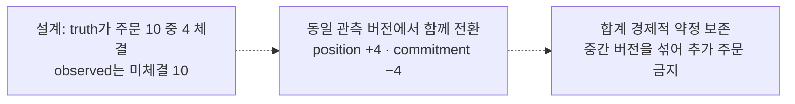

## J09 · 전송 응답 timeout/접수 상태 관측 불가

**현재 상태: 설계 제안 · 현재 실행 미지원**

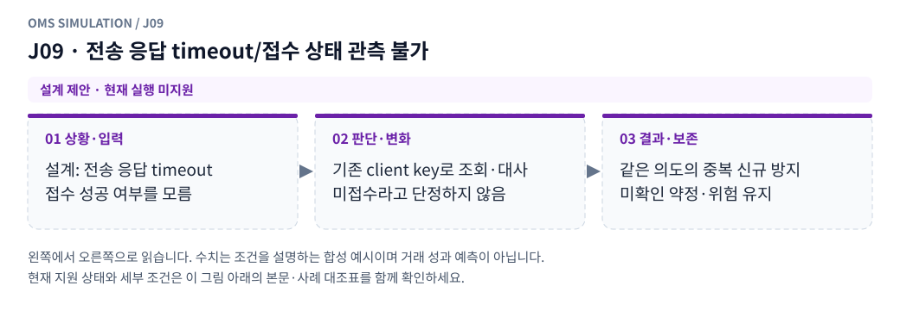

**그림 읽기:** 설계: 전송 응답 timeout / 접수 성공 여부를 모름 → 기존 client key로 조회·대사 / 미접수라고 단정하지 않음 → 같은 의도의 중복 신규 방지 / 미확인 약정·위험 유지.

**원본 처리 제안:** 자동 미접수·자동 재주문으로 단정하지 않고 멱등 조회/가상 정합 정책

**현행 범위:** 별도 거래소·선물·통지·특수 주문 모형이 필요합니다. 해당 주문/제어 입력은 지원하지 않으며 대신 체결하지 않습니다. 세부 정책은 [실행 범위 본문](../limit_execution_coverage.ko.md)을 따른다.

J09 Mermaid 원본 보기

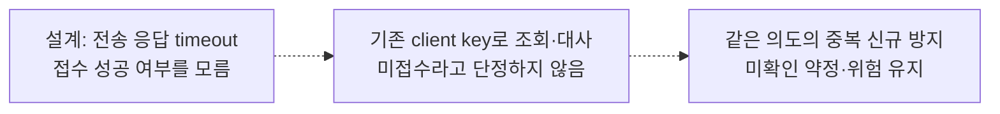

## J10 · refresh가 지연되고 서로 다른 계좌/주문 버전을 반환

**현재 상태: 설계 제안 · 현재 실행 미지원**

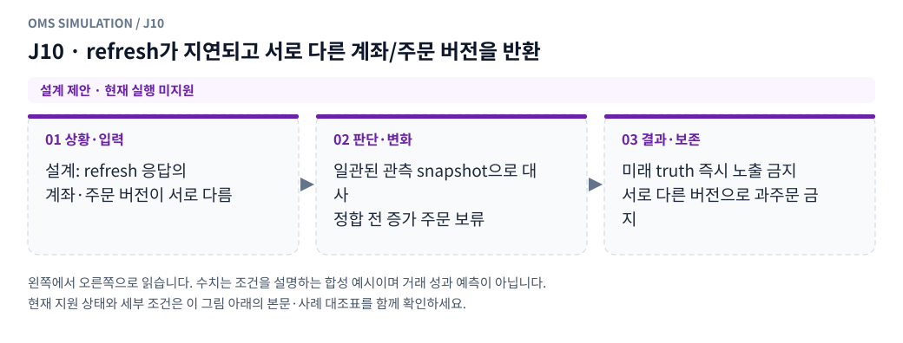

**그림 읽기:** 설계: refresh 응답의 / 계좌·주문 버전이 서로 다름 → 일관된 관측 snapshot으로 대사 / 정합 전 증가 주문 보류 → 미래 truth 즉시 노출 금지 / 서로 다른 버전으로 과주문 금지.

**원본 처리 제안:** 정합 전 새 증가 의도 보류, 미래 truth 즉시 반환 금지

**현행 범위:** 별도 거래소·선물·통지·특수 주문 모형이 필요합니다. 해당 주문/제어 입력은 지원하지 않으며 대신 체결하지 않습니다. 세부 정책은 [실행 범위 본문](../limit_execution_coverage.ko.md)을 따른다.

J10 Mermaid 원본 보기

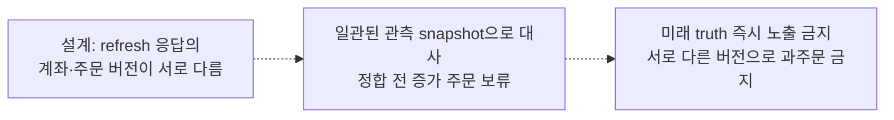

