# K. 자료·깊이·정합 불확실성 — 사례별 설명 그림

[그림 안내](../visual_guide.ko.md) · [원본 사례 목록](../point2_limit_fill_cases.ko.md) · [현재 실행 범위](../limit_execution_coverage.ko.md)

각 그림은 해당 조건에서의 흐름을 설명한다. **설계 제안·현재 실행 미지원** 표시는 향후 동작이며, 부분 지원은 전체 동작의 구현을 뜻하지 않는다. 원본 제안과 현행 동작이 다르면 그림 아래 구분을 따른다.

모든 수치 예시는 명시한 선행 물량 외에 더 우선한 물량이 없고, 별도 언급이 없으면 지연·수수료·규격 제한을 생략한 합성 상황이다. 실제 체결 확률이나 성과 예측이 아니다.

[K01](#k01) | [K02](#k02) | [K03](#k03) | [K04](#k04) | [K05](#k05) | [K06](#k06) | [K07](#k07) | [K08](#k08) | [K09](#k09) | [K10](#k10) | [K11](#k11) | [K12](#k12)

## K01 · OKX passive 주문이 있는데 OKX tick 없음

**현재 상태: 실행·차단 연결**

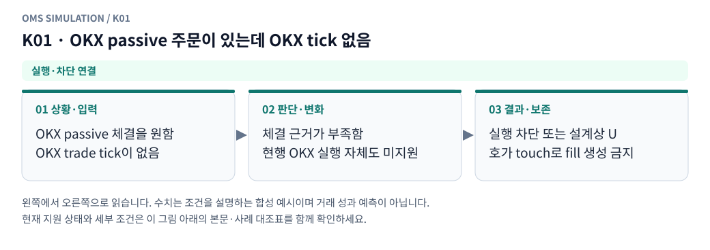

**그림 읽기:** OKX passive 체결을 원함 / OKX trade tick이 없음 → 체결 근거가 부족함 / 현행 OKX 실행 자체도 미지원 → 실행 차단 또는 설계상 U / 호가 touch로 fill 생성 금지.

**원본 처리 제안:** 실행 차단 또는 U, book touch로 확정 체결 금지

**현행 범위:** 현재 현물 재생기에 해당 분기 또는 명시적 사전 차단을 연결했습니다. 거래소 선물까지 지원한다는 뜻은 아닙니다. 세부 정책은 [실행 범위 본문](../limit_execution_coverage.ko.md)을 따른다.

K01 Mermaid 원본 보기

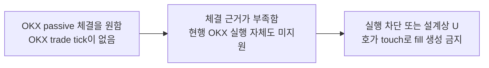

## K02 · tick의 공격 방향 미확인

**현재 상태: 실행·차단 연결**

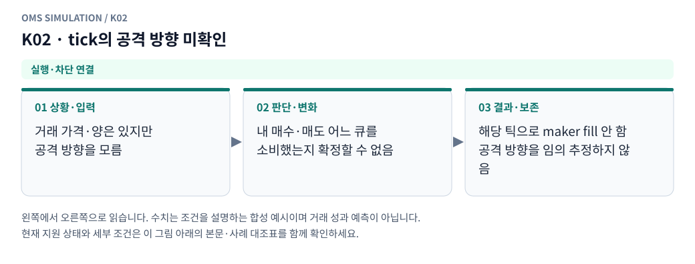

**그림 읽기:** 거래 가격·양은 있지만 / 공격 방향을 모름 → 내 매수·매도 어느 큐를 / 소비했는지 확정할 수 없음 → 해당 틱으로 maker fill 안 함 / 공격 방향을 임의 추정하지 않음.

**원본 처리 제안:** 방향을 임의 추정해 확정 fill 생성 금지

**현행 범위:** 현재 현물 재생기에 해당 분기 또는 명시적 사전 차단을 연결했습니다. 거래소 선물까지 지원한다는 뜻은 아닙니다. 세부 정책은 [실행 범위 본문](../limit_execution_coverage.ko.md)을 따른다.

K02 Mermaid 원본 보기

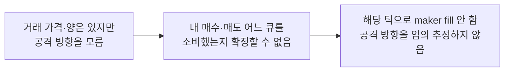

## K03 · 호가 금액/코인/계약 수 단위 미확인

**현재 상태: 부분 지원 · 설계와 현행 범위 구분**

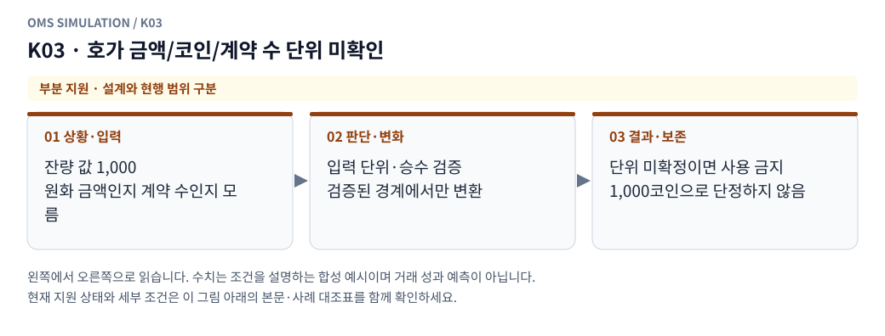

**그림 읽기:** 잔량 값 1,000 / 원화 금액인지 계약 수인지 모름 → 입력 단위·승수 검증 / 검증된 경계에서만 변환 → 단위 미확정이면 사용 금지 / 1,000코인으로 단정하지 않음.

**원본 처리 제안:** 단위 검증 실패, 잘못된 가용량 사용 금지

**현행 범위:** 현재 현물 모형의 일부 분기만 지원합니다. native 정정·수신 역전 복원·미관측 데이터는 구현으로 간주하지 않습니다. 세부 정책은 [실행 범위 본문](../limit_execution_coverage.ko.md)을 따른다.

K03 Mermaid 원본 보기

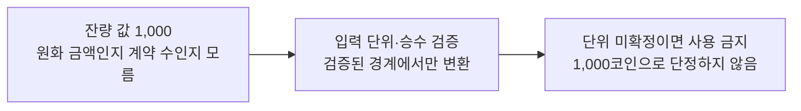

## K04 · 동일 시각·가격·수량의 여러 원본 행

**현재 상태: 실행·차단 연결**

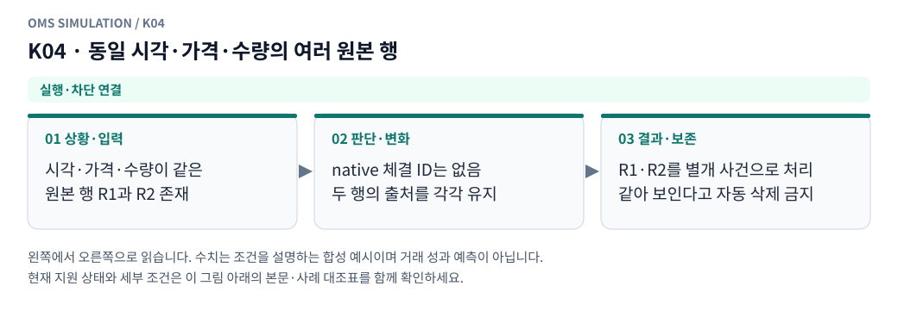

**그림 읽기:** 시각·가격·수량이 같은 / 원본 행 R1과 R2 존재 → native 체결 ID는 없음 / 두 행의 출처를 각각 유지 → R1·R2를 별개 사건으로 처리 / 같아 보인다고 자동 삭제 금지.

**원본 처리 제안:** 신뢰 가능한 ID 없이 자동 중복 제거 금지

**현행 범위:** 현재 현물 재생기에 해당 분기 또는 명시적 사전 차단을 연결했습니다. 거래소 선물까지 지원한다는 뜻은 아닙니다. 세부 정책은 [실행 범위 본문](../limit_execution_coverage.ko.md)을 따른다.

K04 Mermaid 원본 보기

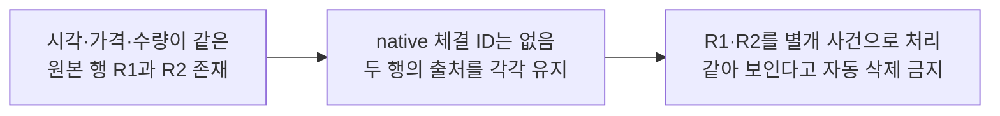

## K05 · 진짜 중복 파일/중복 수집이 확인됨

**현재 상태: 부분 지원 · 설계와 현행 범위 구분**

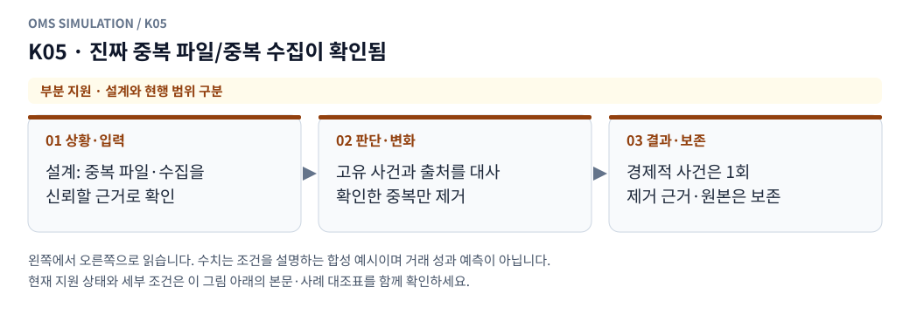

**그림 읽기:** 설계: 중복 파일·수집을 / 신뢰할 근거로 확인 → 고유 사건과 출처를 대사 / 확인한 중복만 제거 → 경제적 사건은 1회 / 제거 근거·원본은 보존.

**원본 처리 제안:** 확인 근거로 1회 처리, 제거 내역 보존

**현행 범위:** 현재 현물 모형의 일부 분기만 지원합니다. native 정정·수신 역전 복원·미관측 데이터는 구현으로 간주하지 않습니다. 세부 정책은 [실행 범위 본문](../limit_execution_coverage.ko.md)을 따른다.

K05 Mermaid 원본 보기

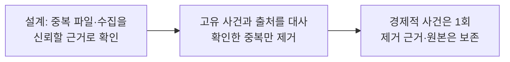

## K06 · heartbeat/연결 기록으로 확인된 자료 공백

**현재 상태: 설계 제안 · 현재 실행 미지원**

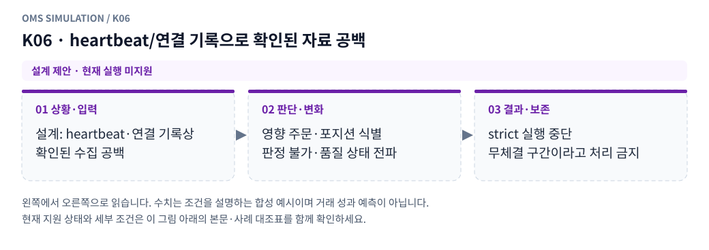

**그림 읽기:** 설계: heartbeat·연결 기록상 / 확인된 수집 공백 → 영향 주문·포지션 식별 / 판정 불가·품질 상태 전파 → strict 실행 중단 / 무체결 구간이라고 처리 금지.

**원본 처리 제안:** 영향 주문·포지션에 U/품질 전파, strict 중단

**현행 범위:** 별도 거래소·선물·통지·특수 주문 모형이 필요합니다. 해당 주문/제어 입력은 지원하지 않으며 대신 체결하지 않습니다. 세부 정책은 [실행 범위 본문](../limit_execution_coverage.ko.md)을 따른다.

K06 Mermaid 원본 보기

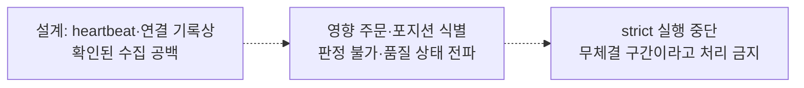

## K07 · 단순히 한동안 tick이 없음

**현재 상태: 실행·차단 연결**

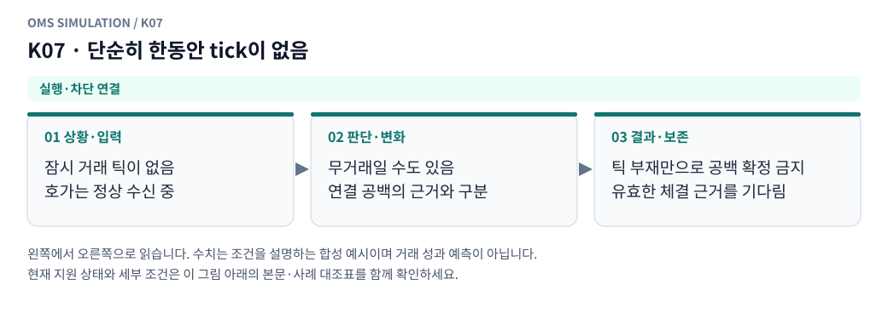

**그림 읽기:** 잠시 거래 틱이 없음 / 호가는 정상 수신 중 → 무거래일 수도 있음 / 연결 공백의 근거와 구분 → 틱 부재만으로 공백 확정 금지 / 유효한 체결 근거를 기다림.

**원본 처리 제안:** 무체결을 수집 공백으로 자동 단정하지 않음

**현행 범위:** 현재 현물 재생기에 해당 분기 또는 명시적 사전 차단을 연결했습니다. 거래소 선물까지 지원한다는 뜻은 아닙니다. 세부 정책은 [실행 범위 본문](../limit_execution_coverage.ko.md)을 따른다.

K07 Mermaid 원본 보기

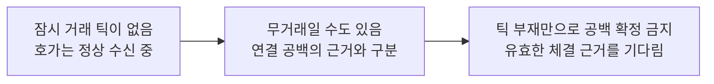

## K08 · 늦은 tick으로 정합 창이 지난 감소가 설명됨

**현재 상태: 설계 제안 · 현재 실행 미지원**

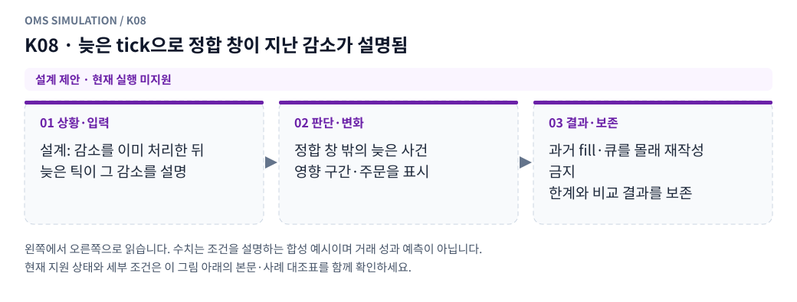

**그림 읽기:** 설계: 감소를 이미 처리한 뒤 / 늦은 틱이 그 감소를 설명 → 정합 창 밖의 늦은 사건 / 영향 구간·주문을 표시 → 과거 fill·큐를 몰래 재작성 금지 / 한계와 비교 결과를 보존.

**원본 처리 제안:** 과거 체결·큐를 몰래 재작성하지 않고 영향 플래그

**현행 범위:** 별도 거래소·선물·통지·특수 주문 모형이 필요합니다. 해당 주문/제어 입력은 지원하지 않으며 대신 체결하지 않습니다. 세부 정책은 [실행 범위 본문](../limit_execution_coverage.ko.md)을 따른다.

K08 Mermaid 원본 보기

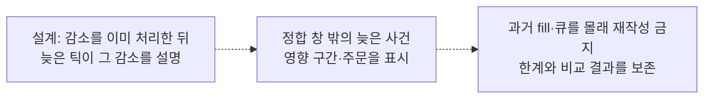

## K09 · snapshot 반복·증가 때 self 부채와 public 부채를 혼동

**현재 상태: 명시적 모형 가정**

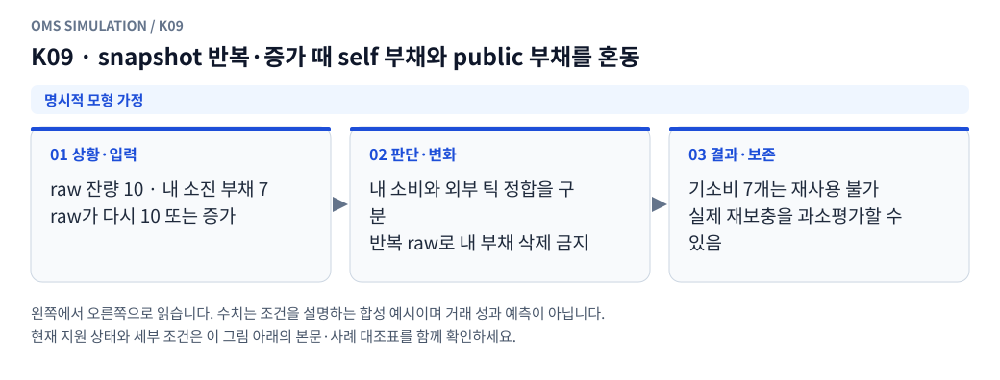

**그림 읽기:** raw 잔량 10 · 내 소진 부채 7 / raw가 다시 10 또는 증가 → 내 소비와 외부 틱 정합을 구분 / 반복 raw로 내 부채 삭제 금지 → 기소비 7개는 재사용 불가 / 실제 재보충을 과소평가할 수 있음.

**원본 처리 제안:** 내 소진은 원본 감소로 소거하지 않음, 이중 보충 금지

**현행 범위:** 설정한 합성 현물 프로필의 가정으로 처리합니다. 실제 거래소의 과거 규칙이나 순서를 확인했다는 뜻이 아닙니다. 세부 정책은 [실행 범위 본문](../limit_execution_coverage.ko.md)을 따른다.

K09 Mermaid 원본 보기

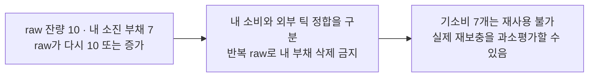

## K10 · top-N 이탈인지 실제 가격대0인지 모름

**현재 상태: 부분 지원 · 설계와 현행 범위 구분**

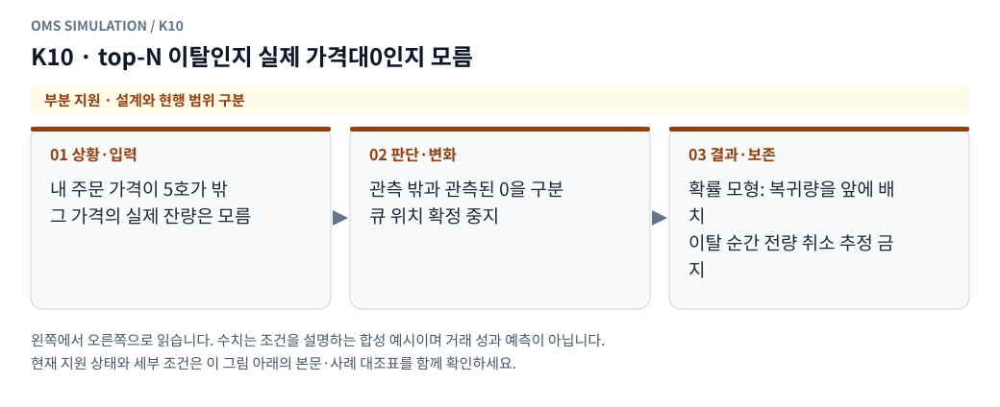

**그림 읽기:** 내 주문 가격이 5호가 밖 / 그 가격의 실제 잔량은 모름 → 관측 밖과 관측된 0을 구분 / 큐 위치 확정 중지 → 확률 모형: 복귀량을 앞에 배치 / 이탈 순간 전량 취소 추정 금지.

**원본 처리 제안:** 큐·생명주기 초기화 금지, 관측 범위 상태 보존

**현행 범위:** 현재 현물 모형의 일부 분기만 지원합니다. native 정정·수신 역전 복원·미관측 데이터는 구현으로 간주하지 않습니다. 세부 정책은 [실행 범위 본문](../limit_execution_coverage.ko.md)을 따른다.

K10 Mermaid 원본 보기

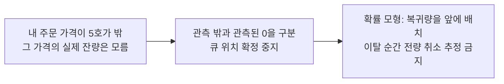

## K11 · 동시각 교차 스트림 순서가 실제로 미확인

**현재 상태: 명시적 모형 가정**

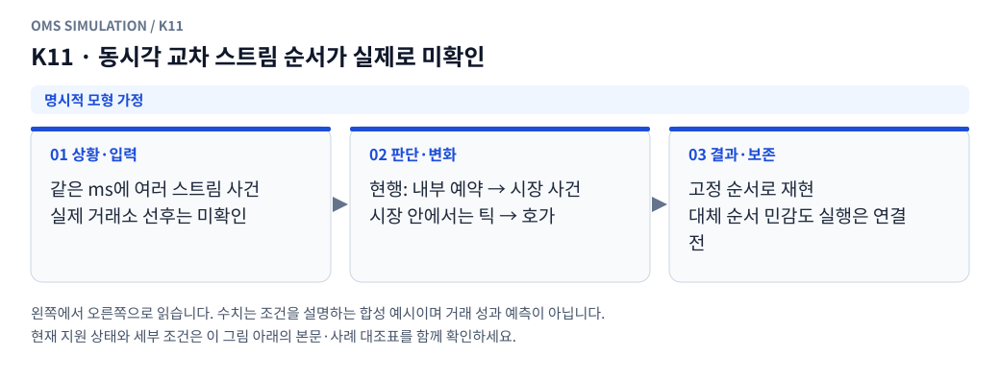

**그림 읽기:** 같은 ms에 여러 스트림 사건 / 실제 거래소 선후는 미확인 → 현행: 내부 예약 → 시장 사건 / 시장 안에서는 틱 → 호가 → 고정 순서로 재현 / 대체 순서 민감도 실행은 연결 전.

**원본 처리 제안:** 고정 순서와 대체 순서 비교, 실제 선후를 안다고 표시 안 함

**현행 범위:** 설정한 합성 현물 프로필의 가정으로 처리합니다. 실제 거래소의 과거 규칙이나 순서를 확인했다는 뜻이 아닙니다. 세부 정책은 [실행 범위 본문](../limit_execution_coverage.ko.md)을 따른다.

K11 Mermaid 원본 보기

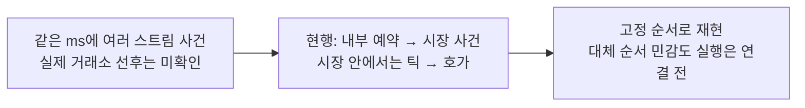

## K12 · 과거 규격·평가가격·환율 중 필수 정보 미확인

**현재 상태: 부분 지원 · 설계와 현행 범위 구분**

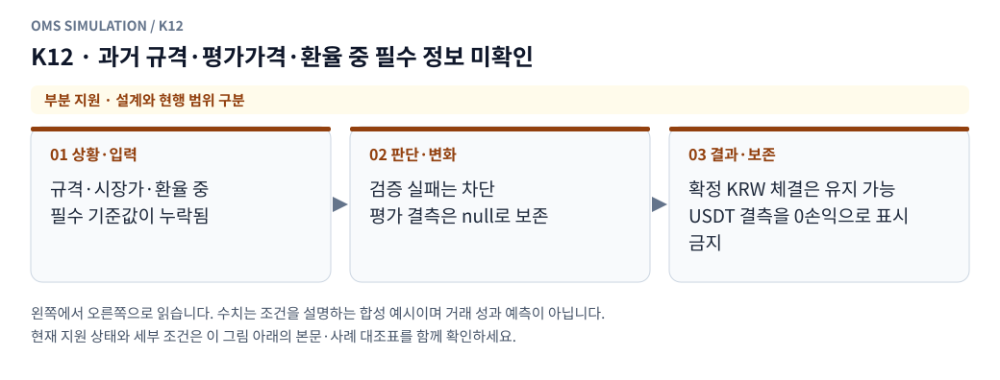

**그림 읽기:** 규격·시장가·환율 중 / 필수 기준값이 누락됨 → 검증 실패는 차단 / 평가 결측은 null로 보존 → 확정 KRW 체결은 유지 가능 / USDT 결측을 0손익으로 표시 금지.

**원본 처리 제안:** 허용 가정 표시/실행 차단, 손익·노출을 임의0으로 채우지 않음

**현행 범위:** 현재 현물 모형의 일부 분기만 지원합니다. native 정정·수신 역전 복원·미관측 데이터는 구현으로 간주하지 않습니다. 세부 정책은 [실행 범위 본문](../limit_execution_coverage.ko.md)을 따른다.

K12 Mermaid 원본 보기

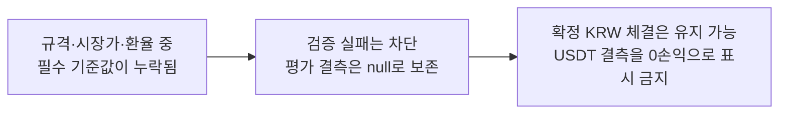

