# L. 종료·확장·지원 경계 — 사례별 설명 그림

[그림 안내](../visual_guide.ko.md) · [원본 사례 목록](../point2_limit_fill_cases.ko.md) · [현재 실행 범위](../limit_execution_coverage.ko.md)

각 그림은 해당 조건에서의 흐름을 설명한다. **설계 제안·현재 실행 미지원** 표시는 향후 동작이며, 부분 지원은 전체 동작의 구현을 뜻하지 않는다. 원본 제안과 현행 동작이 다르면 그림 아래 구분을 따른다.

모든 수치 예시는 명시한 선행 물량 외에 더 우선한 물량이 없고, 별도 언급이 없으면 지연·수수료·규격 제한을 생략한 합성 상황이다. 실제 체결 확률이나 성과 예측이 아니다.

[L01](#l01) | [L02](#l02) | [L03](#l03) | [L04](#l04) | [L05](#l05) | [L06](#l06) | [L07](#l07) | [L08](#l08) | [L09](#l09) | [L10](#l10)

## L01 · 평가 종료 때 주문 live/in-flight/cancel-pending

**현재 상태: 명시적 모형 가정**

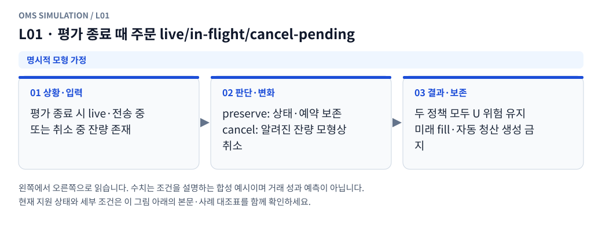

**그림 읽기:** 평가 종료 시 live·전송 중 / 또는 취소 중 잔량 존재 → preserve: 상태·예약 보존 / cancel: 알려진 잔량 모형상 취소 → 두 정책 모두 U 위험 유지 / 미래 fill·자동 청산 생성 금지.

**원본 처리 제안:** 상태·예약·미통지 fill·미완료 헤지 보존, 미래 체결로 완료 안 함

**현행 범위:** 설정한 합성 현물 프로필의 가정으로 처리합니다. 실제 거래소의 과거 규칙이나 순서를 확인했다는 뜻이 아닙니다. 세부 정책은 [실행 범위 본문](../limit_execution_coverage.ko.md)을 따른다.

L01 Mermaid 원본 보기

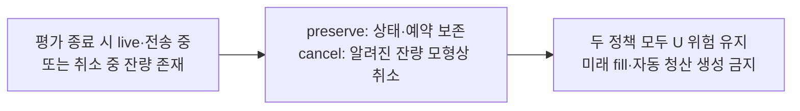

## L02 · 사용자가 pause/stop

**현재 상태: 명시적 모형 가정**

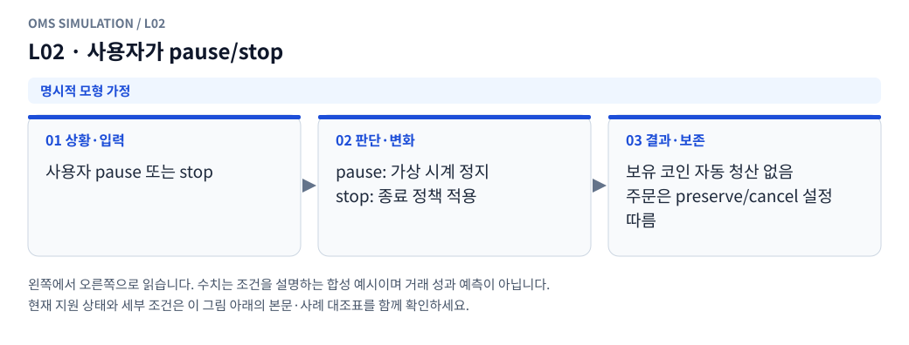

**그림 읽기:** 사용자 pause 또는 stop → pause: 가상 시계 정지 / stop: 종료 정책 적용 → 보유 코인 자동 청산 없음 / 주문은 preserve/cancel 설정 따름.

**원본 처리 제안:** 시계/작업 제어만 수행, 자동 거래소 취소·청산으로 바꾸지 않음

**현행 범위:** 설정한 합성 현물 프로필의 가정으로 처리합니다. 실제 거래소의 과거 규칙이나 순서를 확인했다는 뜻이 아닙니다. 세부 정책은 [실행 범위 본문](../limit_execution_coverage.ko.md)을 따른다.

L02 Mermaid 원본 보기

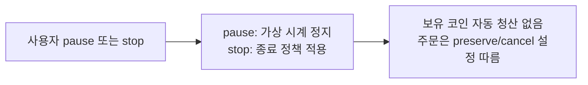

## L03 · FOK 지정가 확장, 알려진 깊이로 전량 가능/불가

**현재 상태: 실행·차단 연결**

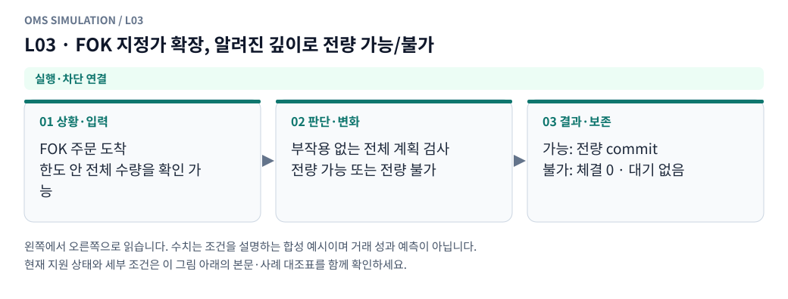

**그림 읽기:** FOK 주문 도착 / 한도 안 전체 수량을 확인 가능 → 부작용 없는 전체 계획 검사 / 전량 가능 또는 전량 불가 → 가능: 전량 commit / 불가: 체결 0 · 대기 없음.

**원본 처리 제안:** 전량 즉시체결 또는 전량 조건 취소. 부분체결·대기 금지

**현행 범위:** 현재 현물 재생기에 해당 분기 또는 명시적 사전 차단을 연결했습니다. 거래소 선물까지 지원한다는 뜻은 아닙니다. 세부 정책은 [실행 범위 본문](../limit_execution_coverage.ko.md)을 따른다.

L03 Mermaid 원본 보기

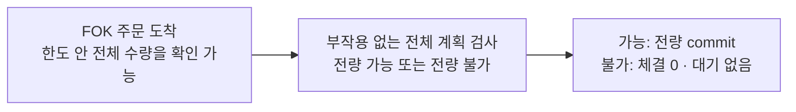

## L04 · FOK 전량 가능 여부를 깊이 밖이라 모름

**현재 상태: 실행·차단 연결**

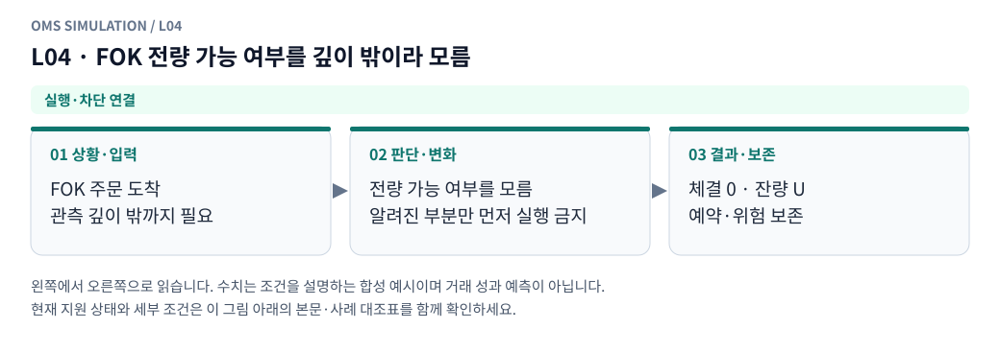

**그림 읽기:** FOK 주문 도착 / 관측 깊이 밖까지 필요 → 전량 가능 여부를 모름 / 알려진 부분만 먼저 실행 금지 → 체결 0 · 잔량 U / 예약·위험 보존.

**원본 처리 제안:** 부분 fill 먼저 commit하지 않음. 원자성 보존하며 판정 불가 처리

**현행 범위:** 현재 현물 재생기에 해당 분기 또는 명시적 사전 차단을 연결했습니다. 거래소 선물까지 지원한다는 뜻은 아닙니다. 세부 정책은 [실행 범위 본문](../limit_execution_coverage.ko.md)을 따른다.

L04 Mermaid 원본 보기

## L05 · GTD/거래소 만료 기능 확장

**현재 상태: 실행·차단 연결**

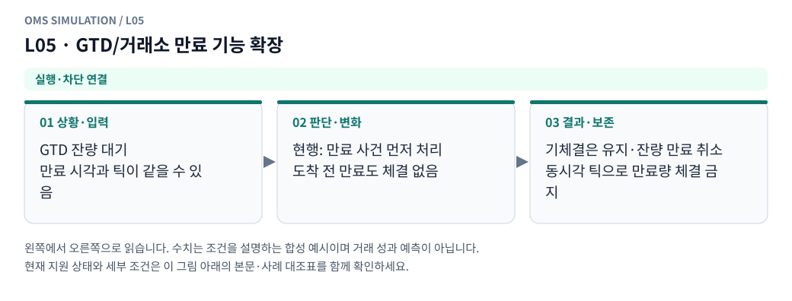

**그림 읽기:** GTD 잔량 대기 / 만료 시각과 틱이 같을 수 있음 → 현행: 만료 사건 먼저 처리 / 도착 전 만료도 체결 없음 → 기체결은 유지·잔량 만료 취소 / 동시각 틱으로 만료량 체결 금지.

**원본 처리 제안:** expiry 이벤트의 정확한 효력시각과 fill 경합 정의, 미지원이면 선택 거절

**현행 범위:** 현재 현물 재생기에 해당 분기 또는 명시적 사전 차단을 연결했습니다. 거래소 선물까지 지원한다는 뜻은 아닙니다. 세부 정책은 [실행 범위 본문](../limit_execution_coverage.ko.md)을 따른다.

L05 Mermaid 원본 보기

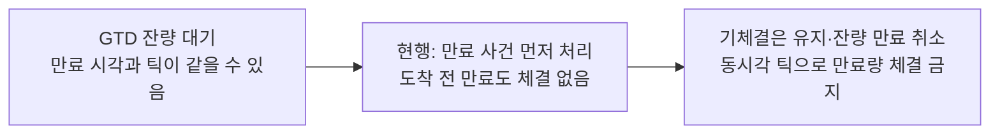

## L06 · stop-limit/조건부 지정가 확장

**현재 상태: 설계 제안 · 현재 실행 미지원**

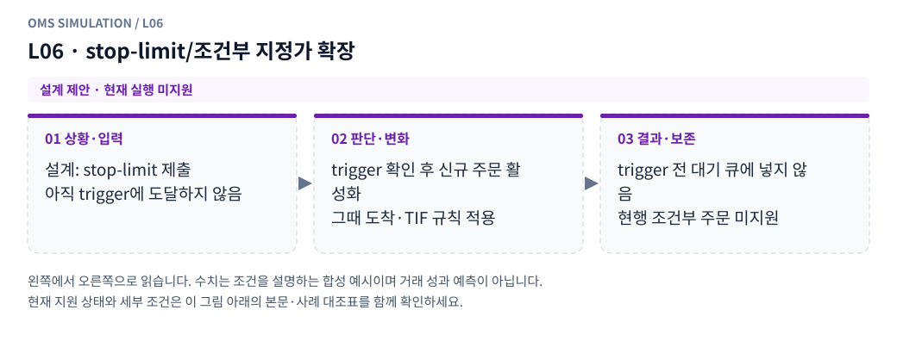

**그림 읽기:** 설계: stop-limit 제출 / 아직 trigger에 도달하지 않음 → trigger 확인 후 신규 주문 활성화 / 그때 도착·TIF 규칙 적용 → trigger 전 대기 큐에 넣지 않음 / 현행 조건부 주문 미지원.

**원본 처리 제안:** trigger 전에는 대기 지정가 아님. trigger 후 신규 도착·TIF 분기로 진입

**현행 범위:** 별도 거래소·선물·통지·특수 주문 모형이 필요합니다. 해당 주문/제어 입력은 지원하지 않으며 대신 체결하지 않습니다. 세부 정책은 [실행 범위 본문](../limit_execution_coverage.ko.md)을 따른다.

L06 Mermaid 원본 보기

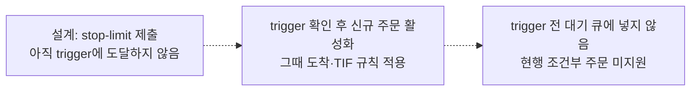

## L07 · 경매·단일가·세션 전환

**현재 상태: 설계 제안 · 현재 실행 미지원**

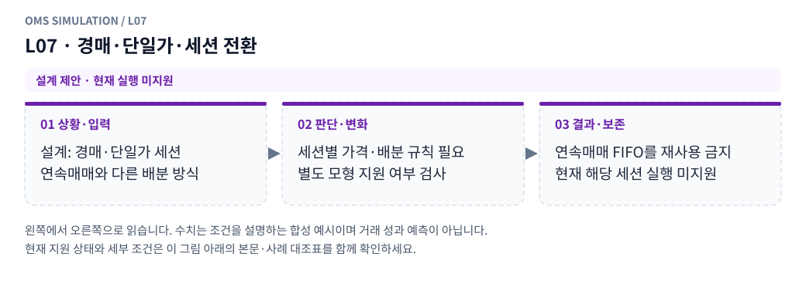

**그림 읽기:** 설계: 경매·단일가 세션 / 연속매매와 다른 배분 방식 → 세션별 가격·배분 규칙 필요 / 별도 모형 지원 여부 검사 → 연속매매 FIFO를 재사용 금지 / 현재 해당 세션 실행 미지원.

**원본 처리 제안:** 연속매매 FIFO를 그대로 적용하지 않고 별도 모형 또는 미지원

**현행 범위:** 별도 거래소·선물·통지·특수 주문 모형이 필요합니다. 해당 주문/제어 입력은 지원하지 않으며 대신 체결하지 않습니다. 세부 정책은 [실행 범위 본문](../limit_execution_coverage.ko.md)을 따른다.

L07 Mermaid 원본 보기

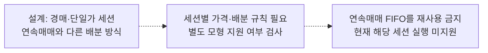

## L08 · iceberg/숨은 수량/우선순위가 관측되지 않음

**현재 상태: 설계 제안 · 현재 실행 미지원**

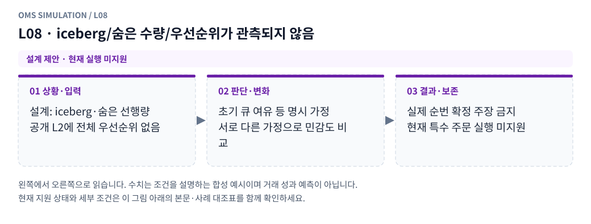

**그림 읽기:** 설계: iceberg·숨은 선행량 / 공개 L2에 전체 우선순위 없음 → 초기 큐 여유 등 명시 가정 / 서로 다른 가정으로 민감도 비교 → 실제 순번 확정 주장 금지 / 현재 특수 주문 실행 미지원.

**원본 처리 제안:** 초기 큐 여유 등 명시된 가정·민감도, 실제 순번 확정 주장 금지

**현행 범위:** 별도 거래소·선물·통지·특수 주문 모형이 필요합니다. 해당 주문/제어 입력은 지원하지 않으며 대신 체결하지 않습니다. 세부 정책은 [실행 범위 본문](../limit_execution_coverage.ko.md)을 따른다.

L08 Mermaid 원본 보기

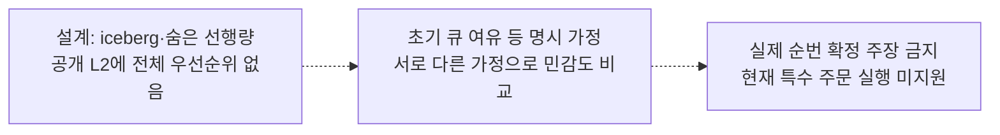

## L09 · OCO/조건 연동 주문 확장

**현재 상태: 설계 제안 · 현재 실행 미지원**

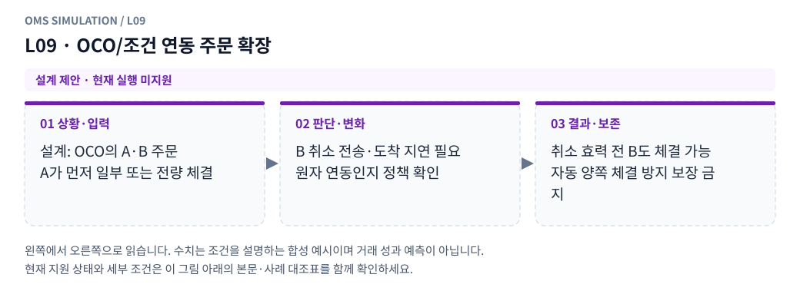

**그림 읽기:** 설계: OCO의 A·B 주문 / A가 먼저 일부 또는 전량 체결 → B 취소 전송·도착 지연 필요 / 원자 연동인지 정책 확인 → 취소 효력 전 B도 체결 가능 / 자동 양쪽 체결 방지 보장 금지.

**원본 처리 제안:** 한 leg fill→다른 leg 취소의 지연·원자성 계약을 별도 정의. 자동 양쪽 체결 방지 보장 금지

**현행 범위:** 별도 거래소·선물·통지·특수 주문 모형이 필요합니다. 해당 주문/제어 입력은 지원하지 않으며 대신 체결하지 않습니다. 세부 정책은 [실행 범위 본문](../limit_execution_coverage.ko.md)을 따른다.

L09 Mermaid 원본 보기

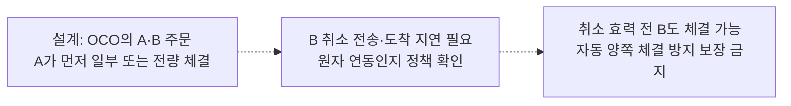

## L10 · 강제청산·거래소 시스템 취소·규격 변경

**현재 상태: 설계 제안 · 현재 실행 미지원**

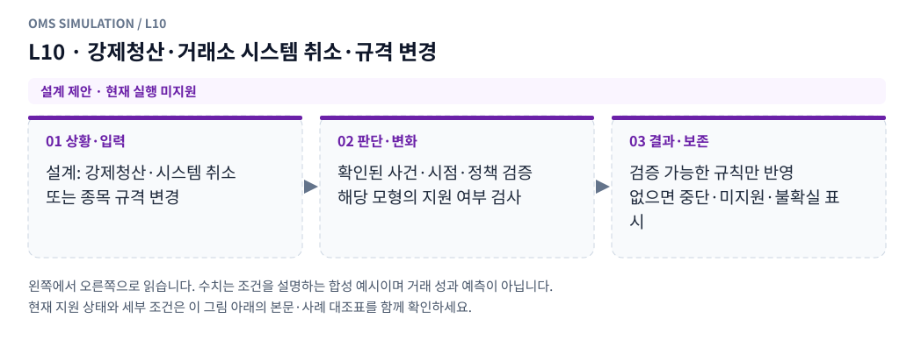

**그림 읽기:** 설계: 강제청산·시스템 취소 / 또는 종목 규격 변경 → 확인된 사건·시점·정책 검증 / 해당 모형의 지원 여부 검사 → 검증 가능한 규칙만 반영 / 없으면 중단·미지원·불확실 표시.

**원본 처리 제안:** 확인된 사건과 모형이 있을 때 반영, 없으면 미지원/중단·불확실 처리

**현행 범위:** 별도 거래소·선물·통지·특수 주문 모형이 필요합니다. 해당 주문/제어 입력은 지원하지 않으며 대신 체결하지 않습니다. 세부 정책은 [실행 범위 본문](../limit_execution_coverage.ko.md)을 따른다.

L10 Mermaid 원본 보기

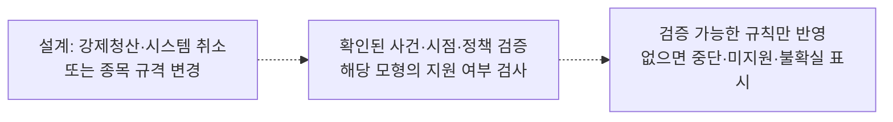

