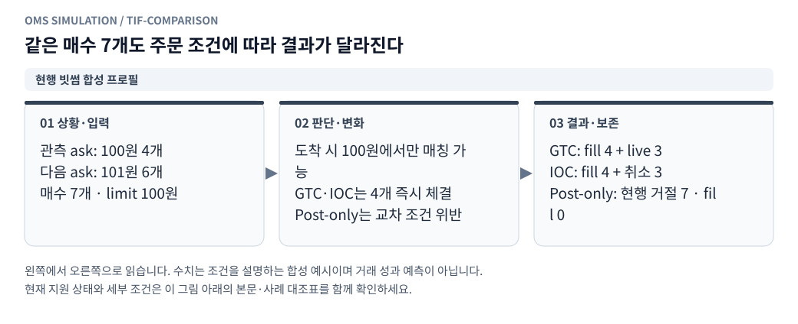

# 지정가 실행 범위와 142개 사례 대조표

[그림으로 보는 문서 안내](visual_guide.ko.md)

작성일: 2026-10-27 KST

현재 실행 프로필은 `spot-limit-v1`이다. 빗썸 현물 재생의 지정가 분기를 확장했으며, 아래 표에서 **실행 연결·명시적 모형 가정·부분 지원·미지원**을 구분한다. 이 표에 항목이 있다는 사실을 142개 모두의 실행 완료로 해석하지 않는다. OKX 선물 원장·헤지·지연 통지와 특수 주문은 별도 구현이 남아 있다.

## 사용 방법

모의거래의 체결 모형 설정에서 maker/taker 수수료, 가격 단위, 접수 전 취소 정책, 종료 정책을 입력한다. 수동 주문에서 Post-only/GTC/IOC/FOK/GTD와 STP를 선택한다. 자동 단일 메이커는 계속 Post-only를 사용한다. 주문별 취소, 전체 취소 요청, 목표 총수량을 지정하는 취소 확인 후 재주문을 지원한다.

가격 단위 0은 가격 단위 검증 생략이라는 명시적 가정이다. 수량 단위·최소 주문 금액·수수료·지연은 계좌 초기조건으로 고정한다. 실제 거래소의 현재/과거 규격을 자동 조회해 적용하지 않는다. 최대 수량·가격 보호·native 정정 등 등록되지 않은 규칙은 지원으로 주장하지 않는다.

## 도착·부분체결·잔량

<!-- diagram: tif-comparison -->

**그림 읽기 · 현행 빗썸 합성 프로필:** 다음 101원이 한도 밖이라고 확인된 예시다. 관측 깊이 자체가 부족한 경우에는 확정 취소·대기와 판정 불가를 구분한다. [수정용 Mermaid 원본](figures/tif-comparison.mmd).

<!-- diagram: fok-atomic -->

**그림 읽기 · 현행 FOK 원자성:** 전량 가능 여부 확인 전에 부분 정산을 하면 수수료·잔고·기존 maker 주문에 부작용이 남는다. [수정용 Mermaid 원본](figures/fok-atomic.mmd).

- Post-only: 도착 시 raw 상대 최우선 가격 또는 내 반대 주문과 교차하면 거절한다. 소진된 raw 가격도 보수적으로 교차로 취급한다. 비교차이면 maker 대기열에 들어간다.
- GTC: 한도가격 안의 관측된 상대 호가를 가격순으로 소진한다. 실제 상대 가격과 taker 역할을 체결별 기록하고, 확인 가능한 잔량은 대기한다. 이후 maker 체결과 섞일 수 있다.
- IOC: 알려진 즉시 체결을 반영한 뒤 확정 가능한 잔량은 취소한다. 정상 처리 뒤 live 잔량을 만들지 않는다.
- FOK: 잔량 전체와 STP 영향을 먼저 부작용 없는 계획으로 검사한다. 전량 가능할 때만 체결·유동성 소진·기존 주문 STP 취소를 한 번 적용한다. 전량 불가이면 체결 0, 판정 불가이면 체결 0과 미확인 위험을 남긴다.
- GTD: GTC와 같은 체결 처리를 하되 가상 만료 시각에 잔량을 취소한다. 도착 전에 만료되면 체결하지 않는다. 만료 시각과 틱이 같으면 만료가 먼저다.

같은 ms의 내부 주문 도착·취소·만료는 예약 순서대로 시장 사건보다 먼저 처리한다. 시장 스트림 내부는 기존 틱 우선 정렬을 유지한다. 새 주문은 접수와 같은 ms의 틱으로 maker 체결하지 않는다. 실제 거래소의 선후를 복원했다는 뜻이 아니며 다른 타이브레이크 민감도 모형은 아직 없다.

## 유동성·대기열

공격 주문이 소비한 수량은 `ExecutionDepth.self_debt`에 기록한다. 뒤 주문이 같은 상대 물량을 다시 사용할 수 없고, 반복 raw snapshot이나 raw 수량 증가만으로 부채를 지우지 않는다. 외부 관측 잔량을 넘어 채우지 않는다. 부채가 오래 남아 실제 재보충을 과소평가할 수 있는 보수적인 반사실 모형이다.

maker 틱은 내 주문이 없는 더 우선한 관측 외부 가격대도 먼저 소진한다. 하나의 틱 예산을 여러 가격·복수 주문이 공유한다. 현재 관측 범위 안에서 비어 있는 가격과 스프레드 안쪽의 신규 호가는 외부 잔량 0으로 알 수 있지만, 관측 밖·교차 뒤 불명확한 위치는 미확인으로 둔다. 호가 touch나 quote cross만으로 maker 체결하지 않는다. 틱 공격 방향이 미확인이면 체결하지 않는다.

확률 취소 모형과 기존 보수 모형은 계속 선택 가능하다. 역전·지연 틱의 정교한 credit 창이나 서버 sequence 복원은 아직 없으며 수신순서상 후속 호가가 앞선 틱을 반영한다고 가정한다. [확률 취소 상세](queue_cancellation_model.ko.md)를 함께 참고한다.

## STP·취소·교체

<!-- diagram: cancel-race -->

**그림 읽기 · 현행 취소 지연:** 취소 요청만으로 주문을 지우면 지연 중의 실제 모의체결을 놓친다. 종료된 체결을 취소 응답으로 되돌리지 않는다. [수정용 Mermaid 원본](figures/cancel-race.mmd).

계좌 범위의 자기체결을 생성하지 않는다. `cancel_taker`, `cancel_maker`, `cancel_both`를 지원한다. 가격순으로 외부와 먼저 체결한 부분은 유지하고 충돌 가격에서는 외부보다 STP를 먼저 적용한다. 같은 가격에서 내 주문의 실제 L3 위치를 안다는 뜻이 아닌 합성 프로필의 규칙이다. 미완료 FOK의 계획 중 STP는 기존 주문에 부작용을 남기지 않는다.

접수 전 취소는 `immediate`(요청 시 전송) 또는 `on_ack`(접수 후 취소 지연 시작)다. 별도 응답 통지망을 모사하는 것은 아니다. 접수·취소 전송 중에는 잔고를 계속 예약하고 취소 효력 전 추가 체결을 허용한다. 이미 끝난 주문의 재취소는 no-op이다. 전체 취소는 주문별로 요청하며 판정 불가 주문을 실제 취소됐다고 처리하지 않는다.

교체는 native amend가 아니라 **구 주문 취소 확인 → 추가 체결을 반영한 목표 총수량−누적 체결량 → 새 ID·새 지연·새 순번**이다. 가격·목표 총수량·TIF가 같으면 아무것도 바꾸지 않는다. 입력 규격 오류는 취소 전에 거절한다. 취소 후 잔고·보호·최소금액 검증에 실패하면 신규는 생성하지 않고 `replace_failed`를 저장한다. 구 주문을 복원하지 않는다. 구 주문이 취소 확인 전에 전량 체결되거나 별도 만료/STP로 종료되면 교체 요청은 폐기하며 추가 목표를 자동 재발주하지 않는다. GTD 신규 만료 시각을 바꾸는 native 정정도 지원하지 않는다.

`client_order_id`가 같고 정규화한 가격·수량·조건이 같으면 원래 ID를 반환한다. 내용이 다르면 거절한다. 종료 주문을 재전달해도 체결·예약을 다시 만들지 않는다. 전송 실패·응답 timeout을 실제로 생성하는 통지 어댑터는 아직 없다.

## 판정 불가와 종료

<!-- diagram: limit-lifecycle -->

**그림 읽기 · 현행 수량 분해:** 그림의 취소·거절·미확인은 서로 다른 상태다. 부분체결 후에는 체결량과 남은 수량을 따로 추적한다. [수정용 Mermaid 원본](figures/limit-lifecycle.mmd).

5호가 최심부보다 공격적인 한도까지 소진할 필요가 있거나 수량이 누락되면, 알려진 체결만 유지하고 미확인 잔량을 `execution_unknown`으로 남긴다. FOK는 이때 부분체결도 하지 않는다. 예약금·코인은 유지하고 해당 실행의 신규 주문과 자동 MM을 보류한다. 이후 호가가 들어왔다고 과거 체결 여부를 소급 확정하지 않는다. 미확인 주문 취소 요청도 위험을 없애지 않는다.

계좌 평가·손익은 **확정한 모의체결 기준**이다. 미확인 체결의 최종 성과로 보아서는 안 된다. 결과의 `uncertain`과 화면·계좌 이력의 판정 불가 표시를 함께 확인해야 한다. 미확인 잔량을 해결하려면 충분한 자료와 재실험이 필요하며 임의 수동 정산 기능은 없다.

UI의 신규 계좌는 종료 정책 `preserve`를 기본으로 마지막 주문 상태·예약을 보존한다. 이전 API와의 호환을 위한 생략 기본값은 `cancel`이며 이 경우 알려진 잔량만 모형상 취소한다. 두 정책 모두 `end_orders`에 종료 직전 상태를 남기며 판정 불가 잔량은 취소 정책에서도 유지한다. stop은 보유 코인을 청산하지 않는다. pause는 가상 시계를 멈춘다.

## 저장·조회와 검증

각 주문에는 수량 분해 `quantity_state={filled,in_flight,live,cancelled,rejected,unknown}`를 남긴다. 합계는 요청수량과 같아야 한다. 체결에는 한도가격·실제 가격·TIF·maker/taker 역할·각 역할별 누적 수수료를 기록한다. 전체 체결 CSV에 역할·TIF·한도가격 열을 추가했다.

주문 종료/거절과 교체 실패는 SQLite `order_events`에 체결·스냅샷과 같은 트랜잭션으로 저장한다. 화면은 최근 100건이고 전체 결과 JSON의 `closed_orders`는 다운로드 시작 체크포인트까지 전부 제공한다. 판정 불가·진행 주문은 해당 체크포인트의 `orders`에 남는다. 기존 결과에 없던 정보를 새로 만들어 넣지는 않는다.

`GET /api/replays/capabilities`는 로그인 후 지원 TIF·STP·제약과 아래 142개 사례 상태를 반환한다. `limit_case_matrix.json`은 원본 사례 ID와 1:1로 검증한다. `tests/test_limit_execution.py`의 양방향 가격/수량 행렬·FOK 원자성·STP·예약·수수료·멱등성·교체·만료·관측 깊이·전체 주문 보관 테스트와 API 인증/입력 차단/결과 내보내기 테스트를 추가했다. 이것이 미지원 사례까지 실행됐다는 뜻은 아니다.

## 사례별 상태

각 행의 **사례 ID를 누르면 해당 사례 전용 그림**으로 이동한다. A~L 전체 142개에 상황·판단·결과 그림과 현재 지원 상태를 붙였다. 그림을 한 문서에 모두 펼쳐 놓는 대신 분류별로 나눠 읽도록 했다.

실행/차단 연결 62개 · 모형 가정 적용 16개 · 부분 지원 17개 · 미지원 · 별도 연결 필요 47개

| ID | 경우 | 현재 상태 |
|---|---|---|
| [A01](illustrated/limit-a.ko.md#a01) | 규격·자금·선택 거래소가 모두 유효 | 실행/차단 연결 |
| [A02](illustrated/limit-a.ko.md#a02) | 여러 매수가 같은 현금을 중복 사용하려 함 | 실행/차단 연결 |
| [A03](illustrated/limit-a.ko.md#a03) | 현물 복수 매도의 합계가 가용 코인 초과 | 실행/차단 연결 |
| [A04](illustrated/limit-a.ko.md#a04) | OKX 증가 주문에 담보 부족 | 미지원 · 별도 연결 필요 |
| [A05](illustrated/limit-a.ko.md#a05) | tick·lot·단위·부호가 잘못됨 | 부분 지원 |
| [A06](illustrated/limit-a.ko.md#a06) | 주문 종류별 최소/최대 수량·금액 위반 | 부분 지원 |
| [A07](illustrated/limit-a.ko.md#a07) | 거래 중단·종목 상태·가격 보호에 걸림 | 미지원 · 별도 연결 필요 |
| [A08](illustrated/limit-a.ko.md#a08) | 선택되지 않은 거래소·종목으로 주문/입력 전달 | 실행/차단 연결 |
| [A09](illustrated/limit-a.ko.md#a09) | 한 실행에 거래소 3개 이상 설정 | 실행/차단 연결 |
| [A10](illustrated/limit-a.ko.md#a10) | 거래소 ID 중복 또는 동일 멱등 키의 상충 요청 | 실행/차단 연결 |
| [B01](illustrated/limit-b.ko.md#b01) | 매수 limit<ask / 매도 limit>bid, GTC | 실행/차단 연결 |
| [B02](illustrated/limit-b.ko.md#b02) | limit이 상대 best와 정확히 같음 | 실행/차단 연결 |
| [B03](illustrated/limit-b.ko.md#b03) | 상대 best보다 공격적인 limit, 한 호가로 전량 가능 | 실행/차단 연결 |
| [B04](illustrated/limit-b.ko.md#b04) | 여러 상대 호가를 써야 전량 가능 | 실행/차단 연결 |
| [B05](illustrated/limit-b.ko.md#b05) | GTC 일부만 즉시 가능, 뒤 가격은 limit 밖으로 확인됨 | 실행/차단 연결 |
| [B06](illustrated/limit-b.ko.md#b06) | IOC 일부만 즉시 가능, 뒤 가격은 limit 밖으로 확인됨 | 실행/차단 연결 |
| [B07](illustrated/limit-b.ko.md#b07) | IOC 즉시 가능량 0 | 실행/차단 연결 |
| [B08](illustrated/limit-b.ko.md#b08) | Post-only가 도착 때 교차 | 실행/차단 연결 |
| [B09](illustrated/limit-b.ko.md#b09) | Post-only가 도착 때 비교차 | 실행/차단 연결 |
| [B10](illustrated/limit-b.ko.md#b10) | top-N 소진 후 limit 안의 더 깊은 잔량 미관측 | 실행/차단 연결 |
| [B11](illustrated/limit-b.ko.md#b11) | raw best는 교차하나 self/public 소진 부채로 유효량 0 | 모형 가정 적용 |
| [B12](illustrated/limit-b.ko.md#b12) | 전송→도착 사이 호가 개선·악화·소멸 | 모형 가정 적용 |
| [C01](illustrated/limit-c.ko.md#c01) | 주문가격까지 유효한 반대 체결이 오지 않음 | 실행/차단 연결 |
| [C02](illustrated/limit-c.ko.md#c02) | best quote가 내 가격에 닿았으나 trade tick 없음 | 실행/차단 연결 |
| [C03](illustrated/limit-c.ko.md#c03) | 상대 quote가 내 대기가격을 넘어왔으나 tick 없음 | 실행/차단 연결 |
| [C04](illustrated/limit-c.ko.md#c04) | 내 매수에 매수 주도 tick / 내 매도에 매도 주도 tick | 실행/차단 연결 |
| [C05](illustrated/limit-c.ko.md#c05) | 반대 주도 tick이지만 가격이 내 주문에 도달하지 않음 | 실행/차단 연결 |
| [C06](illustrated/limit-c.ko.md#c06) | 반대 tick 수량이 내 앞 물량보다 작음 | 실행/차단 연결 |
| [C07](illustrated/limit-c.ko.md#c07) | 반대 tick 수량이 내 앞 물량과 정확히 같음 | 실행/차단 연결 |
| [C08](illustrated/limit-c.ko.md#c08) | 반대 tick이 앞 물량을 초과하나 내 잔량 전체에는 부족 | 실행/차단 연결 |
| [C09](illustrated/limit-c.ko.md#c09) | 앞 물량+내 잔량을 정확히 소진 | 실행/차단 연결 |
| [C10](illustrated/limit-c.ko.md#c10) | 앞 물량+내 잔량보다 많은 tick | 실행/차단 연결 |
| [C11](illustrated/limit-c.ko.md#c11) | 내 주문보다 불리한 원본 가격까지 반대 tick이 관통 | 부분 지원 |
| [C12](illustrated/limit-c.ko.md#c12) | 스프레드 안쪽에 내 지정가가 존재 | 실행/차단 연결 |
| [C13](illustrated/limit-c.ko.md#c13) | 앞쪽 외부 취소 후보가 확인됨 | 모형 가정 적용 |
| [C14](illustrated/limit-c.ko.md#c14) | 뒤쪽 외부 취소만 발생 | 모형 가정 적용 |
| [C15](illustrated/limit-c.ko.md#c15) | 같은 가격 신규 외부 잔량 증가 | 모형 가정 적용 |
| [C16](illustrated/limit-c.ko.md#c16) | snapshot 감소만 있고 대응 tick 없음 | 모형 가정 적용 |
| [C17](illustrated/limit-c.ko.md#c17) | tick→snapshot 또는 snapshot→tick 순서 역전 | 부분 지원 |
| [C18](illustrated/limit-c.ko.md#c18) | 반복 snapshot 또는 top-N 이탈 후 복귀 | 부분 지원 |
| [D01](illustrated/limit-d.ko.md#d01) | 같은 가격 O1→O2, 예산이 O1에도 도달 못 함 | 실행/차단 연결 |
| [D02](illustrated/limit-d.ko.md#d02) | 같은 가격 O1 일부체결 | 실행/차단 연결 |
| [D03](illustrated/limit-d.ko.md#d03) | 같은 가격 O1 전량, O2 일부/전량 | 실행/차단 연결 |
| [D04](illustrated/limit-d.ko.md#d04) | 다른 가격 여러 매수 | 실행/차단 연결 |
| [D05](illustrated/limit-d.ko.md#d05) | 다른 가격 여러 매도 | 실행/차단 연결 |
| [D06](illustrated/limit-d.ko.md#d06) | 내 주문 없는 더 우선한 외부 가격대가 존재 | 실행/차단 연결 |
| [D07](illustrated/limit-d.ko.md#d07) | 한 tick이 여러 내 주문을 채움 | 실행/차단 연결 |
| [D08](illustrated/limit-d.ko.md#d08) | 여러 공격 주문이 같은 상대 잔량을 노림 | 실행/차단 연결 |
| [D09](illustrated/limit-d.ko.md#d09) | 매수만 체결 / 매도만 체결 | 실행/차단 연결 |
| [D10](illustrated/limit-d.ko.md#d10) | 양쪽이 순차 체결 / 양쪽 일부 체결 | 실행/차단 연결 |
| [D11](illustrated/limit-d.ko.md#d11) | 같은 ms의 여러 child 도착 또는 일부 child 거절 | 부분 지원 |
| [D12](illustrated/limit-d.ko.md#d12) | 한 슬롯 취소/교체 중 다른 슬롯 주문은 유효 | 실행/차단 연결 |
| [E01](illustrated/limit-e.ko.md#e01) | 무체결 상태에서 취소가 먼저 효력 발생 | 실행/차단 연결 |
| [E02](illustrated/limit-e.ko.md#e02) | 취소 요청 전에 일부 체결 | 실행/차단 연결 |
| [E03](illustrated/limit-e.ko.md#e03) | 취소 전송→도착 사이 추가 부분체결 | 실행/차단 연결 |
| [E04](illustrated/limit-e.ko.md#e04) | 취소 전송→도착 사이 전량체결 | 실행/차단 연결 |
| [E05](illustrated/limit-e.ko.md#e05) | 전량체결 뒤 취소 요청 | 실행/차단 연결 |
| [E06](illustrated/limit-e.ko.md#e06) | cancel arrival과 tick이 같은 ms | 모형 가정 적용 |
| [E07](illustrated/limit-e.ko.md#e07) | 취소 효력 후 새로운 거래량 발생 | 실행/차단 연결 |
| [E08](illustrated/limit-e.ko.md#e08) | 취소 통지 후 과거 fill 통지 도착 | 미지원 · 별도 연결 필요 |
| [E09](illustrated/limit-e.ko.md#e09) | 주문 ACK 전 취소 요청 | 실행/차단 연결 |
| [E10](illustrated/limit-e.ko.md#e10) | 취소 요청 거절/전달 실패 | 미지원 · 별도 연결 필요 |
| [E11](illustrated/limit-e.ko.md#e11) | 여러 주문 일괄 취소 중 일부만 완료 | 부분 지원 |
| [E12](illustrated/limit-e.ko.md#e12) | 취소 대기 중 반대 주문 또는 교체 주문 전송 | 실행/차단 연결 |
| [F01](illustrated/limit-f.ko.md#f01) | 같은 주문을 같은 가격·같은 잔량으로 유지 | 실행/차단 연결 |
| [F02](illustrated/limit-f.ko.md#f02) | 같은 가격에 별도 order_id/슬롯으로 추가 | 실행/차단 연결 |
| [F03](illustrated/limit-f.ko.md#f03) | 가격 변경을 취소 후 신규로 구현 | 실행/차단 연결 |
| [F04](illustrated/limit-f.ko.md#f04) | 신규 가격이 도착 때 상대와 교차 | 실행/차단 연결 |
| [F05](illustrated/limit-f.ko.md#f05) | 수량 증가 native 정정 | 미지원 · 별도 연결 필요 |
| [F06](illustrated/limit-f.ko.md#f06) | 수량 감소 native 정정 | 미지원 · 별도 연결 필요 |
| [F07](illustrated/limit-f.ko.md#f07) | 기체결40·총수량100에서 new total50 | 부분 지원 |
| [F08](illustrated/limit-f.ko.md#f08) | 정정 수량이 이미 체결된 양 이하 | 부분 지원 |
| [F09](illustrated/limit-f.ko.md#f09) | 정정 전송→도착 사이 추가체결 | 부분 지원 |
| [F10](illustrated/limit-f.ko.md#f10) | 정정 실패·cxlOnFail 등 부가 정책 | 부분 지원 |
| [F11](illustrated/limit-f.ko.md#f11) | 오래된 revision의 정정/취소 응답 도착 | 미지원 · 별도 연결 필요 |
| [F12](illustrated/limit-f.ko.md#f12) | 취소 후 신규 사이 구 주문의 잔량·헤지 목표가 바뀜 | 부분 지원 |
| [G01](illustrated/limit-g.ko.md#g01) | 내 신규 매수가 내 대기 매도와 교차 | 실행/차단 연결 |
| [G02](illustrated/limit-g.ko.md#g02) | 내 신규 매도가 내 대기 매수와 교차 | 실행/차단 연결 |
| [G03](illustrated/limit-g.ko.md#g03) | STP cancel_maker 모드 | 모형 가정 적용 |
| [G04](illustrated/limit-g.ko.md#g04) | STP cancel_taker 모드 | 모형 가정 적용 |
| [G05](illustrated/limit-g.ko.md#g05) | STP cancel_both 모드 | 모형 가정 적용 |
| [G06](illustrated/limit-g.ko.md#g06) | 외부 물량 일부 체결 후 내 반대 주문과 충돌 | 모형 가정 적용 |
| [G07](illustrated/limit-g.ko.md#g07) | 같은 전략/다른 전략의 주문이 같은 계좌에서 충돌 | 실행/차단 연결 |
| [G08](illustrated/limit-g.ko.md#g08) | 가격 보호·체결 제한 때문에 유효 limit 안에서도 추가 매칭 중단 | 미지원 · 별도 연결 필요 |
| [G09](illustrated/limit-g.ko.md#g09) | 내 숨은 대기열 여유량·queue multiplier가 있음 | 미지원 · 별도 연결 필요 |
| [G10](illustrated/limit-g.ko.md#g10) | 거래소별 STP/매칭 규칙을 과거 시점에 확인 못 함 | 모형 가정 적용 |
| [H01](illustrated/limit-h.ko.md#h01) | 지정가 체결이 기존 포지션과 같은 방향 | 미지원 · 별도 연결 필요 |
| [H02](illustrated/limit-h.ko.md#h02) | 반대방향 fill이 기존 포지션 일부만 줄임 | 미지원 · 별도 연결 필요 |
| [H03](illustrated/limit-h.ko.md#h03) | 반대방향 fill이 정확히 전량 청산 | 미지원 · 별도 연결 필요 |
| [H04](illustrated/limit-h.ko.md#h04) | 일반 반대 주문이 기존 포지션보다 많이 체결 | 미지원 · 별도 연결 필요 |
| [H05](illustrated/limit-h.ko.md#h05) | reduce-only가 현재 포지션을 유효하게 줄임 | 미지원 · 별도 연결 필요 |
| [H06](illustrated/limit-h.ko.md#h06) | reduce-only 도착/실행 전에 다른 주문이 이미 청산 | 미지원 · 별도 연결 필요 |
| [H07](illustrated/limit-h.ko.md#h07) | 여러 reduce-only가 같은 청산 가능량을 약정 | 미지원 · 별도 연결 필요 |
| [H08](illustrated/limit-h.ko.md#h08) | 전송 때 담보 충분, 도착 때 부족 | 미지원 · 별도 연결 필요 |
| [H09](illustrated/limit-h.ko.md#h09) | 접수 뒤 포지션·담보·거래 상태 변화 | 미지원 · 별도 연결 필요 |
| [H10](illustrated/limit-h.ko.md#h10) | 지정가 max_q와 시장가 max_q·lot가 다름 | 미지원 · 별도 연결 필요 |
| [H11](illustrated/limit-h.ko.md#h11) | OKX GTC가 일부 taker 후 여러 번 maker 체결 | 미지원 · 별도 연결 필요 |
| [H12](illustrated/limit-h.ko.md#h12) | 대기 중 확정 펀딩 또는 평가환율 변화 | 미지원 · 별도 연결 필요 |
| [I01](illustrated/limit-i.ko.md#i01) | 거래소1개 선택·그 거래소용 유효 프로필 | 실행/차단 연결 |
| [I02](illustrated/limit-i.ko.md#i02) | 거래소1개 선택·point2 양 거래소 의존 프로필 | 실행/차단 연결 |
| [I03](illustrated/limit-i.ko.md#i03) | 두 거래소가 같은 ms에 체결 | 미지원 · 별도 연결 필요 |
| [I04](illustrated/limit-i.ko.md#i04) | 빗썸 매수 일부/전량, OKX 매도 지정가 미체결 | 미지원 · 별도 연결 필요 |
| [I05](illustrated/limit-i.ko.md#i05) | 빗썸 매수 일부/전량, OKX 매도 일부체결 | 미지원 · 별도 연결 필요 |
| [I06](illustrated/limit-i.ko.md#i06) | 빗썸 매수와 OKX 매도가 목표량만큼 완료 | 미지원 · 별도 연결 필요 |
| [I07](illustrated/limit-i.ko.md#i07) | 빗썸 매도 체결, 기존 OKX 숏의 매수 청산이 미체결 | 미지원 · 별도 연결 필요 |
| [I08](illustrated/limit-i.ko.md#i08) | 여러 현물 fill을 여러 OKX 가격에 분산 | 미지원 · 별도 연결 필요 |
| [I09](illustrated/limit-i.ko.md#i09) | OKX fill 통지 지연 중 현물 추가체결 | 미지원 · 별도 연결 필요 |
| [I10](illustrated/limit-i.ko.md#i10) | 현물 매수30→OKX 매도30 대기→현물 매도30으로 목표0 | 미지원 · 별도 연결 필요 |
| [I11](illustrated/limit-i.ko.md#i11) | 목표0 후 기존 매도 fill과 반대 매수 조정이 엇갈림 | 미지원 · 별도 연결 필요 |
| [I12](illustrated/limit-i.ko.md#i12) | 한 거래소 자료 공백/거절/거래 중단, 다른 쪽은 정상 | 미지원 · 별도 연결 필요 |
| [J01](illustrated/limit-j.ko.md#j01) | ACK→fill→account 순서 정상 | 부분 지원 |
| [J02](illustrated/limit-j.ko.md#j02) | fill 통지가 ACK보다 먼저 도착 | 미지원 · 별도 연결 필요 |
| [J03](illustrated/limit-j.ko.md#j03) | 최신 ACK 뒤 낮은 버전의 고유 fill 도착 | 미지원 · 별도 연결 필요 |
| [J04](illustrated/limit-j.ko.md#j04) | 같은 fill 통지 중복 | 미지원 · 별도 연결 필요 |
| [J05](illustrated/limit-j.ko.md#j05) | account snapshot이 fill을 먼저 포함 | 미지원 · 별도 연결 필요 |
| [J06](illustrated/limit-j.ko.md#j06) | 취소 통지가 fill 통지보다 먼저 도착 | 미지원 · 별도 연결 필요 |
| [J07](illustrated/limit-j.ko.md#j07) | 일부 child 통지만 늦거나 빠짐 | 미지원 · 별도 연결 필요 |
| [J08](illustrated/limit-j.ko.md#j08) | truth 일부체결, observed는 여전히 전체 약정 | 미지원 · 별도 연결 필요 |
| [J09](illustrated/limit-j.ko.md#j09) | 전송 응답 timeout/접수 상태 관측 불가 | 미지원 · 별도 연결 필요 |
| [J10](illustrated/limit-j.ko.md#j10) | refresh가 지연되고 서로 다른 계좌/주문 버전을 반환 | 미지원 · 별도 연결 필요 |
| [K01](illustrated/limit-k.ko.md#k01) | OKX passive 주문이 있는데 OKX tick 없음 | 실행/차단 연결 |
| [K02](illustrated/limit-k.ko.md#k02) | tick의 공격 방향 미확인 | 실행/차단 연결 |
| [K03](illustrated/limit-k.ko.md#k03) | 호가 금액/코인/계약 수 단위 미확인 | 부분 지원 |
| [K04](illustrated/limit-k.ko.md#k04) | 동일 시각·가격·수량의 여러 원본 행 | 실행/차단 연결 |
| [K05](illustrated/limit-k.ko.md#k05) | 진짜 중복 파일/중복 수집이 확인됨 | 부분 지원 |
| [K06](illustrated/limit-k.ko.md#k06) | heartbeat/연결 기록으로 확인된 자료 공백 | 미지원 · 별도 연결 필요 |
| [K07](illustrated/limit-k.ko.md#k07) | 단순히 한동안 tick이 없음 | 실행/차단 연결 |
| [K08](illustrated/limit-k.ko.md#k08) | 늦은 tick으로 정합 창이 지난 감소가 설명됨 | 미지원 · 별도 연결 필요 |
| [K09](illustrated/limit-k.ko.md#k09) | snapshot 반복·증가 때 self 부채와 public 부채를 혼동 | 모형 가정 적용 |
| [K10](illustrated/limit-k.ko.md#k10) | top-N 이탈인지 실제 가격대0인지 모름 | 부분 지원 |
| [K11](illustrated/limit-k.ko.md#k11) | 동시각 교차 스트림 순서가 실제로 미확인 | 모형 가정 적용 |
| [K12](illustrated/limit-k.ko.md#k12) | 과거 규격·평가가격·환율 중 필수 정보 미확인 | 부분 지원 |
| [L01](illustrated/limit-l.ko.md#l01) | 평가 종료 때 주문 live/in-flight/cancel-pending | 모형 가정 적용 |
| [L02](illustrated/limit-l.ko.md#l02) | 사용자가 pause/stop | 모형 가정 적용 |
| [L03](illustrated/limit-l.ko.md#l03) | FOK 지정가 확장, 알려진 깊이로 전량 가능/불가 | 실행/차단 연결 |
| [L04](illustrated/limit-l.ko.md#l04) | FOK 전량 가능 여부를 깊이 밖이라 모름 | 실행/차단 연결 |
| [L05](illustrated/limit-l.ko.md#l05) | GTD/거래소 만료 기능 확장 | 실행/차단 연결 |
| [L06](illustrated/limit-l.ko.md#l06) | stop-limit/조건부 지정가 확장 | 미지원 · 별도 연결 필요 |
| [L07](illustrated/limit-l.ko.md#l07) | 경매·단일가·세션 전환 | 미지원 · 별도 연결 필요 |
| [L08](illustrated/limit-l.ko.md#l08) | iceberg/숨은 수량/우선순위가 관측되지 않음 | 미지원 · 별도 연결 필요 |
| [L09](illustrated/limit-l.ko.md#l09) | OCO/조건 연동 주문 확장 | 미지원 · 별도 연결 필요 |
| [L10](illustrated/limit-l.ko.md#l10) | 강제청산·거래소 시스템 취소·규격 변경 | 미지원 · 별도 연결 필요 |

OKX 선물·reduce-only·다중 거래소 헤지(H/I), 비동기 ACK·계좌 통지(J), native 정정, stop-limit/OCO/iceberg·경매·강제청산은 현재 주문 입력으로 선택할 수 없다. 지원하지 않는 필드·조건을 보내면 거절하며 일반 지정가로 바꿔 실행하지 않는다. [미결정 사항 Q-010](strategy_registration_queries.ko.md)에 후속 판단을 남겼다.
