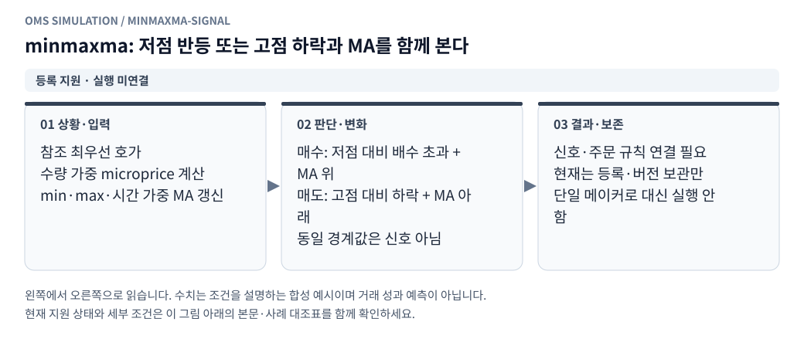
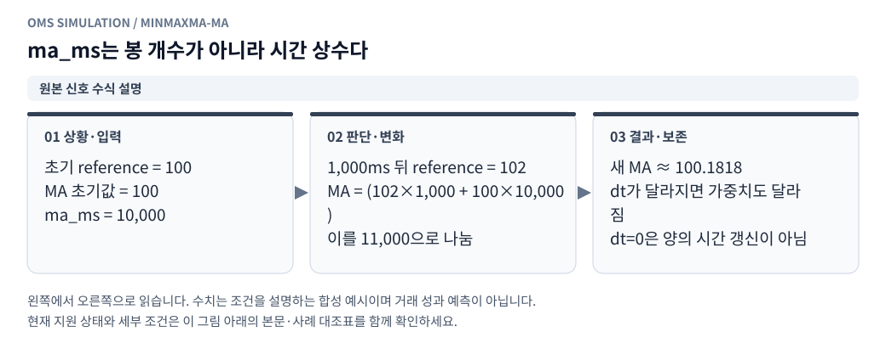

# minmaxma 전략 — point_st 등록 프로필

[그림으로 보는 문서 안내](visual_guide.ko.md)

표시 이름은 사용자 지정대로 **minmaxma 전략**, 내부 유형은 `minmaxma`, 기본 등록 ID는 `builtin_minmaxma`다. 기존 `point2`/`builtin_point2`와 독립적이다. `전략 관리`에서 이름을 붙여 여러 설정으로 등록하고 수정·복사·버전 보관·복원할 수 있다.

## 확인한 원본과 선택

다음 두 `point_st.js`를 읽기 전용으로 확인했다.

- `Tsystem2/sys_v2/strategy/point_st.js`: 오래된 BTC 전용 구현. `run()`에 조기 `return`이 있어 아래 신호·주문 코드가 실행되지 않는 상태다. 참고 가격에 best ask를 사용하는 과거 형태가 남아 있다.
- `Tsystem2_point_st2_sim/sys_v2/strategy/point_st.js`: 고정 커밋 `d7dcd97a35fa32b56813d16b92ee53e1604d5c06`의 유지보수된 구현. 기존 신호의 상태 갱신을 분리하고 기준가격에 1호가 microprice를 사용한다. 현재 등록 프로필의 기준으로 선택했다.

선택 파일 SHA-256: `2142987a8bb2be98d41610f226872a0bacb6f214bfb5720e8898cb0f749d3fc6`.

운영 환경파일이나 개인 거래 계정을 읽거나 전략의 `main()`을 실행하지 않았다. 원본의 모든 운영 옵션을 현재 등록 스키마에 이식한 것은 아니다. 추가된 FX 신호와 복합 신호는 이번 minmaxma 기본 프로필에서 사용하지 않고 `signal_mode=original`로 기록한다.

## 신호 의미

<!-- diagram: minmaxma-signal -->



**그림 읽기 · 등록 지원 · 실행 미연결:** 기준 거래소는 시세 참조용이다. Binance/OKX를 선택했다고 그곳에 자동 헤지 주문을 만드는 전략이 아니다. [수정용 Mermaid 원본](figures/minmaxma-signal.mmd).

<!-- diagram: minmaxma-ma -->



**그림 읽기 · 원본 신호 수식 설명:** 원본 수식을 설명하는 합성 예시다. 극값 재설정·주문·취소까지 구현됐다는 의미는 아니다. [수정용 Mermaid 원본](figures/minmaxma-ma.mmd).

기준 거래소의 최우선 호가로 가격을 계산한다.

```text
reference = (bid_price × ask_qty + ask_price × bid_qty) / (bid_qty + ask_qty)

min_price = min(이전 min_price, reference)
max_price = max(이전 max_price, reference)

MA 초기값 = reference
MA = (reference × dt_ms + 이전 MA × ma_ms) / (dt_ms + ma_ms)   [dt_ms > 0]

매수 신호: reference / min_price > buffer_ratio AND reference > MA
매도 신호: reference / max_price < 2 - buffer_ratio AND reference < MA
```

`ma_ms`는 봉 개수가 아닌 **시간 상수(ms)**다. `buffer_ratio`는 bp가 아닌 배수다. 예를 들어 `1.001`은 저점 대비 0.1% 초과 반등, 고점 대비 0.1% 초과 하락 조건이며, `1.0001`은 0.01%에 해당한다. 경계와 정확히 같으면 신호를 내지 않는다. 주문·체결에 따른 극값 재설정과 재주문·취소 규칙은 원본 상태 흐름을 연결할 때 함께 재현해야 한다.

빗썸에 주문하고 기준 거래소에서는 시세만 참조한다. 원본의 Binance를 OKX 선물 헤지 거래소로 오해해 자동 헤지하지 않는다.

## 등록 설정

| 키 | 기본값 | 의미 |
|---|---|---|
| `direction` | `both` | 양방향·매수만·매도만 |
| `reference_exchange` | `binance` | 원본 Binance 참조. `okx` 선택은 명시적 변형 |
| `buffer_ratio` | `1.001` | 반등·하락 조건의 배수, 등록 범위 1 초과 2 미만 |
| `ma_ms` | `10000` | MA 시간 상수, 양의 정수 |
| `max_quote_age_ms` | `5000` | 기준가격 시세의 허용 지연 |
| `max_position_krw` | `0` | 현물 보유액 한도, 0은 무제한 |
| `order_notional_cap_krw` | `0` | 주문 금액 한도, 0은 무제한 |
| `buy_notional_cap_krw` | `0` | 매수 미체결 대금 한도, 0은 무제한 |
| `sell_notional_cap_krw` | `0` | 매도 미체결 대금 한도, 0은 무제한 |
| `min_quote_krw` | `0` | 작은 최우선 호가 대금 필터, 0은 해제 |

기본값은 선택한 소스의 코드 기본값이다. 특정 종목의 실제 운용값을 복사하지 않았다. 종목·초기 원화·코인·실행 기간은 전략과 별개로 계좌에서 입력받는 구조를 유지한다.

Binance를 선택하면 필요한 거래소는 빗썸+Binance, OKX를 선택하면 빗썸+OKX다. 모두 최대 2개다. OKX 선택은 `variant=okx_reference_variant`로 저장하며 원본과 동일한 신호라고 주장하지 않는다. 거래용 거래소는 빗썸 하나이고 기준 거래소 거래는 비활성이다.

## 이론가와 실행 상태

현재는 **등록·버전 보관까지 지원하고 모의 실행은 연결 전**이다. 기준 호가 스트림, min/max/MA 상태, 주문 가격·극값 재설정·취소 규칙을 실행기에 연결해야 한다. UI와 서버가 모두 미지원 실행을 차단하며, 단순 메이커로 대신 실행하지 않는다. Binance 데이터가 현재 재생기에 연결돼 있다는 뜻도 아니다.

미실현 이론가 손익은 기존 요구대로 **전략 출력**을 받아야 한다. 기준 거래소의 USDT MA를 원화 이론가로 그대로 쓰지 않는다. 원화 환산·이론가 정의는 아직 정하지 않았으므로 `theory_formula_status=pending_krw_definition`을 저장하고 임의 이론가를 만들지 않는다. 선택 가정과 답변 칸은 [미결정 사항 Q-004/Q-005](strategy_registration_queries.ko.md)에 있다.

## 저장과 검증

최초 서버 시작 때 새 기본 프로필만 추가한다. 기존 메이커·Point의 이름·버전·보관 상태를 덮어쓰지 않는다. 사용자 정의 minmaxma도 일반 전략 등록의 불변 버전 규칙을 따른다. 변경된 유형은 신규 등록하며 기존 Point를 minmaxma로 이름만 바꾸지 않는다.

`tests/test_strategy_registry.py`에서 별도 유형·기본값·설정 검증, Binance/OKX 변형과 거래소 수, 미지원 실행 차단, 기존 DB에 새 기본 프로필 추가 시 기존 버전 보존, API 등록을 검증한다. 화면에서도 전용 입력과 등록, 실행 지원 상태를 확인한다.
