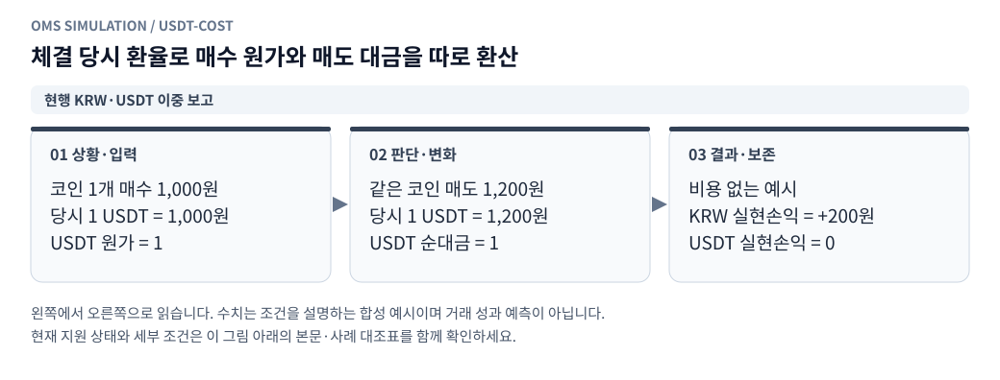
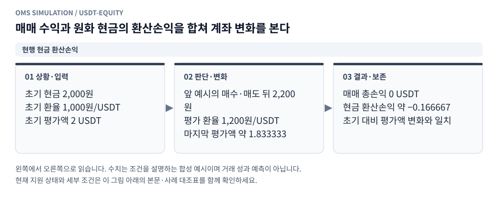
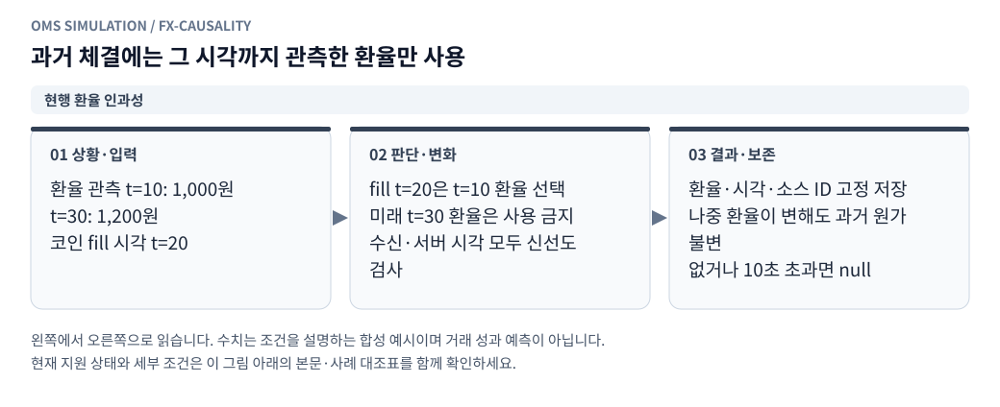

# 모의계좌의 KRW·USDT 손익과 체결 당시 환율

[그림으로 보는 문서 안내](visual_guide.ko.md)

작성일: 2026-10-27 KST

리플레이와 실시간 모의계좌 화면에서 **손익·거래대금 표시 통화 → 원화(KRW) / 테더(USDT)**를 선택한다. 기본값은 KRW이며 두 화면의 선택을 브라우저에 각각 저장한다. 통화를 바꾸거나 화면을 닫아도 체결·계좌 원장은 바뀌지 않는다. 서버는 표시 선택과 관계없이 두 통화의 평가를 저장한다.

## 계산 기준

<!-- diagram: usdt-cost -->

**그림 읽기 · 현행 KRW·USDT 이중 보고:** 200원을 오늘 환율로 나눈 값이 USDT 실현손익은 아니다. 실제 계산에는 각 체결 수수료와 가중 원가를 포함한다. [수정용 Mermaid 원본](figures/usdt-cost.mmd).

USDT 표시는 현재 환율로 누적 원화 손익 전체를 나누는 방식이 아니다. 매수 원가와 수수료를 각 매수 체결 당시의 환율로 고정하고, 매도 대금과 수수료를 각 매도 체결 당시의 환율로 환산한다. 따라서 같은 거래에서 원화 수익과 USDT 수익의 방향·크기가 다를 수 있다.

환율 `R`의 단위는 **KRW/USDT**다. 기본 소스는 빗썸 USDT/KRW의 최우선 매수·매도 중간가 `(bid + ask) / 2`다. 달러 환율이나 OKX의 달러 가격으로 대신하지 않는다. 이는 손익 보고를 위한 평가 환율이며 실제 USDT 환전 체결, 환전 스프레드·수수료는 발생시키지 않는다.

| 항목 | USDT 계산 |
|---|---|
| 체결 가격 | 원화 체결 가격 / 체결 당시 R |
| 체결 수수료 | 원화 수수료 / 체결 당시 R |
| 매수 원가 증가 | (원화 체결 금액 + 매수 수수료) / 매수 당시 R |
| 평균 원가 | 남은 USDT 취득원가 / 보유 수량 |
| 부분 매도 원가 배분 | 매도 전 USDT 취득원가 × 매도 수량 / 매도 전 보유 수량 |
| 이번 실현손익 | (원화 매도 금액 − 매도 수수료) / 매도 당시 R − 배분 원가 |
| 누적 실현손익 | 각 매도의 USDT 실현손익 누적 |
| 시장가 미실현손익 | 현재 원화 시장 평가액 / 평가 시점 R − 남은 USDT 취득원가 |
| 이론가 미실현손익 | 현재 원화 이론가 평가액 / 평가 시점 R − 남은 USDT 취득원가 |
| 매매 총손익 | 누적 실현손익 + 시장가 미실현손익 |
| 이론가 총손익 | 누적 실현손익 + 이론가 미실현손익 |
| 현금·평가액 | 현재 원화 현금·평가액 / 평가 시점 R |

매수 수수료는 취득원가에 포함하고 매도 수수료는 매도 대금에서 뺀다. `fees_paid`는 각 체결 수수료를 해당 체결 환율로 환산한 합계로, 총손익에서 다시 차감하지 않는다. 전량 매도 시 남은 원가 전체를 배분한다. 예상 청산 수수료는 기존 원화 평가와 동일하게 미실현손익에서 차감하지 않는다. 이론가와 시장가는 서로 다른 평가 기준이므로 두 미실현손익을 더하지 않는다.

예를 들어 코인 1개를 1,000원에 매수했을 때 환율이 1,000원/USDT이고, 1,200원에 매도했을 때 환율이 1,200원/USDT라면, 수수료 없는 원화 실현손익은 **+200원**, USDT 실현손익은 **0 USDT**다. 매수 원가와 매도 대금 모두 1 USDT이기 때문이다. `200원 / 매도 당시 1,200원`으로 계산한 값과 다르다.

## 현금 환산손익과 전체 자산 변화

<!-- diagram: usdt-equity -->

**그림 읽기 · 현행 현금 환산손익:** 확정 실현손익은 체결 환율로 고정하고, 미실현·현재 자산은 평가 시점 환율을 사용한다. 결측은 0 대신 미평가다. [수정용 Mermaid 원본](figures/usdt-equity.mmd).

계좌의 실제 결제·예약 통화는 계속 KRW다. KRW 현금을 보유하는 동안 USDT 가격이 변하면 USDT 기준 현금 가치도 달라진다. 이 변화를 코인 매매 실현손익에 섞지 않고 별도 표시한다.

- `cash_basis`: 시작 원화 현금의 USDT 가치에서 매수 시 USDT 지출을 빼고, 매도 시 USDT 수입을 더한 누적 현금 기준값.
- `cash_fx_pnl`: 현재 원화 현금 / 현재 R − `cash_basis`.
- `equity_change_pnl`: 현재 전체 USDT 평가액 − 초기 전체 USDT 평가액.
- 모든 평가가 가능하면 `매매 총손익 + 현금 환산손익 = 초기 대비 평가액 변화`다. 화면 반올림과 기존 실시간 KRW float 원장에 따른 미세한 차이는 허용한다.

앞의 예에서 2,000원으로 시작해 1,000원을 매수에 쓰고 1,200원을 회수했다면 마지막 현금은 2,200원이다. 시작 2 USDT에서 마지막 약 1.833333 USDT로 줄어든 차이 약 −0.166667 USDT는 남아 있던 원화 현금의 환산손익이며, 코인 매매 손익 0 USDT와 구분한다.

리플레이의 초기 코인은 시작 시점 빗썸 최우선 매수호가로 원화 원가를 잡고, 시작 시점 환율로 USDT 초기 원가를 고정한다. 실시간 모의계좌는 거래가 없는 상태의 첫 유효 환율 조회에서 초기 기준을 저장한다. 조회 전에 첫 주문이 발생하면 첫 체결 시점에 저장한다. 초기 환율 메타데이터는 `usdt.initial_fx`에 남는다.

## 환율의 시간·결측 규칙

<!-- diagram: fx-causality -->

**그림 읽기 · 현행 환율 인과성:** 동일 관측 밀리초의 환율은 사용한다는 모형 가정이다. 기존 체결의 환율 결측을 현재 시세로 소급 채우지 않는다. [수정용 Mermaid 원본](figures/fx-causality.mmd).

1. 체결·평가 시각보다 미래인 수신 시각 또는 서버 시각을 가진 환율은 사용하지 않는다.
2. 수신·서버 시각 모두 기준 시각으로부터 10,000ms 이내여야 한다. 정확히 10,000ms는 허용한다.
3. 가격은 유한한 양수이고 매수호가 ≤ 매도호가여야 한다. 다른 거래소·다른 종목은 환율로 받지 않는다.
4. 리플레이는 해당 시각까지 관측한 가장 최근 USDT 호가만 사용한다. 선형 보간이나 미래값 채우기를 하지 않는다. 관측 시각이 정확히 같으면 해당 환율을 사용한다. 서로 다른 소스의 동일 밀리초 내부 도착 순서는 알 수 없다는 모형 가정이다.
5. 환율이 없거나 지연되면 관련 값은 `null` / 화면 `—` / CSV 빈칸이다. 0 또는 1로 대신하지 않는다. 원화 모의 체결 자체는 계속 처리한다.
6. 매수 당시 환율이 없으면 그 포지션의 USDT 원가가 미확정이다. 이후 환율이 돌아와도 과거 매수 원가를 다시 만들지 않는다. 해당 포지션을 모두 매도한 뒤 새 매수는 새로운 알려진 원가를 가질 수 있으나, 이미 불명확해진 누적 실현손익·수수료·현금 기준은 계좌 초기화 없이 복원하지 않는다.
7. 현재 환율만 없으면 이미 확정한 실현손익·수수료는 유지한다. 보유 포지션의 현재 평가액·미실현손익은 미평가다. 보유 수량이 0이면 미실현손익은 0이다.
8. 초기 환율만 없으면 초기 USDT 자산과 전체 자산 변화는 미평가일 수 있다. 이후 모든 체결의 환율·원가가 알려졌다면 매매 손익 자체는 계산 가능하다. `status=complete`는 시장 기준 매매 총손익·현재 환율에 대한 상태이며 이론가·초기 평가·현금 환산손익까지 모두 유효하다는 의미는 아니다. 각 필드의 null을 확인한다.
9. 기존 실행·체결은 오늘의 환율로 소급 환산하지 않는다. 이전 DB에서 USDT 원장 없이 거래가 이미 있었던 실시간 계좌는 기존 원가·누적 손익을 미확정으로 취급한다. 초기화는 기존 계좌 초기화 절차를 따른다.

## 화면과 저장 결과

- 리플레이의 평가액·손익 카드, 체결 표, 저장 계좌별 결과에 선택 통화를 적용한다. 통화 전환은 캐시된 체결 행도 다시 렌더링한다.
- 실시간 모의계좌의 평가액·현금·포지션·체결 표에 적용한다. 활성 화면에서 2초마다 갱신하며 이전 조회가 진행 중이거나 주문·초기화 중에는 주기 조회를 중첩하지 않는다. 숨긴 브라우저에서는 주기 조회를 미룬다. 체결 수가 같으면 열어 놓은 과거 체결 페이지를 유지한다.
- 체결 표의 가격·수수료·손익은 해당 체결에 저장된 통화 값을 사용한다. 체결 당시 이론가도 해당 보고서의 이론가와 체결 환율로 표시한다. 현재 환율이 바뀌어도 과거 체결 행의 손익은 바뀌지 않는다.
- 두 표에 **체결 환율(KRW/USDT)** 열을 추가했다. 현재 평가 환율·관측 시각은 통화 선택 아래에 표시한다.
- 주문 입력, 미체결 주문, 원본 호가·틱은 거래소 통화다. 빗썸은 KRW, OKX 시세는 USDT이며 손익 선택으로 가격 입력 단위를 바꾸지 않는다. 계좌 초기 자금 입력은 KRW다.
- 결과 JSON은 `usdt`와 체결별 환율 근거를 포함한다. CSV는 기존 원화 열을 보존하고 `fx_*`, `usdt_*` 열을 추가한다. 표시 통화와 관계없이 두 종류를 함께 내보낸다.
- 구버전 서버나 기존 결과에 `usdt`가 없으면 USDT 필드는 비워 둔다. 원화 값을 USDT로 잘못 표시하지 않는다.
- 이번 적용 범위는 리플레이와 실시간 모의계좌다. 별도 단순 봉 백테스트 화면, 실제 계좌, 실제 USDT 환전·출금, OKX 실제 체결 회계는 포함하지 않는다.

## 모듈·데이터 계약

| 위치 | 책임 |
|---|---|
| `paper_trading/currency.py:FxQuote` | 불변 환율 값 객체, 시각·가격 검증, 기준 소스 보고 |
| `paper_trading/currency.py:UsdtLedger` | Decimal 취득원가·실현손익·수수료·현금 기준, 평가와 상태 직렬화 |
| `replay/fx.py:AsOfFxQuotes` | 단방향 과거 환율 커서, 미래값 차단, 한 개 lookahead와 최신 호가 보유 |
| `replay/source.py` | 빗썸 USDT 참조 원본 읽기·종료·manifest 검증 |
| `replay/engine.py` | 시작 원가 및 모든 maker/taker 부분체결을 환산 원장에 연결 |
| `paper_trading/service.py` | 공개 환율 조회, SQLite 원자 저장, 기존 계좌 호환 |
| `api/routes/paper_trading.py`, `api/routes/replays.py` | 저장된 환산 필드의 CSV 내보내기 |
| `frontend/shared/dom.js` | 표시 통화 설정·보고서 값 선택, 체결 이론가 환산, 결측 처리 |
| 두 화면의 `controller.js` | 선택 통화 렌더링과 기존 갱신·페이지 동작 |

`usdt`는 기존 KRW 응답에 추가되는 선택 필드다. `account`, `positions`, 현재 `fx`, `initial_fx`, `status`, `basis=execution_time_fx_weighted_cost_v1`을 포함한다. 체결 보고서는 `usdt.fill`에 환산 가격·금액·수수료·이번 실현손익과 체결 `fx`를 저장한다. `fx`에는 `exchange`, `ticker`, `basis`, `krw_per_usdt`, Decimal 문자열 `rate_decimal`, bid/ask, `observed_at_ms`, `server_time_ms`, `source_id`가 있다. 이론가·시장 원본 호가 메타데이터는 원본 통화를 유지한다.

실시간 `paper_usdt_state`에는 현재 환산 원가와 누적값을 Decimal 문자열로 저장한다. 주문·포지션·KRW 잔고·USDT 상태·체결 보고서를 하나의 트랜잭션으로 커밋하며 보고서 삽입 실패는 모두 롤백한다. 동일 client order ID 재요청은 원래 체결 보고서를 반환한다. 리플레이는 기존 체크포인트/체결 원자 저장에 `usdt`를 포함한다. 중단된 리플레이의 재개 기능을 추가하지는 않는다.

USDT 참조 원본은 시작 10초 전부터 종료 시각 직전까지 별도 스트림으로 읽는다. 기존 종목 이벤트·체결 순서·전략 실행·큐 난수·시장 이벤트 카운트를 바꾸지 않는다. 선택 거래소 두 개 제한과도 별개인 평가 참조 소스다. 참조는 최대 256개 파일·500만 행까지 허용하며 원본 커서로 순차 소비한다. 없거나 로딩에 실패하면 USDT만 미평가다. 참조 파일도 실행 manifest 검증 및 공통 데이터 읽기 보호 안에 포함되므로 실행 중 자동 정리가 삭제하지 않는다. 읽은 원본이 변경되면 기존 원본 변경 규칙대로 완료 처리를 거부한다.

## 검증

`tests/test_pnl_currency.py`는 서로 다른 매수·매도 환율, 가중 원가·부분 매도·수수료, 초기 코인, 현금 환산손익 등식, 결측·미래·오래된 환율, 재시작·동일 요청·트랜잭션 실패, 원본 parquet, 1×/32×/빠른 실행 결과 동등성을 검사한다. 기존 API 테스트는 CSV 환율·USDT 필드와 환율 없는 이전 실행의 빈칸을 확인한다. 기존 54개 합성 스냅샷에서도 추가 `usdt` 필드를 제외한 원화 결과가 동일하다.

## 나중에 답할 쿼리

작업을 중단하지 않도록 아래 기본값으로 구현했다. 원하는 내용을 마지막 열에 기입하면 새 계산 기준 버전으로 확장하고 기존 결과는 보존한다.

| ID | 결정할 내용 | 현재 적용 | 나중에 답변 |
|---|---|---|---|
| FX-Q01 | 보고 환율을 중간가·매수호가·매도호가 중 무엇으로 할지 | 빗썸 USDT/KRW 중간가 | |
| FX-Q02 | USDT 실현손익의 원가 방식 | 각 매수·매도 당시 환율을 적용한 가중 평균 원가. 원화 실현손익을 매도 환율로 단순 나누는 방식과 구분 | |
| FX-Q03 | 환율 허용 지연·동일 밀리초 처리 | 수신·서버 모두 10초 이내, 동일 밀리초 환율 사용 | |
| FX-Q04 | 환율 결측 시 주문도 막을지 | 원화 체결은 계속, 계산할 수 없는 USDT 필드만 미평가 | |
| FX-Q05 | 현금 환산손익을 기본 총손익에 합칠지 | 매매 총손익과 현금 환산손익·전체 평가액 변화를 별도 표시 | |
| FX-Q06 | 실시간 계좌 초기 환율 고정 시점 | 거래 전 첫 유효 조회, 없으면 첫 체결 시점. 이후 소급 변경 없음 | |
