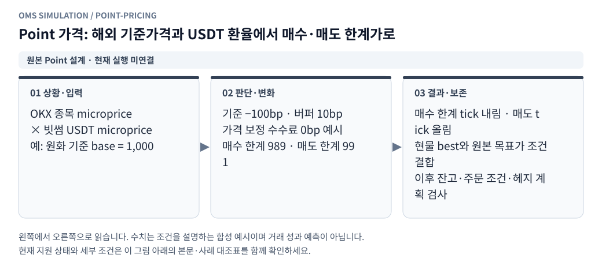
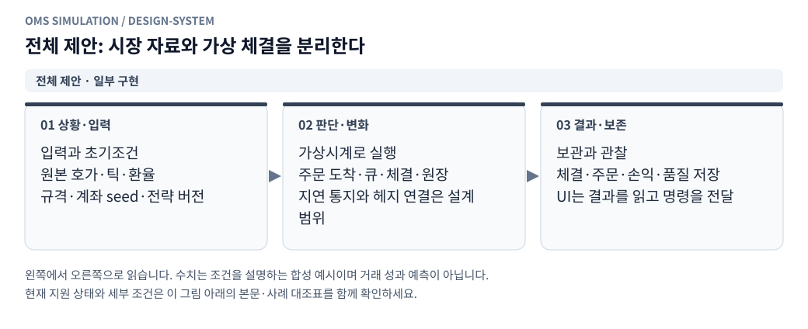
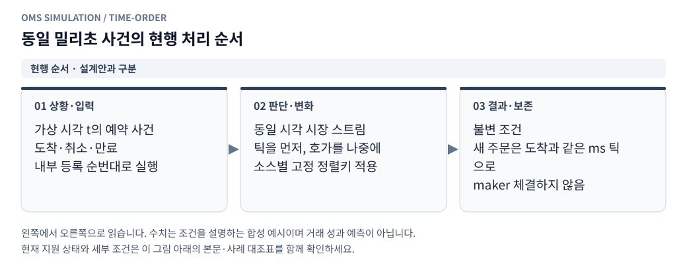
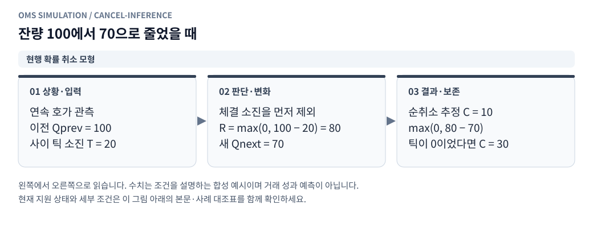
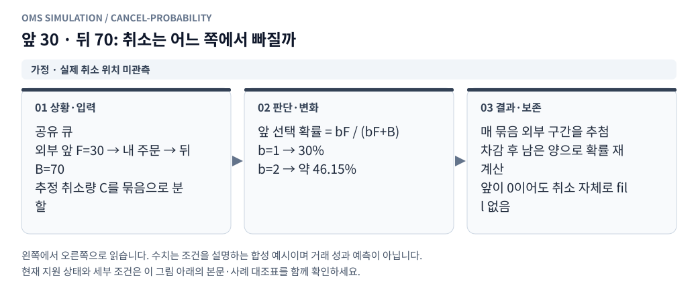

# point2_st 과거 재생 모의매매 구현 설계

[그림으로 보는 문서 안내](visual_guide.ko.md)

작성일: 2026-10-26 KST\
대상: 빗썸 현물 및 OKX 선형 USDT 무기한선물의 복수 지정가·IOC·Post-only·시장가 실행과 헤지\
전략 기준: Tsystem2 `btc_market`, `d7dcd97a35fa32b56813d16b92ee53e1604d5c06`\
상태: 전체 point2 전략을 위한 설계 문서. [현재 재생 모듈](../oms_client/replay/README.md)은 빗썸 현물 지정가·확률 대기열·실행별 계좌·1~32배속 UI를 지원한다. 현재 GTC/IOC/FOK/GTD·Post-only의 범위와 OKX 선물·헤지 등의 미지원 항목은 [지정가 실행 대조표](limit_execution_coverage.ko.md)를 따른다.

실행 범위: **선택 거래소 최소1개·최대2개**. 초기 어댑터는 빗썸·OKX이며 거래용·참조용 source를 모두 선택 집합 안에서 사용한다. 상세 체결 분기는 [지정가 체결 경우의 수](point2_limit_fill_cases.ko.md)를 따른다.

계좌 흐름: [가상계좌 생성과 시뮬레이션](point2_virtual_accounts.ko.md)의 초기조건 revision→실행별 독립 계좌→주문·원장→종료/초기화 계약을 따른다.

첫 실험 프로필: [빗썸 최우선 호가 단순 MM](bithumb_simple_mm.ko.md). 종목·초기 원화·코인을 시작 때 입력하며 원화100만원은 수정 가능한 프리셋이다. 아래 point2 fx·OKX 헤지는 후속 전략 프로필로 보존한다.

## 1. 목표와 확정 조건

이 문서는 실제 주문 로그가 없는 상태에서, 보유한 호가·체결 자료로 빠르게 재생하는 모의매매기를 구현하기 위한 규칙을 정한다.

- 모든 시장 이벤트, 가상 거래소, 전략의 시계는 **원본 `desktopTime`**을 기준으로 한다.
- `serverTime`은 원본 보존·지연 진단에만 사용하며 이벤트 정렬·체결 순서·전략 시계에 사용하지 않는다.
- 주문은 전송 시각에 접수하지 않는다. 거래소별로 입력한 20ms·40ms 등의 지연 후 접수한다.
- 주문 도착 전의 호가·체결 변화를 모두 처리한다.
- 일반 지정가(GTC), IOC, Post-only 중 하나를 주문별로 선택한다. 취소도 지연이 있는 이벤트다.
- 빗썸·OKX 각각 매수·매도 주문을 여러 개 동시에 유지할 수 있다. 같은 가격의 여러 주문과 서로 다른 가격의 호가를 모두 주문별로 관리한다.
- OKX 일반 지정가 GTC·IOC·Post-only는 기본 엔진 지원 범위다. 시장가 헤지는 선택 가능한 실행 프로필이며 OKX를 시장가 전용으로 제한하지 않는다.
- 거래소는 고유 ID로1~2개 선택한다. 종목·통화·OKX swap 같은 시장 구분은 추가 거래소가 아니다. 0개·중복·3개 이상·선택 외 source/주문은 구성 오류다.
- 가상계좌에 거래소별 초기자금·보유 코인·선물 포지션을 저장하고, 고정 revision에서 각 실행의 독립 잔고를 생성한다. 같은 실행의 여러 종목은 venue별 지갑 하나를 공유한다.
- 빗썸 체결에 따라 가상 원화·코인 잔고가 바뀌고, OKX 실제 모의체결에 따라 선물 포지션과 USDT 손익이 바뀐다.
- USDT는 전략 매매 대상이 아니다. 원본 전략의 환산 기준과 OKX 담보·평가 통화로 사용한다.
- 최초 검증은 빗썸 단순 MM으로 하고, 후속 point2 프로필은 CT 예시·`okx_swap` 기준가격 조건을 사용한다. 단순 MM의 종목은 사용자가 입력한다.
- 실제 주문 로그가 없으므로 결과를 **실제 체결 확률로 보정된 예측값**이라고 표시하지 않는다. 가정별 체결 경로와 손익의 민감도를 제시한다.

처음부터 임의의 고정 확률로 주문을 체결시키지 않는다. 가격·수량·대기열·관측 거래량으로 체결을 계산하고, 관측할 수 없는 취소 위치 등을 모형으로 둔다.

사용자 보완에 따른 다중 주문·OKX 지정가의 인터페이스, 주문 집합 관리, 위험·예약·추가 검증은 [모듈 상세 명세](point2_replay_modules.ko.md)의 6.5·14.4·17.5·18.4·26.7절을 함께 따른다. 엔진의 다중 주문 지원과 원본 point2가 실제 생성하는 호가 형태는 구분한다.

단일 거래소는 호환 전략/수동 주문 프로필로 실행한다. 원본 point2 fx는 헤지를 꺼도 OKX CT와 빗썸 USDT 기준가격이 필요하므로 양 거래소를 모두 선택해야 한다. 선택 거래소·기준가격 source는 manifest에 고정하며 세 번째 참조 거래소를 암묵적으로 추가하지 않는다.

## 2. 원본 전략에서 유지할 조건과 실행 방식 변경

확인한 원본은 `point_st2`가 아니라 `sys_v2/strategy/point2_st.js`다. `Point2Strategy`, `quotes`, `makerQuotes`, `hedgePlan` 등의 함수를 내보내며 시계와 거래소를 외부에서 주입받는다. 개인 API·실시간 소켓·DB를 시작하는 `main()`은 재생기에 연결하지 않는다.

### 2.1 가격 조건

<!-- diagram: point-pricing -->



**그림 읽기 · 원본 Point 설계 · 현재 실행 미연결:** 가격계산 수수료 보정과 원장에서 실제 차감하는 수수료는 다르다. Point 원본 microprice와 손익 보고용 USDT 중간가도 목적이 다른 기준이며 섞지 않는다. [수정용 Mermaid 원본](figures/point-pricing.mmd).

해외 기준가격과 빗썸 USDT 환율은 1호가 수량을 교차 가중한 가격이다.

```text
microprice = (bid_price × ask_qty + ask_price × bid_qty)
             / (bid_qty + ask_qty)

base = OKX CT microprice × 빗썸 USDT microprice

bid_limit = tick 내림(base × (1 + (baseline_bps - buffer_bps - pricing_fee_bps) / 10000))
ask_limit = tick 올림(base × (1 + (baseline_bps + buffer_bps + pricing_fee_bps) / 10000))

bid_target = min(bid_limit, 빗썸 best_ask)
ask_target = max(ask_limit, 빗썸 best_bid)
```

기본 기준 조정 -100bp, 버퍼 10bp, 가격계산 수수료 보정 0bp이면 한계가는 `base × 0.989`, `base × 0.991`이다. 가격계산 수수료와 실제 계좌에서 차감하는 수수료는 별개다.

### 2.2 원본 코드 기본값과 프로필

| 항목 | 코드 기본값 | 이번 재생 프로필 |
|---|---|---|
| 종목 | CT | 우선 CT |
| 가격 모드 | `fx` | `fx` |
| 해외 가격원 | `binance` | **`okx_swap` 명시** |
| 방향 | 양방향 | 양방향, 진입/청산 전용도 설정 가능 |
| MA 조정 | 비활성 | 첫 버전 비활성 |
| 기준 조정 / 버퍼 | -100 / 10bp | 동일 |
| 가격계산 수수료 보정 | 0bp | 동일. 실제 수수료로 해석하지 않음 |
| 현물 보유액 한도 | 2,000만원 | 설정으로 저장 |
| 원화 유보액 | 500만원 | 설정으로 저장 |
| 최대 헤지 수량 | 86,000개 | 설정으로 저장. 0의 의미는 원본대로 한도 해제 |
| 헤지 허용 노출 | 5만원 | 설정으로 저장 |
| 담보 활용률 | 0.8 | 단순화한 가상 증거금 모형에 사용 |
| 현물 최소 주문 | 5,000원 | 적용 |
| 현물 수량 단위 | 기본 0.00001 | 종목·버전별 규격을 고정 저장 |
| 매수 용량 계산 수수료 | 기본 10bp | 실제 적용 수수료 입력과 일관되게 검증 |
| 정기 호가 평가 | 기본 500ms | 가상 타이머로 재현 |

README의 운영 프로필과 클래스 기본값은 다르다. 비공개 운영 환경파일은 이 문서에서 읽거나 복사하지 않았다. 위 값이 현재 실제 계좌 설정이라고 주장하지 않는다.

### 2.3 취소·헤지 조건

- 목표가격 변경, 금지된 매매 방향, 주문·보유 한도 초과 등의 원본 취소 조건을 유지한다.
- `bestBidOnly`가 활성화된 프로필이면 매수 목표가가 최우선 매수호가 아래로 밀릴 때 매수를 취소한다. 이 옵션은 항상 켜진 기본 조건이 아니다.
- 같은 가격의 유효 주문은 유지하고 추가 가용 수량은 별도 주문으로 제시할 수 있다.
- 원본은 기준호가가 없거나 오래되면 기존 주문을 유지하고 새 주문을 보류한다. 주문 나이·ping·무체결 시간만으로 취소하지 않는다.
- 원본의 해외 기준호가 신선도는 `now - desktopTime` 기준 -1초~5초다. 빗썸 USDT의 신선도 검사를 추가한다면 원본 대비 변경으로 기록한다.
- 취소 완료·미체결·계좌 확인 전에는 교체 주문을 허용하지 않는다.
- 헤지 목표는 빗썸 가용+잠금 코인 수량의 반대 포지션이다. 원본의 허용 노출·수량 단위를 적용한다.

원본 `fx` 모드의 빗썸은 GTC, OKX는 Post-only 헤지다. **OKX 시장가나 일반 지정가·다단계 호가를 선택하면 명시적인 실행 변형**으로 만든다. 원본의 `postLimitOrder(postOnly=true)`를 가상 어댑터에서 몰래 다른 주문 종류로 처리하지 않는다. 재생용 전략 브리지에 `hedge_execution`과 호가 정책을 추가해 주문 의도를 만들고 변형 내용을 결과에 남긴다.

첫 실행 예시는 `원본 신호 + 빗썸 GTC + OKX 시장가`다. `빗썸 GTC + OKX 일반 지정가 GTC/IOC/Post-only`, `빗썸 IOC + OKX 시장가`, 다중 가격·같은 가격 분할 주문도 선택할 수 있다. 매수·매도 각각 주문 수를 하나로 제한하지 않는다.

## 3. 권장 구조

<!-- diagram: design-system -->



**그림 읽기 · 전체 제안 · 일부 구현:** 전체 목표 구조의 개념도다. 현재 실행은 Python 빗썸 현물이며 제안서의 Node 워커·OKX 실행·지연 통지망은 구현 완료가 아니다. [수정용 Mermaid 원본](figures/design-system.mmd).

```text
OMS_CLIENT 화면 / Flask API
    └─ ReplayJobManager: 실행·진행률·일시정지·중단·결과 관리
        ├─ VirtualAccountService: 계좌 생성·불변 초기조건·복제·초기화
        ├─ Python + DuckDB: 원본 파일 선택, 정규화, 시간순 배치 준비
        └─ Node replay worker: 실행별 별도 프로세스
            ├─ AccountFactory: 선택 거래소별 계좌·opening·초기평가
            ├─ VirtualClock + EventScheduler
            ├─ 원본 Point2Strategy + 재생용 실행 브리지
            ├─ VirtualBithumb / VirtualOKX
            ├─ 원본 호가 / 가상 호가 / 공유 대기열
            ├─ 주문·체결 상태기계
            └─ 실행별 다중 통화 원장
```

제안 파일 배치:

```text
oms_client/replay/
    accounts.py         # 가상계좌·초기조건 revision·실행 binding
    account_repository.py # 계좌 소유권·불변 설정·hash
    jobs.py             # Node 작업 생명주기와 실행 이력
    dataset.py          # 파일 범위·단위 검증·원본 배치 준비
    manifest.py         # 전략 SHA, 데이터 해시, 규격, 설정 저장
    results.py          # 결과·CSV·품질·민감도 집계
oms_client/api/routes/replay.py
replay_worker/
    account_factory.cjs
    account_state.cjs
    runner.cjs
    clock.cjs
    scheduler.cjs
    strategy_bridge.cjs
    book.cjs
    queue.cjs
    matching.cjs
    order_set_manager.cjs
    virtual_bithumb.cjs
    virtual_okx.cjs
    ledger.cjs
    hedge_controller.cjs
```

기존 로그인·파일 탐색·DuckDB 접근 제한·차트는 재사용한다. 기존 단일 KRW 모의계좌 테이블과 구간 평균 체결 백테스트 엔진은 이 재생 원장으로 사용하지 않는다. 긴 작업을 기존 TTL 결과 캐시에만 맡기지 않고 실행별 영구 결과를 보존한다.

전략은 환경변수를 모듈 로딩 때 읽으므로 실행마다 허용된 설정만 전달한 Node 자식 프로세스를 사용한다. 운영 `.env`, 계좌 인증정보, 개인 API 객체는 전달하지 않는다. 같은 가상계좌를 공유하는 여러 종목은 하나의 계좌 원장을 사용해야 하며, 종목별로 현금을 복제하면 안 된다. 병렬화는 우선 독립 실험 사이에서 한다.

## 4. 입력 자료와 정규화

빗썸+OKX point2 프로필의 필수 입력은 빗썸 CT 호가·체결 틱, OKX CT 호가, 빗썸 USDT 호가·실제 잔량이다. 단일 거래소 프로필은 선택 전략·주문 모드에 필요한 소스만 요구한다. OKX GTC·Post-only의 대기 주문을 체결시키려면 **OKX 체결 틱도 필수**이며 방향·가격·계약/코인 수량과 공통 기간을 검증한다. 시장가·IOC의 즉시 체결은 OKX 호가를 주된 입력으로 사용할 수 있다. OKX 틱이 없으면 대기 지정가의 체결을 book touch로 만들지 않고 실행 차단 또는 미확인으로 분류한다.

| 입력 | 정규화 규칙 |
|---|---|
| 기존 빗썸 `b*_q`, `a*_q` | 코인 수량이 아니라 정수 절삭한 호가 금액. 수량은 `금액 / 가격`으로 근사 복원 |
| 기존 OKX `*_q` | 수집 시 계약배수가 반영된 호가 금액인지 검증하고 `금액 / 가격`으로 코인 수량 복원 |
| 새 USDT `bid_size`, `ask_size` | 실제 USDT 수량. 원본 `bithumbMicroprice()`에 넣을 때는 `가격 × 수량`으로 호가 금액 형식에 맞춤 |
| 빗썸 체결 `qty` | 현재 수집기 기준 양수는 매수 주도, 음수는 매도 주도. 절댓값은 코인 수량 |
| OKX 계약 규격 | 선형 여부, `ctVal`, `ctValCcy`, `ctMult`, 결제통화, lot·최소수량·최대주문·가격단위를 검증·고정 |

절삭 전 수량이 `floor(price × qty) = N`이었다면 실제 표시수량은 대략 `[N/price, (N+1)/price)`다. 확인된 절삭 형식에 한해서 시장가 가능 수량은 하한, 초기 앞 대기량은 상한을 사용해 근사 오차 방향을 구분할 수 있다. 단위를 확인하지 못한 소스에 이 식을 임의 적용하지 않는다.

원본 전략의 OKX 어댑터 인터페이스는 코인 환산 수량을 사용한다. 네이티브 계약 수로 변환하는 경계에서만 계약배수를 적용하고 두 번 곱하지 않는다.

### 4.1 이벤트 공통 형식

```text
MarketEvent {
    desktop_time_ms,
    venue,
    symbol,
    kind: BOOK | TRADE | SETTLED_FUNDING,
    source_file_hash,
    source_row_index,
    source_sequence,
    payload,
    quality_flags
}
```

체결 ID가 없는 원본에서 같은 시각·가격·수량이라는 이유로 중복 제거하지 않는다. `(파일 해시, 원본 행 번호)`는 재생용 이벤트 식별자이며 실제 거래소 체결 ID라는 뜻은 아니다. 동일 시간의 실제 교차 스트림 순서는 미확인이다.

빗썸 수집기는 한 수신 배치에 `Date.now()`를 부여하고 각 체결의 `desktopTime`을 1ms씩 증가시키는 코드가 있다. 이를 입력 순서로 그대로 사용하되 1ms 간격이 각각 독립적으로 측정된 수신 지연이라고 해석하지 않는다.

### 4.2 조회·누락 처리

- 차트용 평균·샘플·역순 페이지를 재생 입력으로 쓰지 않는다. 원본을 시간 오름차순으로 읽는다.
- 실제 공통 입력 기간을 검사한다. 특히 USDT 분봉으로 원래 잔량 가중환율을 복원할 수 없다.
- 시작 전 호가 상태를 위한 워밍업 파일을 읽을 수 있으나, 평가 시작 이전의 가상 체결·손익은 만들지 않는다.
- 공백 중에는 이전 호가를 무기한 체결 가능한 호가로 보지 않는다.
- 데이터 공백은 실제 무체결과 다르다. 미체결 주문이 있으면 해당 구간을 `execution_unknown`으로 표시하거나 첫 엄격 실행을 중단한다.
- 원본의 stale 시 주문 유지 정책과, 데이터 부족으로 체결을 판정할 수 없는 상태는 별도 상태로 보존한다.

## 5. 가상 시계와 이벤트 순서

<!-- diagram: clock-pacing -->


**그림 읽기 · 현행 재생 제어:** 명령을 누른 실제 시각이 아니라 같은 가상 시각의 명령을 비교해야 한다. 관측 사이의 가짜 호가·체결은 만들지 않는다. [수정용 Mermaid 원본](figures/clock-pacing.mmd).

<!-- diagram: time-order -->



**그림 읽기 · 현행 순서 · 설계안과 구분:** 현행 빗썸 재생기의 결정적 가정이다. 초기 제안서의 시장 우선 순서와 다르며, 실제 거래소의 미세 순서를 복원한 것은 아니다. [수정용 Mermaid 원본](figures/time-order.mmd).

### 5.1 도착·통지 시각

```text
t_arrive_new    = t_send_new    + order_latency_ms[venue]
t_arrive_cancel = t_send_cancel + cancel_latency_ms[venue]
t_ack_notice    = t_accepted    + ack_notice_latency_ms[venue]
t_fill_notice   = t_fill        + fill_notice_latency_ms[venue]
```

설정한 정확한 시각에 이벤트를 삽입한다. 해당 시각에 원본 행이 없어도 실행한다. 다음 저장 행으로 반올림하지 않고, 관측 사이의 호가 변화를 보간하지 않는다. `desktopTime`이 이미 관측 시점이므로 별도의 시장 수신 지연을 다시 더하지 않는다.

20ms와 40ms 사이에 새 호가·체결이 관측되지 않았다면 두 설정의 결과가 같을 수 있다. 지연 차이를 보이기 위해 가짜 중간 호가나 체결을 생성하지 않는다. 데이터보다 세밀한 실제 시장 변화를 안다고 해석하지 않는다.

전략의 정기 500ms 평가, 헤지 평가 간격, 타임아웃·예약 전환도 가상 이벤트다. 재생 중 실시간 `Date.now()`, 실제 `setTimeout()` 경과시간으로 주문 판단을 하지 않는다. 전략·헬퍼의 시계 사용처를 모두 점검한다.

### 5.2 동시 이벤트

이벤트 키는 `(desktopTime, causal_round, priority, sequence)`로 둔다. 기본 동시각 우선순위 제안은 다음과 같다.

1. 시장 호가·체결 이벤트: 스트림 간 순서는 실행 설정에 고정한다.
2. 주문·취소의 거래소 도착: 접수 시퀀스로 정렬한다.
3. ACK·체결·취소·계좌 통지.
4. 전략 평가·헤지 평가 타이머.
5. 결과 스냅샷.

이는 같은 밀리초의 실제 선후관계를 안다는 뜻이 아니다. 시장 우선/주문 우선 등 다른 순서의 결과도 비교할 수 있게 한다. 0ms 지연을 허용할 경우 자식 이벤트가 원인 이벤트보다 먼저 실행되지 않도록 `causal_round`를 증가시키며, 무한 재주문 감지 상한을 둔다. 첫 지연 실험은 양수 20ms·40ms를 사용한다.

## 6. 주문 상태와 취소

공통 주문 레코드는 요청 수량, 누적 체결 수량, 대기 잔량, 취소 수량, 거절 수량, 미확인 수량을 따로 보존한다.

```text
CREATED -> SENT -> ARRIVED -> LIVE -> PARTIALLY_FILLED -> FILLED
                    ├-> REJECTED
                    └-> CANCELED
LIVE / PARTIALLY_FILLED -> CANCEL_SENT -> CANCELED 또는 FILLED
```

`CANCEL_SENT`는 체결이 가능한 주문이다. 실제 취소 도착 전의 거래량은 정상적으로 체결에 사용할 수 있다. 취소 응답이 늦게 도착해도 이미 체결된 수량을 되돌리지 않는다.

모형의 미확인 수량·MODEL_UNKNOWN은 실제 거래소 취소가 아니다. 자료 부족으로 중단해도 예약·잠재 노출을 확정 취소처럼 해제하지 않는다. 전송/통지 지연과 체결 자료 부족을 구분한다.

- GTC: 도착 시 가격 제한 안에서 즉시 체결하고 남은 수량을 대기열 뒤에 넣는다.
- IOC: 도착 시 가능한 수량만 체결하고, 관측된 호가 범위 내에서 판단할 수 있는 미체결 잔량을 취소한다. 대기 주문으로 남기지 않는다.
- Post-only: 도착 당시 상대 호가와 체결 가능하면 주문 전체를 체결 없이 취소한다. 원래 전송 시점의 가격으로 판정하지 않는다.
- IOC의 거래소 상태 `done`을 전량 체결로 해석하지 않는다. 체결 수량과 취소 잔량이 함께 존재할 수 있다.
- 가격·수량 정정의 대기순번 보존 여부는 거래소·변경 종류별 명시 규칙이다. 첫 버전은 빗썸 취소 확인 후 신규 주문으로 처리하고 신규 주문의 순번을 다시 부여한다.
- 서버 주문 ID를 받기 전의 수동 취소는 `cancel_on_ack`로 기록한다. ACK를 받은 후 취소 전송 지연이 시작되는 클라이언트 동작을 기본으로 한다. 다른 정책은 설정으로 분리한다.
- 일시정지/재생 중단과 주문 취소는 별개다. 일시정지는 가상 시계를 멈추고, 주문 취소는 시계 안에 취소 도착 이벤트를 만든다.

## 7. 원본 호가와 내 주문을 반영한 가상 호가

<!-- diagram: depth-debt -->


**그림 읽기 · 현행 모형 가정:** 내 가상 소비와 원본 외부 틱 소비는 다른 근거다. 이 보수 모형은 현실의 재보충을 완벽히 복원하지 않는다. [수정용 Mermaid 원본](figures/depth-debt.mmd).

한 개의 호가 객체를 덮어쓰지 말고 다음 계층을 둔다.

| 계층 | 역할 |
|---|---|
| `raw_book` | 마지막으로 처리한 원본 외부 호가 |
| `own_orders` | 접수된 내 주문의 가격·잔량·접수 순번 |
| `execution_depth` | 원본 호가에 미반영된 소진·내 주문의 소진을 차감한 체결용 잔량 |
| `visible_book` | 전략에 전달된 외부 호가와 내 공개 주문의 합성 결과 |
| `queue_book` | 가격별 외부 구간과 내 주문 노드의 대기순번 |

내 가상 주문은 원본에 없었다. 따라서 원본 수량에서 내 주문을 먼저 빼지 않는다. 접수된 대기 주문을 합성하고, 체결·취소된 부분을 제거한다. 100/102원 원본 호가 사이에 내 매수 101원이 접수되면 가상 최우선 매수는 101원이 된다.

raw 표시상 교차와 실제 execution depth를 구분한다. 이미 대기 중인 주문을 상대 quote가 넘어갔어도 tick 없이 자동 전량체결시키지 않는다. 소진 부채로 유효량이 없는 가격의 raw 수량을 재사용하지 않는다.

매칭 엔진은 접수 직후 상태를 알지만 전략은 `own_book_notice_latency_ms` 이후에 공개 반영을 관측하도록 할 수 있다. 내 주문의 실제 상태와 전략에 보이는 상태를 분리한다. 상대편에 내 주문이 있으면 자기 체결 방지 정책을 적용하고, 자기 주문과의 체결로 수익을 만들지 않는다.

### 7.1 같은 잔량을 반복 사용하지 않기

- 시장가·IOC가 소진한 외부 수량은 가격별 `self_depletion`에 기록한다. 같은 실험의 다른 주문이 다시 사용할 수 없다.
- 원본 체결로 소진된 수량 중 아직 호가 갱신에 반영되지 않은 부분은 `pending_public_depletion`으로 관리한다.
- 이후 절대값 호가 스냅샷이 반영되면 공공 체결 소진과 정합 처리해 같은 거래를 두 번 차감하지 않는다.
- 반복 표본을 새 유동성으로 간주하지 않는다. 새 잔량 증가분을 반영하면서 소진 부채까지 같은 양 줄이면 보충량을 두 번 더하게 된다.
- 내 가상 소진은 원본 자료에 없으므로 공공 체결 소진과 다른 부채다. 기본 보수 모형에서는 가격대 생명주기가 유지되는 동안 남긴다.
- 가격대가 관측 범위 안에서 실제로 0이 됐다가 재생성됐음이 확인될 때만 해당 외부 가격대의 생명주기를 새로 연다. top5 밖으로 밀린 것은 0 확인이 아니다.

재정합을 위한 정확한 신규 주문량·취소량은 L2만으로 알 수 없다. 스냅샷 처리 정책과 정합 불일치를 실행 결과에 남긴다. 내 주문 때문에 외부 참여자가 다르게 행동하는 경로까지 실제처럼 복원하는 것은 이 원본 고정 재생 모형의 범위 밖이다.

### 7.2 첫 버전의 체결용 외부 잔량 부채

가격별로 `effective_depth = max(0, raw_qty - self_depletion - pending_public_depletion)`를 사용한다. 두 부채는 공개 표시 잔량을 바꾸는 원본 데이터가 아니라, 같은 실험에서 이미 사용한 잔량의 재사용을 제한하는 기록이다.

- 내 공격 주문의 체결은 `self_depletion`을 늘린다. 내 대기 주문의 체결은 내 주문·대기열을 줄이며 이 부채를 추가로 늘리지 않는다.
- 원본 체결 틱은 전체 원본 체결량을 `pending_public_depletion`에 반영한다. 이때 이전 호가 감소 크레딧으로 이미 설명된 양은 제외한다.
- 새 스냅샷에서 관측된 수량 감소와 기존 공공 체결 부채를 오래된 것부터 한 번 매칭한다. 매칭한 양만 공공 체결 부채에서 제거하고 새 절대 원본 수량을 적용한다. 내 공격 주문의 부채는 그대로 둔다.
- 예를 들어 원본 수량 1,000개에서 체결 틱 100개를 먼저 받으면 체결용 잔량은 900개다. 이후 원본 수량 900개 스냅샷에서 공공 부채 100개를 해소하므로 체결용 잔량은 계속 900개다. 800개로 두 번 줄이지 않는다.
- 스냅샷 감소가 먼저였다면 크레딧을 보관해 뒤늦은 틱에서 같은 소진을 다시 추가하지 않는다.
- 새 절대 원본 수량이 증가하면 그 증가가 식에 한 번 반영된다. 같은 양을 부채에서도 빼서 두 번 보충하지 않는다.
- 설명되지 않는 공공 체결 부채를 시간 경과만으로 지우지 않는다. `depth_reconciliation_incomplete`로 남기고, 사용할 잔량이 없거나 정합 신뢰가 필요한 주문은 품질 정책에 따라 중단/미확인 처리한다.

이 delta 기반 부채 정책은 동시에 일어난 보충·취소를 완전히 알 수 없어 체결용 잔량을 작게 볼 수 있다. 더 유연한 절대 스냅샷 재앵커 모형은 별도 버전으로 비교할 수 있지만, 첫 버전에서 부채를 조용히 초기화하지 않는다. 원본 고정 재생의 한계를 결과에 보존하기 위한 선택이다.

## 8. 지정가 대기열: 첫 버전의 핵심 알고리즘

<!-- diagram: queue-budget -->


**그림 읽기 · 현행 공유 FIFO:** 각 주문에 원본 틱 125개를 다시 주면 과체결이다. 더 우선한 외부 가격대가 없고 큐 위치를 아는 합성 예시다. [수정용 Mermaid 원본](figures/queue-budget.mmd).

이 알고리즘은 빗썸·OKX 모두에 적용한다. 큐는 거래소·종목·방향·가격별로 분리하며 한 거래소의 tick을 다른 거래소 주문 체결에 쓰지 않는다. 가격 우선, 같은 가격 접수순 FIFO를 적용하고 여러 매수·매도 주문의 부분체결·개별 취소를 독립 처리한다.

### 8.1 가격별 공유 대기열

가격마다 외부 구간과 내 주문 노드를 접수 순서대로 둔다.

```text
가격 p: [외부 구간 A] -> [내 주문 O1] -> [이후 외부 구간 B] -> [내 주문 O2] -> [외부 구간 C]
```

내 주문마다 독립적으로 외부 체결량을 차감하면 같은 물량이 중복 사용된다. 반드시 이 공유 대기열에서 한 번만 배분한다.

새 주문 도착 시:

1. 도착 전 시장 이벤트를 모두 처리한다.
2. 자기 체결 방지·잔고·가격단위·최소수량을 검사한다.
3. 상대편과 체결 가능하면 주문 조건에 따라 즉시 체결 또는 Post-only 취소를 처리한다.
4. 남은 GTC 잔량만 해당 가격 대기열 끝에 추가한다.
5. 그 가격의 외부 잔량과 앞선 내 주문은 신규 주문보다 앞에 있다.
6. 이후 확인되는 같은 가격의 신규 외부 물량은 기존 내 주문 뒤에 배치한다.

실제 수량을 모르고 호가 금액을 복원하는 구간에서는 초기 외부 앞 물량에 수량 상한과 `queue_ahead_multiplier`를 적용할 수 있다. 이 배수는 보정된 사실이 아니라 숨은 물량·해석 오차에 대한 시나리오다.

배수로 늘린 부분과 미확인 앞 물량 부채는 **비표시 대기열 여유**다. `visible_book`, microprice, 시장가 체결 가능 잔량을 늘리지 않는다. 새 내 주문은 기존 공유 대기열 끝에 추가하고, 같은 원본 외부 물량을 다시 생성하지 않는다.

### 8.2 반대 방향 체결량 배분

매도 주도 체결이면 매수 대기열을 높은 가격부터, 매수 주도 체결이면 매도 대기열을 낮은 가격부터 소진한다. 동일 가격에서는 접수 순서를 따른다.

관측 체결가격을 `p_trade`라 하면 매도 주도 체결은 **매수가격 p >= p_trade**, 매수 주도 체결은 **매도가격 p <= p_trade**만 대상이다. 그 범위에서 다 쓰지 못한 거래량은 미배분으로 남긴다. 더 불리한 가격까지 내려가거나 올라가면서 가상 체결을 만들어내지 않는다.

```text
가격 p에 내 매수 200개, 앞선 외부 물량 1,000개:
매도 주도 체결 800개 -> 앞 물량 200개, 내 체결 0개
추가 매도 체결 300개 -> 앞 물량 0개, 내 체결 100개, 내 잔량 100개
```

취소는 순번만 바꾼다. 내 주문의 체결은 반대 방향 공격 거래량이 배분될 때 발생한다.

### 8.3 가격 관통과 스프레드 안쪽 주문

매수 주문이 p원에 대기하는데 실제 매도 주도 체결이 p보다 낮은 가격에서 관측됐다면, 가상 주문이 그 거래량을 먼저 받을 수 있었던 후보로 본다. 매도 주문은 대칭이다.

예: 원본 호가 100/102원 사이에 내 매수 101원·10개가 접수돼 있다. 이후 100원 매도 주도 체결 4개가 관측되면, 가상 시장에서는 가격 우선으로 내 101원 매수가 4개 체결될 수 있다. 내 주문의 체결가격은 101원이며 원본의 100원으로 가격을 개선해 주지 않는다.

이 규칙은 같은 공격 거래량이 가상 주문에도 도착한다는 가정이다. 해당 이벤트의 관측 수량을 넘겨 체결하지 않고, 더 우선하는 알려진 외부·내 주문을 먼저 처리한다. quote가 가격을 건드렸거나 지나갔다는 이유만으로 잔량 전체를 체결하지 않는다. 원본 외부 체결 경로는 내 주문으로 대체될 수 있으므로 이후 외부 시장의 정확한 반응까지 일치하는 것은 아니다.

### 8.4 첫 모형: 거래량으로만 순번 전진

`queue_model = trade_only`를 기본으로 한다.

- 앞 수량은 관측된 반대 방향 체결량으로만 줄인다.
- 스냅샷의 잔량 감소만으로 앞 수량을 줄이지 않는다.
- 취소·정정에 의한 외부 감소는 내 뒤에서 일어났다고 가정한다.
- 뒤 물량으로 설명되지 않는 감소는 `queue_inconsistent`로 표시한다. 앞 물량을 새 표시잔량에 맞춰 자동 축소하지 않는다.
- 앞 수량이 현재 표시잔량보다 커질 수 있다. 이는 취소 위치를 알 수 없어 보존한 보수적 대기량이며 실제 정확한 순번이라고 표시하지 않는다.
- top5 밖으로 이탈한 가격대의 앞 물량을 0으로 초기화하지 않는다. `queue_unobservable` 상태를 유지하고 실제 관측 체결로 판정 가능한 부분만 처리한다.

이 모형은 체결을 적게 보는 경향이 있지만 손익의 보장된 하한은 아니다. 불리한 거래를 덜 체결시키면 오히려 손익이 높아질 수 있다.

## 9. 주문 로그 없이 추가할 수 있는 취소 위치 모형

<!-- diagram: cancel-inference -->



**그림 읽기 · 현행 확률 취소 모형:** 체결과 취소가 함께 발생하면 순변화만 추정한다. 틱 유실·수신 역전이 있으면 실제 취소량과 다를 수 있다. [수정용 Mermaid 원본](figures/cancel-inference.mmd).

<!-- diagram: cancel-probability -->



**그림 읽기 · 가정 · 실제 취소 위치 미관측:** 30%는 다음 취소 추첨의 앞쪽 선택 확률이다. 내 주문 체결 확률 또는 전체 취소량의 고정 비율이 아니다. [수정용 Mermaid 원본](figures/cancel-probability.mmd).

두 번째 모형은 `queue_model = proportional_cancel`이다. 거래량 전용 모형과 항상 나란히 비교한다. 이 모형의 파라미터를 실제 취소 확률을 추정한 값으로 표시하지 않는다.

### 9.1 체결과 취소 후보를 구분

같은 가격의 원본 외부 수량을 `R_prev`, `R_now`, 해당 관측 사이에 정합된 **전체 원본 체결량**을 `V_raw`라고 하면 순감소 취소 후보는 다음과 같다.

```text
C_candidate = max(0, R_prev - R_now - V_raw)
A_candidate = max(0, R_now - R_prev + V_raw)
```

신규 주문과 취소가 동시에 일어나면 순감소만 보이므로 실제 취소량 전체를 복원하는 식은 아니다. 내 가상 주문에 배분된 체결량을 `V_raw`에서 빼면 안 된다. 원본 체결·원본 스냅샷의 정합과 가상 주문의 체결 배분은 별도 장부다.

`A_candidate`는 관측 체결로 설명한 순증가 추정량이며 실제 신규 주문량 전체가 아니다. 후보는 해당 시각까지 들어온 자료로만 계산한다. 이미 적용한 증가량을 가격·관측 구간 ID별로 저장하고, 추가로 확인된 양만 **확인된 현재 가상시각의 기존 내 주문 뒤**에 넣는다. 늦은 자료로 과거의 새 주문 위치를 소급 변경하지 않는다. 외부 증가 위치도 추정이며 이로 인한 대기열 불확실성을 남긴다.

구현은 가격별 정합 장부를 둔다.

- 호가 감소가 먼저 오면 감소 크레딧을 보관한다. `sync_window_ms`가 닫히기 전에는 순번을 당기지 않는다.
- 체결 틱이 먼저 오면 관측 체결량을 보관한다. 이후 호가 감소와 겹치는 부분을 매칭한다.
- 하나의 체결량·감소 크레딧은 한 번만 매칭한다.
- 정합 창이 닫힌 시각에만 미설명 순감소를 취소 후보 이벤트로 확정한다. 미래 자료로 과거 순번·체결을 소급 수정하지 않는다.
- 증가·체결·취소를 대기열에 각각 독립적인 전체 물량으로 중복 반영하지 않는다. 적용한 후보량과 미정합량을 구간별 장부에서 대사한다.
- 창이 닫힌 후 도착한 늦은 체결은 `late_reconciliation`으로 기록한다. 영향받은 주문을 불확실로 표시하며 결과를 정상 확정 체결처럼 숨기지 않는다.
- 수량 증가, 가격대 이탈, 공백 때문에 설명이 안 되면 임의의 취소량을 만들지 않는다.

첫 버전의 `trade_only`는 이 불확실한 취소 후보로 앞 수량을 변경하지 않으므로 정합 파라미터에 덜 의존한다.

### 9.2 한 개 주문에서의 취소 위치

내 앞 외부 수량 A, 뒤 외부 수량 B에 대해 다음과 같은 비교 모형을 둔다.

```text
x = A / (A + B)
F(x) = x^gamma / (x^gamma + (1-x)^gamma), gamma > 0

앞에서 취소된 것으로 배분할 비중 = F(x)
```

`gamma = 1`은 외부 수량에 비례한 배분이다. 취소 후보량만큼 외부 물량을 줄이고, 이후 실제 반대 방향 거래량이 들어올 때 내 주문을 체결한다. 취소만으로 내 주문을 체결하지 않는다.

### 9.3 여러 내 주문이 있는 경우

주문별로 위 비율을 독립 적용하면 같은 외부 취소량을 여러 번 사용한다. 가격별 공유 대기열의 **외부 구간**에 한 번만 배분한다.

1. 내 주문 노드를 제외한 총 외부 수량을 Q로 계산한다.
2. 각 외부 구간의 시작·끝 누적 위치를 Q로 나눠 `x_start`, `x_end`를 만든다.
3. 그 구간의 가중치를 `F(x_end) - F(x_start)`로 정한다.
4. 취소 후보 C를 가중치로 배분하되 구간 수량을 넘지 않게 한다. 남은 취소 후보는 수량이 남은 외부 구간에 재배분한다.
5. 내 주문 노드는 외부 취소 모형으로 제거하지 않는다.
6. 각 내 주문 앞의 합계 수량을 다시 계산한다.

총 차감량은 `min(C, 알려진 외부 구간 총수량)`을 넘지 않는다. 수량 정밀도에 따른 잔여분과 잘린 후보량을 기록한다. 같은 가격에 새 내 주문이 추가돼도 기존 외부 구간을 다시 초기화하거나 원본 전체 잔량을 한 번 더 앞에 넣지 않는다.

### 9.4 여기서 말하는 확률의 의미

위 비율대로 수량을 배분하는 첫 구현은 **결정적 모형**이다. 동일 데이터·설정이면 결과가 같으며 시드만 바꿔도 새로운 결과가 나오지 않는다.

실제 주문 로그가 없으면 숨은 물량, 취소의 실제 위치, 숨은 주문의 우선순위를 식별할 수 없다. 따라서 첫 결과는 다음처럼 표시한다.

- 거래량 전용 가정의 체결률·부분체결량·대기시간.
- 취소 위치 추정 가정의 체결률·부분체결량·대기시간.
- 지연·초기 앞 물량·동시각 우선순위에 따른 결과 차이.

이 결과를 “이 주문이 실제로 체결될 확률 73%”처럼 표시하지 않는다. 추후 무작위 취소 배분이나 지연 분포를 명시적으로 추가한 경우에만 반복 실행의 체결 빈도를 낼 수 있고, 그 값도 **선택한 가정에 조건부인 모의 빈도**로 이름 붙인다. 실제 확률로 보정됐다는 뜻은 아니다.

## 10. 즉시 체결: 양 거래소 GTC의 공격 부분, IOC, OKX 시장가

도착 시각의 `execution_depth`에서 매수는 낮은 ask부터, 매도는 높은 bid부터 순차 소진한다. GTC·IOC의 한계가격을 넘지 않는다. Post-only는 소진 전에 교차 여부부터 판정한다.

```text
매도호가: 100원 4개, 101원 6개
시장가 7개 매수: 100원 4개 + 101원 3개
평균체결가: (100×4 + 101×3) / 7

100원 IOC 7개 매수: 100원 4개 체결 + 3개 취소
100원 GTC 7개 매수: 100원 4개 체결 + 3개 매수 대기
100원 Post-only 7개 매수: 전량 취소, 체결 0개
```

호가 깊이로 발생한 비용은 이미 평균체결가에 들어 있다. 별도 추가 슬리피지를 사용한다면 지연·깊이 비용과 겹치지 않는 추가 스트레스 가정임을 명시한다.

OKX 일반 지정가도 도착 시 가능한 부분은 taker, 남은 부분은 자기 거래소의 큐에서 maker로 체결될 수 있다. Post-only는 도착 시 교차하면 조건 취소다. 여러 OKX 주문은 각각 한도 가격·접수 순번·잔량·maker/taker 비용을 가진다.

최대 5호가를 다 사용했는데 주문 잔량이 남으면 깊이 밖 체결은 추정할 수 없다. 마지막 가격에 무제한으로 채우지 않는다. 첫 엄격 모형은 해당 주문/실행을 `depth_insufficient`로 표시해 부분 결과와 원인을 남기고, 완전한 손익 결과로 분류하지 않는다. 최유리 단일 호가 IOC와 여러 호가를 소진할 수 있는 일반 지정가 IOC도 구분한다.

OKX 시장가 헤지는 거래소 가격 보호·네이티브 계약 단위의 영향을 받는다. 역사 가격 제한을 확인할 수 없으면 사용한 보호 가격 가정을 명시한다. 전략이 요구하는 추가 가격 상한을 실제 IOC로 구현한다면 주문 종류도 보호 IOC로 표시하고 순수 시장가와 구분한다.

## 11. 가상 계좌: 실제 상태와 전략이 아는 상태

<!-- diagram: truth-observed -->


**그림 읽기 · 통지 설계 · 현재 미지원:** 포지션만 먼저 늘리거나 약정만 먼저 줄인 중간 상태로 헤지를 계산하면 중복 또는 과소 주문이 발생한다. 지연 통지망은 현행 미연결이다. [수정용 Mermaid 원본](figures/truth-observed.mmd).

사용자가 만든 가상계좌 설정은 이름·소유자·거래소별 초기자산·원가·포지션·레버리지를 revision으로 저장한다. 실행은 계좌ID·revision·hash를 고정하고 거래용 venue별 run_account_id를 만든다. 다른 실행의 가변 잔고는 공유하지 않는다. 참조 전용 venue는 source만 제공하고 주문 지갑·자산을 갖지 않으며 최대2개에는 포함한다.

시작 시각에 OPENING_BALANCE/OPENING_POSITION을 한 번 적용하고 초기평가·사용증거금·truth/observed를 일치시킨 뒤 전략을 시작한다. 초기 주문 예약은0이지만 비영 초기 선물 포지션의 사용 증거금은 계산한다. 기존 보유 평가손익과 초기 자금은 기간 수익으로 만들지 않는다.

각 거래소는 `truth_state`와 `observed_state`를 둔다.

- `truth_state`: 가상 거래소에서 실제 접수·부분체결·취소된 상태. 체결·잔고 검사에 사용한다.
- `observed_state`: 지연된 ACK·체결·계좌 이벤트로 전략에 전달된 상태. 전략 판단에 사용한다.
- 전송 중 현지 예약: ACK를 기다리는 동안 같은 가용잔고를 중복 약정하지 않게 한다.

보낼 때는 클라이언트 예약을 만들고, 도착해서 거래소가 수락하면 거래소 예약으로 전환한다. 전략이 아직 오래된 계좌 스냅샷을 보고 있다면 확인됐지만 스냅샷에 미반영된 잠금액도 가용잔고에서 공제한다. 같은 예약을 클라이언트와 거래소 잠금액으로 두 번 차감하지 않도록 예약 ID·계좌 버전을 연결한다.

계좌·주문 이벤트에는 `venue_version`, `cumulative_filled_qty`를 둔다. 늦은 ACK가 이미 체결·취소된 주문을 LIVE로 되돌리지 못하게 한다. 통지 순서가 달라도 누적 체결량은 감소하지 않는다.

가격은 가능한 경우 정수 tick 단위, 내 주문 수량은 정수 lot 단위로 처리한다. 호가 금액에서 복원한 외부 추정 수량은 범위·정밀도를 보존하고, 현금·수수료·원가는 Decimal 또는 고정 소수점으로 계산한다. 종목별 내림·올림·잔여량 반올림 정책을 manifest에 고정하며 JS 부동소수점의 정확한 등호 비교에 회계 불변식을 의존하지 않는다.

### 11.1 빗썸 원장

보유수량 q, 수수료 제외 평균원가 A로 관리한다. 첫 버전의 현물 매매 수수료 통화는 KRW로 명시한다.

- 매수 체결 d개·가격 P: 원화에서 `d×P + fee` 차감, 코인에 d 추가. 평균원가는 `(q×A+d×P)/(q+d)`로 계산한다.
- 매도 체결 d개·가격 P: 코인 d 차감, 원화에 `d×P-fee` 추가. 수수료 제외 실현손익은 `d×(P-A)`다.
- 누적 수수료를 별도로 보존한다. 환급은 음수 비용으로 처리한다.
- GTC 미체결 잔량에 필요한 금액·코인만 잠근다. 매수 가격 개선, 부분체결, 취소 후 예약액을 다시 계산한다.
- 초기 코인을 보유한 실험은 초기 원가를 입력하거나, 시작 시 평가가격을 원가로 사용했다는 가정을 명시한다.

```text
현물 거래 손익 = 실현손익(수수료 제외) + 미실현손익 - 누적 수수료
현물 자산가치 = 원화 총잔고(가용+잠금) + 코인수량 × 평가가격
```

원화 총잔고에 이미 수수료가 반영됐으므로 자산가치에서 수수료를 다시 차감하지 않는다.

### 11.2 OKX 선형 USDT 선물 원장

가상 어댑터의 포지션 q는 부호 있는 **코인 환산 수량**이다. 매수 체결 d는 양수, 매도 체결 d는 음수로 표현한다.

같은 방향 증가이면 평균진입가를 가중평균한다. 반대 방향 체결의 청산 수량은 `c=min(abs(q),abs(d))`다.

```text
청산 실현손익 = c × (체결가격 P - 평균진입가 A) × sign(q)
지갑잔고 W += 청산 실현손익 - 수수료 + 확정 펀딩
미실현손익 = q × (평가가격 - A)
계좌 평가액 = W + 미실현손익
```

반대 체결이 기존 포지션을 넘으면 초과분은 새 방향의 포지션이며 평균진입가는 그 체결가격이다. 포지션이 0이면 평균진입가를 비운다.

초기 선물 포지션이 0이 아니면 초기 평균진입가를 입력하거나 시작 평가가격을 원가로 삼았다는 가정을 명시한다. 초기 미실현손익도 시작 총평가액에 포함해 기존 보유손익을 새 전략이 번 수익으로 만들지 않는다.

선물 주문 명목금액을 지갑에서 차감하지 않는다. 단순 증거금 모형에서는 사용 증거금을 명목금액/레버리지로 계산하고, 주문 예약 증거금을 별도로 제한한다. 증거금은 비용이 아니라 자산의 사용 제한이다.

정확한 거래소 증거금·강제청산 재현에는 마크가격·유지증거금 구간·가격 보호·계좌 모드 자료가 더 필요하다. 첫 버전이 호가 기반 평가가격과 단순 증거금 모형을 쓰면 그 한계를 표시하고, 담보 부족 시 신규 증가 주문을 거절한다. 모형이 없는 강제청산 가격을 정확한 거래소 값처럼 만들지 않는다.

### 11.3 펀딩·환산·종료 평가

- 펀딩 관측 스냅샷을 행마다 지갑에 합산하지 않는다. 확정 정산 자료가 있으면 정산 시각에 한 번 적용한다.
- 확정 자료가 없으면 펀딩 제외 손익을 표시하거나 명시한 추정 정산 모형을 사용한다. “펀딩 포함 확정 순손익”으로 표시하지 않는다.
- 원화와 USDT 원장을 원통화로 보존한다. 원화 합산 평가액과 환산율 변화 효과를 별도로 보여준다.
- 총평가액은 `빗썸 원화 총잔고 + 현물 평가액 + OKX 계좌 평가액 × 평가환율`이다. 잠금액·증거금·누적 수수료를 다시 빼지 않는다.
- 평가 기간의 입출금이 있으면 자산 증감에서 순입출금을 분리한다. 첫 실험은 초기 자금만 넣고 중간 입출금 없이 진행한다.
- 종료 시각에 남은 포지션은 평가액으로 남긴다. 종료 이후의 미래 호가로 가짜 청산을 만들지 않는다.
- 종료 청산 비용을 보고 싶다면 마지막 관측 호가에서 별도 추정 청산가치를 산출한다. 실제 체결 원장과 구분하며, 지연 청산을 실행하려면 그 기간의 데이터까지 명시적으로 포함한다.

위 다중 통화 합산은 빗썸+OKX 프로필이다. 단일 거래소는 해당 원통화 성과를 기본으로 하며 OKX 단독의 KRW 환산을 위해 선택하지 않은 빗썸 source를 자동 추가하지 않는다. 고정 환산 가정을 별도로 쓰면 값·출처를 명시한다.

초기화는 과거 실행·원장 삭제가 아니라 지정 초기조건으로 새 revision을 만드는 동작이다. 같은 조건 재실행은 새 run 계좌, pause/resume은 동일한 살아 있는 worker를 사용한다. 가용 잔고만 복사해 대기 주문·예약·미통지·미확인을 버린 채 이어 실행하지 않는다.

## 12. 부분체결에 따른 OKX 헤지

<!-- diagram: hedge-exposure -->


**그림 읽기 · 양 거래소 헤지 설계 · 미연결:** 코인 환산 수량이 같은 단순 예시다. 계약 승수·반올림·가격·환율 위험을 별도로 처리해야 한다. [수정용 Mermaid 원본](figures/hedge-exposure.mmd).

원본 신호와 수량 조건을 유지하면서 시장가 또는 지정가 헤지 실행을 지원한다. 하나의 헤지 목표량을 여러 가격의 주문으로 나눌 수 있고, 양 거래소에 일반 매수·매도 호가도 여러 개 동시에 존재할 수 있다. 실제 헤지 위험과 새 주문 필요량은 다른 값이다.

```text
E_truth = 빗썸 실제 코인 총수량 + OKX 실제 코인환산 포지션 - 목표 순노출

new_hedge_intent = -E_observed - signed_working_hedge_remaining
```

`E_truth`는 실제 위험 표시와 가상 거래소 위험 검사에 사용한다. 전략은 지연된 계좌·체결 정보의 `E_observed`로 판단한다. 진행 중 헤지 잔량은 이미 헤지된 포지션으로 세지 않고, 추가 중복 주문을 막는 데만 쓴다.

**관측 포지션과 진행 중 헤지 잔량은 같은 관측 버전 기준**이어야 한다. 여기에 아직 해당 관측에 반영되지 않은 현지 전송 의도를 합친다. 실제 남은 주문량과 오래된 관측 포지션을 섞으면 안 된다. 예를 들어 30개 헤지를 전송해 실제로 20개가 체결됐지만 포지션 통지가 아직 없으면, 전략 관측상 진행 중 약정은 여전히 30개다. 실제 잔량 10개만 공제해 추가 20개를 다시 보내지 않는다. 관측 OKX 포지션 `0→-20`, 진행 중 헤지 약정 `-30→-10`을 같은 계좌/체결 버전에서 함께 전환한다.

```text
빗썸 매수 30개 체결 -> 실제 미헤지 +30
체결 통지 도착 -> OKX 매도 30개 상당 전송
OKX 20개 상당 체결, 10개 진행 중 -> 실제 미헤지 +10
이때 빗썸 추가 20개 체결 -> 실제 미헤지 +30
새 관측 상태가 확인되면 기존 진행 중 10개를 빼고 추가 20개 주문 의도
```

첫 구현은 의도·예약·관측 갱신을 이벤트 경계에서 순서대로 확정한다. **동시에 살아 있는 주문을 하나로 제한하지 않는다.** 같은 방향 여러 지정가 child의 약정을 모두 합산하고 중복 목표량만 제거한다. 체결·취소·계좌 정보가 불일치하면 추가 주문을 보류한다. 최소 계약 단위 미만 잔여 노출은 누적하고 원본 허용 노출·단위 규칙을 적용한다. 축소 주문은 다른 reduce-only 주문의 누적 약정과 실제 포지션 범위를 함께 검사한다.

위 새 헤지 식의 진행 중 약정은 같은 헤지 목표 그룹의 합계다. 일반 양방향 호가를 단순 순상쇄해 위험이 없다고 보지 않는다. 포지션 q, 매수 잔량 B, 매도 잔량 S에 대해 `q+B`, `q-S`의 한쪽 체결 시나리오와 가격·수수료·담보를 별도로 검사한다. 전송 중·취소 대기 수량도 포함한다. 같은 계좌의 일반 호가와 헤지 의도는 주문 집합 조정기에서 목적·목표 배분을 조정한다.

`order_group_id`, `quote_slot_id`, plan revision으로 각 가격대의 유지·추가·취소·교체를 관리한다. 주문 하나를 교체해도 다른 슬롯의 유효 주문은 유지한다. 지정가 잔량의 재호가·시장가 전환은 명시한 정책에 따르며, 미체결이라는 이유만으로 자동 시장가 체결을 만들지 않는다.

각 모의체결에 고유 `fill_id`를 부여하고, `maker_fill_id -> hedge_intent_id -> hedge_order_id -> hedge_fill_id` 관계를 보존한다. 같은 부분체결 통지를 두 번 처리하지 않는다. 취소 요청 뒤에 들어온 빗썸 체결도 헤지 대상이다.

원본은 난수 기반 client ID를 만들 수 있다. 재생 브리지는 `P2H` 등의 식별 규칙을 유지하면서 실행 내 순번 기반 정규 ID로 매핑한다. 원본 난수 ID 때문에 같은 실험의 이벤트 로그가 매번 달라지지 않게 한다.

## 13. 파라미터와 첫 실험 설정

아래 수치는 **실제 주문 로그에서 추정한 값이 아니라 비교 실험용 값**이다.

| 설정 | 첫 실행 또는 비교값 | 의미 |
|---|---|---|
| `bithumb_order_latency_ms` | 20, 40 | 빗썸 전송→도착 |
| `okx_order_latency_ms` | 20, 40 | OKX 전송→도착. 빗썸과 독립 설정 |
| `cancel_latency_ms` | 예: 20, 40 | 취소 전송→효력 발생 |
| `ack_notice_latency_ms` | 예: 20 | 접수→전략 ACK 통지 |
| `fill_notice_latency_ms` | 예: 20 | 체결→전략 통지 |
| `own_book_notice_latency_ms` | 예: 20 | 접수된 내 주문이 전략의 공개 호가에 반영되는 지연 |
| `queue_model` | `trade_only` 우선 | 이후 `proportional_cancel` 비교 |
| `queue_ahead_multiplier` | 1.0, 1.25, 1.5 | 앞 물량 해석의 민감도. 실제 숨은 물량 추정값 아님 |
| `cancel_shape_gamma` | 1.0 우선, 0.5/2.0 비교 | 취소 위치 가정. 거래량 전용 모형에는 미사용 |
| `sync_window_ms` | 예: 50/100/250 | 스트림 정합 민감도. 확정된 거래소 지연 아님 |
| `same_time_policy` | 시장 이벤트 우선 | 다른 우선순위와 비교 가능 |
| `depth_unknown_policy` | `flag_and_stop` 우선 | 부족한 깊이·공백으로 불확실한 실행을 정상 확정하지 않음 |
| 양방향 복수 주문 | 양 거래소 기본 지원 | 같은 가격·다른 가격을 order_id/슬롯별 관리 |
| `hedge_execution` | 시장가 / 일반 지정가 / 원본 Post-only | 지정가는 GTC·IOC·Post-only를 주문별 선택 |
| 실제 수수료·레버리지·초기 자금 | 필수 입력 | 원본 가격계산 수수료와 분리 |
| `rng_seed` | 결정적 첫 모형에서 미사용 | 향후 명시적 무작위 모형을 사용할 때 저장 |

첫 시장가 프로필 설정 예시는 다음과 같다. 이는 엔진을 시장가나 단일 주문으로 제한하지 않는다. 지정가·복수 주문 설정 계약은 상세 명세 24절을 따른다. `null`은 실행 전 입력할 필수 항목이다. 아래 설정 파일만으로 미입력 값을 추정해 순손익을 계산하지 않는다.

```json
{
  "venues": ["bithumb", "okx"],
  "strategy": {
    "name": "point2_st",
    "revision": "d7dcd97a35fa32b56813d16b92ee53e1604d5c06",
    "ticker": "CT",
    "quoteMode": "fx",
    "referenceSource": "okx_swap",
    "baselineBps": -100,
    "bufferBps": 10,
    "feeBps": 0,
    "tradeDirection": "both",
    "maxPositionKrw": 20000000,
    "krwReserve": 5000000,
    "maxHedgeQty": 86000,
    "hedgeToleranceKrw": 50000,
    "hedgeCapacityLimitEnabled": true,
    "marginUtilization": 0.8
  },
  "execution": {
    "clock": "desktopTime",
    "bithumb_tif": "gtc",
    "okx_hedge": "market",
    "order_latency_ms": {"bithumb": 20, "okx": 20},
    "cancel_latency_ms": {"bithumb": 20, "okx": 20},
    "ack_notice_latency_ms": {"bithumb": 20, "okx": 20},
    "fill_notice_latency_ms": {"bithumb": 20, "okx": 20},
    "own_book_notice_latency_ms": 20,
    "queue_model": "trade_only",
    "queue_ahead_multiplier": 1.0,
    "same_time_policy": "market_first",
    "depth_unknown_policy": "flag_and_stop"
  },
  "virtual_account_ref": {
    "virtual_account_id": null,
    "revision": null,
    "expected_initial_state_hash": null
  },
  "actual_fee_bps": {
    "bithumb_maker": null,
    "bithumb_taker": null,
    "okx_maker": null,
    "okx_taker": null
  },
  "funding": {"mode": "excluded_until_settlement_source_verified"}
}
```

`strategy.feeBps`는 원본 키이고 그 외 실행·계좌 키는 제안하는 재생 설정이다. 실제 수수료가 입력되면 매수 용량 계산에도 같은 수수료를 적용하는 변경 여부를 명시한다. 기본 수수료 0bp를 실제 계좌 비용으로 자동 복사하지 않는다.

초기자금·원가·포지션·레버리지는 가상계좌 생성 화면에서 저장한 revision이 소유한다. virtual_account_ref를 실제 생성 응답 값으로 채우며 inline account와 동시에 주어지면 거절한다. 수수료·지연은 실행 설정이 소유한다.

## 14. 핵심 의사코드

### 14.1 스케줄러

```python
while scheduler.has_event_before(end_time):
    event = scheduler.pop_min()
    clock.advance_to(event.desktop_time)
    assert clock.never_moves_backwards()

    if event.kind == BOOK:
        books.apply_raw_snapshot(event)
        reconciliation.observe_snapshot(event)
        scheduler.queue_strategy_evaluation(event.desktop_time)

    elif event.kind == TRADE:
        reconciliation.observe_full_raw_trade(event)
        budget = abs(event.raw_qty)
        allocations = queue_book.allocate_once_by_price_and_fifo(event, budget)
        assert allocations.total_qty <= budget
        books.apply_public_depletion_and_own_order_changes(event, allocations)
        scheduler.enqueue_changed_book_notices(event)
        for fill in allocations.own_fills:
            venue.apply_fill_once_to_truth(fill)
            scheduler.enqueue_fill_notice(fill, delay=fill_notice_latency)

    elif event.kind == NEW_ORDER_ARRIVAL:
        venue.validate_truth_balance_and_order_rules(event.order)
        venue.activate_and_match_order(event.order)
        scheduler.enqueue_ack_or_reject_notice(event.order)

    elif event.kind == CANCEL_ARRIVAL:
        venue.cancel_remaining_only(event.order_id)
        scheduler.enqueue_cancel_notice(event.order_id)

    elif event.kind == PRIVATE_NOTICE:
        adapter.apply_notice_if_newer_version(event)
        scheduler.queue_strategy_evaluation(event.desktop_time)
        scheduler.queue_hedge_evaluation(event.desktop_time)

    elif event.kind == STRATEGY_EVALUATION:
        strategy.evaluate_with_observed_state()

    elif event.kind == HEDGE_EVALUATION:
        hedge_controller.evaluate_observed_position_and_working_intents()

    elif event.kind == RECONCILIATION_WINDOW_CLOSED:
        queue_model.apply_nonduplicated_cancel_candidate_now(event)

    elif event.kind == SETTLED_FUNDING:
        ledger.apply_settlement_once(event)

    results.record_changed_state_and_quality(event)
```

자식 이벤트의 0ms 지연과 같은 시각 처리 규칙은 5.2절을 따른다. 같은 시장 이벤트가 여러 번 전략 평가를 예약하면 같은 시각·같은 계좌 버전의 중복 평가를 병합하되, 원본의 필수 호가·주문·잔고 반응 순서는 유지한다.

### 14.2 새 주문 전송과 도착

```python
def send_new_order(intent):
    client_guard.validate_observed_capacity(intent)
    reservation = client_guard.reserve_unconfirmed_once(intent)
    local_order = orders.create_sent(intent, reservation)
    scheduler.push(now + latency[intent.venue], NEW_ORDER_ARRIVAL, local_order)

def on_new_order_arrival(order):
    if not venue.acceptable_using_truth_state(order):
        order.reject()
        schedule_reject_notice(order)
        return

    if order.tif == POST_ONLY and execution_book.would_cross(order):
        order.cancel_without_fill()
        schedule_terminal_notice(order)
        return

    venue.convert_to_exchange_reservation(order)
    fills, known_remaining, unknown_depth = execution_book.sweep_with_limit(order)
    for fill in fills:
        ledger.apply_once(fill)
        books.record_self_depletion(fill)
        schedule_fill_notice(fill)

    if unknown_depth:
        results.flag_or_stop("depth_insufficient", order)
        return
    if order.tif == IOC:
        venue.cancel_remaining(order)
    elif known_remaining > 0:
        queue_book.append_own_at_tail(order, known_remaining)
    schedule_order_notice(order)
```

거절/취소 통지 후 미확인 예약을 해제하되 계좌 버전과 맞춰 중복 잠금을 막는다. 위 의사코드는 책임 경계 설명이며, 실제 구현에서는 각 경로의 예약 해제·누적 체결량·종료 통지가 빠지지 않도록 상태기계로 묶는다.

## 15. 화면·API·저장 결과

<!-- diagram: orderbook-overlay -->


**그림 읽기 · 현행 리플레이 UI:** 내 주문 위치를 보여 주는 화면 규칙이다. 5호가 밖 물량을 실제 관측된 상대 호가처럼 매칭에 사용하지 않는다. [수정용 Mermaid 원본](figures/orderbook-overlay.mmd).

제안 API:

```text
POST /api/replay-accounts          가상계좌·초기조건 revision 생성
POST /api/replay-accounts/{id}/revisions
POST /api/replay-accounts/{id}/reset
POST /api/replay-accounts/{id}/clone
POST /api/replays                  실행 생성: 설정·기간·초기계좌·원본manifest 검증
GET  /api/replays/{id}             진행률·가상시각·품질·상태
POST /api/replays/{id}/pause       가상시계 일시정지
POST /api/replays/{id}/resume      재개
POST /api/replays/{id}/stop        작업 중단, 부분 결과 보존
POST /api/replays/{id}/orders/{order_id}/cancel
POST /api/replays/{id}/orders/cancel-batch
GET  /api/replays/{id}/orders      가상 주문 내역
GET  /api/replays/{id}/fills       가상 체결 내역
GET  /api/replays/{id}/accounts    실행별 거래소 계좌·잔고·예약·포지션
GET  /api/replays/{id}/results     성과·계좌·품질·가정
GET  /api/replays/{id}/export      실행 결과 묶음
```

모든 취소는 해당 실행의 가상 주문에만 적용한다. 수동 취소를 실제 벽시계 API 수신시각에 매칭하지 않고, 워커가 명령을 처리한 가상시각을 기록한다. 정확한 실험은 일시정지 후 취소하거나 미리 예약한 가상시각 취소를 사용한다.

실행별 결과:

```text
.state/replays/<run_id>/
    manifest.json        # 전략SHA, 데이터·규격 해시, 실제 적용 설정, 처리순서, 모형버전
    opening_accounts.json # 계좌revision·실제 초기자산·원가·평가·증거금
    account_snapshots.parquet # 확정 상태·계좌버전·원장 cursor
    ending_accounts.json # 미완료 주문·예약·미통지·미확인 포함 종료 계좌
    commands.jsonl       # 수동·전략 명령과 접수 가상시각
    orders.parquet       # 가격, 요청/체결/취소/미확인 수량, 상태변경
    fills.parquet        # 가격,수량,역할,수수료,원본 이벤트,헤지 연결
    ledger.parquet       # 입출금·예약·체결·수수료·펀딩·포지션 원장
    equity.parquet       # 평가액·실제미헤지·관측미헤지·진행중헤지
    quality.parquet      # 공백,깊이부족,정합불일치,대기열미관측
    summary.json         # 결과 상태와 비교 지표
```

필수 지표는 순손익만이 아니다.

- 전송·접수·거절·Post-only 취소·부분체결·미체결·수동/자동 취소 수.
- 접수된 주문 수량 대비 체결 수량, 첫 체결·완료까지 대기시간, 종료 시 미체결·미확인 수량.
- 빗썸·OKX 원통화 잔고, 가용/잠금, 증거금, 실현/미실현, 수수료, 펀딩 포함 여부.
- 실제 미헤지 금액, 최대 미헤지 시간, 미헤지 금액×시간, 헤지 완료 지연.
- 체결 후 1/5/30초 가격 변화. 미래 가격은 사후 평가에만 사용하고 체결·전략 판단에는 사용하지 않는다.
- 같은 모형의 주문 조건·지연 차이와 서로 다른 대기열 가정 사이의 결과 차이.
- 공백·정합 문제 때문에 확정할 수 없는 구간과 종료 시 미완료 주문을 별도 표시한다.

## 16. 주문 로그가 없는 상태의 검증 방법

첫 단계는 실계좌와의 체결률 비교가 아니라 **내부 일관성과 가정 민감도** 검증이다.

### 16.1 작은 합성 시장으로 검증

직접 가격·수량을 지정한 짧은 호가·틱 스트림을 만들어 정답을 손으로 계산한다. 다음 표의 사례는 구현 전에 기대 결과를 고정한다.

| 사례 | 반드시 확인할 결과 |
|---|---|
| 주문 지연 40ms 사이 ask 변경 | 40ms 도착 때의 가격으로 체결 |
| 도착 시각에 원본 행 없음 | 정확한 가상시각에 도착, 미래 행 미사용 |
| Post-only가 도착 때 교차 | 체결 0, 예약 해제·취소 통지 |
| IOC 10개 중 4개 가능 | 4개 체결·6개 취소, 대기 잔량 0 |
| GTC 10개 중 4개 즉시 가능 | 4개 체결·6개 대기, maker/taker 비용 분리 |
| 앞 1,000개·내 200개·매도 1,100개 | 내 체결 100개 |
| 같은 가격 내 주문 2개 | 체결량은 앞 주문부터 한 번만 배분 |
| 양 거래소 각각 매수·매도 3가격 동시 주문 | 주문별 예약·도착·부분체결·개별 취소 유지 |
| OKX GTC 일부 즉시 체결 후 대기 체결 | 즉시분 taker·후속분 maker, 비용 분리 |
| OKX 대기 지정가에 체결 틱 없음 | 호가 통과만으로 체결 금지·지원 차단/미확인 |
| 여러 OKX 지정가의 합산 헤지 약정 | 모든 child 잔량 반영, 중복 목표 재전송 금지 |
| 일반 매수100·매도100 순약정0 | 한쪽만 체결한 ±100 위험·담보 검사 |
| 주문 집합 일부 거절·한 슬롯 교체 | 해당 주문만 예약 해제/교체, 다른 주문 유지 |
| 스프레드 안쪽 내 주문 | 불리한 원본 체결가격의 관측량을 가격 우선으로 제한 배분 |
| 호가 감소와 체결 틱이 모두 도착 | 같은 감소를 두 번 순번에 반영하지 않음 |
| 순수 외부 취소 | 순번만 변경, 내 체결·현금 변화 없음 |
| 취소 도착 전 부분체결 | 체결분 유지, 남은 수량만 취소 |
| 취소 도착 후 과거 통지 도착 | 이미 발생한 체결 통지 처리, 추가 새 체결 없음 |
| 새 ACK가 늦게 도착 | 종료 주문을 LIVE로 되돌리지 않음 |
| 동일 체결 통지 2회 | 잔고·헤지·수수료 한 번만 반영 |
| 진행 중 헤지가 있는데 추가 현물 체결 | 진행 중 잔량을 뺀 추가 의도만 생성 |
| 실제 헤지 20개 체결 통지가 지연됨 | 오래된 포지션과 실제 잔량 10개를 섞어 중복 20개를 주문하지 않음 |
| 원본 top5 밖으로 이탈 | 앞 물량 초기화·전량 체결 금지, 불확실 표시 |
| 같은 스냅샷 반복 | 시장가 체결 가능 수량을 새로 복구하지 않음 |
| 데이터 공백·깊이 부족 | 정상 무체결·완전 손익으로 숨기지 않음 |
| 선물 포지션 부분 청산·반전 | 청산분 실현손익, 반전 잔량 평균가는 신규 체결가 |
| 기간 끝에 주문·헤지 진행 중 | 미래 데이터로 완료시키지 않음 |
| 같은 입력으로 재실행 | 정규 ID·체결·원장·경제적 결과 일치 |

### 16.2 회계·수량 불변식

```text
주문 요청수량 = 누적 체결수량 + 대기수량 + 취소수량 + 거절수량 + 미확인수량
개별 원본 체결 이벤트의 총 배분량 <= 관측 절대수량
모든 내 체결은 도착 이후, 취소 효력 이전 또는 취소와의 고정 동시각 규칙 안에서만 발생
종료 주문의 누적 체결량은 감소하지 않음
외부 취소는 내 주문 수량·현금·실현손익을 직접 바꾸지 않음
수수료 차감 현금과 총평가액 계산에서 수수료 이중 차감 없음
미체결 주문의 예약과 거래소 잠금액을 이중 차감하지 않음
선물 명목금액·증거금은 매매 비용으로 차감하지 않음
원화/USDT 원장 변화 = 체결 현금흐름 + 수수료 + 확정 펀딩 + 명시한 입출금
```

### 16.3 같은 실제 구간의 가정 비교

첫 비교는 지연만 바꾼다. 다른 설정을 고정하고 빗썸 20/40ms, OKX 20/40ms의 4개 조합을 실행한다. 그다음 초기 앞 물량 배수 1.0/1.25, 거래량 전용/취소 위치 추정을 추가한다. 한 번에 많은 파라미터를 바꾸지 않는다.

손익이 가장 좋은 설정을 실제값으로 채택하지 않는다. 어떤 가정에서만 수익이 나는지, 작은 지연 변화로 체결·재고가 얼마나 달라지는지 확인한다. 특정 구간을 보고 모형을 조정했다면 다른 시간 구간을 별도 검증용으로 남긴다. 실제 체결 로그가 생기기 전까지 이 과정은 현실 적합성의 확정 검증이 아니다.

## 17. 성능과 구현 순서

원본 데이터를 시간순 배치로 읽고, 시장 이벤트 스트림과 합성 이벤트 우선순위 큐를 병합한다. 틱별 SQL·HTTP·전체 pandas 재계산·SQLite 커밋을 피한다. 지표는 증분 계산하고 결과는 버퍼 단위로 저장한다. 진행률은 실제 벽시계 기준 초당 수 회만 화면에 보낸다. 화면 갱신 속도는 가상 체결 시계를 바꾸지 않는다.

구현 순서:

1. 원본 단위·계약 규격·공통 기간 검증, 입력 manifest 고정.
2. desktopTime 시계·스케줄러·20/40ms 도착·취소 이벤트와 합성 데이터 검사.
3. 가상계좌 생성·불변 초기조건·독립 실행 계좌·opening·원장·예약·선물 회계·관측 계좌.
4. 즉시 체결 GTC/IOC/Post-only와 깊이 부족 처리.
5. 양 거래소 가격별 공유 대기열, 거래량 전용 모형, 복수 주문·OKX 지정가 대기 체결·가상 호가.
6. 원본 전략 코어 연결, 원본 신호와 시장가/지정가·다중 호가 실행 변형 구분.
7. 복수 주문의 부분체결 헤지·합산 약정·중복 방지·취소 경합·원본 신호 일치 검사.
8. 실행 관리 API·결과·CSV·일시정지·가상 주문 취소.
9. 취소 위치 추정과 정합 모형, 지연·앞 물량 민감도 비교.

첫 통과 기준은 수익률이 아니라 합성 사례 정답, 수량·회계 불변식, 동일 입력 재현성이다. 그다음 실제 원본 구간에서 품질 플래그를 포함한 결과를 검토한다.

## 18. 근거와 구현 시 확인할 파일

로컬 코드 기준:

- [전략 코어·가격·취소·헤지](../../Tsystem2_point_st2_sim/sys_v2/strategy/point2_st.js): `quotes`, `Point2Strategy`, `evaluate`, `hedge`, 별도 `main`.
- [가중가격과 빗썸 금액→수량 변환](../../Tsystem2_point_st2_sim/sys_v2/strategy/point_st.js): `firstLevelMicroprice`, `bithumbMicroprice`.
- [가상 거래소 주입을 사용하는 기존 테스트](../../Tsystem2_point_st2_sim/sys_v2/strategy/point2_st.test.js).
- [기존 시장 데이터 계층 설명](../oms_client/market_data/README.md).
- [계약정보 검증](../oms_client/market_data/instruments.py).
- [빗썸 수집기·체결 부호·배치 desktopTime](../../data_store/server/bithumb/websocket.js).
- [OKX 계약배수 반영 수집기](../../data_store/server/okx/websocket.js).

외부 1차 문서:

- [빗썸 주문 요청](https://apidocs.bithumb.com/reference/주문-요청): 원화 지정가의 IOC·Post-only 처리와 일부 체결 IOC의 종료 상태.
- [OKX 주문·계약 명세](https://www.okx.com/docs-v5/en/#order-book-trading-trade-post-place-order): 시장가·Post-only·IOC, 계약 수량과 가격 제한.
- [HftBacktest Order Fill](https://hftbacktest.readthedocs.io/en/py-v2.1.0/order_fill.html): L2에서 대기열을 추정해야 하는 이유, 거래량 전용/취소 위치 모형, 원본 고정 재생의 시장 영향 한계.

이 문서의 지연값·대기열 배수·취소 정합 창·취소 배분은 위 자료로 보정된 빗썸 실측치가 아니라 이 프로젝트의 초기 실험 설계다.

## 후속 확장: 실제 주문·체결을 통한 모형 피드백

사용자가 실제 체결내역을 나중에 입력해 모의투자 시스템을 개선할 계획임을 요구사항으로 추가했다. 상세 입력 계약과 모듈·검증 흐름은 [실제 체결 피드백 계획](real_execution_feedback.ko.md)에 있다. 실제 제출 의도를 고정한 체결 모형 검증과 보정 프로필을 사용한 전략 재실행을 분리하며, 체결·미체결·취소·부분체결을 관측 가능한 범위에서 비교한다.

실제 체결 결과를 모의 원장에 강제 주입하거나 최고 수익 시드를 보정값으로 채택하지 않는다. 실제 로그와 시계·단위·공개 시장 영향의 한계를 함께 보존하고, 시간순 별도 평가를 통과한 후보를 새 불변 프로필로 남긴다. 현재 업로드·비교·보정 실행은 후속 구현 범위다.
