# point2_st 모의트레이딩 모듈 상세 명세

[그림으로 보는 문서 안내](visual_guide.ko.md)

작성일: 2026-10-26 KST\
문서 버전: 설계 초안 1.3 — 가상계좌 생성·초기조건 버전·실행 계좌·초기화 반영\
대상: OMS_CLIENT에 추가할 과거 이벤트 재생형 모의매매 엔진\
기준 구상: [point2_st 과거 재생 모의매매 구현 설계](point2_replay_design.ko.md)\
상태: **전체 Point 구현 명세**. 현재 단일 메이커 재생기·계좌별 결과 저장·전략 등록은 구현됐으며 [현재 실행 범위](../oms_client/strategies/README.md)를 따른다. 아래 Point worker·선물·헤지 전체가 구현됐다는 의미가 아니다.

지정가의 상세 분기: [지정가 체결 경우의 수 — 12개 묶음·142개 사례](point2_limit_fill_cases.ko.md).

계좌 생성·운영: [가상계좌 생성과 시뮬레이션 상세 설계](point2_virtual_accounts.ko.md).

첫 실험 전략: [빗썸 최우선 호가 단순 MM](bithumb_simple_mm.ko.md). 시작 입력과 순수 주문 계획 코어는 구현했으며, 가상계좌 저장/시작 화면/지정가 엔진 연결은 후속 단계다. 아래 point2 조건은 별도 후속 프로필이다.

## 1. 불러온 기존 구상과 이번 문서의 역할

작업 공간에서 확인한 기존 구상은 `docs/point2_replay_design.ko.md`다. 이 문서는 그 구상을 실제 개발 작업으로 나눌 수 있게 모듈의 책임, 입출력, 상태, 의존성, 오류, 완료 조건을 구체화한다. 사용자 보완인 **양쪽 여러 호가 동시 유지와 OKX 지정가 매매**를 두 문서에 함께 반영한다.

기존 구상의 중심은 다음과 같다.

1. 과거 빗썸 CT 호가·체결, OKX CT 선물 호가·체결, 빗썸 USDT 호가를 `desktopTime` 순서로 재생한다. OKX 대기 지정가 체결에는 OKX 체결 틱이 필요하다.
2. 전략은 원본 `point2_st`의 가격·수량·취소 조건을 사용한다. 해외 기준가격은 `okx_swap`으로 명시한다.
3. 빗썸 주문 전송과 실제 가상 거래소 도착을 분리한다. 20ms·40ms 지연 사이에 발생한 시장 변화를 먼저 처리한다.
4. 빗썸·OKX 각각에 여러 매수·매도 주문을 동시에 유지한다. 서로 다른 가격과 같은 가격의 복수 주문, GTC·IOC·Post-only, 부분체결·개별 취소, 가격별 공유 대기열을 구현한다.
5. 빗썸 체결로 현물 잔고가 변하고, OKX 헤지의 실제 모의체결로 선물 포지션이 변한다.
6. 가상 거래소의 실제 상태와 전략이 통지받아 알고 있는 상태를 분리한다.
7. 원본에 존재하지 않는 내 가상 주문을 합성하되, 같은 외부 거래량·호가잔량을 반복 사용하지 않는다.
8. KRW·코인·USDT 원장을 따로 유지하고 통합 평가액, 수수료, 미헤지 노출, 데이터 불확실성을 함께 기록한다.
9. 실제 주문 로그가 없으므로 결과는 가정별 모의 경로다. 체결률을 현실의 체결 확률로 표시하지 않는다.

첫 실험은 **빗썸 단일 거래소·사용자 선택 종목·best bid 매수/best ask 매도**다. point2 실행 예시는 원본 신호+빗썸 GTC+OKX 시장가 헤지+거래량 전용 대기열로 남긴다. 공통 엔진은 OKX 일반 지정가 GTC·IOC·Post-only와 양 거래소의 다중 주문을 지원하는 구조로 만든다. 원본 point2의 신호와 각 전략의 실행 정책은 구분한다.

### 1.1 확정 조건과 추가 설계의 구분

| 구분 | 내용 |
|---|---|
| 기존 구상 유지 | desktopTime, point2_st, CT 우선, OKX 기준가격, 지연·부분체결·공유 대기열·다중 통화 원장 |
| 사용자 보완 반영 | 양 거래소 매수·매도 복수 주문, 같은 가격/다른 가격, OKX 일반 지정가·IOC·Post-only·시장가 |
| 거래소 구성 한도 | 한 실행에 서로 다른 거래소 1~2개. 주문용·기준가격/환산 참조용 모두 선택 집합 안에서 사용 |
| 가상계좌 생성 | 이름·소유자·거래소별 초기자산을 저장하고 불변 revision에서 실행별 독립 계좌 생성 |
| 이번에 구체화 | 모듈별 계약, 필드 이름, 이벤트 원자성, API 응답, 작업 상태, 수량 분해, 재현성 비교 방법 |
| 구현 전 입력 필요 | 초기 자금, 실제 적용 수수료, 레버리지, 데이터 기간, 과거 시점에 유효한 종목 규격 |
| 추가 가정 | 취소 위치, 소진 부채 정책, 동시각 우선순위, 증거금 단순화, 가격 보호, 공백 판단 기준 |
| 후속 범위 | 확률 모형 보정, 정밀 청산 모형, 전체 시장 영향, 장애 체크포인트 복원 |

원본과 다른 실행은 `strategy_variant`에 기록한다. 특히 OKX 시장가 헤지는 원본 Post-only 호출을 몰래 바꾸는 방식으로 구현하지 않는다.

## 2. 현재 구현과 재사용 범위

### 2.1 실제 구현 확인 결과

| 현재 구성 | 확인 파일 | 동작과 한계 |
|---|---|---|
| 현물 모의계좌 | `oms_client/paper_trading/service.py` | 빗썸·업비트, 단일 KRW 계좌, 최신 ask 매수/bid 매도, 고정 슬리피지·수수료 |
| 공개 실시간 시세 | `oms_client/market_data/quotes.py` | 실시간 호가 연결·파싱. 과거 원본 이벤트 재생기는 아님 |
| 모의투자 API | `oms_client/api/routes/paper_trading.py` | 계좌 조회·즉시 주문·초기화 |
| 과거 백테스트 | `oms_client/backtesting/engine.py` | 완료된 이전 구간 신호를 다음 구간 평균호가에서 실행. 도착시점 주문장 모형은 아님 |
| SQLite 기반 | `oms_client/storage/state.py` | 계정·작업 메타데이터 저장에 참고 가능 |
| 인증·접근 제어 | `oms_client/api/auth.py` | 기존 로그인·변경 요청 검증을 새 API에도 적용 |
| 파일 조회 | `oms_client/market_data/` | 허용 경로·파일 검증·DuckDB 접근을 활용하되 재생 입력 계약을 새로 검증 |
| OKX 규격 일부 확인 | `oms_client/market_data/instruments.py` | 현재 선형 USDT 계약의 ctVal 등을 검증. 과거 규격·lot·가격단위 전체를 보장하지 않음 |

현재 모의계좌에는 대기 주문, 부분체결, 취소 경합, OKX 선물 회계, 실행별 다통화 원장이 없다. 현재 화면이 보내는 주문에는 `client_order_id`가 없으므로, API의 선택적 멱등 키 지원을 화면 재시도 보호까지 구현된 것으로 설명하면 안 된다.

### 2.2 공유하면 안 되는 계산

- 기존 paper의 매수 평균원가는 매수 수수료를 포함한다. 새 replay는 수수료 제외 평균원가와 수수료 비용을 분리한다.
- 기존 paper의 `float`·SQLite `REAL`을 새 원장의 정밀도 기준으로 사용하지 않는다.
- 현재 실시간 모의계좌의 10초 시세 제한을 point2의 원본 신선도 조건이나 재생 공백 판단에 그대로 적용하지 않는다.
- 기존 백테스트의 구간 평균가격과 종료 자동청산을 이벤트 재생 체결로 가져오지 않는다.
- 현재 paper 장부의 `id=1` 계좌와 새 실행별 계좌를 공유하지 않는다.

공통 사용 대상은 인증, 경로 제한, 화면 구성, 차트 표시, 일부 파일 접근 기반이다. 체결·예약·회계의 의미가 다른 부분은 새 모듈로 구현한다.

## 3. 목표, 첫 버전 범위, 완료 기준

### 3.1 기능 요구사항

| ID | 요구사항 | 완료 판단 |
|---|---|---|
| FR-01 | 파일·기간·단위 검증 | 부족한 입력과 잘못된 단위를 실행 전에 설명 |
| FR-02 | 가상시계 | wall clock 속도와 무관한 동일 경제적 결과 |
| FR-03 | 주문·취소 지연 | 해당 시각에 시장행이 없어도 정확한 시각에 실행 |
| FR-04 | 지정가 조건 | GTC·IOC·Post-only별 잔량 처리와 체결 역할 구분 |
| FR-05 | 부분체결·공유 대기열 | 원본 체결량을 여러 주문이 중복 사용하지 않음 |
| FR-06 | 자금 예약 | 동시 전송과 지연 통지에도 초과 약정 방지 |
| FR-07 | 다중 통화 원장 | 현물·선물·수수료·펀딩을 원통화로 추적 |
| FR-08 | 원본 전략 연결 | 고정 SHA의 신호와 명시된 실행 변형 재현 |
| FR-09 | 헤지 | 부분체결·지연 통지에도 중복 헤지 방지 |
| FR-10 | 품질 통제 | 공백·깊이 부족을 무체결이나 완전한 손익으로 숨기지 않음 |
| FR-11 | 실행 관리 | 생성·일시정지·재개·중단·부분 결과 보존 |
| FR-12 | 재현·분석 | 데이터·설정·모형 해시와 이벤트 인과관계 보존 |
| FR-13 | 다중 주문 집합 | 거래소·방향·가격별 복수 주문의 유지·추가·개별 취소·교체 |
| FR-14 | OKX 지정가 매매 | GTC·IOC·Post-only의 공격/대기 체결과 부분체결·취소를 공통 엔진으로 처리 |
| FR-15 | 최대 2거래소 선택 | 1~2개의 고유 거래소·전략 의존성을 검증, 선택 외 거래소·3개 이상 차단 |
| FR-16 | 가상계좌 생명주기 | 생성·revision·초기화·복제·실행 binding, 독립 잔고·과거 원장 보존 |

### 3.2 첫 버전의 범위

최초 단순 MM은 빗썸 KRW 현물 한 종목·사용자 입력 초기자산으로 검증한다. 후속 point2 프로필은 CT 예시, 빗썸 현물+OKX 선형 USDT 무기한선물, 단일 순포지션 모드, 고정 수수료·레버리지, 중간 입출금 없음으로 한다. point2의 USDT는 환산·선물 담보 통화이며 전략 매매 대상이 아니다.

단일 순포지션 모드는 OKX의 매수·매도 주문을 여러 개 둘 수 없다는 뜻이 아니다. 주문은 개별 관리하고 실제 체결분이 하나의 부호 있는 포지션에 합산된다. 양방향 복수 주문과 OKX 지정가는 기본 엔진 범위다. 기존 point2 신호를 여러 가격대로 분할하는 호가 정책은 명시적인 전략 프로필로 추가한다.

다종목은 같은 계좌 원장을 공유하는 형태로 확장한다. 종목마다 원화·USDT 자금을 복제하지 않는다. 실험 간 병렬 실행은 가능하지만 한 실행 안의 이벤트·계좌 갱신은 직렬 결정성을 유지한다.

첫 완료 기준은 수익률이 아니다. 합성 데이터의 정답, 수량·회계 불변식, 원본 신호 일치, 동일 입력의 재현성, 불확실 결과의 올바른 표시가 모두 통과해야 한다.

### 3.3 한 실행의 거래소 선택: 최소 1개·최대 2개

선택 가능한 초기 어댑터는 `bithumb`, `okx`다. `venues`에는 고유 거래소 ID를 1~2개 넣는다. 0개·중복 ID·미지원 ID·3개 이상은 구성 오류다. 종목, 통화, spot/swap 시장 종류, 매수·매도 주문 수는 거래소 개수와 별개다. `okx_swap`은 OKX의 시장/가격원 종류이며 추가 거래소로 세지 않는다.

| 구성 | 허용 조건 |
|---|---|
| 빗썸1개 | 빗썸만으로 판단·평가 가능한 전략/수동 주문 프로필 |
| OKX1개 | OKX만으로 판단·평가 가능한 프로필. USDT 원통화 성과 기본 |
| 빗썸+OKX2개 | 원본 point2 fx·현물/선물 헤지 등 양 거래소 의존 프로필 |
| 거래소3개 이상 | 실행 전 거절 |
| 선택 거래소 밖의 주문·호가·체결·참조 가격 | 실행 전 binding 검증 실패. 입력 중 발견돼도 명시적 구성 오류 |

기준가격이나 환산율을 위한 참조 전용 거래소도 선택 집합에 포함한다. 빗썸·OKX를 선택하고 Binance 기준가격을 추가해 세 번째 거래소를 암묵적으로 쓰지 않는다. 원본 point2 fx는 헤지를 꺼도 OKX 가격과 빗썸 USDT가 필요하므로 거래소 하나만으로 실행할 수 없다.

각 거래소의 book·queue·주문·계좌·규격·담보는 분리한다. 공통 시계·scheduler·실행 관리·집계 위험만 공유한다. 한쪽 자금을 다른 거래소의 가용 담보로 자동 사용하지 않는다. 선택 집합은 manifest에 고정하며 실행 중 추가/삭제는 새 실행으로 한다.

이 문서의 두 거래소 입력·초기 자산·통합 KRW 평가 예시는 빗썸+OKX 프로필이다. 실제 필수 파일·계좌는 선택 전략·거래소·주문 모드로 결정한다. 단일 거래소 실행에 미선택 거래소 자료·잔고를 무조건 요구하지 않는다.

선택 venue는 가상계좌 revision의 거래소 부분집합이어야 한다. 거래용 venue마다 실행 계좌 하나를 생성하며, 참조 전용 venue는 주문 지갑·초기자산 없이 source만 제공하고 최대2개에 포함한다. 선택하지 않은 venue 자산은 평가·담보에 넣지 않는다.

## 4. 전체 구조와 책임 경계

<!-- diagram: module-pipeline -->

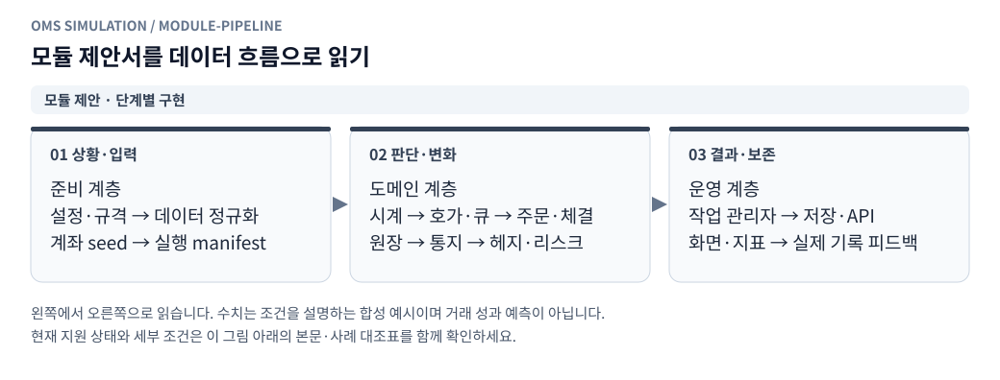

**그림 읽기 · 모듈 제안 · 단계별 구현:** 전체 모듈 명세의 목표 지도다. 현재 Python 실행 객체와 제안된 cjs 모듈 목록을 동일한 구현 목록으로 읽지 않는다. [수정용 Mermaid 원본](figures/module-pipeline.mmd).

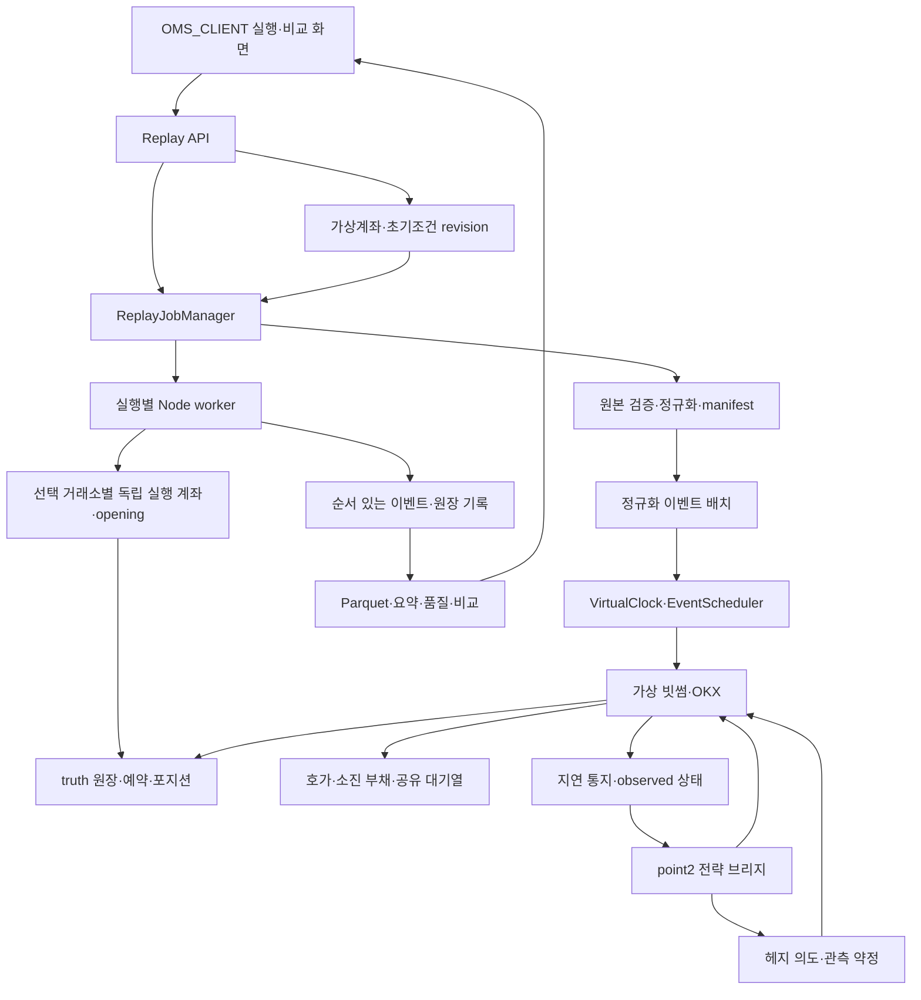

핵심 경계는 다음과 같다.

- Python은 파일 준비·작업 관리·결과 조회를 맡는다. 체결 여부를 HTTP 요청 처리 중에 계산하지 않는다.
- Node worker는 한 실행의 시계·전략·가상 거래소·원장을 소유한다.
- 전략은 observed 상태만 읽는다. truth를 읽어서 빠른 헤지나 주문 취소를 결정하지 않는다.
- 매칭 엔진은 체결 제안을 만든다. 실제 수량·잔고·수수료 반영은 실행 상태 조정기가 원자적으로 확정한다.
- 결과 집계기는 확정된 이벤트를 읽는다. 결과를 좋게 만들기 위해 과거 상태를 수정하지 않는다.

## 5. 제안 디렉터리와 모듈 목록

아래 파일은 **앞으로 만들 파일의 제안 배치**다. 현재 존재하는 파일 목록이 아니다.

```text
oms_client/replay/
    __init__.py
    config.py                 # 설정 스키마·정규화·실행 전 검증
    accounts.py               # 가상계좌 생성·revision·복제·초기화·실행 binding
    account_repository.py     # 계좌 소유권·불변 초기조건·hash 저장
    dataset.py                # 파일 선택·기간·원본 단위·정규화
    manifest.py               # 입력·전략·규격·모형의 불변 식별
    jobs.py                   # worker 생성·IPC·작업 상태·소유권
    repository.py             # 실행 메타데이터·결과 위치·페이지 조회
    results.py                # 원장 대사·성과·품질·비교 집계
    export.py                 # 실행 결과 묶음·다운로드
oms_client/api/routes/replay.py
oms_client/api/routes/replay_accounts.py
frontend/features/replay/
    controller.js             # 입력·진행·명령·결과 화면
    views.js                  # 주문·계좌·노출·품질 표시
    compare.js                # 가정별 실험 비교
replay_worker/
    runner.cjs                # 프로세스 진입·전체 실행 생명주기
    config.cjs                # worker 측 스키마 재검증
    account_factory.cjs       # 고정 revision→실행별 계좌·opening·초기평가
    account_state.cjs         # venue별 가변 계좌 registry·버전·snapshot
    event_source.cjs          # 정규화 배치의 스트리밍 입력
    clock.cjs                 # 가상시각과 가상 타이머
    scheduler.cjs             # 이벤트 병합·동시각·인과 순서
    instrument.cjs            # 가격·수량·계약 규격
    fixed.cjs                 # 정수·고정소수점·직렬화
    book.cjs                  # raw/execution/visible book 분리
    reconciliation.cjs        # 공공 체결·호가 감소·소진 부채
    queue.cjs                 # 가격별 외부 구간·내 주문 FIFO
    queue_models.cjs          # trade_only·proportional_cancel
    matching.cjs              # sweep·passive allocation·체결 제안
    orders.cjs                # 주문 수량 분해·상태기계
    order_set_manager.cjs     # 양 거래소·양방향 복수 주문의 유지·추가·취소·교체
    reservations.cjs          # 클라이언트/거래소 예약 전환
    execution.cjs             # 체결·주문·원장·호가 변경의 원자적 확정
    virtual_bithumb.cjs        # 빗썸 프로필·검사·통지 매핑
    virtual_okx.cjs            # OKX 프로필·계약·reduce-only 검사
    ledger.cjs                # KRW·코인·USDT·선물 포지션 원장
    observations.cjs          # 지연된 주문·체결·계좌 관측 상태
    strategy_bridge.cjs       # 고정 원본 전략·결정적 ID·실행 변형
    hedge_controller.cjs      # 복수 헤지 약정·연결·계획 갱신·잔여 노출
    risk.cjs                  # 가용자금·담보·노출·실행 안전 한도
    quality.cjs               # 품질 플래그와 영향 범위 전파
    journal.cjs               # 이벤트·원장·명령의 순차 기록
    metrics.cjs               # 증분 집계·주기 스냅샷
tests/replay/
    fixtures/                 # 손계산 가능한 원본·기대 결과
    test_dataset.py
    test_jobs_api.py
    test_results.py
replay_worker/tests/
    clock_scheduler.test.cjs
    matching_queue.test.cjs
    orders_reservations.test.cjs
    ledger_observations.test.cjs
    strategy_hedge.test.cjs
    determinism.test.cjs
```

파일을 많이 나누는 것 자체가 목적은 아니다. 작은 순수 함수는 합칠 수 있지만, **원본 정합과 가상 체결 배분**, **truth와 observed**, **가격계산 수수료와 실제 수수료**, **상태 갱신과 결과 조회**의 책임은 섞지 않는다.

## 6. 공통 데이터 계약

### 6.1 숫자·시간·식별자

| 값 | 내부 기준 | 저장·API 기준 |
|---|---|---|
| 시각 | 원본 epoch millisecond, desktopTime | UTC epoch ms. 화면 표시만 Asia/Seoul 변환 |
| 내 주문 가격 | 정수 tick 또는 스케일 정수 | 정밀도 잃지 않는 문자열 + 규격 ID |
| 내 주문 수량 | 정수 lot | 문자열, 코인 환산과 계약 수를 별도 필드 |
| 외부 복원 수량 | 하한·상한·단위·스케일 보존 | Decimal 문자열과 `quantity_quality` |
| KRW·USDT | 고정소수점 또는 Decimal | 문자열. JSON number로 강제 변환하지 않음 |
| 이벤트 ID | 입력 해시·행번호 또는 실행 내 순번 | 실제 거래소 ID와 분리 |
| 주문·체결 ID | 실행 내 결정적 순번 | run_id와 결합해 전역 식별 |
| 버전 | 엔터티별 증가 정수 | venue/account/order/projection 버전 명시 |

`BigInt`를 쓸 경우 IPC에서 문자열로 직렬화한다. 전략 코어가 JS Number를 요구하면 브리지에서만 변환하고, 안전한 정수 범위·반올림 오차를 검사한다. Number 값으로 만든 주문은 규격 경계에서 다시 tick/lot 검증을 거친다.

`virtual_account_id`는 초기조건 설정 묶음, `account_revision`은 그 불변 버전이다. `run_account_id`는 `(run_id,venue)`별 가변 실행 계좌이며 주문 의도의 `account_id`가 이를 참조한다. 이름·ID가 비슷해도 공유 현재잔고로 취급하지 않는다.

### 6.2 입력 시장 이벤트

```typescript
type MarketEvent = {
  event_id: string;
  desktop_time_ms: number;
  server_time_raw: string | null;
  venue: 'bithumb' | 'okx';
  instrument_id: string;
  kind: 'BOOK' | 'TRADE' | 'SETTLED_FUNDING';
  source_file_sha256: string;
  source_row_index: string;
  source_sequence: string;
  schema_version: number;
  payload: object;
  quality_flags: string[];
};
```

체결 이벤트는 `aggressor_side`, `base_qty`, `price`, `raw_signed_qty`를 갖는다. 부호가 없는 자료에서 방향을 추측해 확정하지 않는다. `BOOK`은 snapshot/delta 여부와 각 가격대의 관측 범위를 포함한다. 첫 버전 입력은 검증된 절대 snapshot으로 제한할 수 있다.

`(파일 해시, 행 번호)`는 원본 행의 식별자다. 같은 시각·가격·수량의 서로 다른 행을 자동으로 하나의 거래로 합치지 않는다. 파일 중첩을 제거해야 한다면 확인된 원본 ID·중복 생성 이력으로만 처리하고 제거 내역을 남긴다.

### 6.3 내부 이벤트 봉투

```typescript
type SimEvent = {
  sim_event_id: string;
  cause_event_id: string | null;
  desktop_time_ms: number;
  causal_round: number;
  priority: number;
  sequence: string;
  kind: string;
  entity_id: string | null;
  payload: object;
};
```

전체 정렬키는 `(desktop_time_ms, causal_round, priority, sequence)`다. `sequence`는 원본 스트림 병합 순서·합성 이벤트 생성 순서를 결정적으로 부여한다. wall clock, 프로세스 ID, 난수 UUID를 경제적 정렬키에 사용하지 않는다.

문자열로 직렬화한 `sequence/event_seq/row_index`는 내부 비교 시 정수로 해석한다. 문자열 사전순으로 정렬해 `10`이 `2`보다 앞서게 하지 않는다.

### 6.4 주문 의도

```typescript
type OrderIntent = {
  intent_id: string;
  strategy_id: string;
  order_group_id: string;
  quote_slot_id: string | null;
  plan_revision: string;
  purpose: 'quote' | 'hedge' | 'rebalance';
  account_id: string;
  venue: 'bithumb' | 'okx';
  instrument_id: string;
  side: 'buy' | 'sell';
  order_type: 'limit' | 'market';
  tif: 'gtc' | 'ioc' | 'post_only' | null;
  limit_price: string | null;
  base_qty: string;
  native_contracts: string | null;
  reduce_only: boolean;
  decision_time_ms: number;
  observation_version: string;
  reason_code: string;
  parent_fill_ids: string[];
};
```

수량은 거래소별 네이티브 규격으로 변환하기 전후 값을 모두 검증한다. `tif=null`인 시장가와 보호가격을 지정한 IOC를 같은 주문으로 표시하지 않는다.

### 6.5 복수 주문 집합 계약

`OrderSetPlan`은 `(strategy_id,account_id,venue,instrument_id,order_group_id)`별 목표 주문 목록과 `plan_revision`, 기준 관측 버전을 가진다. 매수·매도 각 목록은 길이 0 이상이며 주문 하나로 고정하지 않는다. `quote_slot_id`는 전략의 가격대/슬롯 식별자이고 실제 order_id와 다르다. 같은 방향·같은 가격에도 서로 다른 슬롯이나 추가 주문이 존재할 수 있다.

```text
가상 예시: 가격·수량은 구조 설명용이며 실제 CT 규격이 아님
빗썸 매수: B1 100원×10, B2 99원×20, B3 100원×5
빗썸 매도: S1 103원×8, S2 104원×12
OKX 매수: K1 1.00 USDT×10, K2 0.99 USDT×20
OKX 매도: K3 1.03 USDT×8, K4 1.04 USDT×12
```

각 주문의 전송·도착·ACK·대기열·부분체결·취소·수수료는 독립적이다. 한 계획에 속해도 거래소가 주문 전체를 동시에 수락하거나 취소하는 것으로 처리하지 않는다. 한 주문의 거절·체결이 다른 주문을 자동 삭제하지 않는다. 명시한 그룹 동작만 별도로 적용한다.

## 7. 설정·종목 규격 모듈

### 7.1 `config.py` / `config.cjs`

**책임:** 입력을 정규화하고 실행 가능한 설정만 worker에 전달한다.

입력은 전략 프로필, 시장·평가 기간, 주문·통지 지연, 초기 계좌, 수수료, 레버리지, 대기열 모형, 품질 정책이다. 출력은 기본값까지 펼친 `effective_config`와 검증 결과다.

검증 항목:

1. 시작 < 종료, 실제 공통 데이터 기간 안에 포함되는지 확인한다.
2. 지연은 유한한 0 이상의 정수 ms다. 0ms 허용 시 인과 라운드 상한을 반드시 설정한다.
3. 가격·수량·잔고·비율에 NaN·Infinity·boolean·잘못된 문자열을 허용하지 않는다.
4. 수수료율은 maker/taker·거래소별로 입력한다. 음수 리베이트 허용 범위도 명시한다.
5. `strategy.feeBps`와 실제 체결 수수료를 별도 필드로 유지한다.
6. OKX net mode·선형·USDT 결제와 지원 계약배수를 검사한다.
7. `queue_model=trade_only`일 때 취소 모형 파라미터는 적용되지 않았음을 표시한다.
8. 초기 포지션이 0이 아니면 원가 또는 시작 평가 원가 사용 정책을 요구한다.
9. 필수 자금·수수료·규격이 미입력인 상태로 실행을 시작하지 않는다.
10. 알 수 없는 설정 키는 조용히 무시하지 않는다. 필드별 오류로 반환한다.
11. 거래소·방향별 동시 주문 한도와 주문별 lot·금액·담보를 검사한다. 원본 단일 목표가격을 쓰는 프로필과 다단계 호가 프로필을 구분한다.
12. OKX GTC/Post-only 대기를 포함하면 OKX 체결 틱의 공통 기간·방향·계약 환산 단위를 필수 검증한다. 순수 시장가/IOC만 쓰는 프로필과 입력 요구가 다르다.
13. `venues`의 고유 개수1~2와 어댑터 지원 여부를 검사한다. 모든 주문·입력·전략 기준가격·평가 환산 source의 venue가 선택 집합에 포함돼야 한다.
14. 선택 거래소 집합이 전략의 필수 의존성을 충족하는지 검사한다. point2 fx는 헤지 비활성이라도 빗썸·OKX 둘 다 필요하다.
15. virtual_account_ref의 소유권·정확한 revision/hash·선택 venue·거래 역할을 검증한다. inline 초기계좌와 참조를 동시에 받지 않는다.

API와 worker가 같은 schema_version을 지원해야 한다. Python 검증을 통과했더라도 worker는 규격·버전·해시를 재확인한다.

### 7.2 `instrument.cjs` / `fixed.cjs`

**책임:** 가격·수량·계약 단위와 반올림을 한곳에서 정의한다.

`InstrumentSpec` 필수 필드:

| 필드 | 설명 |
|---|---|
| `instrument_id`, `venue`, `base_ccy`, `quote_ccy` | 종목 식별·통화 |
| `effective_from_ms`, `effective_to_ms` | 규격 유효기간. 미확인 여부도 저장 |
| `price_tick_rule` | 고정 또는 가격 구간별 호가단위 |
| `quantity_lot`, `min_qty`, `min_notional`, `max_qty` | 주문 검증 규칙. 시장가/지정가별 min/max 한도는 별도 보존 |
| `contract_type`, `ctVal`, `ctValCcy`, `ctMult` | 선형 계약·코인 환산 근거 |
| `settle_ccy`, `position_mode` | USDT 결제·순포지션 모드 |
| `fee_currency`, `rounding_policy` | 수수료 통화·계산별 반올림 |
| `source`, `verified_at`, `historical_validity` | 출처·확인일·과거 적합성 |
| `spec_hash` | 실행 중 불변 규격의 해시 |

기존 `instruments.py`의 현재 ctVal 조회만으로 과거 구간의 lot·가격단위까지 검증됐다고 보지 않는다. 현재 자료를 과거 규격으로 사용할 때는 명시적인 가정과 영향 플래그를 남긴다.

대표 함수는 `floorBuyPrice()`, `ceilSellPrice()`, `floorOrderQty()`, `baseToContracts()`, `contractsToBase()`, `feeAmount()`다. 구간별 tick은 가격이 다른 구간으로 넘어간 후에도 최종 가격이 유효한지 재검증한다. 지원하지 않는 계약은 거절한다.

**검증:** 왕복 단위 변환, lot 미만 잔량, tick 경계, 최소 주문금액, 수수료 반올림, 반올림 뒤 현금 부족을 손계산 사례로 확인한다.

## 8. 데이터 준비 모듈

### 8.1 `dataset.py`

**입력:** 허용된 데이터 루트 안의 원본 파일, 기간, 종목·거래소 목록, 정규화 스키마, 워밍업 정책.\
**출력:** 데이터 검증 보고서, 고정 파일 목록·해시, 시간순 정규화 배치, 스트림별 coverage.

처리 순서:

1. 기존 파일 접근 제한을 통과한 경로만 연다. 임의 경로를 worker 인자로 전달하지 않는다.
2. 파일 크기·변경시각·스키마·실제 행 범위를 확인하고 해시를 계산한다.
3. `desktopTime` 단위, 유효 범위, 누락·역전·동일시각 행 수를 검사한다.
4. 스트림별 중복·공백·호가 단계 수·체결 방향·수량 단위를 요약한다.
5. 가격·수량의 원본 의미를 검증한 뒤 정규화한다.
6. 안정 정렬·k-way merge로 전체 순서를 정한다. 정렬 정책과 원본 행번호를 보존한다.
7. 배치별 최소·최대 시각, 행 수, 체크섬을 출력한다.
8. 실행 시작 시 원본이 준비 이후 변경되지 않았는지 재검사한다. 수집 중 변경되는 파일은 고정 사본 또는 확정 prefix로 격리한다.

### 8.2 단위 변환

OKX 입력 요구는 실행 모드별로 구분한다. 순수 즉시 체결만 판단하는 시장가/IOC는 검증된 OKX 호가를 사용한다. GTC/Post-only 대기 잔량의 체결은 OKX 체결 틱과 공유 대기열로 판단한다. 일반 GTC가 처음에 전량 체결될 것이라고 예상해 체결 틱 검증을 생략하지 않는다. 틱이 없으면 대기 체결 지원 불가로 명시하고 실행을 차단하거나 미확인 결과로 분류한다. 호가 touch만으로 maker 체결을 만들지 않는다.

- 기존 빗썸 `b*_q/a*_q`가 절삭된 호가 **금액**인 스키마에서는 `금액/가격`으로 수량을 복원한다.
- `floor(price×qty)=N` 형식이 확인되면 수량 범위는 `[N/price,(N+1)/price)`다. 이 형식이 아닌 소스에 적용하지 않는다.
- 공격 체결에 사용할 외부 수량은 하한, 초기 앞 대기량은 상한을 쓰는 보수 정책을 구분해 저장한다.
- OKX는 원본이 계약 수인지, 이미 ctVal 반영 금액인지 확인한다. 코인 환산을 두 번 하지 않는다.
- 새 USDT 실제 수량과 원본 전략이 기대하는 금액 형식의 변환은 전략 브리지 경계에서 한 번만 수행한다.
- 호가 금액·코인 수량·계약 수·USDT 수량을 필드 이름 없이 `qty` 하나로 섞지 않는다.

### 8.3 워밍업·기간 경계·누락

평가 구간은 `[start_ms,end_ms)`로 정의한다. 시작 이전 이벤트는 책과 필요한 전략 지표를 준비하는 데만 사용하고 주문·체결·수익을 만들지 않는다. 시작 시점에 초기 계좌를 주입하고 정상 타이머를 시작한다. 시작 이전 자료가 없으면 준비되지 않은 기준가격으로 주문하지 않는다.

종료시각과 같은 시각의 시장·주문·통지 이벤트는 첫 버전에서 처리하지 않는다. 미도착·미통지 항목은 종료 상태로 보존한다. 마지막 평가에는 종료 이전에 관측된 유효 가격만 사용한다.

체결이 한동안 없었다는 이유만으로 체결 스트림 공백이라고 판정하지 않는다. 수집기 heartbeat·연결 기록·파일 연속성 등 근거가 없으면 관측 신뢰가 제한됐다고 표시한다. 반대로 파일이 있다는 이유만으로 전체 기간이 완전하다고 보지 않는다.

**오류:** `input_schema_invalid`, `unit_unverified`, `coverage_missing`, `source_changed`, `timestamp_invalid`. 오류에는 파일의 안전한 표시명·필드·행 범위를 포함한다.

### 8.4 `event_source.cjs`

정규화 배치를 유한 버퍼로 읽고 다음 시장 이벤트를 제공한다. 배치 경계에서 같은 시각의 순서가 바뀌면 안 된다. 모든 배치를 메모리에 로딩하지 않는다. 다음 행을 읽어도 scheduler에 공개되기 전에는 전략·호가·매칭에 노출하지 않는다.

Python→Node는 배치 메타데이터와 파일 경로를 전달하고 Node가 제한된 디렉터리에서 읽는 방식을 우선한다. 초기 구현에서 NDJSON을 쓸 수 있으나 대용량 압축·컬럼형 배치 채택 여부는 프로파일링 후 결정한다. 입력 형식을 바꿔도 정규화 이벤트 해시가 같아야 한다.

## 9. 가상시계와 스케줄러

<!-- diagram: clock-pacing -->

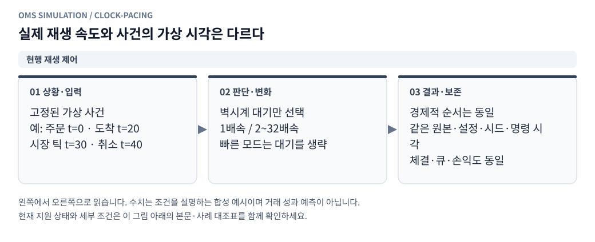

**그림 읽기 · 현행 재생 제어:** 명령을 누른 실제 시각이 아니라 같은 가상 시각의 명령을 비교해야 한다. 관측 사이의 가짜 호가·체결은 만들지 않는다. [수정용 Mermaid 원본](figures/clock-pacing.mmd).

### 9.1 `clock.cjs`

**상태:** 현재 가상시각, 타이머 ID 순번, 활성 타이머 목록.\
**인터페이스:** `now()`, `scheduleAt()`, `scheduleAfter()`, `cancelTimer()`, `advanceTo()`.

`advanceTo(t)`는 현재보다 과거로 이동할 수 없다. 실제 `setTimeout()`은 진행 보고·프로세스 감독에만 쓴다. 전략의 500ms 주기, 헤지 평가, 재시도, 타임아웃은 모두 가상 이벤트로 바꾼다. 취소된 타이머의 이미 큐에 들어간 이벤트는 timer generation을 확인해 무효화한다.

### 9.2 `scheduler.cjs`

다음 시장 이벤트와 합성 이벤트 heap의 최소값을 비교해 하나씩 처리한다. 각 이벤트에 대해 상태 변경을 끝낸 뒤 다음 이벤트로 넘어간다.

기본 같은 시각 우선순위:

| 우선순위 | 이벤트 | 부가 규칙 |
|---|---|---|
| 10 | 원본 BOOK·TRADE·확정 펀딩 | 스트림 순서를 manifest에 고정 |
| 20 | 신규 주문·취소 도착 | 같은 시각이면 전송/예약 sequence |
| 30 | ACK·체결·취소·계좌 통지 | 엔터티 버전·통지 sequence 보존 |
| 40 | 전략·헤지 평가 | 중복 평가를 병합하되 필수 반응 순서 유지 |
| 50 | 평가액·진행 스냅샷 | 해당 인과 라운드의 변경 이후 |

같은 시각에 자식 이벤트가 발생하면 현재 라운드보다 큰 `causal_round`를 부여한다. 이미 처리 중인 원인보다 앞 순위로 되돌아갈 수 없다. 0ms 재주문 루프는 라운드·이벤트 수 상한으로 감지하고 실패 원인을 보존한다.

전략 평가 병합키는 최소 `(가상시각, 관측 projection_version, 평가 종류)`를 포함한다. 서로 다른 계좌 변화까지 같은 시각이라는 이유로 제거하지 않는다.

**검증:** 데이터 행이 없는 20ms 도착, 같은 시각 시장/취소 경합, 0ms 인과 순서, 타이머 취소, 배치 크기 변경 후 결과 동일성.

## 10. 호가·가상 잔량 모듈

### 10.1 `book.cjs`

하나의 book 객체를 여러 의미로 덮어쓰지 않는다.

| 상태 | 소유하는 의미 | 수정 주체 |
|---|---|---|
| `raw_book` | 마지막 원본 외부 호가 | 입력 BOOK 적용 |
| `own_orders` | 실제 접수된 내 주문과 잔량 | execution 조정기 |
| `execution_depth` | 공격 주문이 쓸 수 있는 외부 잔량 | raw + 소진 부채로 계산 |
| `visible_book_truth` | 외부 호가와 내 공개 주문의 합성 | book 모듈 |
| `visible_book_observed` | 전략이 전달받은 지연된 공개 상태 | observations |
| `queue_book` | 외부 구간과 내 주문의 대기순서 | queue 모듈 |

내 주문은 원본에 없었다. 원본 외부 수량에서 내 잔량을 먼저 빼지 않는다. 내 주문 수량은 합성·취소·체결에 따라 별도로 변한다. 내 주문이 스프레드 안으로 들어가면 visible best가 달라질 수 있다.

원본 호가 stale 정책과 내 주문 공개 통지 지연을 분리한다. `own_book_notice_latency_ms`가 있으면 매칭 엔진은 접수 즉시 알고 있어도 전략의 공개 호가는 통지 후 바뀐다.

raw best의 표시상 교차와 `execution_depth`의 실제 가용량을 구분한다. 소진 부채로 가용량이 없는 가격에서 raw quote만 보고 다시 체결하지 않는다. 이미 대기 중인 주문을 상대 quote가 넘어갔어도 tick 없이 자동 전량 maker 체결·taker 전환을 만들지 않는다. 교차 상태의 정합·공백 가능성과 판정 범위를 기록한다. 상세 분기는 지정가 사례 B11·C02~C03을 따른다.

### 10.2 가격대 생명주기

키는 `(venue,instrument,side,price,lifecycle_id)`다. top5 밖으로 밀린 가격은 0으로 확인된 가격이 아니다. 해당 가격의 소진 부채·앞 물량을 지우지 않는다. 관측 범위 안에서 실제 0과 재생성이 확인됐을 때만 새 생명주기를 연다.

0 확인 방식은 소스별로 명시한다. delta의 0 삭제와 top-N snapshot의 단순 부재는 같지 않다. 불완전 자료에서는 `level_lifecycle_unknown`을 보존한다.

## 11. 공공 정합·소진 부채 모듈

<!-- diagram: depth-debt -->

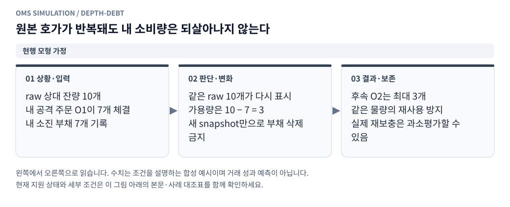

**그림 읽기 · 현행 모형 가정:** 내 가상 소비와 원본 외부 틱 소비는 다른 근거다. 이 보수 모형은 현실의 재보충을 완벽히 복원하지 않는다. [수정용 Mermaid 원본](figures/depth-debt.mmd).

### 11.1 `reconciliation.cjs`

**목적:** 원본 체결 틱과 원본 스냅샷 감소를 두 번 차감하지 않으면서, 내 공격 주문이 쓴 잔량을 다시 쓰지 못하게 한다.

가격별 주요 상태:

| 상태 | 의미 |
|---|---|
| `raw_qty` | 마지막 원본 절대잔량 |
| `self_depletion` | 내 공격 주문이 쓴 외부 잔량. 원본에는 반영되지 않음 |
| `pending_public_depletion` | 원본 체결로 소진됐지만 snapshot에 아직 정합되지 않은 양 |
| `snapshot_drop_credit` | snapshot 감소가 먼저 도착했을 때 후속 틱과 한 번 매칭할 감소량 |
| `reconciled_raw_trade_qty` | 관측 구간별로 이미 설명에 사용한 원본 전체 체결량 |
| `applied_add_candidate` | 이미 대기열 뒤에 추가한 외부 증가 후보량 |
| `unresolved_qty` | 자료 부족으로 정합할 수 없는 양 |

```text
effective_depth = max(0, raw_qty - self_depletion - pending_public_depletion)
```

내 대기 주문 체결은 내 잔량·대기열을 줄인다. 외부 공격 잔량을 소진한 것이 아니므로 `self_depletion`을 추가하지 않는다.

### 11.2 두 종류의 거래량 예산

한 원본 tick V는 다음 두 용도로 사용되지만 한 장부로 섞지 않는다.

1. **원본 정합:** 원본 snapshot 변화와 원본 전체 V를 대사한다. 가상 주문에 체결된 양을 V에서 빼지 않는다.
2. **가상 배분:** 외부 대기열과 내 주문을 합쳐 V 이내에서 한 번 배분한다. 내 주문별로 V를 새로 만들지 않는다.

내 101원 주문이 원본 100원 거래량을 가로채는 가상 경로가 생겨도, 원본 100원 snapshot과 tick의 정합은 원본 가격·수량으로 유지한다. 이는 원본과 반사실적 경로를 별도로 기록하는 모델이다.

### 11.3 기본 예시와 종료 처리

```text
원본 1,000개 → tick 100개 → effective 900개
이후 원본 snapshot 900개 → public 부채 100 해소 → effective 900개 유지

원본 1,000개 → 내 공격 100개 → effective 900개
같은 원본 snapshot 1,000개 반복 → effective 900개 유지
```

원본 증가분은 새 절대잔량에 한 번 반영된다. 같은 증가량을 부채에서도 빼면 이중 보충이므로 금지한다. 설명되지 않은 부채를 시간 경과만으로 초기화하지 않는다.

취소 모형의 정합 창이 닫혀도 모든 미설명 public 부채를 자동 확정하지 않는다. 창의 종료와 부채의 해소는 별개다. 늦은 틱은 현재 시각의 정합에 반영하고, 과거 체결을 소급 수정하지 않으며 영향 주문에 플래그를 남긴다.

**검증:** tick→snapshot, snapshot→tick, 같은 snapshot 반복, 내 소진 후 증가, top5 이탈·복귀, 창 종료 후 늦은 틱, 내 가상 체결이 원본 체결 설명량을 줄이지 않는 사례.

## 12. 가격별 공유 대기열

<!-- diagram: queue-budget -->

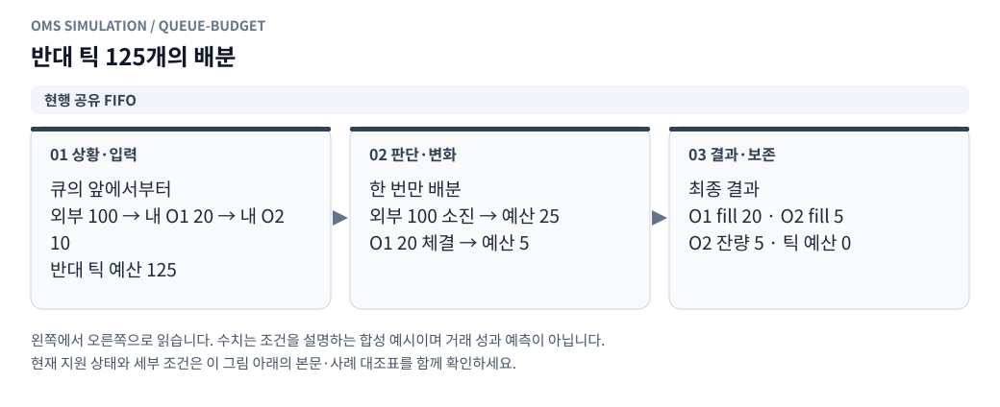

**그림 읽기 · 현행 공유 FIFO:** 각 주문에 원본 틱 125개를 다시 주면 과체결이다. 더 우선한 외부 가격대가 없고 큐 위치를 아는 합성 예시다. [수정용 Mermaid 원본](figures/queue-budget.mmd).

### 12.1 `queue.cjs`

가격별로 다음 노드의 순서를 유지한다.

```text
[외부 A] → [내 O1] → [외부 B] → [내 O2] → [외부 C]
```

외부 노드에는 수량, 생성 근거 이벤트, 관측 구간, 추정 여부를 둔다. 내 노드에는 order_id, 접수 순번, 대기 잔량을 둔다. 새 내 주문은 같은 가격 큐 끝에 들어간다. 새 내 주문마다 원본 전체 잔량을 다시 앞에 삽입하지 않는다.

초기 앞 물량에 `queue_ahead_multiplier`를 적용하면 원본 추정 수량을 넘는 부분을 **큐 전용 비표시 여유량**으로 구분한다. 이 양으로 raw/visible book, microprice, 시장가 가용 깊이를 늘리지 않는다. 같은 공유 큐에서 신규 내 주문 때문에 여유량을 다시 생성하지 않는다. 여유량에 외부 취소 후보를 배분할지는 별도 모형 정책으로 고정하며, 첫 거래량 전용 모형은 관측 거래량으로만 소진한다.

주요 함수:

| 함수 | 입력 | 출력·효과 |
|---|---|---|
| `appendOwn()` | 주문·접수시각·외부 초기 근거 | 큐 끝에 내 노드 1개 추가 |
| `appendExternalIncrease()` | 확인된 증가 후보·구간 ID | 현재 시각의 큐 뒤에 1회 추가 |
| `allocateTrade()` | aggressor·가격·수량 budget | 가격/FIFO별 소진 제안 |
| `removeOwnRemaining()` | order_id·취소 효력 이벤트 | 남은 내 노드만 제거 |
| `applyExternalCancel()` | 구간별 취소 후보 | 외부 노드만 감소 |
| `snapshotAhead()` | order_id | 현재 앞 외부·내 수량과 불확실성 |

같은 가격 내 주문이 2개이면 외부 거래량은 O1 앞 물량→O1→O2 앞 물량→O2 순으로 한 번 소진된다. 외부 취소는 내 노드를 제거하거나 현금을 바꾸지 않는다.

배분 경로에는 내 주문이 없는 더 우선하는 알려진 외부 가격대도 포함한다. 내 주문이 있는 가격의 큐만 순회해 외부 선순위 물량을 건너뛰지 않는다. 그 가격대의 이미 소비된 물량과 정합 상태를 참조해 같은 외부 물량을 다시 배분하지 않는다.

큐 키에는 거래소·종목·방향·가격·생명주기를 모두 포함한다. 같은 가격 여러 주문에는 FIFO, 다른 가격에는 가격 우선을 적용한다. 빗썸 tick으로 OKX 주문을 체결하거나 한 거래소의 거래량을 다른 거래소에서 재사용하지 않는다. 한 tick이 여러 가상 주문에 배분돼도 전체 배분은 해당 거래소의 원본 수량 이내다.

### 12.2 가격 범위·관통 체결

매도 주도 tick은 매수 가격 `p>=p_trade`를 높은 가격부터, 매수 주도 tick은 매도 가격 `p<=p_trade`를 낮은 가격부터 배분한다. 거래량이 남아도 관측가격보다 불리한 큐까지 임의로 확장하지 않는다.

스프레드 안쪽 내 매수 101원·10개가 있고 원본 100원 매도 주도 4개가 관측되면, 내 주문의 후보 체결은 **101원·최대 4개**다. 더 우선하는 알려진 외부·내 물량을 먼저 처리한다. 원본 100원으로 가격을 개선하거나 내 10개를 전량 체결시키지 않는다.

### 12.3 `queue_models.cjs`: 거래량 전용

`trade_only`에서는 반대 방향 거래량으로만 앞 물량이 줄어든다. snapshot 감소로 앞 수량을 자동 축소하지 않는다. 외부 취소는 가능한 뒤 물량에만 반영하며 설명되지 않는 감소는 `queue_inconsistent`로 남긴다.

앞 수량이 현재 표시잔량보다 클 수 있다. 이를 숨기지 않는다. 이 모형의 체결량이 작다고 손익이 반드시 하한이 되는 것은 아니다.

### 12.4 취소 위치 추정: 후속 비교 모형

```text
C_candidate = max(0, R_prev - R_now - V_raw)
A_candidate = max(0, R_now - R_prev + V_raw)
F(x) = x^gamma / (x^gamma + (1-x)^gamma), gamma > 0
```

정합 창이 닫힌 현재 시각에 취소 후보를 확정한다. 각 외부 구간의 누적 위치 `[x_start,x_end]`에 대해 가중치 `F(x_end)-F(x_start)`를 사용한다. 총 외부 취소량은 후보량과 알려진 외부 수량 중 작은 값 이내다. 내 주문별 독립 배분으로 같은 취소를 반복 사용하지 않는다.

외부 증가 후보는 이미 적용한 양을 제외하고 현재 큐 뒤에 추가한다. 뒤늦게 발견한 증가를 과거 내 주문 앞에 소급 삽입하지 않는다. 단일 후보·크레딧·원본 체결량은 각 장부에서 한 번만 소비한다.

이 모형은 결정적 수량 배분이다. seed를 바꿔 결과가 달라지는 실제 확률 모형으로 설명하지 않는다.

## 13. 즉시 체결·가상 거래소

<!-- diagram: fok-atomic -->

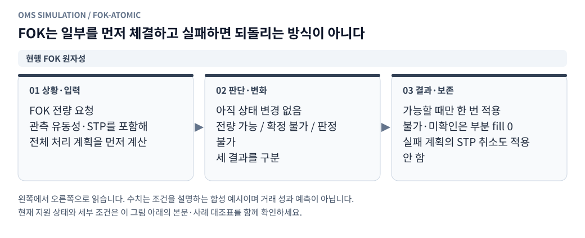

**그림 읽기 · 현행 FOK 원자성:** 전량 가능 여부 확인 전에 부분 정산을 하면 수수료·잔고·기존 maker 주문에 부작용이 남는다. [수정용 Mermaid 원본](figures/fok-atomic.mmd).

### 13.1 `matching.cjs`

**책임:** 현재 유효한 execution depth와 queue 상태에서 체결 제안을 만든다. 원장을 직접 수정하지 않는다.

```typescript
type MatchProposal = {
  cause_event_id: string;
  fills: Array<{
    order_id: string;
    price: string;
    base_qty: string;
    role: 'maker' | 'taker';
    raw_event_id: string | null;
    level_lifecycle_id: string;
  }>;
  known_remaining_qty: string;
  unknown_qty: string;
  depth_changes: object[];
  queue_changes: object[];
  quality_flags: string[];
};
```

매수는 낮은 ask부터, 매도는 높은 bid부터 소진한다. limit 가격을 넘지 않는다. maker/taker는 주문 전체가 아니라 각 체결별로 정한다. GTC의 즉시 체결 부분은 taker, 이후 대기 체결은 maker다.

### 13.2 주문 조건별 도착 처리

| 주문 | 도착 시 교차 | 잔량 |
|---|---|---|
| GTC limit, 빗썸·OKX | 가격 제한 안에서 즉시 소진 | 알려진 비시장성 잔량은 해당 거래소 큐 뒤 대기 |
| IOC limit, 빗썸·OKX | 가격 제한 안에서 즉시 소진 | 확정 미체결 잔량 취소, 대기 없음 |
| Post-only limit, 빗썸·OKX | 교차 여부를 소진 전에 판단 | 교차 시 체결 없이 조건 취소, 아니면 대기 |
| OKX market | 프로필의 가격 보호·깊이 안에서 소진 | 깊이 밖 수량을 임의 가격으로 체결하지 않음 |

관측 top5를 끝까지 소진했고 가격 한도 안의 더 깊은 호가 존재 여부를 모르면 잔량은 확정 취소/대기로 만들지 않는다. `depth_insufficient`로 분류한다. 반대로 관측 가격이 limit을 이미 넘었다면 그 뒤를 볼 필요 없이 가격 제한에 따른 미체결로 판정할 수 있다.

```text
ask: 100원 4개, 101원 6개
시장가 7개 → 100원 4 + 101원 3
100원 IOC 7개 → 4 체결 + 3 취소
100원 GTC 7개 → 4 체결 + 3 대기
100원 Post-only 7개 → 0 체결 + 7 조건 취소
```

### 13.3 `virtual_bithumb.cjs` / `virtual_okx.cjs`

공통 엔진 위에 거래소 프로필을 둔다. 프로필은 주문 문법, 단위, 잔고 검사, 조건 취소, 자기 체결 방지, 수수료, native 상태 매핑을 정의한다.

현재 빗썸 공식 문서는 limit의 IOC·Post-only, 일부 체결 IOC의 `done`, `best`의 단일 상대 1호가 동작을 구분한다. 내부 상태는 native `done`만 보고 전량 체결로 만들지 않는다. [빗썸 주문 요청](https://apidocs.bithumb.com/reference/주문-요청)

OKX 계약·주문 종류·reduce-only·가격 보호의 최종 매핑은 지원하는 계좌 모드와 과거 규격에 고정한다. 공식 문서와 다른 단순화는 manifest의 exchange_model에 남긴다. [OKX API 문서](https://www.okx.com/docs-v5/en/)

OKX 내부 `limit+gtc`, `limit+ioc`, `limit+post_only`는 각각 프로필의 native limit/IOC/Post-only 종류로 매핑한다. 일반 지정가는 도착 시 taker 부분과 이후 maker 대기 부분을 모두 가질 수 있다. Post-only만을 OKX 지정가 지원으로 취급하지 않는다. [OKX 주문 API](https://www.okx.com/docs-v5/en/#order-book-trading-trade-post-place-order)

공식 현재 문서를 확인한 것과 해당 과거 기간의 모든 규칙을 복원한 것은 다르다. 최소 주문·수수료·보호가격을 현재 값으로 자동 채우지 않는다. 자기 체결은 거래소별 고정 정책으로 신규 충돌 수량 취소 등을 처리하고 수익 체결을 만들지 않는다.

## 14. 주문 상태·수량·예약

<!-- diagram: limit-lifecycle -->

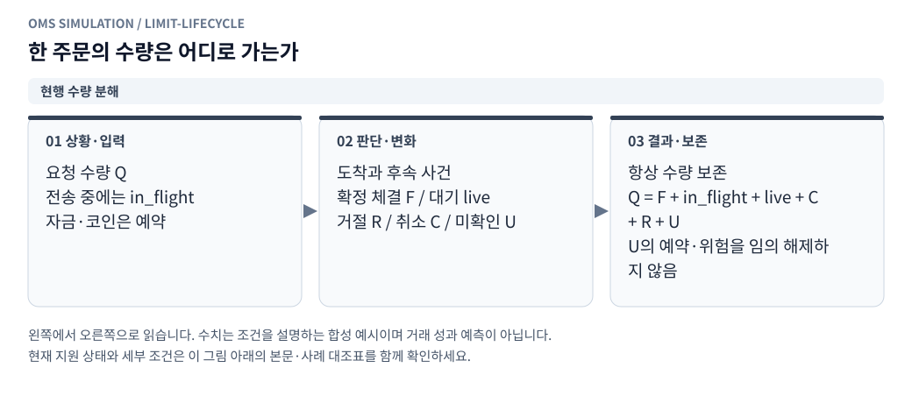

**그림 읽기 · 현행 수량 분해:** 그림의 취소·거절·미확인은 서로 다른 상태다. 부분체결 후에는 체결량과 남은 수량을 따로 추적한다. [수정용 Mermaid 원본](figures/limit-lifecycle.mmd).

<!-- diagram: cancel-race -->

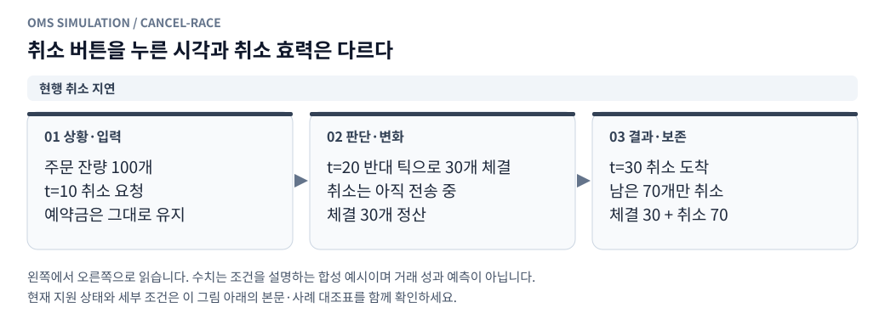

**그림 읽기 · 현행 취소 지연:** 취소 요청만으로 주문을 지우면 지연 중의 실제 모의체결을 놓친다. 종료된 체결을 취소 응답으로 되돌리지 않는다. [수정용 Mermaid 원본](figures/cancel-race.mmd).

### 14.1 `orders.cjs`: 수량 분해가 상태 이름보다 우선

도착 전 수량을 빠뜨리지 않도록 다음 불변식을 사용한다.

```text
requested_qty = filled_qty + working_qty + canceled_qty + rejected_qty + unknown_qty
working_qty = in_flight_qty + live_qty
모든 항목 >= 0, 서로 배타적
```

`in_flight_qty`는 보냈으나 거래소 도착 전인 양, `live_qty`는 접수 후 체결 가능한 양이다. `unknown_qty`는 깊이·공백 등으로 체결 여부를 모형이 판정할 수 없는 양이다. ACK를 아직 못 받았다는 이유만으로 truth의 수량을 unknown으로 바꾸지 않는다.

MODEL_UNKNOWN이나 작업 중단은 거래소 취소가 아니다. unknown 수량의 예약·잠재 노출을 확정 취소처럼 해제하지 않는다. 마지막 확정 예약, 잠재 체결/잔고 범위와 불확실성을 보존하고 정상 주문 처리를 이어가려면 별도 진단 가정을 명시한다.

위 수량 불변식은 SENT 이후 접수한 주문 레코드에 적용한다. CREATED는 전송 전 의도이며 아직 장부상의 주문 수량으로 집계하지 않는다. 전송이 실패한 의도는 의도 거절 내역에 남기고, 주문 레코드가 생성된 뒤 실패했다면 rejected 수량으로 마감한다.

truth와 observed가 각자 같은 수량 분해를 가진다. observed에는 마지막 관측 시각과 freshness를 따로 둔다. 통지 지연과 모델 불확실성을 같은 필드로 표현하지 않는다.

주문 단계는 `CREATED → SENT → ARRIVED → LIVE/PARTIAL → TERMINAL`로 표현하고, terminal reason을 `FILLED`, `CANCELED`, `REJECTED`, `MODEL_UNKNOWN` 등으로 구분한다. `CANCEL_SENT`는 별도 요청 상태다. 취소 도착 전에는 live 잔량의 체결이 가능하다.

예를 들어 IOC 10개 중 4개 체결은 `filled=4,canceled=6,working=0`이다. terminal reason이 취소를 포함해도 체결 4개를 지우지 않는다. native `done`은 별도 필드에 보관한다.

### 14.2 취소 경합·정정

- 취소 효력은 cancel arrival 시각에 발생한다. 요청 시각에 큐에서 제거하지 않는다.
- 이미 전량 체결된 주문에 취소가 도착하면 no-op 결과를 기록한다. 체결을 취소하지 않는다.
- 취소 뒤 늦게 도착한 과거 체결 통지는 observed 상태를 갱신할 수 있다. truth에서 새 체결을 다시 만들지 않는다.
- 주문 ID를 받기 전 수동 취소는 기본 `cancel_on_ack`다. ACK 통지 후 실제 취소 전송 지연을 시작한다.
- 취소 확인 전 교체 주문을 보내지 않는 원본 정책을 유지한다. 자금 예약으로도 중복 약정을 막는다.
- 첫 버전의 정정은 취소 완료 후 신규 주문이다. 새 큐 순번을 부여한다.
- 일시정지는 시계를 멈춘다. 모든 주문을 자동 취소하는 명령으로 바꾸지 않는다.

### 14.3 `reservations.cjs`

예약은 `reservation_id`, `intent_id`, `order_id`, 통화, 금액, stage, 생성/해제 원인, 계좌 버전을 가진다.

1. 전송 시 client in-flight 예약을 만든다.
2. 도착 수락 시 exchange 예약으로 **전환**한다. 두 예약을 합산하지 않는다.
3. 체결 시 실제 현금흐름을 적용하고 남은 주문의 필요 예약을 재계산한다.
4. 취소·거절 시 truth 잠금을 해제한다. observed 측 미확인 약정 해제는 통지·projection 갱신과 일치시킨다.
5. 부분체결 뒤 가격 개선분, 잔여 수량, 수수료를 기준으로 남은 잠금을 계산한다.

매수 GTC는 한계가격×잔량과 예상 수수료를 예약한다. 시장가의 예약은 유효 호가·명시된 보호가·스트레스 가정을 사용하며, 무한 가격의 무담보 주문을 수락하지 않는다. 매도 현물은 코인을 예약한다. 선물은 포지션 위험과 주문 증거금을 예약한다.

**검증:** 동시에 보낸 두 매수, ACK 지연, 도착 거절, 일부 체결 뒤 취소, 예약 전환 후 늦은 계좌 snapshot, 중복 해제, 더 좋은 가격 체결 후 반환액.

### 14.4 `order_set_manager.cjs`: 복수 주문의 변경 계획

현재 주문은 order_id별 registry와 `(venue,instrument,side,price)` 인덱스로 관리한다. 방향별 `currentOrder` 하나로 덮어쓰지 않는다. 계획 변경 시 다음 절차를 따른다.

1. 같은 관측 버전의 주문 집합·전송 중 의도·예약을 읽는다.
2. 그룹·슬롯·revision별로 유지/신규/취소/교체 대상을 결정한다. 첫 버전의 개별 주문 잔량 축소는 취소 확인 후 새 수량으로 재주문하며, native 부분 정정은 별도 프로필로 둔다.
3. 가격·수량이 유효한 기존 주문은 유지해 순번을 보존한다. 가격이 같다는 이유만으로 서로 다른 order_id를 합치지 않는다.
4. 개별 주문의 교체는 해당 주문의 취소 확인과 잔량 대사 후 수행한다. 다른 슬롯의 정상 주문까지 모두 취소하지 않는다.
5. 새 주문의 예약을 결정적 순서로 한 번 배정하고, 배정된 여러 주문은 이전 주문의 전량 체결을 기다리지 않고 전송할 수 있다.
6. 오래된 plan revision의 ACK·취소 응답이 새 슬롯 주문을 변경하지 않게 order_id/revision을 확인한다.

계획 계산·예약 갱신은 이벤트 경계에서 직렬 처리한다. **한 주문의 전체 생명주기가 끝나야 다음 주문을 낼 수 있다는 제약은 두지 않는다.** 취소 요청 중인 주문은 효력/관측 확인 전까지 약정에 포함한다. 배치 API를 쓰더라도 child별 접수·거절·도착·통지를 기록한다.

## 15. 체결 확정과 원장

<!-- diagram: account-settlement -->

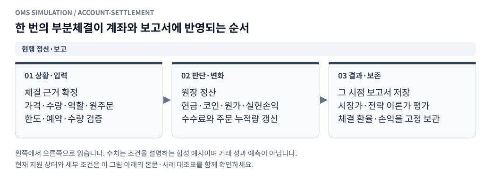

**그림 읽기 · 현행 정산·보고:** 화면 새로고침은 체결을 다시 만들지 않는다. 저장 실패는 현재 저장 계약에 따라 마지막 확정 결과와 구분한다. [수정용 Mermaid 원본](figures/account-settlement.mmd).

### 15.1 `execution.cjs`: 단일 상태 변경 경로

한 체결을 book, orders, ledger가 각자 확정하지 않는다. execution 조정기가 제안을 검증하고 하나의 `event_seq` 아래 다음 변경을 확정한다.

1. 원본 거래량 예산·주문 잔량·가격·규격·도착시각을 검사한다.
2. fill_id를 결정적으로 부여하고 중복 적용 여부를 검사한다.
3. 주문 수량·대기열·외부 소진 부채의 변경을 계산한다.
4. 현금·코인·선물 포지션·수수료·예약의 변경을 계산한다.
5. 수량·잔고·수수료·예산 불변식을 검사한다.
6. 변경 묶음을 현재 이벤트의 트랜잭션에 staging한다.
7. 지연된 통지와 후속 평가 예약도 같은 트랜잭션에 넣고, 이벤트 종료 시 한 번 확정한다.

검증 도중 실패하면 일부 모듈만 바뀐 채 진행하지 않는다. 계획 단계와 반영 단계를 나누고 반영 중 치명 오류는 실행 실패로 처리한다. 같은 원본 tick의 여러 fill도 하나의 이벤트 트랜잭션에서 처리한다. journal에는 이벤트별 시작·commit marker를 하나씩 두어 마지막 완결 이벤트를 식별한다. 결과 변환기는 commit되지 않은 부분을 확정 결과로 읽지 않는다. 자식 이벤트는 commit된 예약만 scheduler에 공개한다.

모든 journal 기록이 이벤트마다 디스크 fsync를 한다는 뜻은 아니다. 버퍼 flush 주기와 장애 시 손실 가능한 suffix를 기록한다. 프로세스 장애 뒤 메모리 상태를 임의 복원하지 않고 고정 입력·명령으로 처음부터 재생하는 정책을 첫 버전에 사용한다.

### 15.2 `ledger.cjs`: 빗썸 현물

원화 총잔고는 가용+잠금, 코인 총수량은 가용+잠금이다. 잠금은 소유 자산 안의 사용 제한이며 비용이 아니다.

수수료 제외 평균원가 A, 보유량 q, 체결량 d, 가격 P, KRW 수수료 f에 대해:

```text
매수:
  KRW_total -= d*P + f
  coin_total += d
  avg_cost = (q*A + d*P)/(q+d)

매도:
  coin_total -= d
  KRW_total += d*P - f
  realized_gross += d*(P-A)

unrealized_gross = q*(mark-A)
cost_basis_pnl_net = realized_gross + unrealized_gross - fee_total
period_trading_pnl_net = realized_gross_since_start
                      + unrealized_gross(t)-unrealized_gross(start)
                      - fees_since_start
```

매수 수수료를 avg_cost에 넣고 fee_total에서도 빼지 않는다. 보유량 0이면 원가를 비운다. 첫 버전은 수수료 통화를 KRW로 고정하며, 코인 수수료 지원은 별도 확장이다.

원가 기준 누적손익과 이번 평가 기간의 손익은 다르다. 초기 보유 10개·원가 100원·시작 평가 110원에서 거래와 가격 변화가 없으면 원가 기준 미실현은 100원이지만 기간 손익은 0이다. 선물도 시작 미실현을 기간 성과에서 제외한다. 통합 기간 성과의 기준은 15.4절의 시작 대비 평가액 증감식이다.

예시: 100원에 10개 매수, 수수료 1원 → 현금 -1,001원, 원가 100원, 수수료 1원. 110원에 4개 매도, 수수료 0.44원 → 현금 +439.56원, 실현 gross 40원, 잔량 6개. 110원 평가 시 미실현 60원, 순거래손익은 `40+60-1.44=98.56원`이다. 현금·코인 평가자산으로 계산해도 같은 증가분이 나와야 한다.

### 15.3 OKX 선형 USDT 선물

포지션 q는 부호 있는 코인 환산 수량이다. 매수 d>0, 매도 d<0이다. 네이티브 계약 수는 별도 보존한다.

```text
반대 방향 체결의 청산량 c = min(abs(q), abs(d))
realized_gross += c*(fill_price-avg_entry)*sign(q)
wallet_usdt += realized_delta - fee + settled_funding
unrealized = q*(valuation_price-avg_entry)
equity_usdt = wallet_usdt + unrealized
```

같은 방향 증가 시 절댓값 수량으로 가중평균한다. 반전 체결은 기존 포지션의 청산분과 새 방향 증가분을 분리한다. 초과 신규분 평균가는 해당 체결가격이다.

예시: -10개, 평균진입 2 USDT에서 1.8 USDT에 4개 매수 → 실현 gross +0.8 USDT, 잔여 -6개, 평균진입 2 유지. 이후 1.9에 8개 매수 → -6개 청산으로 +0.6 USDT, 새 +2개의 평균진입은 1.9다. 각 체결 수수료는 별도 차감한다.

선물 명목금액을 지갑에서 빼지 않는다. 단순 증거금은 명목금액/레버리지, 주문 증거금은 별도 잠금으로 계산한다. 담보 부족 시 증가 주문을 거절한다. 축소 주문은 포지션 범위·다른 reduce-only 약정과 함께 검사한다.

정확한 강제청산은 첫 버전 범위 밖이다. 마크가격·유지증거금 구간·계좌 모드의 역사 자료가 없으면 거래소와 일치하는 청산가격을 제공하지 않는다. 모형의 담보 한계에 도달하면 플래그·실행 중단 정책으로 처리한다.

### 15.4 펀딩·환산·초기 자산

펀딩은 `(venue,instrument,settlement_id)`별 한 번만 반영한다. 관측된 예상 펀딩률의 매 행을 정산으로 보지 않는다. 확정 정산 자료가 없으면 제외 또는 명시적 추정 모형으로 표시한다.

초기 선물 평가손익·현물 원가를 입력받고 초기 총평가액을 먼저 고정한다. 초기 보유 자산의 기존 평가손익을 새 전략 수익으로 포함하지 않는다.

```text
E_KRW(t) = KRW_total(t)
         + coin_total(t)*spot_mark(t)
         + OKX_equity_USDT(t)*FX(t)

net_pnl = E_KRW(t)-E_KRW(start)-net_external_flows_KRW
```

수수료는 잔고에 이미 반영돼 있으므로 E_KRW에서 다시 빼지 않는다. 잠금·증거금도 다시 빼지 않는다. 환산 변화 효과를 분해할 때는 고정 시작환율 평가와 현재환율 평가를 함께 제시하고, 분해 공식·기준환율을 기록한다.

평가가격은 현물 bid 기반, 선물 bid/ask 또는 중간가격 등 선택한 정책을 manifest에 고정한다. 원본 전략의 microprice와 회계 평가가격은 목적이 다르므로 자동으로 같은 값으로 쓰지 않는다. 필요한 평가가격이 stale이면 총평가액을 null 또는 불확실로 표시한다.

위 통합식은 빗썸+OKX 프로필이다. 빗썸 단독은 KRW, OKX 단독은 USDT 원통화 성과를 기본으로 한다. OKX 단독 결과를 KRW로 만들기 위해 선택하지 않은 빗썸 환율을 몰래 구독하지 않는다. 별도의 고정 환산 가정을 선택하면 출처·값·효력을 manifest에 기록하고 원통화 성과와 구분한다.

### 15.5 가상계좌 생성→실행 계좌→원장 반영

가상계좌는 초기 자금·자산·원가·포지션·레버리지의 저장 가능한 설정이다. 사용자는 계좌를 만들고 revision을 선택해 실행한다. worker는 그 revision의 선택 거래용 venue마다 독립 run_account_id를 만든다. 여러 run은 잔고를 공유하지 않고 같은 run의 여러 종목은 venue별 잔고 하나를 공유한다.

초기 현물 수량은 통화별 balance에 한 번만 저장하고 원가 메타데이터에서 다시 더하지 않는다. 시작 시각에 OPENING_BALANCE/OPENING_POSITION을 한 번 적용하고 초기 증거금·평가액·truth/observed projection을 확정한다. 초기 주문·예약·미통지는0이지만 비영 선물 포지션의 사용 증거금까지0으로 만들지 않는다.

수수료·지연 등은 실행 설정, 초기 자산·계좌 모형은 revision에서 가져와 manifest에 고정한다. 체결·예약·원장 계산은 기존 모듈이 담당하며 account_state가 fill을 별도로 재적용하지 않는다.

초기화는 과거 기록 삭제가 아닌 새 revision 생성이다. 같은 조건 재실행은 새 run, pause/resume은 같은 살아 있는 worker다. 종료 잔고만 복사해 미완료 주문·큐·예약·통지를 버린 상태를 정상 resume으로 표시하지 않는다. 자세한 API·스키마·수치 예시·VA01~VA20 검증은 [가상계좌 상세 설계](point2_virtual_accounts.ko.md)를 따른다.

## 16. 지연된 통지와 관측 상태

<!-- diagram: truth-observed -->

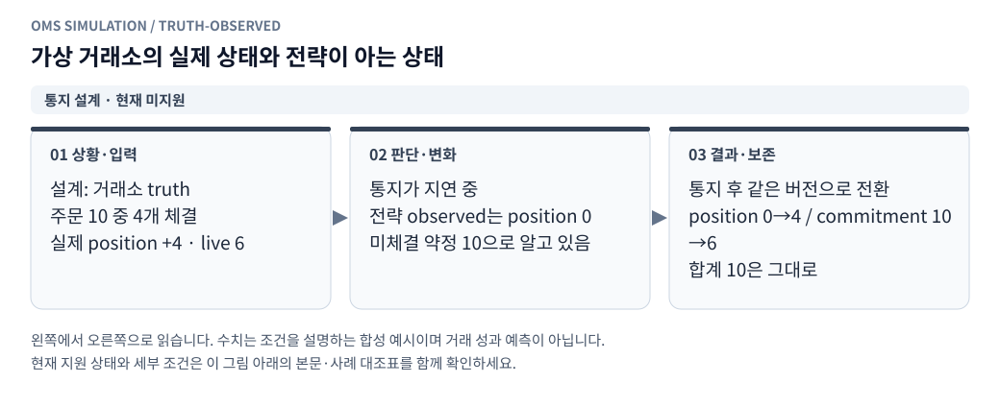

**그림 읽기 · 통지 설계 · 현재 미지원:** 포지션만 먼저 늘리거나 약정만 먼저 줄인 중간 상태로 헤지를 계산하면 중복 또는 과소 주문이 발생한다. 지연 통지망은 현행 미연결이다. [수정용 Mermaid 원본](figures/truth-observed.mmd).

### 16.1 `observations.cjs`

**책임:** 가상 거래소에서 이미 발생한 사실을 정해진 통지 시점에 전략 관측 상태로 전달한다. truth 원장은 바꾸지 않는다.

통지 필드:

```text
notice_id, kind, cause_event_id, generated_at_ms, delivered_at_ms
venue, account_id, order_id, fill_id
truth_entity_version, account_projection_version
cumulative_filled_qty, terminal_reason
coherent_position_delta, coherent_commitment_delta
quality_flags
```

전역 `last_version` 하나보다 오래됐다는 이유로 고유 체결 통지를 버리지 않는다. 이미 최신 ACK가 왔어도 아직 처리하지 않은 fill_id가 있으면 체결 인식·연결 처리가 필요하다.

처리 계약:

1. notice_id로 동일 통지 재전달을 감지한다.
2. fill_id로 같은 체결의 중복 처리를 막는다.
3. 엔터티별 버전과 누적 체결량을 대사한다. 누적량이 감소하는 갱신은 상태를 되돌리지 않는다.
4. 오래된 절대 계좌 snapshot은 최신 상태를 덮어쓰지 않는다.
5. snapshot이 체결을 이미 포함했다면 후속 fill 통지가 계좌를 다시 증가시키지 않게 반영 coverage를 보존한다.
6. 고유 fill의 인과 연결·통계 처리와 계좌 수량 반영을 분리한다.
7. 주문 종료 상태는 늦은 ACK로 LIVE로 되돌리지 않는다.

### 16.2 일관된 포지션·헤지 약정 projection

같은 관측 projection에서 포지션 변화와 진행 중 약정 감소를 함께 적용한다.

```text
매도 30개 헤지 전송:
  observed_position=0, observed_commitment=-30

truth에서 20개 체결, 통지 전:
  truth_position=-20, truth_remaining=-10
  observed_position=0, observed_commitment=-30 유지

체결 관측 적용:
  observed_position=-20, observed_commitment=-10을 원자적 전환
```

observed position 0과 truth remaining -10을 섞으면 추가 20개를 중복 헤지할 수 있다. 전략과 헤지 컨트롤러에 제공되는 계좌·약정은 같은 projection_version을 요구한다.

### 16.3 가상 refresh

원본의 `refreshAccount`, `refreshWaitingOrders`, `reconcilePendingOrders`를 즉시 truth 반환으로 대체하지 않는다. refresh request를 만들고 명시한 snapshot capture 시각과 response 지연을 거쳐 observed 상태로 제공한다. 요청시점 snapshot인지 응답 생성시점 snapshot인지도 고정한다.

계좌 snapshot·주문 snapshot이 서로 다른 버전이면 준비 완료로 표시하지 않는다. 정합되지 않은 동안 새 증가 주문·헤지 의도를 보류하고 이유를 남긴다.

**검증:** ACK 역전, 체결 통지 2회, snapshot 선행 후 fill 도착, position·commitment 버전 불일치, 늦은 취소 통지, refresh 도중 시장 변화.

## 17. 원본 전략 브리지

### 17.1 고정 소스 로딩

전략 기준은 `Tsystem2` Git 객체 `d7dcd97a35fa32b56813d16b92ee53e1604d5c06`이다. 확인 시점의 현재 Tsystem2 작업 트리에는 해당 `point2_st.js`가 없으므로 현재 HEAD 파일 경로만 믿지 않는다. 고정 Git 객체에서 필요한 소스를 읽어 실행별 검증 사본 또는 버전 관리한 vendor 모듈로 준비하고 전체 의존 파일 해시를 manifest에 기록한다.

`Tsystem2_point_st2_sim`에는 관련 파일이 있지만 고정 SHA와 자동으로 동일하다고 간주하지 않는다. 비교 사본으로 쓸 때는 내용을 대조한다. 실행 중 다른 작업 트리 변경이 전략 동작을 바꾸지 않아야 한다.

`Point2Strategy`는 `now`와 거래소 객체를 주입받는다. `main()`은 연결하지 않는다. 모듈 로딩 시 읽는 환경변수는 허용 목록으로 고정하고 운영 환경값을 상속하지 않는다.

### 17.2 원본 어댑터 호환 계약

| 어댑터 | 전략이 요구하는 주요 항목 |
|---|---|
| 빗썸 | `ob.CT`, `ob.USDT`, `accountDict.CT.balance/locked`, `assetDict.KRW.balance/locked`, `waitingList` |
| 빗썸 동작 | `isAccountSyncReady`, `isOrderSyncReady`, `hasPendingCancel`, `hasPendingOrder`, `order`, `delete` |
| OKX | `ob['CT-USDT-SWAP']`, 코인환산 `accountDict.balance`, `assetDict.USDT.available/balance`, leverage·step·min/max |
| OKX 동작 | 주문·취소, 계좌/주문 refresh·reconcile, freshness/dirty 상태, 원본 비교 모드의 정정 |

각 함수가 observed 상태만 읽는지 계약 테스트로 확인한다. 원본이 기대하는 `balance`가 가용인지 총량인지 필드별로 고정하고 가용+잠금을 중복 합산하지 않는다.

원본 빗썸 microprice는 `[가격,호가금액]`, OKX는 `[가격,코인수량]`을 기대한다. 정규화된 수량을 원본 형태로 맞추는 변환은 브리지 한곳에서 수행한다.

### 17.3 가격·원본 조건

```text
microprice = (bid_price*ask_qty + ask_price*bid_qty)/(bid_qty+ask_qty)
base = OKX_CT_microprice * Bithumb_USDT_microprice
bid_limit = tick_floor(base*(1+(baseline_bps-buffer_bps-pricing_fee_bps)/10000))
ask_limit = tick_ceil(base*(1+(baseline_bps+buffer_bps+pricing_fee_bps)/10000))
```

기본 -100bp·10bp·0bp 프로필은 base의 0.989/0.991 한계가다. 기본 해외 가격원은 원본에서 binance이므로 `okx_swap`을 반드시 입력한다.

원본 신선도 기준, 금지 방향 취소가 기준가격 검사보다 먼저 수행되는 순서, 같은 가격 주문 유지, 유보 KRW·보유 한도·매수 비용·헤지 용량 조건을 보존한다. 원본은 기준가격 stale만으로 모든 기존 주문을 취소하는 전략이 아니다.

### 17.4 비동기 실행과 가상시계

원본 `evaluate()`는 동기, `hedge()`는 비동기다. refresh 완료를 기다린다고 scheduler 전체를 멈추면 지연 동안 시장 이벤트가 사라진다.

브리지는 비동기 요청을 가상 pending operation으로 등록한다. 스케줄러는 다음 이벤트를 계속 처리하고 응답 이벤트 시점에 continuation을 진행한다. Promise microtask 완료가 wall clock 우연에 따라 주문 순서를 바꾸지 않게 이벤트 경계마다 정해진 순서로 drain한다. 지원할 수 없는 비동기 경로는 실행 전에 거절한다.

원본 `setInterval` 루프 대신 가상 평가·헤지 타이머를 등록한다. 최대 평가 빈도·헤지 gate 등 시간 조건도 주입 시계를 사용한다.

### 17.5 헤지 주문 생성 권한은 하나

같은 헤지 목표 그룹에는 다음 모드 중 한 경로만 주문을 생성한다. 다른 그룹의 일반 지정가 호가는 함께 존재할 수 있으며, 계좌 단위 주문 집합 조정기가 목적·목표 배분과 전체 위험을 함께 검사한다.

- `original_post_only`: 원본 hedge 실행 경로를 가상 OKX에 연결한다. 별도 controller는 약정·연결만 관리한다.
- `market_variant`: 원본 hedgePlan·수량/용량 조건을 사용하되 브리지가 시장가 의도를 명시적으로 만든다. 원본 Post-only 주문 실행 경로를 동시에 호출하지 않는다.
- `limit_variant`: 원본 목표량과 명시적인 가격·수량 분할 정책으로 여러 OKX 지정가를 만든다. GTC·IOC·Post-only를 주문별로 선택한다. 일반 지정가 호가를 원본 Post-only 동작과 동일하다고 표시하지 않는다.

원본 정정은 기체결분을 포함한 총수량 계약을 사용할 수 있다. 첫 버전에서 정정을 취소 후 신규로 대체하면 실행 변형으로 표시하고 큐 순번 재설정을 기록한다. 원본 Post-only 비교가 이 차이까지 재현됐는지 결과에 명시한다.

원본 어댑터의 지정가 `max_q`와 시장가 `market_max_q`는 서로 다를 수 있다. 각 주문 종류의 lot/min/max 한도를 검증한다. child 분할은 실행 변형으로 기록하고, 각 child의 약정·도착·체결을 따로 추적하며 남은 의도를 보존한다. 계획·예약 배정은 직렬로 확정하되 배정된 child 여러 개를 동시에 live로 둘 수 있다. 기존 child의 전량 체결을 다음 child 전송 조건으로 삼지 않는다.

원본 난수 client ID는 접두사·소유권 의미를 유지하는 순번 ID로 치환한다. ID 생성 경로만 바꿨는지 golden 비교로 확인한다.

## 18. 헤지·리스크 모듈

<!-- diagram: hedge-exposure -->

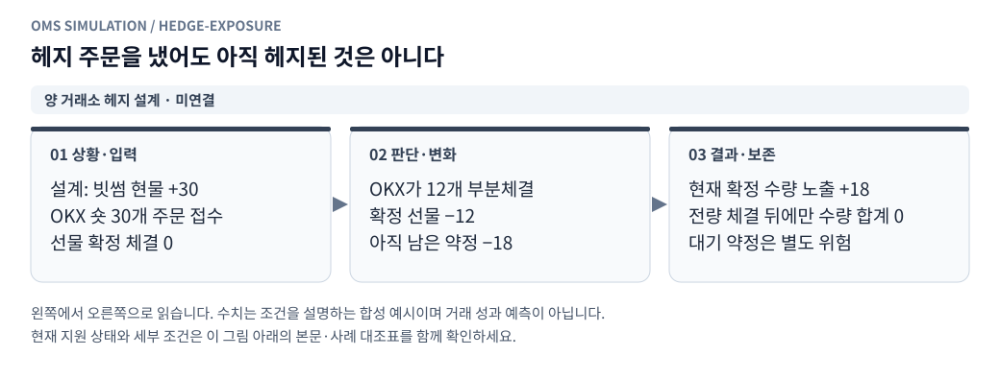

**그림 읽기 · 양 거래소 헤지 설계 · 미연결:** 코인 환산 수량이 같은 단순 예시다. 계약 승수·반올림·가격·환율 위험을 별도로 처리해야 한다. [수정용 Mermaid 원본](figures/hedge-exposure.mmd).

### 18.1 `hedge_controller.cjs`

```text
E_truth = spot_truth_total + swap_truth_base_position - target_exposure
E_observed = spot_observed_total + swap_observed_base_position - target_exposure
new_hedge_intent = -E_observed - signed_observed_working_commitment
```

허용 노출·최소 수량·최대 헤지 수량·담보 용량은 원본 조건을 적용한다. `maxHedgeQty=0`의 원본 의미는 한도 해제다. lot 미만 노출은 없어진 것으로 처리하지 않고 잔여분으로 누적한다.

위 `-E_observed` 식은 한도 적용 전의 개념식이다. 첫 순노출 목표 0·현물 매수 보유 프로필의 원본 목표량은 다음과 같이 계산한다.

```text
hedge_cap = maxHedgeQty if maxHedgeQty > 0 else Infinity
target_swap_position = -floorQty(min(spot_observed_total, hedge_cap), base_step)
desired_delta = target_swap_position - swap_observed_position
new_intent = desired_delta - signed_observed_working_commitment
```

그 뒤 원본 허용 오차·최소/최대 수량·담보·reduce-only와 해당 주문 종류의 한도를 적용한다. 최대 헤지 한도로 남은 노출도 truth 위험 지표에서 숨기지 않는다. 순노출 목표를 0이 아닌 값으로 바꾸는 기능은 별도의 전략 변형이다.

`signed_observed_working_commitment`는 같은 목표를 배분한 헤지 그룹 내 모든 child의 부호 있는 잔량과 아직 관측에 반영되지 않은 현지 전송 의도다. 서로 다른 주문에 중복 배분한 목표량이 없어야 한다. 일반 매수·매도 호가 전체의 순합을 이 식에 무조건 넣지 않는다. 반대 목적·방향 주문이 있으면 그룹 간 목표 배분, 취소/유지 정책과 체결 위험을 먼저 조정한다. 단순 순상쇄로 추가 헤지 필요량과 가용 담보를 동시에 계산하지 않는다.

수행 단계:

1. 새로운 현물 fill_id의 관측을 한 번 등록한다.
2. 같은 projection_version의 포지션·기존 약정·현지 미확인 의도를 읽는다.
3. 헤지 필요량·방향·허용 오차를 계산한다.
4. 같은 방향의 복수 주문 약정을 모두 반영하고 추가 필요분만 생성한다. 계획·예약 갱신만 순서화하며 여러 지정가가 동시에 대기할 수 있다.
5. 실제 축소 주문은 reduce-only와 해당 포지션 한도를 적용한다.
6. 거절·부분체결·취소·재평가를 상태기계로 처리한다.
7. 자료가 불일치하거나 refresh 중이면 보류하고 이유를 남긴다.

헤지 실패 재시도를 무한 반복하지 않는다. 가상 재시도 간격·횟수·최대 미헤지 시간과 실행 중단 정책을 설정한다. 이는 원본을 변경하는 정책일 수 있으므로 프로필에 명시한다. truth 노출에 근거한 강제 실행 중단은 시뮬레이터 정책이며 원본 전략 신호로 기록하지 않는다.

지정가가 미체결이면 미헤지 위험이 남는다. 가격 재산정·일부 취소·재배치·시간 조건에 따른 시장가 전환은 명시한 실행 정책이 있을 때만 수행한다. 기본 대기 지정가를 임의 시간 후 자동 시장가로 바꾸지 않는다. 취소 전송 중인 child도 확인 전까지 그룹 약정에 포함한다.

### 18.2 부분체결 인과관계

관계는 단순 1:1이 아니라 여러 현물 체결을 한 헤지로 묶거나 한 헤지가 여러 번 나눠 체결될 수 있다.

```text
maker_fill → hedge_intent → hedge_order → hedge_fill
```

따라서 연결 테이블에 `source_fill_id`, `hedge_intent_id`, `hedge_fill_id`, `allocated_base_qty`, `allocation_method`를 둔다. FIFO 등 귀속 방법은 분석용으로 고정하고 원장의 실제 포지션 계산과 분리한다. 종료시 미완료 연결 수량을 남긴다.

취소 요청 후 발생한 현물 체결도 헤지 의무다. 매도 체결은 기존 숏을 줄이는 방향일 수 있다. 포지션 반전 가능 여부와 reduce-only 적용을 방향별로 확인한다.

### 18.3 `risk.cjs`

클라이언트 검사와 거래소 검사를 분리한다.

| 단계 | 검사에 쓰는 상태 | 주요 검사 |
|---|---|---|
| 의도 생성/전송 | observed + 현지 미확인 예약 | 원화 유보·가용코인·원본 보유 한도·중복 의도 |
| 가상 거래소 도착 | truth + exchange 잠금 | 잔고·규격·담보·reduce-only·자기 체결 |
| 실행 감독 | truth + 데이터 품질 | 모형 담보 한계·자료 불확실·무한 루프·디스크 실패 |

도착 때 잔고가 부족하면 거절한다. 전송시 observed 검사를 통과했다는 이유로 빚을 허용하지 않는다. 기존 주문 최소금액 검사는 **제출 조건**이다. 제출 후 발생한 작은 부분체결에 최소 주문금액 규칙을 다시 적용해 체결을 삭제하지 않는다.

### 18.4 양방향 복수 주문의 잠재 노출·예약

매수 100개와 매도 100개의 순약정이 0이어도 한쪽만 체결될 수 있다. 현재 순노출과 `buy_working_qty`, `sell_working_qty`, 최대/최소 도달 포지션을 별도로 검사한다. 도착 전 전송량·live 잔량·취소 효력 전 잔량을 order_id별 한 번 포함한다. fill 통지가 지연된 observed 약정과 truth 잔량은 각자의 버전에서 계산한다.

일반 순포지션 q에서 증가·반전 가능한 주문의 보수적 수량 범위는 다음과 같다.

```text
q_upper = q + sum(buy_working_qty)
q_lower = q - sum(sell_working_qty)
worst_abs_position = max(abs(q_upper), abs(q_lower))
```

reduce-only의 실제 가능 수량·체결 순서는 별도 검증한다. 이 범위는 단순 수량 위험 검사이며 실제 거래소 증거금 공식은 아니다. 담보·수수료는 도달 가능한 중간 상태와 적용 가격을 포함한 명시적 보수 모형으로 예약한다. 양방향 주문이 있으므로 위험과 예약을 0으로 처리하거나, 아직 체결되지 않은 매도 대금을 새 매수 자금으로 쓰지 않는다.

같은 포지션을 줄이는 reduce-only 여러 주문은 누적 약정과 실행 시점 포지션을 함께 검사한다. 각 주문이 같은 청산 가능량 전부를 별도로 확보했다고 간주하지 않는다. 프로필에서 수량 축소·취소·거절 중 어떤 처리를 하는지 고정한다.

예시: 목표 매도 헤지 60개를 20개씩 세 가격에 배치했다면 약정은 총 -60이다. 1번 주문이 10개 체결됐지만 통지 전이면 observed 포지션·약정은 종전 조합을 유지한다. 통지 적용 후 포지션 -10과 잔여 약정 -50으로 함께 전환한다. 다른 가격 주문의 남은 40개를 잊고 같은 목표로 새 40개를 중복 전송하지 않는다.

## 19. 데이터 품질과 불확실성

### 19.1 `quality.cjs`

품질은 메시지 목록만이 아니라 영향 범위를 갖는다.

```text
flag_id, code, severity, detected_at_ms, cause_event_id
venue, instrument_id, order_id, account_id
affected_start_ms, affected_end_ms
propagates_to_position, propagates_to_pnl, details
```

| 코드 | 의미 | 기본 처리 |
|---|---|---|
| `unit_unverified` | 수량 의미 미확인 | 실행 전 거절 |
| `coverage_missing` | 필수 입력의 기간 불일치 | 실행 전 거절 |
| `book_stale` | 체결 입력 호가의 신선도 부족 | 신규 매칭 보류/엄격 중단 |
| `source_gap` | 수집 중단 근거가 있는 공백 | 영향 검사 후 중단 |
| `depth_insufficient` | 주문 잔량의 깊이 밖 체결 미확인 | 확정 부분 보존 후 불완전 분류 |
| `queue_unobservable` | 대기 가격이 관측 범위 밖 | 큐 보존·판정 가능한 틱만 사용 |
| `queue_inconsistent` | 감소를 뒤 물량만으로 설명 불가 | 모형 가정 불일치 기록 |
| `depth_reconciliation_incomplete` | public 부채·감소 미정합 | 미확인 유지·정책에 따라 중단 |
| `late_reconciliation` | 창 종료 뒤 관련 자료 도착 | 영향 주문·후속 평가에 전파 |
| `historical_spec_assumed` | 과거 규격을 확인하지 못함 | 가정 표시·민감도 또는 엄격 거절 |
| `valuation_unavailable` | 종료/평가 가격 부족 | 총평가액 null 또는 불확실 |

`queue_unobservable` 하나가 언제나 모든 결과를 무효화하는 것은 아니다. 관측된 반대 tick으로 제한 배분 가능한 부분과 전혀 모르는 부분을 구분한다. 반대로 관련 주문이 살아 있었던 데이터 공백 뒤에 새 snapshot이 왔다고 과거 불확실성이 자동 해소되지는 않는다.

### 19.2 엄격 실행과 진단 실행

- `strict`: 첫 영향 공백·깊이 부족에서 신규 의사결정을 멈추고, 마지막 확정 상태와 문제 이벤트를 보존한다. 이미 판정된 부분체결은 삭제하지 않는다.
- `diagnostic_continue`: 선택한 가정으로 계속할 수 있지만 영향받은 포지션·후속 주문·손익에 불확실성을 전파한다. 정상 확정 손익과 같은 열에 섞지 않는다.

공백이 이미 끝난 뒤에야 발견됐으면 최초 영향 구간을 소급 표시할 수 있다. 다만 과거 체결·주문을 몰래 다시 계산하지 않는다. `first_invalid_event_seq`부터의 suffix를 불확실로 분류하고, 가정을 바꾼 재계산은 새 실행으로 한다.

실행 전 설정한 공백·freshness 기준이 필요하다. heartbeat 없는 체결 스트림에 임의의 무체결 시간 임계치를 적용하지 않는다. 원본 전략의 stale 정책은 별도로 유지한다.

### 19.3 작업 상태와 결과 품질을 분리

```text
lifecycle_status:
  VALIDATING | PREPARING | QUEUED | RUNNING | PAUSED
  STOPPING | STOPPED | FINISHED | FAILED | INTERRUPTED

result_quality:
  NOT_EVALUATED | VALID_WITHIN_MODEL | PARTIAL | INDETERMINATE
```

worker가 정상 종료해도 결과가 INDETERMINATE일 수 있다. `VALID_WITHIN_MODEL`은 선택한 입력·가정 안의 내부 정합을 뜻하며 실제 시장 적합성을 검증했다는 의미가 아니다.

## 20. 실행 관리자·프로세스·명령

### 20.1 `jobs.py` / `runner.cjs`

관리자는 실행 소유권, 설정 검증, 입력 준비, 프로세스 생성, 상태 수신, 중단, 결과 등록을 담당한다. worker는 계좌·전략·scheduler 상태를 독점 소유한다.

실행 준비에서 가상계좌 revision/hash와 venue별 초기상태를 고정하고 계좌 공장을 호출한다. opening·초기평가·관측 동기화가 모두 완료되기 전 전략을 시작하지 않는다. 한 venue 준비 실패 시 다른 venue만 매매하도록 부분 시작하지 않는다.

```text
VALIDATING → PREPARING → QUEUED → RUNNING ↔ PAUSED
                                      → STOPPING → STOPPED
                                      → FINISHED
실행/준비 오류                        → FAILED
호스트·worker 예기치 않은 종료        → INTERRUPTED
```

동시 실행 수·실행별 메모리·준비 파일·결과 디스크 한도를 설정한다. 수치는 실제 벤치마크 후 정한다. 별도 프로세스는 전략의 모듈 로딩 환경과 메모리를 격리하기 위한 것이며, 그 자체로 완전한 보안 sandbox라는 의미는 아니다.

worker는 허용된 Node 실행 파일과 고정 runner를 인자 배열로 실행한다. shell 문자열로 데이터 경로나 설정값을 이어 붙이지 않는다. 운영 `.env`, 인증키, 개인 API 객체를 전달하지 않는다.

### 20.2 IPC 메시지

명령은 `request_id`, `run_id`, `attempt_id`, `kind`, `payload`를 가진다. worker 응답은 ACK/상태/진행/결과/오류로 구분한다. stdout은 구조화된 제어 메시지, stderr는 크기 제한 진단 로그에 사용한다. 메시지 크기·버퍼 한도와 backpressure를 구현한다.

API 명령을 수락한 것과 worker가 적용한 것은 다르다. `202 accepted` 이후 command 조회로 실제 적용 경계를 확인한다. 잘못된 attempt의 늦은 메시지는 현재 worker 상태를 덮어쓰지 않는다.

### 20.3 pause·resume·stop

- pause는 현재 이벤트를 완결한 경계에서 시계를 멈춘다. 적용 event_seq·시각·causal_round를 ACK한다.
- resume은 같은 살아 있는 worker의 큐·전략·원장을 이어간다.
- stop은 다음 안전 경계에서 신규 이벤트 처리를 끝내고 결과를 flush한다. 주문을 가상 취소·포지션을 청산하는 명령이 아니다.
- pause/stop 요청을 받아도 이미 확정된 체결은 되돌리지 않는다.
- 강제 종료가 필요하면 마지막 journal commit 지점과 미완료 suffix를 식별하고 INTERRUPTED/부분 결과로 남긴다.

### 20.4 재시작·재현 범위

첫 버전은 crash 이후 임의 시점 resume을 보장하지 않는다. 서버 재시작 시 실행 중이었던 작업을 INTERRUPTED로 표시하고 기존 부분 결과를 유지한다. 사용자가 재실행하면 고정 입력·설정·명령 로그로 처음부터 재생하는 새 실행을 만든다.

향후 checkpoint에는 시계, heap, 입력 cursor, 인과 sequence, books, queues, 모든 부채·크레딧, 주문, 예약, truth/observed, fill coverage, 전략 내부 상태, pending async, 헤지 약정, 지표·journal cursor가 모두 필요하다. 일부만 저장한 checkpoint를 정상 복원으로 표시하지 않는다.

### 20.5 수동 명령의 결정성

명령 로그 필수값은 `command_id`, `idempotency_key`, action, target, 요청 wall time, 적용 virtual time, **적용 event_seq·causal_round·경계**와 결과다. 가상시각만 기록하면 같은 ms 안의 순서가 모호하다.

빠른 재생 중 사용자가 누른 시점을 경제적 비교에 직접 사용하지 않는다. 엄밀한 비교는 사전 예약한 가상 명령 또는 pause ACK 경계에 명령을 고정한다. 재실행은 기록된 적용 경계와 순서로 명령을 주입한다.

## 21. API 상세 계약

아래는 제안 API다. 기존 인증·변경 요청 검증을 적용하고 모든 run·파일·주문 조회에서 소유권을 확인한다.

| API | 역할 | 성공 응답 |
|---|---|---|
| `POST /api/replay-accounts` | 이름·거래소별 초기조건으로 가상계좌 생성 | 계좌ID·revision·hash |
| `POST /api/replay-accounts/{id}/revisions` | 충돌 검사 후 새 초기조건 | 새 revision·hash |
| `POST /api/replay-accounts/{id}/reset` | 지정 초기 revision으로 새 revision 생성 | 새 revision, 과거 원장 보존 |
| `POST /api/replay-accounts/{id}/clone` | 초기조건을 새 가상계좌로 복사 | 새 계좌ID·revision |
| `POST /api/replays/validate` | 거래소1~2개·전략 의존성·입력·기간·규격 검사. 작업 실행 없음 | 검증 결과·warnings·effective config |
| `POST /api/replays` | 가상계좌 revision/hash·설정을 고정해 실행 생성 | 202, run_id·상태 URL |
| `GET /api/replays` | 실행 목록 | cursor·실행 요약 |
| `GET /api/replays/{id}` | 상태·진행률·가상시각·품질 | lifecycle과 result_quality |
| `POST /api/replays/{id}/pause` | 안전 경계 일시정지 | 202, command_id |
| `POST /api/replays/{id}/resume` | 살아 있는 worker 재개 | 202, command_id |
| `POST /api/replays/{id}/stop` | 처리 중단·부분 결과 보존 | 202, command_id |
| `POST /api/replays/{id}/orders/{order_id}/cancel` | 해당 가상 주문 취소 전송 | 202, command_id |
| `POST /api/replays/{id}/orders/cancel-batch` | 명시한 가상 order_id 목록의 개별 취소 요청 | 202, command_id·child별 receipt |
| `GET /api/replays/{id}/commands/{command_id}` | 명령 적용 결과 | applied boundary·오류 |
| `GET /api/replays/{id}/orders` | 주문/변경 내역 | 안정 cursor·수량 분해 |
| `GET /api/replays/{id}/fills` | 체결 내역 | fill_id·원인·수수료·연결 |
| `GET /api/replays/{id}/accounts` | 실행별 거래소 계좌·잔고·담보·포지션 조회 | run_account_id·snapshot·버전·품질 |
| `GET /api/replays/{id}/ledger` | 원통화 원장 | event_seq·계좌·통화별 흐름 |
| `GET /api/replays/{id}/quality` | 품질 영향 | 최초 영향·범위·코드 |
| `GET /api/replays/{id}/results` | 성과·가정·미완료 상태 | 확정/불확실 지표 구분 |
| `GET /api/replays/{id}/export` | 실행 결과 묶음 | 권한 확인된 다운로드 |
| `POST /api/replays/compare` | 호환 실행 비교 | 공통 조건·차이·결과표 |

### 21.1 생성·상태 응답 예시

```json
{
  "run_id": "replay_example",
  "attempt_id": "attempt_1",
  "lifecycle_status": "RUNNING",
  "result_quality": "NOT_EVALUATED",
  "manifest_hash": "sha256:...",
  "progress": {
    "virtual_time_ms": 0,
    "processed_market_events": 0,
    "processed_sim_events": 0,
    "time_coverage_ratio": 0,
    "last_committed_event_seq": "0"
  },
  "pending_command_id": null,
  "first_invalid_event_seq": null,
  "warnings": []
}
```

예시의 0은 응답 구조 표시용이다. 실제 날짜·잔고·수수료의 기본값이 아니다. 진행률은 시간 범위와 처리 이벤트 수를 구분한다. 남은 시간 추정은 변동 가능하다고 표시한다.

### 21.2 멱등성과 오류

실행 생성 멱등 키는 사용자+키 범위에서 설정의 정규 해시와 묶는다. 같은 키·같은 요청은 같은 run을 반환하고, 같은 키·다른 요청은 409다. 제어 명령도 command_id/멱등 키로 중복 적용을 막는다.

| HTTP | 예시 | 처리 |
|---|---|---|
| 400 | 잘못된 JSON·형식 | 필드 경로와 사유 |
| 401/403 | 로그인·변경 검증 실패 | 기존 정책 적용 |
| 404 | 접근 불가/없는 run·주문 | 다른 사용자 정보 노출 방지 |
| 409 | 상태 충돌·키 재사용·죽은 worker resume | 현재 상태·가능 작업 |
| 422 | 단위·기간·규격·필수 설정 불충족 | 실행 전 검증 보고서 |
| 429 | 동시 실행·큐 한도 | 재시도 가능한 범위 |
| 500/503 | 저장 실패·worker 시작 실패 | run 보존·실패 이유·재시도 가능성 |

목록은 `(event_seq,subsequence)` 기반 안정 cursor를 쓴다. 전체 체결을 매 poll마다 다시 보내지 않는다. 페이지 크기·필터·내보내기 한도를 둔다. 가격·수량·금액은 문자열로 응답한다.

주문 조회에는 venue·side·price·order_group_id·quote_slot_id·purpose 필터와 각 그룹의 합계 잔량을 제공한다. 일괄 취소도 거래소별 지연·이미 체결된 주문·개별 거절을 반영하고 전체 원자 성공으로 표시하지 않는다.

## 22. 저장 스키마·manifest·결과 파일

<!-- diagram: committed-snapshot -->

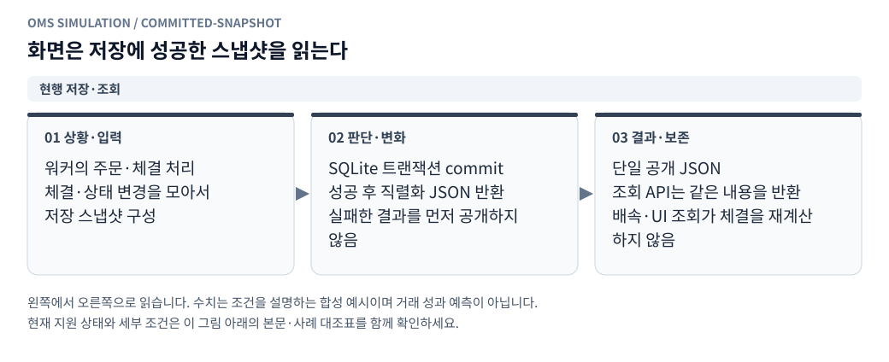

**그림 읽기 · 현행 저장·조회:** 리플레이 저장·조회 경로의 설명이다. 저장하기 전의 가변 원장 객체를 HTTP 응답과 공유하지 않는다. [수정용 Mermaid 원본](figures/committed-snapshot.mmd).

### 22.1 제어 DB와 경제적 기록 분리

SQLite에는 실행·소유권·상태·설정 위치·명령 receipt·결과 인덱스를 둔다. worker의 틱별 경제적 이벤트를 Flask의 공유 DB에 매번 commit하지 않는다.

제안 제어 테이블:

| 테이블 | 주요 키·필드 |
|---|---|
| `replay_runs` | run_id, owner, attempt_id, lifecycle, quality, manifest_hash, start/end, output_path, 마지막 commit |
| `replay_commands` | run_id+command_id, 멱등 키, 요청 해시, 적용 경계, 결과 |
| `replay_artifacts` | run_id+artifact_type, 경로, schema_version, 행 수, 해시, 완결 여부 |
| `replay_virtual_accounts` | 계좌ID·소유자·이름·최신revision·보관 상태 |
| `replay_account_revisions` | 계좌ID+revision·불변 초기조건·hash·복제/초기화 원본 |
| `replay_run_accounts` | run_account_id·run_id·venue·초기조건 참조·마지막 확정경계 |

run 메타데이터와 파일 commit 상태가 어긋나면 `FINISHED`로 표시하지 않는다. 최종 summary와 파일 인덱스가 확정된 뒤 완료 상태를 갱신한다.

### 22.2 실행 디렉터리

```text
.state/replays/<run_id>/
    manifest.json
    opening_accounts.json     # 실제 적용 초기자산·원가·증거금·평가액
    account_snapshots.parquet  # 계좌별 확정 상태·버전·원장 cursor
    ending_accounts.json      # 종료 상태·미완료·예약·미확인
    commands.jsonl
    journal/                  # 순차 chunk + commit marker
    orders.parquet            # 최종 주문 + 별도 주문변경 기록 또는 이벤트키
    fills.parquet
    hedge_links.parquet
    ledger.parquet
    equity.parquet
    quality.parquet
    summary.json
    artifacts.json            # 파일 해시·행수·마지막 event_seq
    diagnostics/              # 경제적 결과와 분리한 실행 진단
```

준비 입력은 별도 dataset cache에 해시로 저장할 수 있다. 결과 보존기간과 cache 삭제기간을 분리한다. 입력 cache가 삭제돼도 manifest로 원본을 식별할 수 있어야 하며, 원본까지 사라지면 재실행 불가 사유를 표시한다.

### 22.3 manifest 필수 내용

| 영역 | 반드시 기록할 내용 |
|---|---|
| 실행 정의 | schema_version, 고유 venues1~2·필수 소스 binding, start/end, 워밍업, 종료 경계 |
| 전략 | repo, 고정 SHA, 사용 파일 해시, 설정, 실행 변형, 결정적 ID 정책 |
| 입력 | 원본 파일 해시·행 범위·스트림 순서·단위·정렬·coverage·중복 처리 |
| 규격 | 종목·tick·lot·ctVal·수수료 통화·유효기간·역사 적합성 |
| 모형 | matching/queue/reconciliation/ledger/observation/valuation·주문 집합/분할/목표 배분 버전 |
| 시간 | 거래소별 신규/취소/ACK/fill/book/refresh 지연, 같은 시각 우선순위 |
| 계좌 | virtual_account_id·revision/hash·선택 venue 초기상태·초기 원가/평가·증거금·레버리지 |
| 비용 | 가격계산 수수료·용량 계산 수수료·실제 maker/taker 비용·추가 스트레스 |
| 품질 | 공백·stale·depth·정합 정책, 허용 가정 |
| 명령 | 사전 예약 명령 해시·런타임 명령 기록/주입 정책. 실행 중 명령 최종 해시는 종료 seal에 기록 |
| 런타임 | worker 소스 해시·Node/Python·수치 라이브러리·의존성 잠금 정보 |

immutable experiment manifest와 wall clock 실행 진단을 구분한다. manifest를 사후에 바꾸어 같은 실행의 가정을 변경하지 않는다. 준비 확정 전 provisional manifest와 실행용 확정 manifest를 구분한다.

실행 중 추가되는 수동 명령의 최종 해시는 시작 시점에 알 수 없다. commands journal을 append-only로 기록하고 종료 `artifacts.json`/summary seal에 최종 해시를 둔다. 재현 실행은 원래 manifest와 seal된 명령 로그를 함께 입력으로 삼는 새 manifest를 생성한다. 중단된 실행도 확정된 명령 prefix의 해시와 마지막 경계를 보존한다.

### 22.4 경제적 테이블 공통키

모든 경제적 행은 `event_seq`, `desktop_time_ms`, `cause_event_id`, `schema_version`, 품질 플래그를 가진다. 경제적 결과 해시용 순서는 행의 명시적 정렬키로 정한다.

| 테이블 | 주요 필드 |
|---|---|
| Orders | order_id, intent_id, reservation_id, strategy/group/slot, purpose, plan_revision, replaces_order_id, venue, side, type/tif, 가격, 요청/체결/in_flight/live/취소/거절/unknown 수량, 전송/도착/취소 시각, terminal reason |
| Fills | fill_id, order_id, base_qty, native_contracts, price, maker/taker, fee_ccy, fee_amount, raw_event_id, level_lifecycle_id |
| Ledger | entry_id, 계좌·통화, entry_type, delta_total, delta_locked, position_delta, realized_delta, fee/funding, fill/reservation/settlement 참조 |
| HedgeLinks | maker_fill_id, hedge_intent/order/fill, allocated_qty, 귀속 방법, 미완료 수량 |
| Equity | 원통화 현금·가용/잠금·포지션·원가·실현/미실현·총평가액·평가가격·truth/observed 노출·약정·품질 |
| Quality | 코드·심각도·원인·영향 시작/종료·주문/계좌·손익 전파 |

Parquet는 고정 Decimal 스케일을 사용하고 초과값은 저장 전 검사한다. 저널·IPC의 문자열과 변환한 뒤 합계가 일치해야 한다. 파일은 임시 이름에 쓴 뒤 완결·검증 후 원자적 rename한다. 부분 chunk는 식별 가능한 이름·상태로 남긴다.

## 23. 화면 구성과 결과 지표

<!-- diagram: orderbook-overlay -->

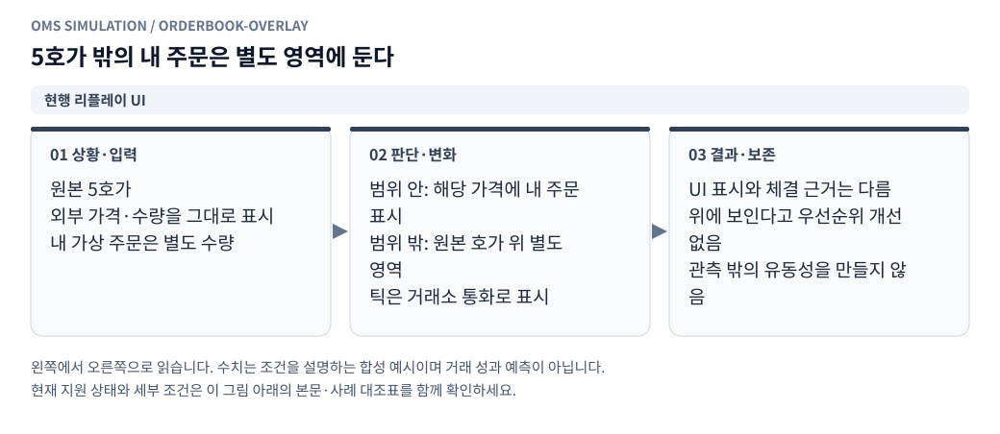

**그림 읽기 · 현행 리플레이 UI:** 내 주문 위치를 보여 주는 화면 규칙이다. 5호가 밖 물량을 실제 관측된 상대 호가처럼 매칭에 사용하지 않는다. [수정용 Mermaid 원본](figures/orderbook-overlay.mmd).

### 23.1 실행 설정 화면

설정은 데이터, 전략, 체결 가정, 초기 자산, 비용, 품질 정책 순으로 입력한다. 입력 검증 결과에 실제 공통 기간·호가 깊이·수량 복원 여부·과거 규격 확인 상태를 보여준다.

거래소 선택을 먼저 제공하고 선택 개수를 1~2개로 제한한다. 선택 거래소의 데이터·계좌·주문 설정만 표시한다. 전략에 필요한 두 번째 거래소가 빠지면 이유를 표시하고 실행을 차단한다. 프런트 제한과 같은 검증을 서버·worker에도 적용한다.

실행 전 가상계좌 생성/선택과 revision 미리보기를 제공한다. 초기 자금·코인·선물 포지션·레버리지를 저장하고, 선택 venue의 초기자산만 이번 실행에 반영됨을 표시한다. 진행 화면에는 초기/현재 자산, 가용/잠금, 원가·포지션·증거금·실현/미실현·수수료·미완료 주문을 연결한다. 초기화/복제/새 실행과 pause/resume을 구분한다.

원본 가격계산 수수료, 매수 용량 계산 수수료, 실제 체결 수수료는 서로 다른 설명과 입력을 제공한다. 사용자는 실제 비용에 어떤 값이 적용되는지 확인할 수 있어야 한다. 내부 파일 경로·프로세스 세부사항은 기본 화면에 노출할 필요가 없다.

실행 직전 검토 내용은 다음과 같다.

- 전략과 실행 변형: 예를 들어 point2 원본 신호 + OKX 시장가 헤지.
- 평가 구간, 워밍업, 종료 포지션 평가 정책.
- 빗썸/OKX 주문 지연과 체결 통지 지연.
- GTC/IOC/Post-only, 거래량 전용/취소 위치 추정 모형.
- 초기 KRW·현물·USDT·선물 포지션과 적용 수수료.
- 확인된 데이터 한계와 실행을 막는 미입력 항목.

### 23.2 실행 진행 화면

실행 상태·가상시각·진행률·품질 상태를 상단에 둔다. 일시정지/재개/중단과 가상 주문 취소는 서로 다른 동작으로 표시한다. 명령은 수락됨과 적용됨을 구분한다.

차트·표는 다음 정보를 연결해서 보여준다.

1. 원본 기준가격, 빗썸 best, 전략 목표가격, 내 공개 주문.
2. 빗썸 주문의 전송·도착·부분체결·취소 시점.
3. OKX 헤지 의도·전송·체결과 미완료 수량.
4. truth 미헤지 노출과 전략이 아는 observed 노출.
5. KRW·USDT 잔고, 잠금, 선물 포지션, 순평가액.
6. 공백·깊이 부족·정합 문제의 시간 범위.

주문 표와 차트에는 양 거래소의 전체 매수·매도 가격대를 표시한다. 그룹·슬롯별 선택, 개별/명시 목록 취소, 원본 주문과 교체 주문의 연결, 방향별 gross 잔량과 잠재 포지션 범위를 보여준다. 최우선 주문 하나만 표시해 다른 주문과 예약을 숨기지 않는다.

큰 체결 목록은 cursor로 읽고 차트는 표시용으로 다운샘플링한다. 표시용 집계 결과를 엔진의 체결 입력으로 되돌리지 않는다. 화면의 초당 갱신 횟수가 가상 이벤트 순서를 바꾸면 안 된다.

### 23.3 주문 상세와 추적 화면

주문을 선택하면 의사결정 시각의 관측 버전, 전송·도착 가격, 최초 앞 물량, 체결 근거 tick, 남은 수량, 취소 효력, 수수료, 헤지 연결을 볼 수 있어야 한다. 체결되지 않은 주문도 가격 미도달·대기열 미소진·Post-only 취소·자료 부족을 구분해 설명한다.

`source_event → strategy_intent → order → fill → ledger → hedge` 연결을 기록해 특정 손익 변화가 어디서 나왔는지 추적한다. 분석을 위해 전체 엔진 상태를 매 틱 JSON으로 복사할 필요는 없지만, 중요한 주문 판단 근거와 상태 버전은 남긴다.

### 23.4 `metrics.cjs` / `results.py`

worker는 증분 지표와 평가 스냅샷을 만들고 Python은 저장 결과를 대사해 최종 지표를 확정한다. 전체 journal이 있는 지표와 샘플 equity로만 계산한 지표를 구분한다.

| 지표 | 정의·주의 |
|---|---|
| 제출/접수/거절 수 | 멱등 재전송은 한 번 집계. 종료·거절 뒤 새 주문을 생성한 재시도는 원래 의도와 연결해 별도 집계 |
| 조건 취소 수 | Post-only·IOC 잔량·수동/전략 취소를 구분 |
| 제출 수량 대비 체결률 | filled / submitted. 거절 포함 여부를 이름에 표시 |
| 접수 수량 대비 체결률 | filled / accepted. 도착 전/거절 수량 제외 |
| 부분체결 주문 비율 | `0<filled<requested` 주문 수 / 분모 정의. 종료 live 포함 여부 표시 |
| 첫 체결 대기 | first_fill-arrival. 미체결 주문을 0ms로 넣지 않음 |
| 완료 대기 | final_fill-arrival. 완전 체결되지 않은 주문은 censored로 별도 집계 |
| 취소 지연 중 체결량 | cancel send 이후 effect 이전 또는 고정 동시각 규칙의 체결량 |
| 비용 | maker/taker 수수료·추가 stress·펀딩을 원통화별 표시 |
| 순손익·수익률 | 순입출금 분리. 초기 평가액 양수일 때만 단순 수익률 |
| 최대 낙폭 | 유효 평가액 high-water mark 기준. 평가 불가 구간 포함 범위 명시 |
| turnover | 현물·선물 별도 명목합계. 왕복 거래를 중복 오류로 보지 않음 |
| 종료 위험 | 포지션·대기/전송 주문·잠금·미통지 체결·미완료 헤지 |
| 가정 민감도 | 동일 데이터·비교 가능한 설정에서의 차이 |

### 23.5 미헤지 위험 지표

```text
exposure_qty_truth(t) = spot_qty_truth(t)+swap_qty_truth(t)-target_qty
exposure_krw_truth(t) = exposure_qty_truth(t)*valuation_base_krw(t)
exposure_time_area = ∫ abs(exposure_krw_truth(t)) dt
```

첫 지표의 `valuation_base_krw(t)`는 `OKX 선물 평가가격(t) × 평가환율(t)`로 정의한다. 원본의 주문 허용 노출 판단에 다른 가격이 쓰이면 원본 판단값을 별도로 기록한다. 이 평가가격·환율 중 하나라도 없거나 stale이면 해당 구간의 금액 노출은 unknown이며 적분에 0으로 넣지 않는다.

위 적분의 단위는 KRW·초로 고정한다. 포지션 또는 평가가격이 바뀌는 이벤트 사이의 piecewise 상태를 사용한다. 화면 다운샘플 시계열로만 계산해 피크를 놓치지 않는다. 평가가격이 없는 구간은 면적 0으로 만들지 않고 unknown duration을 별도로 기록한다.

최대 절대노출, 허용 노출 초과 누적시간·최장 연속시간, 현물 체결→필요 헤지 관측→헤지 전송→헤지 체결 지연을 함께 낸다. truth와 observed는 다른 지표이며 값이 작은 쪽을 골라 보고하지 않는다.

### 23.6 체결 후 가격 변화와 선택 편향

체결 후 1/5/30초 markout은 사후 분석용이다. 기준 `M`과 maker 체결가격 `P`, 매수 +1/매도 -1인 side sign s에 대해 `s*(M(t+h)-P)/P*10000`을 사용하고 기준시장·환산을 고정한다.

해당 미래 시각에 유효 관측값이 없으면 null이다. 미래 보간가격을 체결 시점의 판단에 넣지 않는다. 체결률 감소가 불리한 거래를 제외해 손익을 높일 수 있으므로 trade_only 결과를 손익의 보장된 하한으로 설명하지 않는다.

## 24. 첫 실행 설정과 비교 실험

### 24.1 입력이 필요한 설정 예시

아래는 **실행 전 검증을 통과하기 전의 설정 템플릿**이다. null은 사용자가 입력하거나 데이터 준비에서 확정해야 할 항목이다. 초기 자금·수수료·기간을 임의로 만들어 실행하지 않는다. 새 키는 제안 스키마이며 현재 API가 지원한다는 뜻이 아니다.

```json
{
  "schema_version": 1,
  "venues": ["bithumb", "okx"],
  "dataset": {
    "dataset_manifest_hash": null,
    "start_ms": null,
    "end_ms": null,
    "interval": "[start,end)",
    "warmup_ms": null,
    "stream_order": ["bithumb_ct_book", "bithumb_ct_trade", "okx_ct_book", "okx_ct_trade", "bithumb_usdt_book"]
  },
  "strategy": {
    "name": "point2_st",
    "revision": "d7dcd97a35fa32b56813d16b92ee53e1604d5c06",
    "ticker": "CT",
    "quoteMode": "fx",
    "referenceSource": "okx_swap",
    "baselineBps": -100,
    "bufferBps": 10,
    "feeBps": 0,
    "spotBuyFeeBps": 10,
    "tradeDirection": "both",
    "maxPositionKrw": 20000000,
    "krwReserve": 5000000,
    "maxHedgeQty": 86000,
    "hedgeToleranceKrw": 50000,
    "marginUtilization": 0.8,
    "maEnabled": false,
    "hedgeEnabled": true,
    "hedgeCapacityLimitEnabled": true,
    "bestBidOnly": false
  },
  "strategy_variant": {
    "hedge_execution": "market_variant",
    "amend_policy": "cancel_then_new",
    "spot_buy_capacity_fee_policy": "explicit_original_value_pending_validation"
  },
  "execution": {
    "clock": "desktopTime",
    "bithumb_tif": "gtc",
    "okx_order_type": "market",
    "okx_limit_tif": null,
    "order_latency_ms": {"bithumb": 20, "okx": 20},
    "cancel_latency_ms": {"bithumb": 20, "okx": 20},
    "ack_notice_latency_ms": {"bithumb": 20, "okx": 20},
    "fill_notice_latency_ms": {"bithumb": 20, "okx": 20},
    "own_book_notice_latency_ms": {"bithumb": 20, "okx": 20},
    "refresh_capture_policy": "request_time_snapshot",
    "refresh_response_latency_ms": {"bithumb": 20, "okx": 20},
    "same_time_policy": "market_first",
    "queue_model": "trade_only",
    "queue_ahead_multiplier": "1.0",
    "self_depletion_policy": "retain_until_verified_lifecycle_reset"
  },
  "order_management": {
    "multiple_orders_per_side": true,
    "same_price_multiple_orders": true,
    "quote_policy": "original_point2",
    "max_open_orders_per_venue": {"bithumb": null, "okx": null},
    "plan_commit_policy": "reserve_then_submit_children",
    "replace_policy": "cancel_confirmed_then_new_per_slot"
  },
  "virtual_account_ref": {
    "virtual_account_id": null,
    "revision": null,
    "expected_initial_state_hash": null
  },
  "actual_fee_bps": {
    "bithumb_maker": null,
    "bithumb_taker": null,
    "okx_maker": null,
    "okx_taker": null
  },
  "instrument_spec_hashes": {"bithumb_CT": null, "okx_CT": null, "bithumb_USDT": null},
  "funding": {"mode": "excluded_until_settlement_source_verified"},
  "quality": {
    "mode": "strict",
    "depth_unknown_policy": "flag_and_stop",
    "book_stale_ms": {"bithumb": null, "okx": null, "bithumb_usdt": null},
    "historical_spec_policy": "require_verified_or_explicit_assumption"
  },
  "valuation": {
    "spot": "bid",
    "swap": "mid",
    "fx": "bithumb_usdt_mid",
    "end_position_policy": "mark_without_forced_close"
  }
}
```

위 템플릿을 원본 constructor config에 그대로 전달하지 않는다. `name/revision/ticker` 등 로더용 메타데이터와 실행 설정을 분리하고 검증된 원본 키만 전달한다. 원본의 숫자 설정 검증에 문자열 메타데이터가 들어가지 않게 한다. 원본 기본 `tick=1`도 해당 과거 종목의 유효 규격을 확인한 후 주입하며, 이 값만으로 실제 호가단위를 확정하지 않는다. 브리지용 별도 키는 명시적인 변환표로 처리한다.

초기 자산·계좌 모형은 먼저 생성한 가상계좌 revision에서 가져온다. virtual_account_ref의 null은 생성 응답의 실제ID·revision·hash로 채운다. 예전 inline account와 동시에 주어지면 검증에서 거절한다. [계좌 생성 템플릿](point2_virtual_accounts.ko.md)을 따른다.

매수 용량의 원본 10bp와 실제 체결 수수료가 다르면 정책을 명시한다. 원본값 유지 비교와 실제 비용 일치 변형을 구분하며, 값이 다르다는 이유로 실제 비용을 자동 변경하지 않는다. 예약 검사에는 적용 가능한 실제 비용의 보수적 상한을 따로 사용한다.

OKX 일반 지정가 프로필은 `hedge_execution=limit_variant`, `okx_order_type=limit`, `okx_limit_tif=gtc`로 선택한다. Post-only/IOC도 tif로 선택할 수 있다. 다단계 호가를 생성할 때는 `quote_policy`를 원본과 구분한 프로필로 바꾸고 슬롯별 목표 가격·수량과 분할 규칙을 함께 저장한다. 위 시장가 템플릿은 엔진의 주문 수를 1개로 제한하지 않는다. `stream_order`에는 선택된 입력을 고정 순서로 넣으며, OKX 대기 지정가를 사용하는 실행에는 `okx_ct_trade`가 반드시 있어야 한다.

### 24.2 단계별 실험 행렬

| 단계 | 바꾸는 조건 | 고정하는 조건 | 목적 |
|---|---|---|---|
| A | 빗썸 지연 20/40 × OKX 지연 20/40, 총 4조합 | GTC·시장가 헤지·trade_only·앞 배수 1.0, 취소·통지 지연 고정 | 전송 지연 영향 |
| B | 앞 배수 1.0/1.25/1.5 | 선택한 지연·같은 구간 | 미확인 앞 물량 민감도 |
| C | trade_only / proportional_cancel | 같은 지연·앞 배수·가격조건 | 취소 위치 가정 영향 |
| D | 빗썸 GTC / IOC / Post-only | 같은 원본 신호·계좌·헤지 변형 | 주문 조건 차이 |
| E | OKX 시장가 / 일반 GTC / IOC / Post-only | 같은 현물 신호·계좌·지원 규격, OKX 틱 확보 | 지정가 대기·헤지 지연·체결 역할·비용 차이 |
| F | 같은 시각 market_first / 대체 정책 | 다른 조건 고정 | 미확인 동시각 선후 영향 |
| G | 같은 총수량의 단일/다중 가격·같은 가격 분할 | 계좌·비용·지연·호가 생성 규칙 명시 | 주문 분할·FIFO·예약·노출 영향 |

20/40ms가 다른 체결을 보장하지 않는다. 중간 관측 이벤트가 없으면 결과가 같을 수 있다. 실제 주문 로그로 보정된 지연값이라는 의미도 아니다.

### 24.3 비교 호환성 검사

compare는 데이터 해시·기간·초기 자산·수수료·종목 규격·전략 revision·평가 정책이 같은지 확인한다. 비교 대상으로 의도한 필드만 다르면 직접 비교하고, 다른 필드가 함께 다르면 차이 목록을 먼저 보여준다.

완전한 결과와 자료 부족으로 중단된 결과를 수익률 순위 하나로 섞지 않는다. 공통 확정 prefix 비교가 가능하면 범위와 종료 위험을 함께 표시한다. 최적 손익 설정을 실제 시장 모형으로 채택하지 않는다. 가정 조정에 사용하지 않은 구간을 후속 검증용으로 남긴다.

## 25. 핵심 실행 의사코드

다음 코드는 책임과 처리 순서를 설명하기 위한 의사코드다. 실행 가능한 라이브러리 API가 아니다.

코드의 상태 변경 함수는 모두 현재 이벤트 트랜잭션 안에서 staging한다. 호가·정합·관측 갱신도 같은 경계에 포함하며 `commit_event_once` 이전에 후속 이벤트가 그 상태를 읽지 못하게 한다. 중간 오류가 나면 해당 이벤트의 변경을 확정하지 않는다.

### 25.1 이벤트 루프

```text
while lifecycle permits processing:
    command = pending_control_command_at_safe_boundary()
    if command:
        apply_and_journal_control_command(command, current_boundary)
        if paused_or_stopped:
            yield_control_without_advancing_virtual_time()
            continue

    event = min(next_market_event, next_synthetic_event)
    if event is absent or event.time >= end_ms:
        finalize_without_future_events()
        break

    clock.advance_to(event.time)
    tx = execution.begin_event(event)

    if event.kind == BOOK:
        raw_book.apply(event)
        reconciliation.observe_snapshot_once(event)
        queue_model.apply_current_known_changes(event)
        schedule_public_projection_and_strategy_evaluation(event)

    if event.kind == TRADE:
        reconciliation.observe_full_raw_trade_once(event)
        proposal = queue.allocate_once(event, abs(event.raw_base_qty))
        execution.stage(tx, proposal)

    if event.kind == ORDER_ARRIVAL:
        venue.validate_using_truth(event.order)
        proposal = venue.match_or_cancel_or_rest(event.order)
        execution.stage(tx, proposal)

    if event.kind == CANCEL_ARRIVAL:
        execution.stage_cancel_remaining_only(tx, event.order)

    if event.kind == PRIVATE_NOTICE:
        observations.apply_notice_with_entity_coverage(event)
        schedule_evaluation_if_projection_changed()

    if event.kind == STRATEGY_EVALUATION:
        bridge.evaluate_using_observed_only()

    if event.kind == HEDGE_EVALUATION:
        single_hedge_owner.evaluate_coherent_projection()

    if event.kind == FUNDING_SETTLEMENT:
        ledger.settle_once(event.settlement_id)

    quality.propagate_current_impacts()
    assert_quantity_cash_position_invariants()
    execution.commit_event_once(tx)
    drain_supported_async_continuations_at_fixed_boundary()
    metrics.update_incrementally()
```

원본 `MarketEvent.kind=SETTLED_FUNDING`을 내부 `FUNDING_SETTLEMENT`로 매핑한다. 임의 이름 차이 때문에 펀딩이 두 번 처리되거나 누락되지 않게 매핑표를 둔다.

### 25.2 주문 생성·통지

```text
on_order_intent(intent):
    validate_spec_and_observed_capacity(intent)
    client_reservation = reserve_unconfirmed_once(intent)
    create_truth_in_flight_order(intent, client_reservation)
    create_observed_local_commitment(intent)
    schedule_order_arrival(now + configured_order_latency)

on_order_arrival(order):
    revalidate_truth_capacity_and_rules(order)
    if rejected:
        release_truth_reservation_once()
        schedule_reject_projection_notice()
        return
    convert_reservation_stage_without_double_counting()
    classify_post_only_crossing_before_sweep()
    proposal = matching.plan(order, execution_depth, shared_queue)
    execution.stage(current_event_transaction, proposal)

on_fill_notice(notice):
    do_not_modify_truth_ledger()
    apply_unique_fill_link_even_if_notice_version_is_old()
    update_observed_position_and_commitment_as_one_projection()
    do_not_double_apply_fill_already_covered_by_snapshot()
    schedule_hedge_evaluation_on_new_coherent_projection()
```

### 25.3 종료 시 처리

```text
finish_or_stop():
    stop_accepting_new_strategy_intents()
    preserve_in_flight_live_cancel_pending_orders()
    preserve_pending_notices_refreshes_and_hedges()
    value_using_only_available_pre_end_prices()
    do_not_fill_or_cancel_using_future_data()
    flush_last_committed_journal_chunks()
    reconcile_outputs_and_write_artifact_hashes()
    classify_lifecycle_and_result_quality_separately()
```

## 26. 검증 시나리오와 불변식

아래는 **앞으로 구현할 엔진의 검증 명세**다. 이 문서 작성만으로 테스트가 구현되거나 통과한 것은 아니다. 검증 데이터의 가격·수량은 계산을 단순화한 가상 종목 규격을 사용할 수 있으며 실제 CT 가격·최소금액으로 오해하지 않게 fixture에 표시한다.

### 26.1 시계·정렬·입력

| ID | 입력/상황 | 기대 결과 |
|---|---|---|
| T01 | t=0 주문 전송, 지연 40ms, t=20 ask 변경 | t=40의 마지막 유효 상태에서 매칭 |
| T02 | t=20 도착, 원본 다음 행은 t=100 | t=20에 처리. t=100 가격 미사용 |
| T03 | 같은 ms에 BOOK·TRADE·도착·취소 | 고정 priority·sequence와 같은 결과 |
| T04 | 0ms 자식 주문·통지 | 원인 이후 causal_round, 무한 루프 상한 |
| T05 | 배치 크기 1/큰 배치·화면 갱신 빈도 변경 | 경제적 이벤트 해시 동일 |
| T06 | 같은 시각·가격·수량인 서로 다른 원본 행 | 근거 없는 중복 제거 없음 |
| T07 | 원본 파일이 준비 이후 변경 | 실행 시작 전 거절 또는 고정 사본 사용 |
| T08 | 워밍업에 강한 진입 신호 존재 | 시작 전 주문·체결·손익 0 |
| T09 | 정확히 end에 주문 도착 | 미처리, 전송 중 수량 보존 |
| T10 | 수집 heartbeat 없이 tick이 뜸함 | 단순 무체결 시간을 확정 source_gap으로 만들지 않음 |

### 26.2 매칭·대기열·정합

| ID | 입력/상황 | 기대 결과 |
|---|---|---|
| T11 | IOC 10개·가용 깊이 4개·이후 가격은 limit 밖 | 4 체결+6 취소, 대기 0 |
| T12 | GTC 10개·공격 4개 가능 | 4 taker+6 live, 후속 passive는 maker |
| T13 | Post-only 전송 때 비교차, 도착 때 교차 | 체결 0·조건 취소·예약 해제 |
| T14 | 앞 1,000·내 200, 반대 tick 800 후 300 | 첫 0, 다음 100 체결·100 live |
| T15 | 같은 가격 O1 100·O2 100, budget 150·외부 앞 0 | O1 100·O2 50, 총 150 |
| T16 | 100/102 스프레드·내 101 매수·원본 100 매도 tick 4 | 내 101에서 최대 4, 가격 개선 없음 |
| T17 | tick 100 후 snapshot 1,000→900 | effective 900 유지, 800으로 이중 감소 안 함 |
| T18 | snapshot 감소 후 같은 감소를 설명하는 tick | 감소 credit 한 번 소비 |
| T19 | 내 공격 소진 100 후 동일 snapshot 반복 | 외부 가용량 복원 안 됨 |
| T20 | 내 소진 100 존재·원본 잔량 100 증가 | effective 증가 100, 200 아님 |
| T21 | 내 큐 체결에 일부 배분된 원본 tick | 원본 정합에는 tick 전체량 유지 |
| T22 | 순수 외부 취소 후보 | 큐 위치만 변경, 내 체결·현금 변화 없음 |
| T23 | 같은 가격 내 주문 2개·취소 후보 C | 외부 구간 총차감≤C, 내 노드 유지 |
| T24 | top5 밖 이탈 후 재등장 | 앞 수량·소진 부채 자동 초기화 없음 |
| T25 | 취소 정합 창 종료 뒤 늦은 틱 | 과거 체결 수정 없이 late flag·영향 전파 |
| T26 | 시장가 주문이 관측 최심부를 초과 | 마지막 가격 무제한 체결 없음·unknown 표시 |

### 26.3 주문·예약·관측

| ID | 입력/상황 | 기대 결과 |
|---|---|---|
| T27 | 같은 자금에 두 SENT 매수 | in-flight 예약 포함해 초과 약정 차단 |
| T28 | client 예약→exchange 잠금 전환 | 가용자금 한 번만 공제 |
| T29 | 취소 도착 전 체결 4·도착 때 잔량 6 | 4 유지·6 취소 |
| T30 | 체결 완료 후 늦은 ACK | LIVE로 상태 후퇴 없음 |
| T31 | 최신 ACK 후 낮은 버전의 고유 fill 통지 | fill 누락·중복 없이 반영 |
| T32 | 동일 fill 통지 2회 | truth·observed·헤지·수수료 각각 한 번 |
| T33 | 계좌 snapshot이 fill을 먼저 포함 | 뒤 fill 통지가 포지션 재가산 안 함 |
| T34 | 원가보다 좋은 매수가·부분체결 뒤 취소 | 체결 비용+잔여 예약+해제액 대사 |
| T35 | ACK 전 취소 요청 | cancel_on_ack 후 취소 전송 지연 적용 |
| T36 | 최소 제출금액 아래의 작은 부분체결 | 유효 체결 보존·제출 규칙 오용 없음 |

### 26.4 회계·헤지·품질·작업

| ID | 입력/상황 | 기대 결과 |
|---|---|---|
| T37 | 현물 수수료 포함 매수·일부 매도 | 15.2 예시 순손익 98.56원 일치 |
| T38 | 선물 숏 일부 청산 후 롱 반전 | 15.3 예시 gross +0.8, +0.6·롱2@1.9 |
| T39 | 선물 증가 주문 체결 | 명목금액을 wallet에서 빼지 않음 |
| T40 | 같은 확정 펀딩 정산 2회 | settlement_id로 한 번만 반영 |
| T41 | 30 헤지 중 truth 20 체결·통지 지연 | observed 약정 30 유지·추가 20 중복 주문 없음 |
| T42 | 진행 헤지 10 남음·새 현물 20 체결 관측 | 버전 정합 후 추가 필요분 20 의도 |
| T43 | cancel 요청 뒤 새 현물 fill | 헤지 의무 유지 |
| T44 | 원본 hedge와 market controller 동시 활성 설정 | 실행 전 거절, 주문 생성권 단일화 |
| T45 | 살아 있는 주문 도중 관측 공백 | strict 중단, 진단 모드는 후속 손익 불확실 |
| T46 | 평가가격 없음·stale | equity null/불확실, 임의 0 손익 아님 |
| T47 | pause/resume 반복 | 명령 자체가 주문을 바꾸지 않고 경제적 결과 동일 |
| T48 | worker 장애 후 resume 요청 | 409/INTERRUPTED, 부분 상태로 정상 복원 주장 안 함 |
| T49 | 결과 디스크 쓰기 실패 | FINISHED 표시 금지·마지막 commit 식별 |
| T50 | 종료 직전 전송·종료 이후 체결 예정 | 미래 행 미사용·in-flight·미완료 헤지 보존 |
| T51 | 수동 명령 로그 재주입 | event_seq·causal_round 경계 일치 |
| T52 | 같은 입력·설정·명령 두 실행 | 정규화 경제적 결과 해시 동일 |

### 26.5 핵심 불변식

```text
1. requested = filled + in_flight + live + canceled + rejected + unknown
2. 원본 tick별 가상 총배분량 <= abs(raw_base_qty)
3. 외부 취소 총량 <= min(취소 후보량, 알려진 외부 수량)
4. 내 체결은 도착 이후·취소 효력 이전 또는 고정 동시각 규칙 안에서만 발생
5. 누적 체결량은 감소하지 않으며 terminal 주문은 늦은 ACK로 되살아나지 않음
6. 하나의 fill_id·settlement_id·reservation 전환은 각각 한 번만 적용
7. KRW_total = KRW_available + KRW_locked, coin_total도 동일
8. wallet 변화 = 선물 실현손익 - 수수료 + 확정펀딩 + 명시 입출금
9. 포지션 변화 = 부호 있는 체결량 합계
10. 잠금·증거금·수수료를 평가액에서 중복 차감하지 않음
11. observed 포지션과 진행 약정은 같은 projection version
12. 전략 의사결정에서 미래 입력·truth 미통지 상태 사용 없음
13. input batch·wall clock 처리속도·진행률 보고 주기는 경제적 결과에 영향 없음
14. 데이터 불확실성은 새 snapshot 하나로 과거 구간에서 자동 사라지지 않음
```

금액·수량 정밀도는 규격에서 고정한 허용 잔여 단위로 검증한다. JS 부동소수점 정확한 등호나 임의로 큰 epsilon으로 불일치를 숨기지 않는다. 반올림 잔차는 별도 원장 항목으로 추적하고 원인 없는 차이를 잔차로 처리하지 않는다.

### 26.6 결정성 비교 방법

run_id·attempt_id·벽시계·호스트·처리시간·진행 보고 횟수를 제거하고, 실행 계좌/스냅샷ID도 고정 초기조건·venue 순번으로 정규화한다. 정규 ID와 `(event_seq,subsequence)`로 정렬한 경제적 이벤트·주문·체결·원장을 canonical serialization해 해시한다. Parquet 파일 바이너리는 메타데이터·writer 차이가 있으므로 그 해시만으로 경제적 동일성을 판단하지 않는다.

기본 회귀 테스트는 의미 있는 작은 fixture의 정답과 불변식을 검증한다. 구현 코드를 그대로 복제한 expected 계산으로 자기 자신을 확인하지 않는다. 원본 신호 비교는 고정 SHA의 순수 함수·어댑터 fixture에 동일 입력을 넣는 golden 방식으로 수행한다.

지정가의 접수·도착·대기·취소·정정·복수 주문·헤지·통지·미확인 경로는 [142개 체결 사례](point2_limit_fill_cases.ko.md)를 교차 검증 목록으로 사용한다. 기존 T01~T64는 기본 회귀 항목이며 사례 문서의 142개가 모두 구현됐다는 뜻은 아니다.

### 26.7 다중 주문·OKX 지정가 추가 검증

| ID | 입력/상황 | 기대 결과 |
|---|---|---|
| T53 | 한 거래소 매수 3가격·매도 3가격 동시 제출 | 6개 주문과 개별 예약·도착·상태 유지 |
| T54 | OKX 동일가격 매도 O1 100·O2 100·외부 선순위0·매수 주도 tick150 | FIFO로 100/50, 관측 거래량 총150 이내 |
| T55 | OKX GTC 10개 중 도착 때 4개, 이후 tick으로 3개 | taker4·maker3·live3, fill별 비용 |
| T56 | OKX Post-only 두 주문 중 하나만 도착 때 교차 | 교차 주문만 조건 취소·다른 주문 대기 유지 |
| T57 | OKX 대기 지정가 프로필에 book만 있고 tick 없음 | 검증 차단/미확인, 호가 통과만으로 체결 금지 |
| T58 | 목표 헤지 60개를 20개씩 세 지정가로 전송 | child별 예약·그룹 총약정60, 모두 live 가능 |
| T59 | 위 주문 하나의 10개 체결 통지 지연 | observed 약정60 유지 후 포지션-10/잔여약정-50 동시 전환 |
| T60 | 포지션0·일반 매수100/매도100 대기 | 순약정0, 잠재 포지션 -100~+100으로 위험 검사 |
| T61 | 같은 포지션을 줄이는 reduce-only 복수 주문 | 누적 청산 약정 검사·실행 시 과도 반전 방지 |
| T62 | O1 일부 체결 중 다른 슬롯 O2 취소·교체 | O1 체결·FIFO 유지, O2 잔량만 취소 후 신규 순번 |
| T63 | 다건 주문 3개 중 1개 거절·다른 주문은 접수 | 거절분 예약만 해제·나머지 주문 유지 |
| T64 | 취소 효력 전 내 반대방향 신규 주문이 교차 | 자기 체결 방지·담보/잔여약정 유지, 수익 체결 생성 금지 |

### 26.8 거래소 수·프로필 의존성 검증

| ID | 입력/상황 | 기대 결과 |
|---|---|---|
| T65 | venues가0개·중복·3개 이상 | 구성 오류, worker 시작 안 함 |
| T66 | 빗썸 또는 OKX1개+호환 단일 거래소 프로필 | 선택 venue만 생성·주문/원장 실행 |
| T67 | 빗썸+OKX2개+point2 fx | 필수 입력·규격 검증 후 실행 가능 |
| T68 | 거래소1개+point2 fx, 헤지 비활성 포함 | 누락된 기준가격 의존성으로 실행 차단 |
| T69 | 빗썸+OKX 선택 후 Binance 참조 또는 선택 외 주문/입력 | 구성 오류, 자동 세 번째 venue 생성 안 함 |
| T70 | OKX 단독 성과·다수 종목·시장 구분 | venue 수1, 원통화USDT 평가, 외부 빗썸 환율 자동 추가 안 함 |

### 26.9 가상계좌 생성·시뮬레이션 검증

[가상계좌 VA01~VA20](point2_virtual_accounts.ko.md)의 독립 run 잔고, 동일 run 공유 자금, 초기 원가·증거금·평가, opening 멱등성, 초기화 기록 보존, revision 격리, snapshot 대사·소유권을 추가 검증한다. 이 항목들은 기존 T01~T70과 함께 구현한다.

## 27. 구현 작업 순서와 단계별 산출물

| 단계 | 작업·모듈 | 구체 산출물 | 통과 기준 |
|---|---|---|---|
| P0 | 데이터·규격 감사 | 스트림별 단위표, 실제 공통 기간, 수집 부호·절삭 근거, 입력 manifest | 필수 소스·단위가 확인되거나 미확인 사유로 차단 |
| P1 | config·fixed·instrument·clock·scheduler | 합성 이벤트 runner·정렬 로그 | T01~T10·기간 경계·0ms 인과 통과 |
| P2 | accounts·account_factory/state·orders·예약·원장·관측 | 고정 초기조건→독립 실행 계좌·opening·복수 주문 | VA01~VA20·수량/회계/통지/예약 불변식 통과 |
| P3 | book·matching·virtual venues | GTC/IOC/Post-only·시장가·취소 지연 | 즉시 매칭·깊이 한계·maker/taker 구분 통과 |
| P4 | reconciliation·queue·trade_only | 양 거래소 가격별 공유 큐·OKX 대기 지정가·public/self 부채 | 거래량 예산·복수 주문·GTC maker·top5 이탈 사례 통과 |
| P5 | strategy_bridge·원본 golden fixture | 원본 가격/취소/수량 조건 연결 | 고정 SHA와 신호 일치·truth 접근 없음 |
| P6 | hedge_controller·market/limit variants | 복수 지정가/시장가 헤지·관측 약정·인과 링크 | T41~T44·T53~T64·중복/누락 헤지 없음 |
| P7 | accounts API/repository·jobs·journal·export | 계좌생성/초기화·실행·영구 결과·장애 상태 | revision 소유권·멱등성·과거 결과 보존 |
| P8 | frontend·metrics·compare | 실행/주문/계좌/노출/품질·4조합 비교 | 불완전 결과 구분·경제적 해시·다운샘플 독립 |
| P9 | proportional_cancel·원본 전략 비교 확장 | 취소 위치·원본 Post-only 신호/정정 차이·민감도 | 기본 OKX 지정가 지원과 원본 동일성 검증을 구분 |

한 단계의 완료를 해당 모듈 파일이 생성됐다는 뜻으로 사용하지 않는다. 데이터 입력→주문→체결→원장→결과까지 작은 합성 시나리오가 통과해야 한다. 초기 단계는 HTTP·화면 없이 명령행 합성 runner로 확인하면 원인을 좁히기 쉽다.

### 27.1 첫 번째 실행 가능한 범위

최초 개발 묶음은 다음 세 부분으로 잡는다.

1. **입력 검증기:** 선택한 하루의 빗썸 CT/USDT·OKX CT를 읽어 단위·공통 기간·정렬·품질 보고서를 만든다. 전략 매매는 하지 않는다.
2. **가상 거래소 합성 runner:** 정해진 시각의 주문·취소를 넣고 20/40ms 도착·부분체결·공유 큐·원장을 검증한다.
3. **원본 전략 연결 실행:** 같은 runner에 point2 신호와 선택한 시장가/지정가 헤지 프로필을 연결한다. 다중 가격 호가 프로필은 원본과 구분해 검증하고, 동일 프로필에서 네 가지 지연 조합의 결과를 낸다.

실행 API·화면은 위 경제적 계약을 통과한 뒤 연결한다. 현재 실시간 paper 엔진에 기능을 조금씩 얹어 회계 의미를 혼합하지 않는다.

### 27.2 구현된 첫 전략 코어

[simple_mm.py](../oms_client/strategies/simple_mm.py)는 사용자 입력 종목·초기 KRW/coin 검증과 외부 best bid/ask를 추종하는 순수 주문 계획을 구현한다. 같은 가격 주문은 유지하고 새 free만 추가하며, 가격 이탈은 취소 확인 후 재주문한다. 다른 owner를 포함한 반대 working 주문과의 자기 교차를 검사한다.

[test_simple_mm.py](../tests/test_simple_mm.py)의18개 테스트로 잔고·수량·수수료·취소 대기·교차·결정성을 확인한다. 현재는 MMPlan 의도 출력까지이며 API/UI나 지정가 체결 엔진이 실행된다는 뜻은 아니다. 첫 실험에는 이 코어를 먼저 연결하고 point2는 이후 전략 프로필로 연결한다.

## 28. 성능·운영·변경 관리

### 28.1 성능 설계

시장 입력은 정렬된 스트림, 합성 이벤트는 heap으로 관리한다. heap 연산은 예약 이벤트 수 기준 O(log N)을 목표로 하고, 전체 시장행을 heap에 모두 넣지 않는다. 같은 가격 큐는 앞에서 소진·중간 내 주문 취소가 효율적인 자료구조를 선택한다.

틱별 SQL·HTTP·전체 DataFrame 재계산·전체 주문 배열 복사·매번 fsync를 피한다. 결과는 chunk로 쓰고 backpressure를 관리한다. 로그·차트 스냅샷과 경제적 이벤트 기록을 분리해 표시량 때문에 메모리가 증가하지 않게 한다.

벤치마크는 다음 조건을 함께 기록한다.

| 측정 | 기록 항목 |
|---|---|
| 입력 | 기간·행 수·파일 크기·호가 단계·내 주문 수 |
| 환경 | CPU·메모리·디스크·런타임·의존성 버전 |
| 속도 | 준비 시간·시장/합성 이벤트 처리량·최종 변환 시간 |
| 자원 | peak RSS·출력 크기·대기열/heap 최대 크기 |
| 정확성 | 동일 조건 경제적 해시·품질 상태 |

현 시점에는 실제 벤치마크를 수행하지 않았다. 초당 처리량·배속·하루 실행시간을 확정 성능으로 제시하지 않는다.

### 28.2 결과 보존과 실패

저장 공간 부족·worker crash·입력 해시 변경·journal 불완결을 별도 사유로 남긴다. 실패한 실행의 확정 prefix를 보존하고 정상 완료 통계에서 제외한다. export가 실패해도 원본 결과를 삭제하지 않는다.

결과 조회·차트 생성·다운로드는 경제적 상태를 바꾸지 않는 read-only 동작이다. 결과를 다시 열 때 자동 취소·청산·펀딩 적용이 일어나면 안 된다.

### 28.3 모형 버전 변경

queue·정합·수수료 반올림·동시각·평가가격·헤지 실행 규칙이 바뀌면 관련 모형 버전을 올린다. 기존 결과를 새 모형으로 덮어쓰지 않고 새 실행을 생성한다. 화면 표기 수정과 경제적 모형 변경을 구분한다.

## 29. 아직 필요한 입력과 확인 사항

이 문서는 모듈 설계까지 완료한 것이며, 아래 입력을 임의로 확정하지 않는다.

| 항목 | 필요한 내용 | 없을 때 처리 |
|---|---|---|
| 평가 데이터 | 실제 파일·시작/종료·워밍업 | 실행 전 검증에서 선택 요구 |
| OKX 대기 체결 자료 | OKX tick 방향·코인환산 수량·공통 기간 | 지정가 대기 체결 지원 불가/미확인으로 처리 |
| 원본 단위 | 호가 금액 절삭 형식·OKX 변환 단계·tick 부호 | 확인 전 체결 계산 금지 |
| USDT 입력 | 실제 잔량·기간·정밀도 | 분봉으로 원본 microprice 대체 안 함 |
| 초기 자금 | KRW·USDT·초기 코인/선물 포지션 | 필수값 null 상태로 실행 금지 |
| 가상계좌 참조 | 실제 생성한 계좌ID·revision·초기조건hash | 소유권·venue·역할 일치 전 실행 금지 |
| 실제 비용 | 거래소·maker/taker·통화·리베이트 | 원본 feeBps나 paper 기본값 복사 금지 |
| 계약/주문 규격 | 과거 유효 tick·lot·최소금액·ctVal·수량 상한 | 미확인 가정 표시 또는 엄격 차단 |
| 증거금·보호가격 | 레버리지·단순화 한계·시장가 보호 정책 | 정확한 청산/무제한 시장가 가정 금지 |
| 공백 근거 | heartbeat·수집 연결 기록·freshness 기준 | 무체결과 공백 구분·불확실성 표시 |
| 펀딩 | 확정 정산 자료·정산 ID | 제외 모드 유지 |
| 원본 의존성 | 고정 SHA의 전체 로딩 경로·async 지원 범위 | 확인되지 않은 원본 일치 주장 금지 |

과거 주문 로그가 생기면 실제 전송→접수→체결→통지 시각, queue 앞 물량, 취소 지연, 거절 사유를 수집해 모형 적합성을 검토할 수 있다. 그 전에는 지연·앞 물량·취소 위치를 실측 보정값으로 표현하지 않는다.

## 30. 근거 파일과 문서 사용 방법

### 30.1 로컬 근거

| 근거 | 확인한 내용 |
|---|---|
| [기존 재생 구상](point2_replay_design.ko.md) | 이번 명세의 기본 요구·가격·대기열·회계·지연·검증 기준 |
| [현재 paper 서비스](../oms_client/paper_trading/service.py) | KRW 현물 즉시 체결·예약 없는 단순 장부·원가 차이 |
| [현재 paper API](../oms_client/api/routes/paper_trading.py) | 기존 API 범위 |
| [현재 백테스트](../oms_client/backtesting/engine.py) | 구간 평균호가 체결·현금 매수 보유·종료 청산 |
| [현재 인증](../oms_client/api/auth.py) | 인증·변경 요청 검증 재사용 |
| [현재 규격 확인](../oms_client/market_data/instruments.py) | 현재 OKX 선형 계약값 검증의 범위 |
| [현재 tick 조회](../oms_client/market_data/ticks.py) | 차트·CSV 정렬이 원본 재생 행순서 계약과 다름 |
| [현재 paper 화면](../frontend/features/paper_trading/controller.js) | 수동 주문·계좌 화면 범위 |
| [현재 paper 테스트](../tests/test_paper.py) | 기존 단순 모의계좌의 검증 범위 |

원본 전략 근거는 아래처럼 **고정 Git 객체**에서 확인한다. 다음은 조회용 명령 예시다.

```bash
git -C ../Tsystem2 show d7dcd97a35fa32b56813d16b92ee53e1604d5c06:sys_v2/strategy/point2_st.js
git -C ../Tsystem2 show d7dcd97a35fa32b56813d16b92ee53e1604d5c06:sys_v2/strategy/point_st.js
git -C ../Tsystem2 show d7dcd97a35fa32b56813d16b92ee53e1604d5c06:sys_v2/strategy/point2_st.test.js
git -C ../Tsystem2 show d7dcd97a35fa32b56813d16b92ee53e1604d5c06:sys_v2/okx_tradfi_module/instruments.js
```

명령의 기준 작업 디렉터리는 `OMS_CLIENT/`다. 소스 위치를 현재 HEAD와 혼동하지 않는다. 원본 core의 constructor/시계, 어댑터 fixture, 가격·취소 조건, 비동기 hedge/refresh, Post-only/정정, 난수 ID 사용을 확인한 근거다.

### 30.2 외부 1차 자료

- [빗썸 주문 요청](https://apidocs.bithumb.com/reference/주문-요청): 주문 종류·조건·native 상태의 구분. 2026-10-26 확인.
- [OKX API 문서](https://www.okx.com/docs-v5/en/): 계약·주문·계좌 모드·가격 보호 확인 기준. 현재 문서의 모든 규칙이 과거 구간에 적용된다고 전제하지 않는다.

### 30.3 개발 시 읽는 순서

전체 구상은 기존 설계 문서에서 읽고, 구현 분해는 이 문서의 4~5절에서 시작한다. 데이터·시계·체결을 개발할 때는 6~14절, 회계·관측·전략·헤지를 개발할 때는 15~19절을 기준으로 한다. 작업/API/저장은 20~22절, 화면·성과·설정·검증·개발 순서는 23~29절을 따른다.

가상계좌 생성→초기조건 고정→실행별 계좌→초기화/재실행의 전체 흐름은 [가상계좌 상세 설계](point2_virtual_accounts.ko.md)를 함께 읽는다.

개발 티켓에는 해당 모듈의 입력·출력·상태 소유권, 관련 테스트 ID, 산출 파일, 통과 기준을 붙인다. 이 문서를 실제 구현 상태표로 사용할 때는 기능별로 미구현/구현 중/검증 완료와 근거를 추가하고, 설계 제안을 이미 동작하는 기능으로 표시하지 않는다.

## 후속 모듈 계약: 실제 거래 피드백

<!-- diagram: feedback-paths -->

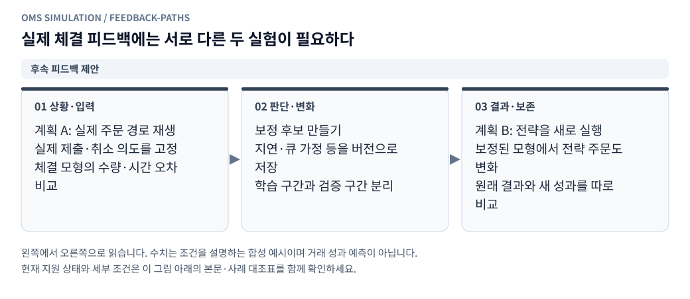

**그림 읽기 · 후속 피드백 제안:** 체결 목록만으로는 미체결 주문·취소의 분모를 알 수 없다. 현재 업로드·비교·자동 보정 기능은 구현 전이다. [수정용 Mermaid 원본](figures/feedback-paths.mmd).

[실제 체결 피드백 계획](real_execution_feedback.ko.md)을 후속 명세로 연결한다. 제안된 `oms_client/execution_feedback/`의 수입·정규화·시간/주문 대응·고정 의도 재생·오차 비교·보정·프로필 관리 모듈은 아직 구현 파일이 아니다. 기존 `replay`의 계좌 초기조건, 원본 manifest, 주문/체결 결과와 버전을 참조하되 실제 자료를 가상계좌 원장과 분리한다.

우선 실제 자료를 불변 revision으로 정규화한 뒤 주문별 누적 체결·취소·대기시간을 비교하고, 이후 고정 구간·시드 집합으로 보정 후보와 별도 평가 보고서를 만든다. 후보 적용은 새 모의계좌에서 수행한다. 체결 목록만으로 미체결 분모나 실제 큐 앞/뒤 취소 위치를 알 수 없다는 제한, 시간 정렬·검열·미지원 주문의 품질 계약도 같은 명세를 따른다.
