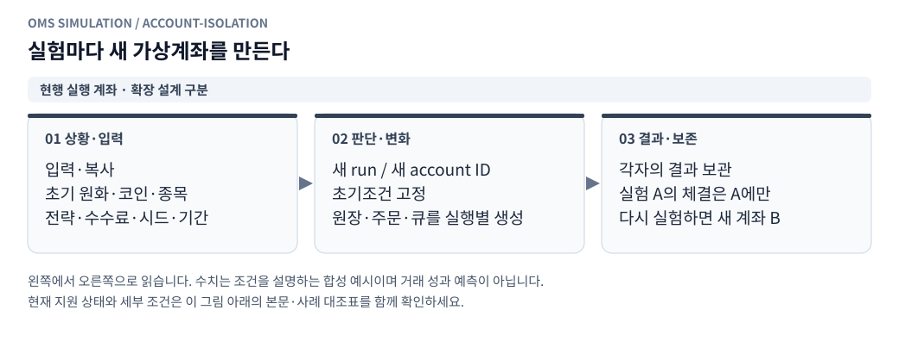

# 가상계좌 생성과 모의 시뮬레이션 상세 설계

[그림으로 보는 문서 안내](visual_guide.ko.md)

작성일: 2026-10-26 KST\
상태: 전체 가상계좌 모델의 구현 명세. 현재 [최소 MM 재생 모듈](../oms_client/replay/README.md)은 실행마다 이름·고유번호·초기잔고가 있는 별도 빗썸 계좌를 생성하고 체결·손익 결과를 저장한다. 계좌별 결과 조회·전체 결과 다운로드·초기조건 복사를 지원한다. 아래 별도 템플릿 revision 관리·OKX 거래 계좌·선물 모델 전체가 구현됐다는 뜻은 아니다.\
관련 문서: [전체 구상](point2_replay_design.ko.md), [모듈 명세](point2_replay_modules.ko.md), [지정가 체결 사례](point2_limit_fill_cases.ko.md)

## 1. 추가할 기능

사용자가 이름을 붙인 가상계좌를 만들고, 거래소별 초기 자금·코인 보유량·선물 포지션을 저장한다. 시뮬레이션을 시작하면 그 초기조건을 실행 전용 계좌로 복사하고, 주문·부분체결·취소·헤지·수수료·평가손익을 가상 원장에 반영한다.

한 가상계좌 설정에는 **서로 다른 거래소 1~2개**를 둔다. 초기 어댑터는 빗썸·OKX다. 각 거래소에는 초기 버전 기준 거래용 지갑 하나를 두고, 여러 종목·매수·매도 주문이 그 지갑을 공유한다. 계좌를 종목마다 복제해 자금을 늘리지 않는다.

거래용·기준가격 참조용 거래소 모두 최대2개에 포함한다. 참조 전용 거래소는 `trading_enabled=false`로 두며 주문용 지갑·초기자산을 만들지 않는다. 이 경우 초기자산 입력은 비어 있어야 하고 성과에도 포함하지 않는다. 실제 주문이 필요한 전략은 해당 거래소의 거래 활성 상태를 요구한다.

사용 흐름:

```text
가상계좌 생성
 → 거래소1~2개와 거래/참조 역할 선택
 → 초기 자금·보유자산·선물 포지션·계좌 모형 입력
 → 초기조건 revision 저장
 → 전략·데이터 기간·주문 조건·비용 선택
 → 실행별 독립 가상계좌 생성
 → 가상시계로 주문·체결·계좌 변경
 → 잔고·포지션·예약·손익·노출 확인
 → 종료 상태 보존 / 같은 초기조건으로 새 실행
```

## 2. 가상계좌 설정과 실행 계좌를 분리

<!-- diagram: account-isolation -->



**그림 읽기 · 현행 실행 계좌 · 확장 설계 구분:** 현행 리플레이의 실행별 계좌 흐름이다. 별도 템플릿 revision 서비스와 OKX 선물 계좌 생성은 제안 범위다. [수정용 Mermaid 원본](figures/account-isolation.mmd).

| 객체 | 식별자 | 저장 내용·역할 |
|---|---|---|
| 가상계좌 | `virtual_account_id` | 이름·소유자·설명·초기조건 revision 목록 |
| 초기조건 버전 | `(virtual_account_id,revision)` | 거래소 역할·초기자산·원가·포지션·레버리지·계좌 모형의 불변 설정 |
| 실행 계좌 | `run_account_id` | 특정 `run_id`와 거래소에 속한 실제 가변 잔고·예약·포지션 |
| 계좌 스냅샷 | `account_snapshot_id` | 확정 event_seq 시점의 상태·원장 cursor·해시·품질 |

기존 주문 의도의 `account_id`는 **해당 거래소의 `run_account_id`**를 가리킨다. `virtual_account_id`를 현재 잔고 테이블의 키로 사용하지 않는다. 동일 실행의 거래용 거래소별 `(run_id,venue)`에는 실행 계좌 하나를 둔다.

예를 들어 같은 초기조건으로 지연20ms·40ms 두 실험을 만들면 서로 다른 run_account_id가 생성된다. 두 실행은 초기조건만 같고 잔고·주문·체결·평가손익은 독립이다. 병렬 비교 실험의 현금을 합쳐 사용자 총자산으로 표시하지 않는다.

반대로 같은 실행에서 CT·다른 종목·복수 전략이 같은 거래소를 사용하면 그 거래소 실행 계좌 하나를 공유한다. 가용 현금·코인·담보와 모든 진행 약정도 함께 검사한다.

## 3. 생성 화면과 초기조건

첫 전략은 [빗썸 단순 MM](bithumb_simple_mm.ko.md)이며 종목·초기 원화·초기 코인을 시작 입력으로 받는다. 원화100만원·코인0은 수정 가능한 프리셋이다. `StartInputs.account_seed()`가 이 문서 형식의 단일 빗썸 초기조건 payload를 생성하며 저장/실행 호출은 별도로 연결한다.

### 3.1 공통 입력

| 입력 | 내용 | 검증 |
|---|---|---|
| 계좌 이름 | 사용자가 구분할 이름 | 빈 이름·길이 제한 검사 |
| 거래소 | 빗썸/OKX 중1~2개 | 중복·0개·3개 이상·미지원 ID 거절 |
| 거래 역할 | 거래 활성 또는 참조 전용 | 전략의 주문/가격 의존성과 대조 |
| 초기 현금·자산 | 통화별 Decimal 문자열 | null과0 구분, 음수·NaN·Infinity·boolean 거절 |
| 현물 원가 | 비영 보유 코인의 평균원가/시작평가 원가 정책 | 수량과 원가 정책의 일관성 |
| 선물 포지션 | 코인환산 부호 수량·평균진입가/원가 정책 | 선형 USDT·순포지션·lot 검증 |
| 레버리지·담보 모형 | 선택한 단순 증거금 모형의 입력 | 지원 범위·초기 담보 적합성 검사 |
| 설명 | 가정·목적 | 실행에 영향을 주는 수치 설정과 분리 |

구조·숫자 형식 검증은 계좌 생성 때 한다. 특정 과거 기간의 규격·평가가격·실제 적용 비용·전략 적합성은 실행 준비에서 다시 검증한다. 계좌 저장 성공을 바로 실행 가능으로 해석하지 않는다.

미입력 값은 DRAFT 상태에서만 저장할 수 있고 실행은 필수 초기조건을 채운 READY revision을 참조한다. READY는 초기조건의 구조 검증 상태이며 특정 과거 기간의 실행 검증 완료를 뜻하지 않는다. 통화별 balance·spot_cost_basis·선물 instrument_id의 중복을 거절하고, 원가 메타데이터가 해당 보유량·포지션과 일치하는지 검사한다.

초기값을 모르면 필수 입력으로 남긴다. 아래 수치 예시는 합성 설명용이며 사용자 계좌에 자동 적용할 기본 자금·실제 수수료가 아니다.

### 3.2 빗썸 현물

- `balances`에 KRW·보유 코인 등 각 통화의 총량을 한 번만 저장한다.
- 보유 CT 입력은 CT balance를 설정한다. 별도의 포지션 수량을 더해 코인을 두 번 생성하지 않는다.
- `spot_cost_basis`는 코인별 수수료 제외 평균원가 또는 시작 평가 원가 정책만 저장한다. 수량은 balance에서 파생한다.
- 초기 가용량은 총량과 같고 주문 잠금·전송 예약은0이다.
- 현물 수량은 음수가 될 수 없다. 초기부터 코인을 보유하면 초기 매도 호가를 낼 수 있다.

### 3.3 OKX 선형 USDT 선물

- `balances.USDT`는 지갑잔고다. 선물 명목금액을 지갑에서 차감하지 않는다.
- `swap_positions`에 종목별 부호 있는 코인환산 수량과 원가 정책을 저장한다.
- 네이티브 계약 수는 실행의 고정 InstrumentSpec으로 검증·산출한다. 입력 수량의 단위와 환산 근거를 보존한다.
- 초기 포지션0이면 평균진입가는 비운다. 비영이면 평균진입가 또는 명시적 시작 평가 정책이 필요하다.
- **초기 주문 예약은0이지만, 초기 선물 포지션의 사용 증거금은0이 아닐 수 있다.** 평가가격·레버리지·모형으로 계산한다.
- 담보 부족·지원하지 않는 포지션 모드·규격 불일치 상태는 기본 실행에서 차단한다. 별도 진단 모형 없이 유효 계좌처럼 진행하지 않는다.

### 3.4 비용과 설정의 단일 출처

초기 자산·원가 정책·레버리지·계좌 모드는 account revision이 소유한다. 적용 maker/taker 수수료·가격 보호·주문 지연·펀딩 포함 정책은 실행 설정이 소유한다. 실행 계좌 화면에는 두 입력을 합친 실제 적용값을 표시한다.

같은 값을 account revision과 실행 요청에서 각각 덮어쓰지 않는다. revision 변경이 필요한 항목은 새 revision을 만든다. 수수료를 바꾼 비교는 같은 계좌 초기조건에 다른 실행 비용 설정을 결합한다. 전략 가격계산 수수료는 실제 원장 수수료와 별개다.

## 4. 초기조건 데이터 예시

다음은 입력 구조를 보여주는 템플릿이다. null인 필수 초기 현금·레버리지는 실행 전 입력해야 한다. 참조 전용 venue는 `initial_state=null`로 두고 주문·자산을 갖지 않는다.

```json
{
  "schema_version": 1,
  "name": "CT 현물-선물 모의계좌",
  "venue_configs": [
    {
      "venue": "bithumb",
      "trading_enabled": true,
      "account_mode": "spot_cash",
      "initial_state": {
        "balances": [
          {"currency": "KRW", "total": null},
          {"currency": "CT", "total": "0"}
        ],
        "spot_cost_basis": [],
        "swap_positions": []
      }
    },
    {
      "venue": "okx",
      "trading_enabled": true,
      "account_mode": "linear_usdt_net",
      "initial_state": {
        "balances": [{"currency": "USDT", "total": null}],
        "spot_cost_basis": [],
        "swap_positions": [
          {
            "instrument_id": "CT-USDT-SWAP",
            "signed_base_qty": "0",
            "avg_entry_price": null,
            "cost_policy": "explicit"
          }
        ]
      },
      "margin_model": "simple_notional_over_leverage_v1",
      "leverage": null
    }
  ]
}
```

비영 현물 보유의 원가 입력 예시는 `{"currency":"CT","avg_cost":"100","cost_policy":"explicit"}`다. 원가를 시작 평가가격으로 정하려면 `cost_policy=start_mark`를 명시하고, 실행 시작 전 유효 가격에서만 원가를 확정한다. 나중에 알게 된 미래 가격을 시작 원가로 사용하지 않는다.

가상계좌 설정의 거래소가2개이면 실행은 그중1개 또는2개를 선택할 수 있다. 선택한 거래소의 초기자산만 복사·평가하고 미선택 거래소 자산을 손익·담보에 합산하지 않는다. 전략의 필수 거래소와 거래/참조 역할을 충족해야 하며, 원본 point2 fx는 헤지를 꺼도 빗썸·OKX 둘 다 필요하다.

## 5. 시뮬레이션 시작과 초기 계좌 주입

### 5.1 실행 준비

1. 사용자 소유의 virtual_account_id와 정확한 revision·hash를 읽는다.
2. 실행 venues1~2개가 revision의 거래소 부분집합인지 확인한다.
3. 전략 필수 거래소·주문 역할·입력 source·거래 규격·비용을 검증한다.
4. 원본 파일·전략·실행 설정과 account revision 참조를 provisional manifest에 준비한다.
5. 선택 거래용 venue마다 독립 run_account_id를 생성한다.
6. 초기자산을 실행 전용 메모리/원장 상태로 복사한다. 다른 run의 현재 잔고를 읽지 않는다.
7. 과거 호가 워밍업을 처리한다. 주문·체결·수익은 시작 전 생성하지 않는다.
8. 초기 원가·증거금·평가액을 계산해 실제 opening 상태/hash를 준비하고 최종 manifest를 고정한 뒤, 시작 시각의 opening 원장과 초기 관측 projection을 한 번 확정한다.
9. 계좌·주문 동기화 준비 상태가 일치하면 전략·헤지 가상 타이머를 시작한다.

계좌 생성·입력 준비·worker 초기화 실패 시 시작되지 않은 계좌를 ACTIVE로 표시하지 않는다. 한쪽 준비만 성공한 상태에서 전략을 실행하지 않는다.

### 5.2 opening 원장과 초기 평가

`OPENING_BALANCE`, `OPENING_POSITION`을 시작 시각에 계좌별 한 번 기록한다. 초기 자산은 입금으로 주입한 시작 조건이며 거래 수익이 아니다. 초기 포지션을 가짜 체결로 생성하거나 수수료를 부과하지 않는다.

초기 비용 정책이 `start_mark`이면 워밍업에서 확보한 **시작 이전의 마지막 유효 가격**으로만 원가를 확정한다. 필요한 초기 평가가격·환율이 없거나 stale이면 기본 실행을 차단한다. 종료나 미래의 첫 가격으로 시작 상태를 소급 채우지 않는다.

초기 원가가 직접 입력돼 있어도 시작 평가액 E0 계산에 필요한 가격·환율은 별도로 유효해야 한다. 초기 사용 증거금·가용 담보를 계산하고, 비영 초기 포지션의 평가손익은 E0에 포함한다.

```text
기간 순손익 = 현재 평가액 - 시작 평가액 E0 - 기간 중 순외부자금유입
```

첫 버전은 시작 후 입출금·거래소 간 이체·자동환전을 수행하지 않는다. 새 초기 자금을 원하면 새 revision·새 실행을 만든다. 수익률 분모 E0가0이면 수익률은 null이며 금액 손익·원장 상태를 표시한다.

### 5.3 초기 truth/observed 동기화

초기 truth와 observed는 같은 opening snapshot·account projection coverage로 시작한다. pending 주문·취소·통지·헤지 의도는 비어 있다. 이 동기화는 알고 있는 초기조건의 부트스트랩이며 미래 계좌정보를 주는 동작이 아니다.

이후 주문·체결·취소·refresh에는 기존 지연 규칙을 적용한다. 초기 현물과 선물 수량이 불일치하면 실제 초기 노출로 표시하고 정상 헤지 의도를 생성한다. 계좌를 보기 좋게 맞추려고 선물 포지션을 자동 추가하지 않는다.

## 6. 주문·체결에 따른 가상계좌 변화

<!-- diagram: account-settlement -->


**그림 읽기 · 현행 정산·보고:** 화면 새로고침은 체결을 다시 만들지 않는다. 저장 실패는 현재 저장 계약에 따라 마지막 확정 결과와 구분한다. [수정용 Mermaid 원본](figures/account-settlement.mmd).

| 사건 | 계좌에 반영할 내용 |
|---|---|
| 주문 의도 전송 | 현지 미확인 예약 생성, 여러 주문의 자금 중복 사용 방지 |
| 주문 도착 수락 | 현지 예약→거래소 잠금으로 전환, 이중 차감 금지 |
| 도착 거절 | 해당 주문의 truth 예약 해제, observed 약정은 통지·버전과 대사 |
| 현물 매수 fill | KRW에서 대금+수수료 차감, 코인 증가·원가 갱신 |
| 현물 매도 fill | 코인 감소, KRW 대금−수수료 증가·실현손익 |
| 선물 fill | 포지션·평균진입가·청산 실현손익·수수료·증거금 갱신 |
| 부분체결 | 체결량만 반영하고 남은 잔량의 예약을 재계산 |
| 취소 효력 | 아직 체결되지 않은 잔량만 해제 |
| 지연된 fill/account 통지 | observed만 갱신, truth 원장을 다시 적용하지 않음 |
| 확정 펀딩 | settlement_id별 한 번 지갑 반영 |
| 평가가격 변화 | 미실현손익·평가액·위험 갱신, 가짜 매매 현금흐름 생성 안 함 |
| 자료 부족 U·실행 stop | 마지막 확정 상태·예약·잠재 위험 보존, 확정 취소처럼 해제 금지 |

한 거래소의 원장 변화가 다른 거래소 현금을 자동 증가시키지 않는다. 빗썸 매수 fill은 OKX 헤지 의도의 원인이 될 수 있지만, OKX 포지션은 OKX의 실제 모의 fill이 발생할 때만 바뀐다.

## 7. 상태·초기화·재실행·복제

가상계좌 설정은 DRAFT/READY/ARCHIVED로 관리할 수 있다. revision이 저장되면 초기조건 payload는 불변이며 새로운 설정은 새 revision이다. 실행에서 사용된 revision·해시·원장은 보존한다.

실행 계좌는 INITIALIZED→ACTIVE→FROZEN으로 관리한다. 작업의 RUNNING/PAUSED/STOPPED/FINISHED/FAILED/INTERRUPTED는 기존 실행 상태가 소유한다. PAUSED는 계좌를 초기화하지 않는다. FROZEN은 계좌 기록 쓰기를 끝냈다는 뜻이며 주문 취소나 포지션 청산을 뜻하지 않는다.

| 사용자 동작 | 처리 |
|---|---|
| 초기조건 수정 | 새 account revision, 진행 중 run은 기존 revision 유지 |
| 같은 조건 재실행 | 같은 revision을 복사한 새 run·새 실행 계좌 |
| 초기화 | 지정한 원본 revision의 초기값으로 새 revision 생성, 기존 결과 삭제 안 함 |
| 가상계좌 복제 | 초기조건을 복사한 새 virtual_account_id, 이전 fill/원장 복사 안 함 |
| pause/resume | 같은 살아 있는 worker의 주문·큐·원장·예약 유지 |
| worker 장애 뒤 다시 실행 | 기존 부분 결과 보존, 고정 입력에서 처음부터 새 run |
| 결과 잔고에서 이어 실행 | 첫 버전 미지원. 가용 잔고만 복사해 정상 resume으로 표시하지 않음 |
| 계좌 보관 | 신규 실행 선택에서 숨길 수 있으나 기존 run 참조 보존 |

reset은 새 revision만 만들고 새 run을 자동 시작하지 않는다. 재실행은 사용자가 고른 revision을 명시적으로 참조한다. 초기화 요청의 원본 revision과 현재 계좌 revision을 둘 다 기록한다.

향후 종료 잔고를 새 초기조건으로 가져오는 기능은 완전 checkpoint 복원과 별개다. live/in-flight/cancel-pending, 미통지 fill, 예약, 외부 대기열·소진 부채, 미확인 U를 버린 채 이어 실행할 수 없다. 해당 기능을 구현하려면 포지션만 가져오는 새 실험인지, 같은 시장 경로의 전체 상태 복원인지 먼저 계약을 분리해야 한다.

## 8. 추가 모듈과 책임

| 제안 모듈 | 책임 | 맡지 않는 일 |
|---|---|---|
| `oms_client/replay/accounts.py` | 가상계좌 생성·revision·복제·초기화·실행 binding 검증 | 체결 계산 |
| `oms_client/replay/account_repository.py` | 소유권·revision/hash·계좌 메타데이터 저장 | 틱마다 잔고 임의 수정 |
| `oms_client/api/routes/replay_accounts.py` | 계좌 설정 API·요청 검증 | worker truth 직접 변경 |
| `replay_worker/account_factory.cjs` | 고정 revision→선택 venue 실행 계좌·opening 생성 | 실제 계정 로그인 |
| `replay_worker/account_state.cjs` | 실행 계좌 registry·버전·snapshot 조회 | 별도 체결/수수료 중복 적용 |
| 기존 `reservations.cjs` | 현지/거래소 예약·해제·가용액 | 초기 자금 생성 |
| 기존 `ledger.cjs` | 현금·코인·포지션·비용·원가·손익 | API 계좌 설정 변경 |
| 기존 `execution.cjs` | 계좌·주문·큐 변경의 이벤트 원자성 | 결과 조회 시 재체결 |
| 기존 `observations.cjs` | 지연된 observed projection·coverage | truth 원장 재적용 |

Python·Node가 각자 현재 잔고를 수정하는 이중 소유 구조를 만들지 않는다. worker가 실행 중 가변 계좌 상태를 소유하고 API는 확정 snapshot·결과를 조회한다.

## 9. API 제안

아래 경로는 새 명세이며 현재 구현된 API 목록이 아니다. 인증·소유권·변경 요청 검증을 적용한다.

| API | 동작 |
|---|---|
| `POST /api/replay-accounts` | 가상계좌와 첫 revision 생성 |
| `GET /api/replay-accounts` | 사용자 가상계좌 목록·최신 revision |
| `GET /api/replay-accounts/{id}` | 이름·설명·상태·revision 목록 |
| `GET /api/replay-accounts/{id}/revisions/{revision}` | 고정 초기조건·hash 조회 |
| `POST /api/replay-accounts/{id}/revisions` | `expected_revision`을 검사해 새 초기조건 저장 |
| `POST /api/replay-accounts/{id}/clone` | 지정 revision으로 새 가상계좌 생성 |
| `POST /api/replay-accounts/{id}/reset` | 지정 초기 revision 기준 새 revision, 기존 원장 보존 |
| `POST /api/replays` | 계좌 ID·revision·hash와 실행 설정을 고정해 실행 생성 |
| `GET /api/replays/{run_id}/accounts` | 실행 계좌별 잔고·가용/잠금·포지션·품질 |
| `GET /api/replays/{run_id}/accounts/{run_account_id}` | 특정 거래소 계좌 snapshot·버전·원장 cursor |
| `GET /api/replays/{run_id}/ledger` | 계좌·통화·사건별 원장 조회 |

생성·revision·복제·reset·실행 생성에는 사용자 범위 멱등 키를 적용한다. 같은 키·같은 payload는 같은 결과, 같은 키·다른 payload는409다. revision 충돌은409로 알리고 조용히 마지막 저장값으로 덮어쓰지 않는다.

실행 참조 예시:

```json
{
  "venues": ["bithumb", "okx"],
  "virtual_account_ref": {
    "virtual_account_id": "va_example",
    "revision": 1,
    "expected_initial_state_hash": "sha256:example"
  }
}
```

위 ID·hash는 형식 설명용이다. 실제 생성 응답의 값을 사용한다. run 요청은 virtual_account_ref와 inline 초기계좌 값을 동시에 받지 않는다. 예전 inline account 형식을 지원해야 한다면 명시적 변환으로 새 revision을 먼저 생성하고 그 ID를 사용한다. 조용한 override는 금지한다.

## 10. 저장 스키마·스냅샷·재현성

<!-- diagram: committed-snapshot -->


**그림 읽기 · 현행 저장·조회:** 리플레이 저장·조회 경로의 설명이다. 저장하기 전의 가변 원장 객체를 HTTP 응답과 공유하지 않는다. [수정용 Mermaid 원본](figures/committed-snapshot.mmd).

| 테이블/파일 | 핵심 필드 |
|---|---|
| `replay_virtual_accounts` | virtual_account_id, owner_id, name, state, latest_revision, 생성시각 |
| `replay_account_revisions` | 계좌ID+revision, schema_version, 초기조건 JSON, canonical hash, 원본revision/clone 참조 |
| `replay_run_accounts` | run_account_id, run_id, venue, source 계좌/revision/hash, 실행 상태, 마지막 확정 event_seq |
| `opening_accounts.json` | 선택 venue의 실제 적용 초기 상태·원가·규격·증거금·평가액·opening hash |
| `account_snapshots.parquet` | 계좌·시각·event_seq·계좌버전·projection coverage·잔고·포지션·예약·품질 |
| `ledger.parquet` | opening/체결/예약/비용/정산의 계좌별 증분 |
| `ending_accounts.json` | 마지막 확정 상태·미완료 주문·미통지·예약·미확인 범위·결과 품질 |

snapshot은 현재 상태를 빠르게 조회하는 자료이며 원장에 다시 합산하는 입금이 아니다. 같은 event_seq까지 반영한 ledger cursor와 상태 hash를 저장해 대사한다. 여러 거래소 snapshot을 합쳐 표시할 때 공통 전역 event_seq 경계와 venue별 버전을 함께 제공한다.

snapshot의 truth account version과 observed projection version을 별도 필드로 둔다. observed의 통지 coverage가 따라오지 않았는데도 같은 버전처럼 표시하지 않는다.

manifest에는 가상계좌 ID·revision·hash, 선택 venue 초기상태 hash, 초기 원가 확정 근거, 초기평가가격·환율, 사용 증거금, 실제 비용 설정과 수치 모형을 기록한다. 초기조건을 실행 후 바꾸어 손익을 다시 해석하지 않는다.

재현성 비교에서는 새 run_account_id·snapshot_id를 그대로 경제적 해시에 넣지 않는다. 선택 venue와 고정 초기조건·계좌 순번으로 정규 매핑한다. 같은 초기조건·데이터·설정·명령이면 새 실행 ID가 달라도 경제적 결과가 같아야 한다.

## 11. 합성 계좌 변화 예시

아래는 **계산 확인용 가상 종목·규격**이다. 실제 CT 가격·주문 최소금액·수수료나 사용자 초기자금이 아니다. 수수료는 양쪽10bp, KRW 환산율은 고정1,000, 선물 레버리지는5로 둔다.

| 단계 | 빗썸 | OKX | 확인점 |
|---|---|---|---|
| 초기 | KRW10,000·코인0 | USDT100·포지션0 | E0=110,000원 |
| 매수100원×10개 전송 | 예약1,001원·가용8,999원 | 변화 없음 | 대금1,000+예상비용1 |
| 4개만100원에 체결 | 총현금9,599.6·코인4·잔량예약600.6·가용8,999 | 변화 없음 | 대금400+비용0.4만 반영 |
| OKX 매도4개가0.1USDT에 체결 | 코인4 유지 | 지갑99.9996·포지션−4·평균가0.1·사용증거금0.08 | 명목0.4를 지갑에서 빼지 않음 |
| 현물 잔량6개 취소 효력 | 예약0·가용9,599.6·코인4 | 상태 유지 | 예약600.6만 해제 |
| 같은 가격에서 평가 | 현물가치400 | 미실현0·계좌평가99.9996USDT | 총평가109,999.2원·기간손익−0.8원 |

사용 증거금0.08USDT는 가용 담보 제한이며 자산 비용이 아니다. 위 단순 모형에서 다른 예약이 없다면 OKX 가용 담보는99.9196USDT다. 초기 현물·선물 포지션이0인 예시라 원가 기준과 기간 손익이 일치한다. 비영 초기 보유에는 시작 미실현손익을 기간 성과에서 제외한다.

## 12. 추가 검증 시나리오

| ID | 경우 | 기대 결과 |
|---|---|---|
| VA01 | 계좌 생성·revision 저장·조회 | 초기조건·hash 일치, 실제 거래 연결 없음 |
| VA02 | 거래소0·중복·3개 이상/미지원 venue | 구성 검증 실패 |
| VA03 | 같은 revision으로 두 run 동시 생성 | 서로 다른 실행 계좌, 잔고 변경 독립 |
| VA04 | 한 run에서 여러 종목·복수 주문 | 같은 venue 잔고·예약 공유, 초과지출 차단 |
| VA05 | 두 venue 자금 배정 | 각 venue에만 배정, 자동 현금 이동 없음 |
| VA06 | 한 venue만 선택하거나 참조 전용 venue 포함 | 선택 거래자산만 원장/성과 포함, source는 최대2개 안에서 처리 |
| VA07 | 비영 현물·선물의 초기 원가 | 기존 미실현을 새 기간 수익으로 계산하지 않음 |
| VA08 | 비영 초기 선물 포지션 | 사용 증거금·가용 담보 계산, 포지션 명목금액 지갑 차감 없음 |
| VA09 | 워밍업·opening 반복 전달 | 시작 전 거래 없음, opening 항목 한 번만 적용 |
| VA10 | 초기 가격·환율·담보 부족 | 기본 실행 시작 차단, 미래 가격으로 초기값 채우지 않음 |
| VA11 | 부분체결·취소·예약 전환 | 11절 수치·잔고·잠금·손익 일치 |
| VA12 | 중복 fill·지연 snapshot·projection 역전 | truth 한 번, observed coverage 대사·헤지 중복 없음 |
| VA13 | 초기화/새 revision 중 기존 run 실행 | 기존 run·과거 원장 보존, 새 run에만 새 조건 |
| VA14 | clone·멱등 재요청·revision 충돌 | 새 계좌 분리, 중복 생성 방지·상충409 |
| VA15 | pause/resume·stop·U | 기존 예약·주문 유지, 확정 취소처럼 해제 안 함 |
| VA16 | 결과 잔고만 가져와 resume 시도 | 첫 버전 거절, 새 초기실험/전체복원과 구분 |
| VA17 | 초기 CT balance와 원가 메타데이터 | 코인 수량 한 번만 생성 |
| VA18 | 초기 포지션 불일치 | 실제 초기 노출·정상 헤지 의도, 자동 선물 fill 생성 없음 |
| VA19 | 다른 사용자 계좌/revision/run 참조 | 소유권 검증으로 차단 |
| VA20 | 같은 입력 재실행·계좌 snapshot 대사 | 정규 경제적 해시·원장 합계·상태 hash 일치 |

이 표는 새 기능의 검증 명세다. 계좌 생성·실행 기능과 해당 테스트는 앞으로 구현해야 한다.
