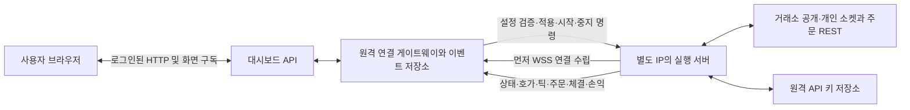
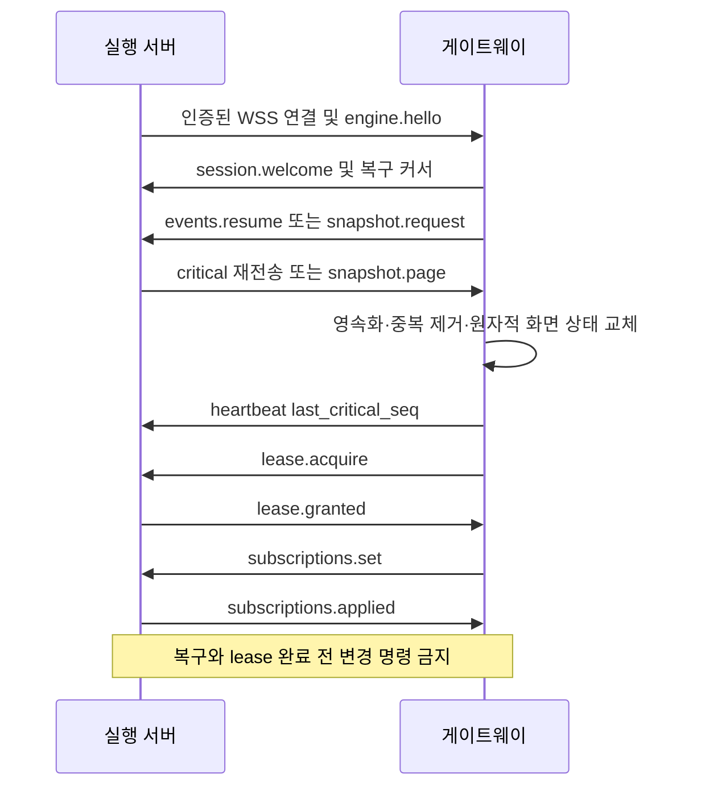
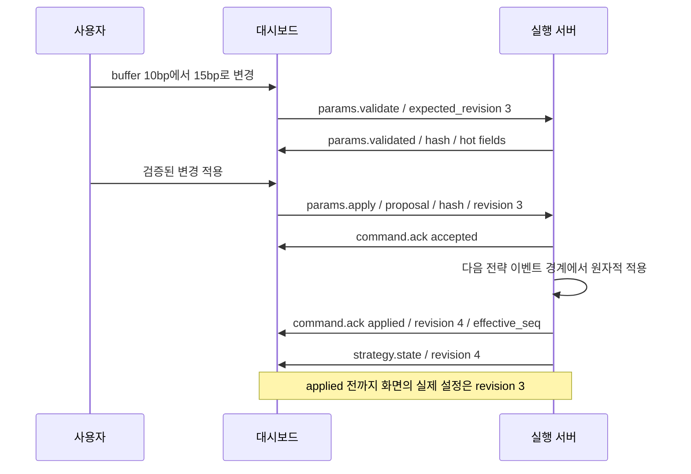
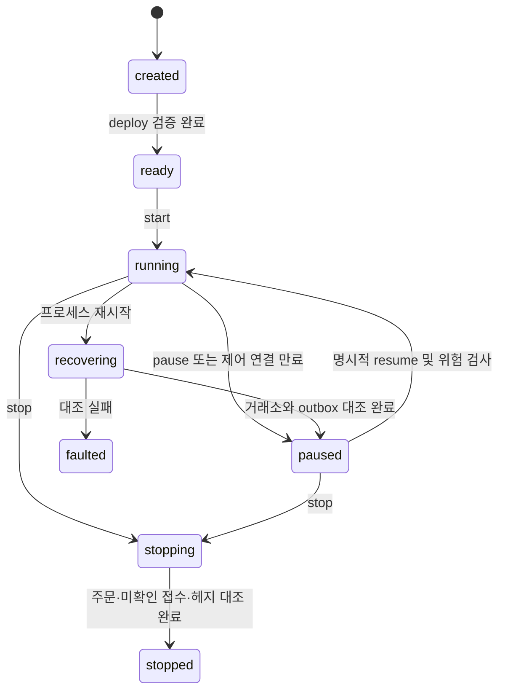

# 원격 전략 실행 서버 소켓 연동 정의서

버전: `oms.remote.v1` · 작성일: 2026-10-27 · 대상: 대시보드 개발자와 별도 매매 실행 서버 개발자

**실제 매매와 거래소 API 키는 다른 서버에서 관리한다. 이 PC는 전략 설정·제어·상태 관찰·거래내역 조회를 담당한다.** 실행 서버가 끊겨도 이 PC가 대신 주문하거나 체결을 만들어서는 안 된다. 원격 실행 서버의 관측 결과가 실제 계좌·주문·체결 상태의 기준이다.

이 문서는 구현 계약이다. 현재 구현한 것은 이 서버의 직접 거래소 개인 요청 기본 차단, 상태 안내, JSON Schema와 검증용 메시지 예제다. 원격 WebSocket 게이트웨이·실행 서버 어댑터·원격 제어 화면은 아직 연결 전이다. 기존 모의투자와 과거 재생은 독립적으로 유지한다.

- [메시지 JSON Schema](contracts/remote_execution.v1.schema.json)
- [세 전략 배포·설정 변경·체결·헤지·재접속 예제](contracts/remote_execution.v1.examples.json)
- [상대 서버 구현 순서와 인수 조건](#14-상대-서버-구현-순서와-인수-조건)
- [후속 결정 항목](#15-후속-결정-항목)

## 1 역할과 연결 방향



연결을 먼저 여는 쪽은 **실행 서버**다. 대시보드 쪽의 WSS 게이트웨이에 outbound 연결하므로 실행 서버에서 외부 제어 포트를 공개할 필요가 없다. 수립된 소켓은 양방향이다. 브라우저는 실행 서버 IP에 직접 접속하지 않으며 거래소 키도 받지 않는다.

| 구성요소 | 소유하는 상태와 책임 |
|---|---|
| 대시보드 API | 사용자 인증·권한, 전략 라이브러리, 변경안, 사용자 명령 감사, 화면용 읽기 모델 |
| WSS 게이트웨이 | 실행 서버 인증, 연결 식별, 제어자 lease 전달, 명령 전달, 이벤트 영속화, 재접속 커서 |
| 실행 서버 supervisor | 실행 인스턴스, 구현 버전, 실제 적용 설정, 복구·중지 상태 |
| 실행 서버 전략 객체 | 신호·이론가·주문 의도 계산 |
| 실행 서버 주문 관리 객체 | 거래소 요청 ID, 다중 주문, 취소 경쟁, 재조회, 예약 수량 |
| 실행 서버 위험 관리 객체 | 시세 지연·실제 RTT·한도·미헤지 노출과 주문 차단 |
| 실행 서버 원장 | 실제 체결, 수수료·원가·평가·환율, 체결 후 스냅샷 |
| 실행 서버 outbox | 전송 전 저장한 주문 의도, 명령 결과, 미전달 개인 이벤트 |

현재 Flask/Waitress HTTP 서버에 WSS가 이미 구현되어 있다고 가정하지 않는다. 게이트웨이는 WebSocket을 지원하는 별도 서비스로 두고 기존 API와 내부 저장소/IPC로 연결한다. 거래소와 연결하는 소켓과 **대시보드 제어용 소켓**은 다른 계층이다. 특히 빗썸 체결 → OKX 헤지 경로에 브라우저나 대시보드 왕복을 넣지 않는다.

한 실행의 사용 거래소는 참조용을 포함해 최대 두 개다. 한 거래소의 여러 시장·종목은 추가 거래소가 아니다. 대시보드에는 여러 실행을 동시에 표시할 수 있으나 계좌 예약·한도는 실행 서버에서 공유 계좌 단위로도 검사한다.

## 2 전송과 인증

아래 주소는 경로 계약이며 호스트와 인증 발급처는 배포 때 입력한다. 예제 주소로 실제 접속하지 않는다.

| 연결 | 제안 경로 | 용도 |
|---|---|---|
| 제어·개인 이벤트 | `wss://<gateway>/ws/oms/v1/control` | 명령, 결과, 실제 주문·체결, 설정, 위험 상태 |
| 공개 시세 전송 | `wss://<gateway>/ws/oms/v1/market` | 5호가·시장 틱·전략 진단 표시 |

기본 transport는 TLS 위 WebSocket, subprotocol은 `oms.remote.v1`이다. Socket.IO 전용 프레임은 쓰지 않는다. JSON 한 객체를 한 WebSocket message에 UTF-8로 넣으며 프레임 단편화는 라이브러리에서 재조립한 뒤 처리한다. 최대 message는 1 MiB, 명령은 64 KiB다. 큰 이력·스냅샷은 페이지로 나눈다. 본 전송 형식은 [WebSocket RFC 6455](https://www.rfc-editor.org/info/rfc6455/)에 기반한 **프로젝트 자체 응용 프로토콜**이다.

- 실행 서버는 사전 발급한 짧은 수명의 `Authorization: Bearer ...`로 Upgrade한다. 토큰에는 `engine_id`, 대상 게이트웨이, 만료, 허용 lane·계좌·전략 범위를 바인딩한다. 인증 실패는 Upgrade 전 401/403이다. URL query·일반 이벤트 본문에 토큰을 넣지 않는다.
- 인증된 engine와 envelope의 `engine_id`가 다르면 거절한다. `actor_id`는 신뢰된 게이트웨이가 로그인 세션에서 부여한다. 실행 서버가 보낸 문자열만으로 관리자 권한을 부여하지 않는다.
- `viewer`는 구독·이력·상태 조회, `operator`는 지정 실행 제어, `admin`은 engine 등록·권한·lease 회수를 할 수 있다. 실제 허용 계좌와 명령을 매 요청 검사한다.
- 공개 market lane은 control에서 발급한 같은 `session_id`에 바인딩하고 별도 짧은 토큰으로 인증한다. 다른 engine의 시세를 주입할 수 없어야 한다.
- 서버 인증서와 호스트를 검증한다. 로그에는 토큰·거래소 키·서명을 기록하지 않는다. 키 생성·등록·삭제는 원격 실행 서버의 운영 절차로 처리하고 대시보드는 `account_ref`라는 불투명 참조만 사용한다.

heartbeat는 5초, 15초 무응답이면 연결을 끊고 복구한다. 재연결 간격은 1·2·4·8·16·30초에 ±20% jitter다. 이 값은 초안 기본값으로 welcome에 확정해서 전달한다. WSS ping/pong은 transport 생존 확인이며 아래 application heartbeat의 커서·lease 갱신과 구분한다.

## 3 식별자와 공통 메시지

```json
{
  "protocol":"oms.remote.v1",
  "type":"params.apply",
  "message_id":"command-20261027-001",
  "correlation_id":null,
  "engine_id":"executor-01",
  "epoch_id":"boot-001",
  "run_id":"run-point2-btc-001",
  "stream":"control",
  "seq":null,
  "sent_at_ms":1793062800000,
  "expires_at_ms":1793062805000,
  "actor_id":"dashboard-admin",
  "payload":{
    "expected_revision":3,
    "lease_id":"lease-1",
    "fencing_token":7,
    "proposal_id":"proposal-001",
    "config_hash":"<validated-config-hash>"
  }
}
```

| 필드 | 계약 |
|---|---|
| `message_id` | 송신자가 생성한 영속 ID. 명령이면 바로 `command_id`다. 재전송에도 유지 |
| `correlation_id` | 응답은 원요청 message_id, 자발 이벤트는 null. 부모 체결은 별도 parent 필드 사용 |
| `engine_id` | 등록된 실행 서버 논리 ID. 계정/IP 문자열로 대체하지 않음 |
| `epoch_id` | 실행 프로세스 boot ID. 재시작하면 변경. 명령은 현재 boot를 대상으로 함 |
| `run_id` | 실행 인스턴스 ID. 같은 전략 프로필로 다시 시작하면 새 ID, 프로세스 복구면 기존 ID 유지 |
| `stream` | `control`, `critical`, `market` |
| `seq` | critical에서만 1부터 증가하는 engine·epoch 단위 영속 순번. 나머지는 null |
| `sent_at_ms` | 해당 송신자의 UTC Unix milliseconds. 지연 시각의 기준 호스트를 별도 명시 |
| `expires_at_ms` | 거래 상태를 바꾸는 명령에 필수. 읽기·이벤트는 null |
| `payload` | type별 본문. 알 수 없는 변경 명령 필드는 거부 |

Schema는 type별 stream, 필수 run_id, 변경 명령의 비어 있지 않은 만료 시각도 검사한다. 권한·상태·실제 시각 비교는 런타임 검증 대상이다.

금액·가격·수량·bp·배율은 **십진 문자열**, 개수·ms·버전·seq는 정수다. 지수 표기, NaN, Infinity, JSON float 금액을 허용하지 않는다. 정수는 JavaScript 안전 정수 상한 이하로 제한한다. 음수 포지션·손익·환급 수수료는 허용하되 가격·주문 수량은 양수, 체결/잔량은 비음수여야 한다. Schema의 십진 문자열 검사는 문법 검사이며 실행 서버가 Decimal로 범위·단위·합계까지 검증한다.

`strategy_id`는 등록 프로필 ID, `strategy_revision`은 그 저장 버전, `config_revision`은 **해당 실행에서 실제 적용된 설정 버전**이다. 프로필 편집과 실행 중 적용은 별개다. `implementation_version`도 별도 고정한다. 로컬 재생기의 `executable` 표시를 원격 실거래 지원 여부로 재사용하지 않는다.

## 4 메시지 목록과 방향

D는 대시보드 게이트웨이, E는 실행 서버다. critical 이벤트는 실행 서버 outbox에서 영속화하고 D에서 중복 제거 후 저장한다. control의 순번 없는 응답은 같은 요청 ID로 재조회할 수 있어야 한다.

| type | 방향 / stream | 핵심 의미 |
|---|---|---|
| `engine.hello` | E→D / control | 구현·지원 전략·명령·hot field·보존 seq·시계 불확실도 보고 |
| `session.welcome` | D→E / control | session·heartbeat·크기 한도·재전송 기준 확정 |
| `heartbeat` | 양방향 / control | nonce/echo, 마지막 **영속 저장** critical seq, lease 갱신 |
| `subscriptions.set`, `subscriptions.applied` | D→E, E→D / control | market lane의 실행·시장·채널·표시 간격 선택 |
| `lease.acquire`, `lease.granted` | D→E, E→D / control | 단일 제어자 권한 요청·수여 |
| `strategy.deploy` | D→E / control | 설정·시장·계좌·한도로 새 run 준비, 시작하지 않음 |
| `strategy.start`, `strategy.resume` | D→E / control | 준비/일시중지 실행의 신규 주문 허용 요청 |
| `strategy.pause` | D→E / control | 신규 진입 중단·현재 주문 취소 요청, 잔여 위험 관리는 유지 |
| `strategy.stop` | D→E / control | `cancel_and_drain`, 취소·미확인 조회·필요 헤지 완료 뒤 종료 |
| `params.validate`, `params.validated` | D→E, E→D / control | 전체 다음 parameters의 유효성·hot/restart 필드·hash |
| `params.apply` | D→E / control | 검증한 동일 변경안의 실제 적용 요청 |
| `command.ack` | E→D / critical | 명령 accepted/rejected/applied/failed/unknown 결과 |
| `command.status` | D→E / control | 명령 ID의 현재 결과 조회, 응답은 command.ack |
| `events.resume` | D→E / control | 지정 epoch·seq 다음부터 critical 재전송 |
| `snapshot.request`, `snapshot.page` | D→E, E→D / control | 동일 watermark의 실행·미체결·계좌·미확인 명령 전체 상태 |
| `strategy.state` | E→D / critical | 실행 상태·적용 revision·hash·이유 |
| `orders.update` | E→D / critical | 이 실행이 소유한 각 주문의 실제 누적 상태 |
| `fills.append`, `fills.correct` | E→D / critical | 실제 개별 체결 추가·정정, 삭제 덮어쓰기 금지 |
| `risk.state`, `hedge.trace` | E→D / critical | 주문 차단·미헤지 노출·헤지 단계 변경 |
| `account.state` | E→D / critical | 계좌별 잔고·예약·포지션 전체 상태와 마지막 대조 시각 |
| `account.valuation` | E→D / market | 주기 평가 표시. 체결 당시 평가는 fills.append에 영속 보존 |
| `strategy.metrics` | E→D / market | 신호·이론가·기준가격·한도 사용량. 전략별 필드는 7절 |
| `market.book`, `market.trades` | E→D / market | 실행 서버가 실제 사용한 시세의 화면용 전송 |
| `history.query`, `history.page` | D→E, E→D / control | 거래내역·주문 이력·체결 전후 데이터 manifest |
| `order.submit`, `order.cancel` | D→E / control | 원격 수동 주문. capability 광고·계좌 권한·lease 필요 |

`engine.hello.capabilities`에 없는 전략·버전·명령은 UI에서 숨기거나 비활성화하고 서버에서도 `UNSUPPORTED_CAPABILITY`로 거절한다. 읽기 전용 연결도 허용한다. `strategy.metrics.values`만 전략별 진단 확장 object이고 거래 명령이나 숨겨진 실행 옵션을 넣어서는 안 된다.

`subscriptions.set`은 해당 subscription_id의 market 구독 전체를 교체한다. 초기 market 구독은 비어 있다. 비어 있는 run_ids/instruments는 각각 실행 진단/시장 구독 없음이며 wildcard가 아니다. 요청 채널·주기·권한을 검증한 뒤 subscriptions.applied로 실제 값을 회신한다. critical 이벤트는 market 구독과 무관하게 모두 저장하며, UI 사용자별 필터는 게이트웨이가 영속 저장한 다음 적용한다. engine 인증 범위 밖 계좌·run 이벤트를 critical stream에 생성하지 않는다.

### 연결과 초기 복구



연결 후 5초 이내 hello를 받고 version·engine·인증 범위를 확인한다. 모든 지원 전략은 구현 버전과 `ready` 여부를 광고한다. 준비되지 않은 Point/minmaxma를 단일 메이커로 대체하지 않는다. 실행 서버에서 거래소와 미체결 주문을 대조하기 전에는 `recovering`이다.

## 5 명령 중복 방지와 단일 제어자

명령 결과의 `accepted`는 **명령을 영속 큐에 받았다**는 뜻이다. 설정 적용·거래소 주문 접수·체결 완료와 같지 않다. `applied`는 명령의 정의된 효과가 이루어졌음을 뜻한다. 수동 주문 명령의 applied는 거래소 접수 결과를 주문 장부에 반영했다는 뜻이며 실제 체결은 fills.append로만 알린다.

1. D는 명령 ID·본문·사용자·대상 run·만료를 저장한 뒤 전송한다.
2. E는 `(engine_id,message_id)`로 조회한다. 같은 ID·같은 본문이면 기존 상태만 돌려주고 효과를 다시 실행하지 않는다. 다른 본문이면 `ID_CONFLICT`다.
3. 신규 명령은 권한, 대상 epoch/run, lease/fence, expected_revision, 만료, 위험 조건을 검사한다.
4. 명령 의도와 accepted 결과를 영속 저장한 뒤 처리한다. 거래소 요청도 먼저 client order ID·의도를 저장한다.
5. 적용과 config revision·후속 이벤트 기록은 같은 원자적 경계로 커밋한다. 장애 후 적용 여부가 불확실하면 unknown/recovering으로 조회·복구하고 새 명령 ID로 자동 재주문하지 않는다.

본문 동일성은 `{engine_id,epoch_id,run_id,type,expires_at_ms,payload}`의 JCS 정규화 후 SHA-256으로 비교한다. 전송 시각·correlation_id는 해시에서 제외한다. [JCS RFC 8785](https://www.rfc-editor.org/info/rfc8785/)를 사용하며 이 명세는 금액을 문자열로 제한한다. 검증 응답의 config_hash는 **적용될 전체 deployment config**를 같은 방식으로 해시한다. Python의 임의 JSON 정렬 결과가 항상 JCS와 같다고 가정하지 않는다.

원래 accepted된 명령은 만료 뒤에도 상태 조회가 가능하다. 신규/아직 실행 시작 전 명령의 만료는 실제 효과를 시작하기 전에 검사한다. 취소·drain이 이미 시작되었다면 TTL이 지났다고 작업을 되돌리거나 남은 위험 관리를 중단하지 않는다. command.status에 대한 ack는 새 critical seq를 가지되 같은 command_id와 원결과를 유지한다.

lease는 engine 단위 단일 writer, 기본 15초다. 성공한 heartbeat에서 소유자와 fence를 확인하고 갱신한다. E가 부여하는 fencing_token은 영속 단조 증가 정수이며 제어권 교체·회수 시 증가한다. 오래된 소켓·프로세스가 보내는 명령은 `STALE_FENCE`다. 조회는 lease 없이 권한으로 허용한다. 재접속만으로 새 제어권이나 자동 resume을 주지 않는다.

| 오류 코드 | 의미와 재시도 |
|---|---|
| `UNAUTHORIZED`, `FORBIDDEN` | 인증·계좌/실행 권한 실패, 동일 토큰 반복 금지 |
| `UNSUPPORTED_VERSION`, `UNSUPPORTED_CAPABILITY` | 프로토콜·구현 불일치 |
| `VALIDATION_FAILED`, `BINDING_MISMATCH` | 값·시장·계약 단위·역할 오류, 변경안 수정 |
| `REVISION_CONFLICT`, `STALE_FENCE`, `EPOCH_MISMATCH` | 최신 상태/제어권 재조회 후 새 사용자 의도 필요 |
| `COMMAND_EXPIRED`, `ID_CONFLICT` | 만료 또는 ID 재사용 충돌, 자동 새 ID 생성 금지 |
| `RESTART_REQUIRED`, `RISK_LIMIT`, `FEED_STALE` | 변경 방식 또는 현재 운영 조건이 불허 |
| `RECOVERY_REQUIRED`, `UNKNOWN_RESULT` | 실제 상태 대조까지 신규 주문 차단 |
| `RESYNC_REQUIRED`, `BACKPRESSURE` | 연속 이벤트 복구 또는 부하 해소 필요 |

## 6 파라미터 변경과 실행 수명

`strategy.deploy`는 새 run의 `expected_revision=0`과 전체 config를 받는다. 계좌·시장 규격·버전·한도를 검증해 ready/revision 1을 만들며 매매는 시작하지 않는다. 실제 초기 잔고는 거래소에서 조회한다. 모의투자의 100만원·초기 코인 입력으로 실제 잔고를 덮어쓰지 않는다.



validate는 부분 patch가 아니라 **다음 전체 parameters**를 받는다. 생략 항목을 오래된 기본값으로 채우지 않는다. 변경안에는 인증 주체·run·현재 revision·전체 다음 config hash를 묶고 기본 60초 동안 보관한다. apply는 같은 제어자·revision·hash·lease를 검사한다. validate 후 다른 변경이 먼저 적용되면 다시 검증해야 한다. 수정 입력값과 실제 적용값을 화면에서 별도로 표시한다.

hot 변경은 다음 전략 이벤트 처리 경계에서 하나의 revision으로 적용한다. 동시에 처리 중인 체결·헤지 이벤트 하나의 앞이나 뒤에만 배치하며 중간에 설정을 바꾸지 않는다. 이미 전송한 주문은 생성 당시 config_revision을 유지한다. 새 가격·방향·한도 때문에 주문을 바꿔야 하면 실제 취소 완료 또는 명확한 체결 결과를 확인하고 교체한다. 새 revision을 받았다고 거래소의 기존 주문이 즉시 바뀌지는 않는다.

| 분류 | 기본 정책 |
|---|---|
| hot 후보 | direction, baseline/buffer, 가격계산 수수료, 호가 평가 주기, 주문·포지션 한도, 시세 보호 임계값 |
| 검증 후 hot | 한도 축소 시 현재 예약·노출이 새 한도를 넘으면 거절. 먼저 pause·정리 후 다시 적용 |
| restart 필수 | strategy_type, 구현 버전, 계좌, 종목, 시장 종류, 참조 거래소, 헤지 방식, 포지션/마진 모드 |
| minmaxma 상태 영향 | ma_ms·buffer_ratio 변경은 기본 pause 후 새 run. 극값·MA를 임의로 재해석하지 않음 |
| 항상 별도 | 프로필 저장 revision과 실행 config_revision, 화면 표시 통화와 실행 위험 한도 |

실제 hot 가능 목록은 E가 hello·validated에 광고한 목록과 위 정책의 교집합이다. 미지원 hot 변경을 슬쩍 restart하거나 이전 설정 일부만 적용하지 않는다. 시작 명령도 계좌의 미확인 주문·warm-up·시세·한도·lease가 준비된 경우에만 적용한다.



pause는 신규 전략 진입을 멈추고 해당 run 소유 주문의 취소를 요청한다. Point의 이미 발생한 노출 헤지·취소·재조회는 살아 있다. stop은 기본 `cancel_and_drain`이며 강제 시장가 청산을 뜻하지 않는다. 잔여 포지션은 보고하고 남길 수 있지만 미확인 주문이나 진행 중 헤지가 남으면 stopped로 표시하지 않는다. 필요한 헤지를 끝낼 수 없으면 stopping/faulted와 잔여 노출을 유지한다. 수동 주문은 paused 상태에서 operator 권한으로만 허용하며 running 전략의 주문·예약과 섞지 않는다.

## 7 전략별 연결 계약

### 7.1 일반 단일 거래소 메이커

- 내부 type: `single_exchange_maker`; 실행 binding은 빗썸 KRW 현물 하나다.
- E가 직접 구독할 것: 대상 종목 양방향 호가·시장 체결, 개인 주문·체결·잔고. 대시보드의 표시용 호가가 전략 입력을 대신하지 않는다.
- 기본 동작: 가용 KRW로 best bid에 매수 의도, 가용 코인으로 best ask에 매도 의도. 수수료·예약·최소 단위·최대 주문/노출 한도 적용 뒤 수량을 정한다. 원격 실거래 한도는 별도 필수 입력이며 잔고 전액을 무조건 주문하지 않는다.
- 메이커 의도는 post-only 보장 가능 여부를 capability로 협상한다. 거래소가 보장하지 못하면 일반 지정가로 몰래 바꾸지 않고 배포를 거절하거나 사용자가 별도 변형을 선택해야 한다.
- 전략 설정: `direction`, `max_quote_age_ms`, `theory_mode`와 공통 보호 필드. 전체 이름·자료형은 Schema와 현재 [전략 등록](../oms_client/strategies/README.md)에 맞춘다.
- diagnostics 필수 keys: `best_bid`, `best_ask`, `available_krw`, `available_base`, `reserved_krw`, `reserved_base`, `target_bid`, `target_ask`, `target_buy_base`, `target_sell_base`, `theory`, `guard_state`. 수치는 decimal string, 계산 불가 값은 null. `theory`는 Schema의 valuation.theory 구조다.
- `theory_mode=midprice`이면 전략이 `(bid+ask)/2`와 유효시각을 보고한다. none이면 가격 null. 헤지 이벤트는 발생시키지 않는다.

### 7.2 Point 전략

- 내부 type: `point2`, 원본 진입점: `point2_st.js`. 대화 중 부른 point_st2/point_st와 혼동하지 않는다. **point_st는 아래 minmaxma**다.
- execution: 빗썸 대상 KRW 현물, reference/hedge: OKX **선형 USDT 무기한선물**, fx: 빗썸 KRW-USDT. 빗썸·OKX 두 거래소이며 FX는 참조용이다.
- 공개 입력: 빗썸 대상·USDT 및 OKX 대상 swap 호가·틱. 개인 입력: 빗썸 계좌·주문·체결, OKX 주문·체결·포지션·증거금.
- OKX 현물 `BTC-USDT`를 swap `BTC-USDT-SWAP` 대신 넣으면 BINDING_MISMATCH다. contract value, lot size, tick size, minimum size, position/margin mode와 규격 revision을 실행 서버가 조회·고정한다. 예제의 `contract_value_base=0.01`은 합성 값이며 실계약 규격이 아니다.

```text
microprice = (bid_price × ask_qty + ask_price × bid_qty) / (bid_qty + ask_qty)
base_krw = okx_microprice × bithumb_usdt_microprice
bid_limit = tick_floor(base_krw × (1 + (baseline_bps-buffer_bps-pricing_fee_bps)/10000))
ask_limit = tick_ceil (base_krw × (1 + (baseline_bps+buffer_bps+pricing_fee_bps)/10000))
```

원본 가격·주문 규칙의 기준은 [Point 설계](point2_replay_design.ko.md)와 registry의 고정 source_reference다. 가격식만 맞추고 취소·예약·노출 제한을 생략한 구현을 같은 implementation_version으로 광고하지 않는다.

설정은 direction, baseline_bps, buffer_bps, pricing_fee_bps, max_spot_krw, reserve_krw, max_hedge_qty, hedge_tolerance_krw, collateral_utilization, quote_interval_ms, hedge_execution 및 공통 보호 필드다. `max_hedge_qty` 단위는 **base 코인 수량**이고 0은 원본 전략 한도 해제다. 이때도 별도 배포 `limits`는 유한한 양수로 필수다. 원본 500만원 reserve와 모의 초기자산 100만원을 그대로 조합하면 매수 가능액이 없을 수 있으므로 검증 결과에 설명한다.

diagnostics 필수 keys: `spot_mid`, `reference_microprice`, `fx_microprice`, `fx_mid`, `base_krw`, `bid_limit`, `ask_limit`, `target_spot_base`, `current_spot_base`, `target_hedge_base`, `actual_hedge_base`, `pending_hedge_base`, `unhedged_base`, `unhedged_krw`, `collateral_available`, `guard_by_venue`, `theory`. 이론가 공식은 원격 전략이 명시해서 제공하며 base_krw를 대시보드가 임의로 이론가로 대체하지 않는다.

헤지는 빗썸 체결 통지를 받은 실행 서버 내부에서 시작한다. 두 실행 프로세스로 분리한다면 별도의 내부 durable queue·전송 ID·중복 제거를 사용한다. **대시보드 소켓은 헤지 실행의 필수 중계 노드가 아니다.** 헤지 목표를 base 단위로 계산하고 거래소 주문에서 contract 단위로 변환한다. `pending_hedge_base`와 미확인 접수도 예약 노출에 넣어 재시도 때 이중 헤지하지 않는다.

### 7.3 minmaxma 전략

- 내부 type: `minmaxma`, 원본 `point_st.js`, 기본 참조: Binance USDT perpetual. OKX reference 선택은 명시적 변형이다.
- 실행 binding은 빗썸 KRW 현물. reference binding은 Binance 또는 OKX 둘 중 하나, account_ref=null이다. 참조 거래소 개인 키나 주문 권한은 필요하지 않으며 **자동 헤지하지 않는다**.
- 입력은 빗썸 공개 시세·개인 주문·체결·잔고, 참조 거래소 공개 호가다. 최대 두 거래소 조건 때문에 Binance와 OKX를 동시에 암묵적으로 참조하지 않는다.

```text
reference = first_level_microprice
min_price = min(previous_min, reference)
max_price = max(previous_max, reference)
MA = (reference × dt_ms + previous_MA × ma_ms) / (dt_ms + ma_ms)
buy_signal  = reference/min_price > buffer_ratio AND reference > MA
sell_signal = reference/max_price < 2-buffer_ratio AND reference < MA
```

설정은 direction, reference_exchange, buffer_ratio, ma_ms, max_quote_age_ms, max_position_krw, order_notional_cap_krw, buy_notional_cap_krw, sell_notional_cap_krw, min_quote_krw 및 공통 보호 필드다. `ma_ms`는 봉 개수가 아닌 시간 상수다. source hash·극값 재설정·체결/취소 규칙은 [minmaxma 문서](minmaxma_strategy.ko.md)의 고정 버전을 따른다.

diagnostics 필수 keys: `reference_price`, `min_price`, `max_price`, `ma`, `dt_ms`, `buy_signal`, `sell_signal`, `signal_mode`, `warmup_ready`, `last_extreme_reset_at_ms`, `theory`. 신호와 warmup은 boolean, dt/reset은 integer 또는 null, 나머지 수치는 decimal string 또는 null이다. signal_mode는 original이다. checkpoint에 극값·MA·마지막 입력 시각·원본 규칙 버전을 저장하고 재시작 때 복구하거나 warm-up 후 명시적으로 새 run을 시작한다. 보유 포지션은 MA 초기화와 무관하게 실제 계좌에서 복구한다.

현재 KRW 이론가 정의가 미정이면 theory.price=null과 근거를 보내고 USDT reference 가격을 KRW 이론가로 쓰지 않는다. 헤지 제어 UI는 비활성화한다.

### 7.4 공통 보호 필드와 시뮬레이션 설정 분리

공통 필드는 `ping_guard_mode`, `max_feed_delay_ms`, `feed_delay_spike_ms`, `feed_delay_resume_ms`, `feed_delay_stable_ms`, `ping_existing_orders`다. 기존 의미는 [지연 보호 문서](execution_latency_controls.ko.md)를 따른다. `desktopTime − serverTime`은 feed delay이고 REST RTT·제어 RTT와 구분한다. 실거래에서는 desktopTime 역할을 **실행 서버 수신 시각**이 맡으며 이 대시보드 수신 시각으로 대체하지 않는다.

과거 재생용 `hedge_fill_notice_ms`, `hedge_signal_transfer_ms`, `hedge_decision_ms`, `hedge_submit_ms`, `hedge_ack_ms`는 모의 지연 입력이다. 원격 live parameters Schema에서는 제외한다. 실제 실행에 인위적 sleep으로 적용하지 않는다. `hedge_timeout_ms`만 실운영 기한 정책으로 남긴다. 원격 실행 서버가 실제 측정한 단계별 시간은 hedge.trace로 보낸다. 기존 프로필을 배포할 때 이 다섯 모의 필드는 simulation metadata로 분리하고 사용자에게 매핑 결과를 보여 준다.

## 8 주문과 실제 체결 원장

원격 주문의 limit은 양수 price, market은 price=null·post_only=false·time_in_force=ioc로 정규화한다. gtd는 미래 expire_at_ms가 필수이고 그 외는 null이다. post_only는 limit GTC/GTD에서만 허용한다. 거래소가 해당 조합을 지원하지 않으면 거절하며 다른 주문형으로 바꾸지 않는다. reduce_only는 지원되는 파생상품 청산에만 사용한다. 가격·수량 step, contracts→base 변환, filled+remaining≤quantity도 실행 서버가 검증한다.

주문 ID, client order ID, 거래소 주문 ID, 체결 ID를 분리한다. 같은 가격에 여러 주문·부분체결 여러 건이 가능하다. orders.update는 주문의 누적 상태이고 fills.append는 **새 개별 체결**이다. 누적 filled가 1→2가 되었다고 전체 2를 새 체결로 넣지 않는다.

`account.state`는 해당 account_ref의 잔고·예약·포지션 전체 snapshot이다. 체결·입출금·펀딩·재대조 결과로 변동할 때 critical로 전송하고 해당 계좌만 교체한다. 하위 balance/position의 account_ref도 외부 account_ref와 일치해야 한다. 체결 이후 상태는 fills.append 다음 seq에 놓아 표시와 원장을 대조한다.

체결 중복 키는 `(venue,account_ref,instrument.symbol,exchange_trade_id)`다. 거래소 trade ID의 고유 범위가 주문 단위라면 어댑터가 exchange order ID를 합쳐 exchange_trade_id를 정규화한다. fill_id는 해당 영속 키에 매핑된 내부 ID다. 미확인 주문·취소 접수는 별도 상태이며 취소 요청 뒤 늦은 체결도 원장에 반영한다. 종결 주문으로 가정해 해당 체결을 버리지 않는다.

`fills.append`는 체결 가격·수량·실제 수수료·maker/taker·거래소 시각·실행 서버 수신 시각·실제 적용 config_revision·체결 당시 환율·체결 직후 평가를 함께 보낸다. `orders.update`와 순서가 역전되어도 order_id와 seq로 연결할 수 있어야 한다. 주문별 체결 합계와 누적 filled를 대조하고 불일치면 recovering 상태로 재조회한다.

정정은 fills.correct의 correction_id·original_fill_id·reason·replacement를 추가 기록한다. replacement=null은 원체결 무효화다. 원본을 삭제하지 않으며 correction과 재평가 결과를 별도로 보존한다. 동일 correction_id 재수신도 한 번만 적용한다. 과거 잘못된 숫자를 UI가 현재 가격으로 조용히 덮어쓰지 않는다.

### 손익과 환율

손익 원장은 실행 서버가 계산하고 대시보드는 받은 숫자를 표시한다. 누적 스냅샷끼리 더하거나 같은 체결을 중복 합산하지 않는다. account.valuation은 run 전체의 해당 통화 평가이며 개별 계좌 잔고는 account.state로 구분한다. KRW/USDT를 선택해도 전략의 주문 가격·한도가 바뀌지 않는다. 가중평균 원가를 기본으로 하며 원가 정책·수수료 포함 여부를 기록한다. 기본 회계는 원가에서 수수료를 제외하고 realized_pnl은 실현 매매손익에서 발생 수수료를 차감한 값이다. fees는 별도 표시 지표이므로 realized_pnl에서 다시 빼지 않는다. 이론가 미실현과 시장 미실현은 대체 평가값이지 서로 더할 값이 아니다.

- 실현 현금흐름·체결 거래대금·수수료 환산은 **각 발생 시점의 고정 FX**를 사용한다. `FX = KRW per USDT`, KRW→USDT는 나누고 USDT→KRW는 곱한다.
- 포지션 시장 미실현은 현재 평가시각 시세·FX로 재평가한다. 체결 당시 스냅샷은 그 체결 직후 시세·FX로 고정한다. 현재 총액을 현재 FX로 통째로 나눈 값을 과거 실현손익 환산으로 표시하지 않는다.
- FX quality가 stale/missing이면 환산값은 null이다. 1, 마지막 정상값, 0으로 묵시 대체하지 않는다. native 통화 장부는 유지하고 환산 불가 사유를 표시한다.
- 이론가는 전략 출력의 price·currency·observed_at_ms·valid_until_ms·basis·formula_revision을 사용한다. 만료·미제공이면 theory_unrealized_pnl=null이다.
- account.valuation은 표시 통화별로 각각 보낼 수 있다. 초기 평가자산·입출금·swap 펀딩을 고려해야 총손익 대조가 되므로 E는 내부 원장에 현금흐름을 따로 저장한다. 현금흐름 상세 스트리밍은 v1 후속 확장 항목이다.

호가창의 내 주문은 orders.update 기준이다. 공개 호가에 내 수량을 더해 시장 잔량을 이중 계산하지 않는다. 5호가 밖 주문은 위에 별도 행으로 보여 주고 마지막 확인 시각·미확인 상태를 함께 표시한다.

## 9 헤지 시간과 시계

| milestone name | 기록 주체 / 의미 |
|---|---|
| `spot_exchange_fill` | 거래소가 제공한 빗썸 체결 UTC |
| `spot_fill_received` | 실행 서버가 개인 체결을 수신한 시점 |
| `hedge_signal_sent` | 체결 listener가 헤지 모듈로 신호를 발행 |
| `hedge_signal_received` | 헤지 모듈 수신. 프로세스 간 전달 지연 관측 |
| `hedge_submit` | 실제 OKX 주문 요청을 네트워크로 보냄 |
| `hedge_exchange_arrival` | 거래소가 증거 시각을 제공할 때만 기록 |
| `hedge_ack_received` | 주문 접수 응답을 실행 서버가 수신 |
| `hedge_first_fill`, `hedge_complete` | 실제 헤지 체결 첫 수신·목표 충족 시점 |

실운영 hedge_timeout_ms는 실행 서버의 spot_fill_received monotonic 시각부터 재는 로컬 기한이다. 과거 재생의 원체결 시각부터 계산한 계획 기한과 기준이 다르므로 나란히 표시할 때 이름을 구분한다. 거래소 체결 시각부터의 총 지연은 별도 관측/추정치로 표시하고 시계 불확실도를 함께 남긴다.

각 점에는 clock_id, UTC ms, 가능하면 monotonic ns 문자열, clock uncertainty, measured 여부가 있다. **같은 clock_id의 monotonic 값 차이만 직접적인 구간 소요시간**이다. 다른 호스트의 wall clock 차이는 동기화 오차를 포함하므로 추정 구간과 오차를 함께 표시한다. clock 불확실도가 임계값보다 크면 단방향 지연은 null이며 RTT를 반으로 나눠 거래소 도착 시각을 만들지 않는다. 누락한 arrival은 누락 그대로 둔다. arrival 측정이 없는 trace도 유효하다.

`source_fill_ids`는 헤지를 유발한 여러 원체결, hedge_id는 하나의 헤지 묶음이다. target_base·filled_base·outstanding_base는 **절대량 base 코인 단위**이며 실제 방향은 연결된 주문의 side로 읽는다. 미헤지 부호 노출은 risk.state의 unhedged_base로 별도 전송한다. partial·blocked·timed_out·unknown에서도 원체결과 현재 노출을 보존한다. 접수 ACK만으로 hedge_complete를 보내지 않는다.

## 10 끊김과 재접속 복구

critical seq는 engine·epoch 하나에서 명령 결과·주문·체결·설정·위험 변경을 모두 직렬화한다. D는 **DB에 commit한** 마지막 연속 seq만 heartbeat로 확인한다. 같은 seq/message_id 재수신은 중복 저장하지 않고 같은 seq에 다른 내용이 오면 무결성 오류다. 시장 메시지는 이 seq를 소비하지 않으므로 5호가 샘플 생략이 체결 누락으로 보이지 않는다.

D가 seq 100까지 저장하고 끊겼다면 events.resume(after_seq=100)을 보내 E가 101부터 재전송한다. 순번에 틈이 있으면 후속 critical 이벤트를 제한 버퍼에 보관하고 해당 구간 복구 전 계좌 집계에 적용하지 않는다. E outbox의 미확인 critical 이벤트는 ACK 전 삭제하지 않는다. 이미 ACK된 이벤트는 기본 7일 재전송용으로 유지하되 거래 원본 원장은 별도 장기 보관한다. 디스크 부족 시 체결을 버리지 않고 신규 진입을 중지한다.

보존 범위를 벗어났거나 epoch가 바뀌면 snapshot을 받는다. 각 snapshot.page는 같은 snapshot_id·watermark_seq·page_count를 가지며 index는 0부터다. 전체 페이지를 모두 받기 전 부분 화면으로 현재 상태를 덮어쓰지 않는다. E는 watermark 시점의 일관된 상태를 복사한 뒤 동시에 발생하는 이벤트를 outbox에 저장한다. D는 snapshot을 원자적으로 교체한 후 watermark+1부터 적용한다. 스냅샷은 현재 상태 복구이고 빠진 과거 체결은 history.query로 별도 보충한다.

구 epoch 이벤트와 신규 epoch 이벤트는 seq만으로 섞지 않는다. 과거 이력 조회는 원래 epoch와 fill_id를 보존하고 새 boot에서 이전 체결을 다시 내보내도 체결 고유 키로 중복 제거한다. E 재시작 후에는 거래소와 outbox·예약·미확인 client order ID를 대조한 뒤 paused로 복구하며 명시적 resume을 기다린다.

제어 연결 또는 lease가 15초 만료되면 기본 `pause_entries_cancel_keep_hedge` 정책을 E가 자율적으로 실행한다. 신규 진입을 멈추고 전략 주문 취소를 요청하되 실제 체결·미확인 주문 재조회와 이미 생긴 노출 관리는 계속한다. 거래소까지 끊겨 취소를 못하면 요청 완료로 표시하지 않는다. 위험·담보·시세가 허용하지 않는 헤지는 강행하지 않고 미헤지 노출과 경보를 유지한다. 브라우저만 닫히고 게이트웨이·제어자 lease가 살아 있는 상황은 별도이므로 사용자 세션 종료 시 lease 회수 정책도 적용해야 한다.

## 11 처리량과 화면 갱신

기본 market.book은 **완전한 5호가 snapshot**이며 delta는 v1에서 받지 않는다. 중간 snapshot은 합쳐 최신만 보낼 수 있고 100ms마다 전송, UI는 최대 10Hz로 그린다. 전략은 이 전송 주기를 기다리지 않고 원격 원시 피드를 처리한다. market.trades는 100ms 배치, 최대 1,000건과 1MiB 중 먼저 도달한 한도로 나눈다. 시세 표시 부하 때문에 생략한 틱 개수는 dropped_count에 명시하고 원본 기록은 별도 조회한다.

control·critical 큐를 market과 분리한다. 기본 송신 메모리 상한 8MiB 또는 10,000 messages 중 먼저 도달한 값이다. market snapshot은 최신으로 교체할 수 있지만 실제 fills·orders·command 결과는 조용히 버릴 수 없다. critical backlog는 디스크 outbox로 보존하고 한도를 넘으면 BACKPRESSURE·신규 진입 중단·재접속 복구로 전환한다. 채널별 지연·pending bytes·last persisted seq를 운영 지표로 남긴다.

이 수치는 초기 구성값이며 성능 보장치가 아니다. 2개 거래소·다수 주문·급격한 틱 증가 조건으로 측정 후 조정한다. 동일 account_ref를 여러 run이 사용하면 잔고·예약의 합산 한도를 executor의 공유 계좌 관리자가 직렬화한다.

## 12 거래내역과 체결 전후 데이터

history.query는 `[start_ms,end_ms)` UTC 범위, kind, limit(1~1000), 불투명 cursor를 받는다. 첫 조회 때 as_of_seq를 고정하고 이어지는 cursor도 같은 필터·권한·watermark에 묶는다. 기본 정렬은 `(exchange_at_ms,fill_id)` 오름차순이며 동일 시각을 fill_id로 구분한다. 이벤트 수신 순번과 거래소 시각 정렬을 혼동하지 않는다.

체결을 클릭하면 kind=fill_context와 fill_id를 보내며 기본 요청 범위는 체결 시각 전 60초부터 후 60초까지다. 현재 진행 중이면 미래 구간을 만들지 않는다. history.page의 context_manifest에는 dataset_id·요청/가용 범위·complete/partial/missing·sha256을 제공한다. 기록 파일이 없거나 기록 시작 전이면 missing/partial로 명시한다.

호가·틱 원본 파일은 원격 수집 저장소에 남기고 임의 URL이나 로컬 파일 경로를 브라우저에 넘기지 않는다. dataset_id는 권한 검사된 별도 데이터 전달 API/저장소 어댑터로 받도록 후속 확장한다. **v1 소켓 Schema는 manifest까지 정의하며 데이터 파일 전송 API는 아직 미정**이다. 단일 fill 이력 조회는 v1 history.page의 fills·orders 배열로 완료된다.

## 13 구현 모듈과 현재 코드의 경계

| 만들 모듈 | 입력 → 출력 | 위치 |
|---|---|---|
| `ExecutionProtocol` | JSON → 검증된 typed command/event, Decimal 경계 변환 | 양쪽 공용 계약 구현 |
| `ExecutorConnection` | TLS 연결·hello·heartbeat·재접속 | 원격 서버 |
| `CommandInbox` | 명령 → 중복 제거·검증·영속 상태 전이 | 원격 서버 |
| `StrategySupervisor` | deploy/start/params → 전략 인스턴스·revision | 원격 서버 |
| `StrategyAdapter` | 원시 피드/계좌 → 전략별 의도·metrics·이론가 | 원격 서버 |
| `ExchangeOrderManager` | 의도 → 거래소 요청·상태 대조·부분체결 | 원격 서버 |
| `ExecutionLedger`, `EventOutbox` | 실제 체결 → 원가·손익·복구 가능한 이벤트 | 원격 서버 |
| `RemoteGateway`, `CommandService` | 사용자 명령 ↔ 인증된 실행 서버 | 대시보드 서버 |
| `RemoteReadModel` | 연속 이벤트·snapshot → 화면용 상태·이력 | 대시보드 서버 |
| `RemoteTradingController` | 실행 선택·적용 확인·상태·거래내역 표시 | 브라우저 |

현재 `oms_client/strategies/registry.py`는 프로필 저장·스키마 기준이다. `oms_client/oms/status.py`는 원격 실행 예정과 미연결을 표시한다. 기존 `manual_trading`의 로컬 직접 API 경로는 `MANUAL_DIRECT_TRADING_ENABLED=False`가 기본이며 공개 시세 구독 외 키 등록·잔고 조회·주문·취소·개인 조회를 HTTP에서 차단한다. 브라우저 조작으로 우회하지 못한다. 기존 로컬 키와 장부를 삭제하거나 원격으로 자동 복사하지 않는다.

이 플래그는 Python app config에서만 명시적으로 바꿀 수 있는 호환·테스트 경로다. 이 PC의 운영 설정은 false로 유지한다. 새 원격 전송을 이 로컬 flag로 활성화하지 않는다. 소켓 구현 후에는 별도 remote capability로 UI를 활성화한다.

## 14 상대 서버 구현 순서와 인수 조건

1. **연결 골격**: 인증된 hello/welcome, 두 lane, heartbeat, version 거절, engine와 계좌 범위, lease/fence를 구현한다. 처음에는 ready=false·viewer만 제공한다.
2. **읽기 모델**: 실제 계좌·포지션·주문 snapshot과 critical outbox, seq 재전송, history를 구현한다. 계좌·체결 대조가 먼저다.
3. **메이커**: single_exchange_maker 어댑터 하나를 연결하고 deploy/validate/start/pause/stop의 명령 상태를 검증한다. 원격 모의 어댑터로 시험한 뒤 live 여부를 별도 운영 절차로 선택한다.
4. **설정 변경**: 전체 parameters 검증·JCS hash·expected_revision·원자적 적용·취소 경쟁·복구를 구현한다.
5. **Point**: spot와 swap 단위를 분리하고 체결 통지·헤지 예약·실제 체결·타임아웃·재시작 대조를 연결한다.
6. **minmaxma**: source 버전의 극값/MA checkpoint·warm-up·참조 거래소 변형을 연결한다. Point 헤지를 재사용해 자동 활성화하지 않는다.
7. **화면 연결**: 실행 목록·연결 상태·실제 적용 revision·대기 변경안·위험·호가·틱·다중 주문·체결 손익을 연결한다.

필수 인수 시나리오:

| 시험 | 기대 결과 |
|---|---|
| 같은 params.apply·order.submit 3회 | 하나의 효과, 같은 command 결과. 새 주문 3건 생성 금지 |
| 같은 ID·다른 본문 | ID_CONFLICT, 원상태 유지 |
| revision 3에서 동시 변경 2건 | 한 건만 revision 4 적용, 다른 건 conflict |
| applied 응답 전 단절 | command.status/재전송으로 같은 결과 복구, 설정 재적용 금지 |
| 오래된 소켓의 fence 또는 boot 대상 | 신규 주문 전 거절 |
| heartbeat 15초 단절 | 신규 진입 차단·취소 요청·미헤지 노출 유지, 자동 resume 금지 |
| cancel과 fill 경쟁 | 늦은 실제 체결 반영, 잔량·예약·손익 보존 |
| 체결 중복·순서 역전·seq gap | 한 번 정산, gap 복구 전 집계 보류 |
| 100페이지 snapshot 중 하나 누락 | 부분 상태를 현재 상태로 공개하지 않음 |
| market 큐 폭증 | 시세만 명시적 축약, 실제 fills 유실 금지 |
| Point 계약 단위 오류 | 배포/주문 거절, 코인과 계약 수량 혼용 금지 |
| Point hedge ACK 후 미체결 | hedge 완료로 표시하지 않음 |
| minmaxma reference 변경·재시작 | restart_required·checkpoint/warm-up, 참조 시장 주문 없음 |
| FX/이론가 누락 | 해당 환산·이론가 평가 null, native 원장 보존 |
| 실제 주문 API 직접 호출 | 이 대시보드 기본 모드에서 409, 거래소 호출 0회 |

검증 환경은 `pip install -r requirements-dev.txt`로 준비하고 `python -m unittest discover -s tests -p test_remote_execution_contract.py`로 Schema·예제·세 전략 설정 매핑을 확인한다. 이 검사는 네트워크나 실제 거래소를 호출하지 않는다.

예제 배열은 하나의 연속 실거래 시나리오가 아니라 각 메시지 형식과 전략 배포를 보여 주는 독립 fixture다. hello의 ready=false는 미연결 구현 상태를 뜻한다. 배포 예제는 구현 협의·파서 검증용 합성 fixture이며 **실전 권장 파라미터나 자동 배포 입력이 아니다**. 예제 hash 표시는 실제 params.validated 결과로 대체해야 한다. JSON Schema는 [Draft 2020-12](https://json-schema.org/draft/2020-12)를 사용한다. 스키마 검증에 더해 수량 보존·시장 binding·Decimal 범위·권한·상태 전이 검증을 구현해야 한다.

## 15 후속 결정 항목

사용자 답변 없이 진행하기 위한 기본 결정이다. 아래 답변란을 나중에 채우면 된다.

| ID | 현재 결정 | 나중에 작성할 내용 |
|---|---|---|
| SOCKET-001 | 실행 서버가 대시보드 게이트웨이로 outbound WSS | 운영 gateway 주소·TLS·토큰 발급 주체: ___ |
| SOCKET-002 | 게이트웨이 별도 서비스, 브라우저 직접 접속 없음 | 기존 Node/Python/기타 실행 서버와 IPC 방식: ___ |
| SOCKET-003 | 메이커·Point·minmaxma capability 분리 | 실제 구현 버전·원본 소스 hash·지원 가능 전략: ___ |
| SOCKET-004 | engine당 제어자 1개, lease 15초 | 단절 시 운영 정책과 자동 resume 허용 여부: ___ |
| SOCKET-005 | 계좌는 remote account_ref로만 전달 | 거래소 지역·계좌·swap 마진/포지션 모드: ___ |
| SOCKET-006 | Point 헤지는 실행 서버 내부, minmaxma 참조에는 주문 없음 | 현물/헤지 프로세스 분리 여부·내부 메시지 구현: ___ |
| SOCKET-007 | 시뮬레이션 지연값은 live 입력에서 제외 | RTT 보호 기준·시계 불확실도 임계값: ___ |
| SOCKET-008 | 체결 환율 고정, 시장 미실현 현재 시점 평가 | 이론가 공식·펀딩·입출금 상세 이벤트 확장: ___ |
| SOCKET-009 | 5호가 snapshot 10Hz·틱 배치, critical 무유실 | 종목/실행 수·처리량 목표·장기 보존 기간: ___ |
| SOCKET-010 | 체결 전후 1분 manifest만 socket에 전달 | 데이터 파일 전달 API·원격 저장소·보존 기간: ___ |
| SOCKET-011 | 기존 직접 주문 기능 기본 비활성·저장 키 자동 이전 없음 | 이전 호환 모듈의 향후 제거 여부: ___ |
