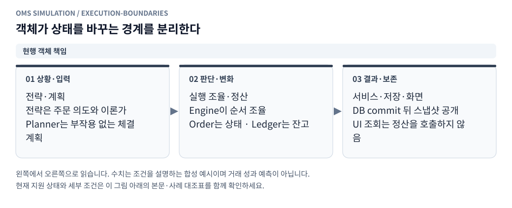
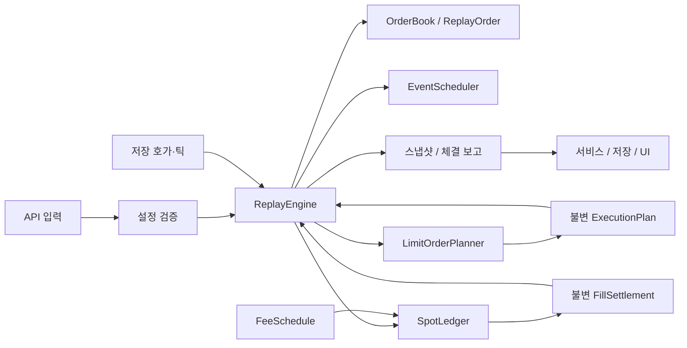

# 모의거래 실행기의 객체 구조와 유지보수 기준

[그림으로 보는 문서 안내](visual_guide.ko.md)

## 1. 이번 리팩터링의 범위

과거 호가·틱 실행기 `oms_client/replay`에서 주문 상태, 현물 원장, 수수료, 가상 이벤트, 지정가 도착 계획을 독립 객체로 분리했다. `ReplayEngine`은 실행 순서를 조율하고 시장 이벤트를 체결·전략·보고에 연결한다. 각 실행은 별도의 주문 관리 객체·원장·스케줄러를 생성하므로 계좌 상태를 공유하지 않는다.

이번 변경은 객체 구조 정리다. 주문 조건, 수수료 올림, 같은 시각 처리 순서, 확률 모형, 외부 JSON 필드와 기존 실행 결과를 유지한다. 경제적 모형을 변경하지 않으므로 엔진 모형 버전도 올리지 않는다. 현재 지원 범위는 기존 [지정가 실행 범위](limit_execution_coverage.ko.md)와 같다. OKX 실행·Point 전략 실행·실제 체결 피드백 기능이 추가된 것은 아니다.

## 2. 객체별 책임과 상태 소유

<!-- diagram: execution-boundaries -->

**그림 읽기 · 현행 객체 책임:** 전략이나 UI가 원장의 내부 필드를 직접 변경하지 않는다. OrderBook은 내 주문 관리 객체이고 외부 호가창과 다르다. [수정용 Mermaid 원본](figures/execution-boundaries.mmd).

| 객체·모듈 | 소유하는 상태·책임 | 하지 않는 일 |
|---|---|---|
| `configuration.config_from` | 외부 입력 검증·기본값·정규화 | 주문·원장 생성, 실행 |
| `orders.ReplayOrder` | 가격·수량·역할별 체결 합계, 접수·취소·판정 불가·종료 상태 전이, 주문 직렬화 | 계좌 잔고 계산, 큐 추정, 타이머 등록 |
| `orders.OrderBook` | 주문 ID, 주문 컬렉션, 요청 재시도 식별, 종료 식별자, 교체 대기 요청 | 외부 시장 호가 관리, 시장 체결 판단 |
| `orders.ReplacementRequest` | 교체 가격·총수량·조건을 담는 불변 요청 | 취소 또는 새 주문 실행 |
| `ledger.SpotLedger` | 현금·코인·원가·실현손익·누적 수수료·초기 평가액, 정산 검증과 반영 | 시장 가격 선택, 체결 수량 추정, 저장 |
| `ledger.FeeSchedule` | maker/taker 수수료와 예약금 계산의 불변 정책 | 주문 상태 변경 |
| `ledger.FillSettlement` | 체결 가격·수량·수수료·실현손익·역할의 불변 결과 | 후속 이벤트 실행 |
| `scheduler.EventScheduler` | 가상 이벤트 우선순위 큐, 등록 순번 | 실제 시간 대기, 도메인 콜백 호출 |
| `limit_execution.LimitOrderPlanner` | 관측 유동성과 주문 조건에서 도착 시 처리 계획 계산 | 주문 취소, 잔고 정산, 호가 소진 |
| `limit_execution.ExecutionPlan` | 불변 action 튜플, 처리 결과와 사유 | 계획 자동 실행 |
| `limit_execution.ExecutionDepth` | 외부·가상 체결에 의한 관측 호가 소진 부채 | 가격 조회, 계좌 변경 |
| `strategy_view.StrategyOrderViews` | 실행별 불변 전략 주문 입력 재사용, 변경 필드 검사, 종료 주문 캐시 제거 | 주문 상태·잔고 변경, 다른 계좌의 캐시 공유 |
| `ReplayEngine` | 시장·주문·전략의 실행 순서, 큐 갱신과 틱 매칭, 평가·보고 조립 | 원장 정산 공식 재구현, DB·HTTP·실제 시계 접근 |
| `ReplaySession`·`ReplayStore`·`ReplayClock` | 작업 실행·사용자 명령 직렬화, 저장, 실제 시간과 재생 시간 연결 | UI 조회 시 체결 계산 |

`OrderBook`은 **내 주문 관리 객체**이며 외부 시장 오더북과 다르다. `orders` 컬렉션은 읽기 전용 매핑으로 공개한다. 내부 주문 객체는 상태를 가진 가변 객체이므로 읽기 전용 매핑이 주문 자체까지 불변으로 만들지는 않는다. 상태 전이는 주문 메서드로, 잔고·예약금 정산은 원장으로 모은다. UI와 저장 계층에는 해당 객체를 직접 넘기지 않고 JSON 스냅샷을 사용한다.

## 3. 주문과 정산 흐름

<!-- diagram: fok-atomic -->

**그림 읽기 · 현행 FOK 원자성:** 전량 가능 여부 확인 전에 부분 정산을 하면 수수료·잔고·기존 maker 주문에 부작용이 남는다. [수정용 Mermaid 원본](figures/fok-atomic.mmd).

<!-- diagram: committed-snapshot -->

**그림 읽기 · 현행 저장·조회:** 리플레이 저장·조회 경로의 설명이다. 저장하기 전의 가변 원장 객체를 HTTP 응답과 공유하지 않는다. [수정용 Mermaid 원본](figures/committed-snapshot.mmd).

1. 엔진이 주문 입력·시세 지연 보호·가용 잔고를 검사한다. `FeeSchedule`로 매수 예약금을 구하고 `OrderBook`에 주문을 등록한다.
2. `EventScheduler`에 도착·취소·만료 이벤트를 예약한다. 이벤트 실행 시각이 같으면 등록 순번을 따른다. 처리 도중 같은 시각 이벤트를 추가해도 기존 이벤트 뒤에 실행한다.
3. 도착 시 `LimitOrderPlanner`가 `FillAction`·`CancelAction`과 종료 판단을 반환한다. 계획을 만드는 동안 주문·원장·호가 부채를 바꾸지 않는다.
4. 엔진이 계획을 검토한 뒤 실행한다. 특히 FOK는 전체 체결 가능 여부를 먼저 확인하며 실패한 계획의 부분체결·STP 취소를 실행하지 않는다. 깊이 부족에 따른 판정 불가 정책도 기존대로 유지한다.
5. 체결은 `SpotLedger.settle`로 전달한다. 수량·상태·지정가 한도·역할·누적 수수료·잔고/예약금을 먼저 검사한 뒤 원장과 주문 체결 합계를 반영하고 `FillSettlement`를 반환한다.
6. 엔진이 종료 주문, 체결 당시 계좌·포지션·전략 이론가·큐 근거를 기존 형식으로 기록한다. 서비스가 기존 저장 트랜잭션으로 이를 보관한다.

원장 정산의 실패 시 무변경 보장은 정규화된 Decimal 입력과 서비스의 단일 명령 처리 경계를 전제로 한다. 원장 자체가 DB 트랜잭션이나 다중 스레드 잠금인 것은 아니다. 잘못된 입력을 받은 정산은 계좌와 주문을 모두 보존하도록 테스트한다.

성능 개선 후 서비스의 공개 상태는 저장에 성공한 JSON 문자열 하나로 보유한다. 조회 API는 그 문자열을 그대로 응답하고, Python 객체가 필요한 호출자는 새로 디코딩한 사본을 받는다. 다음 저장이 끝나기 전에는 진행 중 원장의 변경이 공개되지 않는다. 저장 실패 시 미저장 체결 버퍼를 유지하고, 최종 실패 응답에는 마지막 저장 계좌와 실패 상태를 표시한다. `ReplayStore.save`의 반환 문자열은 DB 커밋이 성공한 후에만 제공된다.

## 4. 보존해야 하는 불변 조건

- 매수 체결은 현금·예약금 범위 안에서만 발생하고, 매도 체결은 보유 코인을 넘지 않는다. 접수 중·취소 대기·판정 불가 주문의 예약을 유지한다.
- 체결량을 합쳐 주문 수량을 초과하지 않는다. 부분체결 뒤 취소한 주문은 체결량과 취소 잔량을 따로 보고한다.
- 수수료는 주문의 maker/taker 누적 대금별로 올림한다. 작은 체결마다 전체 수수료를 새로 올려 중복 과금하지 않는다. 혼합 역할의 추가 예약 최소단위도 유지한다.
- 초기 코인 원가는 처음 유효한 기준가격으로 한 번 설정한다. 후속 가격으로 원가를 초기화하거나 가짜 매수를 만들지 않는다.
- 종료 이벤트는 주문당 한 번만 발행한다. 완료 주문 객체를 메모리에서 수거해도 재시도 ID와 완료 식별은 해당 실행 동안 유지한다.
- 판정 불가 주문은 취소 확인만으로 해제하지 않는다. 같은 시각 신규 주문과 틱의 기존 선후 가정도 유지한다.
- 계좌 평가는 전략이 제공한 이론가를 사용한다. 원장이 별도로 이론가를 생성하지 않는다.

## 5. 외부 호환과 테스트 경계

`engine.config_from` 임포트 경로는 재노출해 기존 호출부를 유지한다. 주문·체결·계좌 JSON, 결과 다운로드, DB 스냅샷의 필드와 숫자 표현은 기존과 같다. 반면 내부 `engine.orders[id]`와 `engine.working()`의 항목은 딕셔너리에서 `ReplayOrder`로 바뀌었다. 서비스와 내부 검사 테스트는 속성 접근으로 수정했다. 이 내부 변경을 외부 API 형식 변경과 혼동하지 않는다.

독립 도메인 검증은 `tests/test_replay_domain.py`에 둔다. 왕복 정산과 수수료·실현손익 대사, 정산 거절 시 무변경, 판정 불가·취소 대기 예약, 계좌 격리, 접수 전 취소 경합, 재시도 식별 보존, 교체/완전체결 경합, 동일 시각 FIFO, FOK 계획의 무부작용을 검증한다. 기존 실행기·지정가·보호·확률 큐·전략·API 회귀 테스트는 통합 경계를 검증한다.

리팩터링 전후 대표 시나리오의 **전체 스냅샷**을 동일 입력·시드·가상 명령 시각으로 비교한다. 비교 대상은 혼합 maker/taker 체결, 여러 주문의 확률적 취소, 각 STP 정책, FOK/IOC/GTC 깊이 부족, 접수 전 취소, 교체 중 체결, 만료, 지연 보호와 자동 MM이다. 앞으로 모형을 의도적으로 변경할 때는 이 비교의 기대 차이를 별도 설명하고 모형 버전 변경 여부를 판단한다.

이번 리팩터링 검증에서는 독립 도메인 테스트 10개를 포함한 전체 Python 테스트 439개가 통과했다. 변경 전 저장한 대표 시나리오의 전체 스냅샷 54개와 변경 후 직렬화 결과가 바이트 단위로 일치했다. 전체 테스트 명령은 `/home/minsung1/dev/.venv/bin/python -m unittest discover -s tests`다.

## 6. 다음 확장 시 적용할 기준

현재 큐 자료구조 갱신·틱 매칭·평가 보고 조립은 엔진에 남아 있다. 이 영역에 기능을 추가할 때는 `QueueState`·틱 매칭 정책·보고 조립 객체 등의 실제 필요성을 검토하고, 기존 동작을 먼저 검증한 뒤 작은 단위로 분리한다. 아직 존재하지 않는 클래스를 구현 완료로 취급하지 않는다.

실제 체결 피드백은 [별도 계획](real_execution_feedback.ko.md)에 따라 가져오기·시간 정렬·비교·보정 객체로 구성한다. 가져온 기록이 `SpotLedger`나 주문 객체의 필드를 직접 수정하지 않게 한다. 새 보정 프로필은 새 실행의 설정으로 주입하고 기존 실행 결과를 덮어쓰지 않는다.

전략 추가 시 전략은 의도와 이론가만 반환하고 실행기에서 주문·정산 계약을 재사용한다. 다중 거래소 연결은 거래소별 원장과 실행 정책을 조합하는 방향으로 설계한다. 공통 부모 클래스에 모든 거래소의 예외를 쌓거나 엔진 전체를 도메인 객체에 넘기는 방식은 피한다. 상태 없는 단순 검증을 억지로 클래스로 만들지는 않는다.

측정 부하, 캐시 무효화, 원본 변환·조회·화면 최적화와 검증 방법은 [성능 문서](replay_performance.ko.md)를 따른다.
