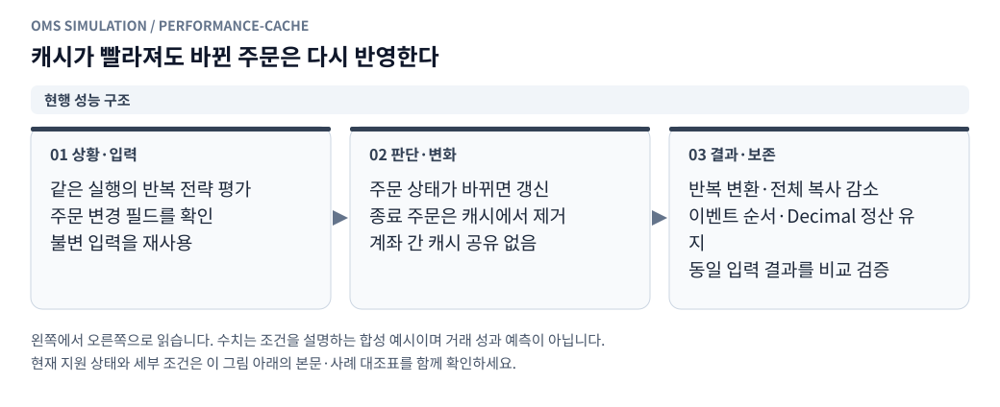

# 리플레이 성능 개선과 검증

[그림으로 보는 문서 안내](visual_guide.ko.md)

## 1. 측정 범위와 결과

2026-10-27에 `71f585e`를 기준으로 핵심 리플레이·원본 변환·공개 상태 조회·화면 숫자/시각 표시를 최적화했다. 매매 규칙을 바꾸거나 시장 이벤트를 생략하는 작업은 포함하지 않는다. 아래 수치는 같은 환경에서 3회 실행한 **합성 부하의 중앙값**이다. 실제 거래소 데이터 전체나 운영 서버의 종단 간 처리량을 보장하는 수치는 아니다.

| 시나리오 | 개선 전 | 개선 후 | 속도 비율 |
|---|---:|---:|---:|
| 수동 주문 없는 20,000개 시장 이벤트 | 0.201초 | 0.159초 | 1.26배 |
| 초기 주문 100개 + 20,000개 시장 이벤트 | 1.051초 | 0.668초 | 1.57배 |
| 자동 MM + 20,000개 시장 이벤트 | 9.943초 | 3.577초 | 2.78배 |
| 공개 스냅샷 Python 객체 조회 100회 | 1.619초 | 0.827초 | 1.96배 |
| 조회 API 응답 생성 100회, Flask 테스트 클라이언트 | 2.343초 | 0.011초 | 약 204배 |
| 생성한 Parquet 호가 20,000행 읽기·변환 | 0.098초 | 0.078초 | 1.25배 |
| 숫자·시간 포맷 각 5,000회 | 175.20ms | 6.28ms | 27.91배 |

API 측정은 네트워크·로그인 검증·브라우저를 제외한 응답 생성 경로다. 기존에는 큰 공개 스냅샷을 복사하고 JSON으로 다시 만들었고, 개선 후에는 이미 저장된 JSON을 재사용하므로 차이가 크다. 실제 화면 전체가 204배 빨라진다는 의미는 아니다. 포맷 측정 역시 DOM 생성·배치·그리기 시간을 포함하지 않는다.

엔진 입력은 5호가와 틱을 1:9로 구성하며, 큐 취소 모형·시드·수수료·초기 계좌·가상 시각을 고정한다. MM 시나리오에는 부분체결과 주문 누적이 포함된다. 원본 변환 측정은 1호가만 있는 생성 파일이므로 실제 5호가 파일·압축 틱·디스크 지연이 포함된 운영 처리량과 구분한다. 엔진 시나리오는 전체 체결·종료 주문 보고, 최종 상태 및 중간 체크포인트를 비교했다. 원본 시나리오는 정규화한 전체 이벤트, 조회 시나리오는 계좌·주문·체결·틱 필드를 비교했다. 조회 비교에서 실제 계좌 생성 시각처럼 매 실행 달라지는 메타데이터는 제외했다. 시나리오 6개의 결과 해시가 모두 일치했다.

실행별 원시 측정값·결과 해시·Python 버전·기준 커밋은 [측정 기록](../benchmarks/results/replay-2026-10-27.json)에 있다. 성능 임계값을 일반 단위 테스트에 넣어 공유 환경의 순간 부하로 테스트가 실패하게 하지는 않는다.

## 2. 확인한 병목과 변경 사항

<!-- diagram: performance-cache -->



**그림 읽기 · 현행 성능 구조:** 캐시는 경제적 상태의 소유자가 아니다. 변경 없는 경로만 재사용하며 속도 개선 때문에 검증을 생략하지 않는다. [수정용 Mermaid 원본](figures/performance-cache.mmd).

### 전략 주문 입력 재사용

초기 프로파일에서 자동 MM의 전략 주문 입력을 매 틱 다시 생성·검증하는 부분이 가장 컸다. 20,000개 이벤트에서 약 202만 개의 `WorkingOrder` 생성이 발생했다.

`StrategyOrderViews`는 실행마다 별도 캐시를 가진다. 주문 ID·소유자·방향·가격·잔량·상태가 같으면 검증을 마친 불변 객체를 재사용한다. 어떤 입력이라도 바뀌면 새 객체를 생성하고 검증한다. 부분체결·취소 대기·접수 상태 변경이 이전 객체에 가려지지 않는다. 현재 투영에 없는 주문은 바로 캐시에서 제거하며, 엔진의 동시 주문 한도인 100개에 맞춰 캐시 크기가 제한된다. 전략 자체의 의사결정은 매번 수행한다.

### 정확한 주문 수량 계산의 빠른 경로

`SimpleMM._buy_size`는 올림 전 수수료로 계산한 최대 주문 수량 후보가 올림 후에도 예산 안에 들어오는지 먼저 확인한다. 들어오면 이진 탐색 없이 반환한다. 수수료 최소단위가 크거나 수량 단위가 작아 예산을 넘으면 기존의 정확한 유리수 이진 탐색을 수행한다. 부동소수점 근사로 수량을 계산하지 않는다. 경계·리베이트·작은 수량 단위와 무작위 500개 설정에서 예산 이하이면서 다음 한 단위는 예산 초과인지 검증한다.

### 주문·큐의 중복 순회 축소

한 번의 주문 검증이나 MM 판단에서는 변경 전 주문 목록을 한 번 얻어 상태 검사·가용 잔고·전략 입력에 재사용한다. 실제 주문 추가 이후에는 다시 최신 상태를 확인한다.

도착 이벤트가 없고 수거할 종료 주문도 없는 단순 시각 이동에서는 중복 큐 정리를 건너뛴다. 시장 이벤트 처리 뒤 정리와 타이머 처리 뒤 정리는 유지한다. 종료 주문이 생겼는지는 주문 관리 객체가 표시하므로 종료 직후 시각 이동에서도 주문과 큐가 정리된다.

같은 큐의 여러 주문에 대해 취소 전후 위치를 계산할 때 공통 가중치를 한 번 계산한다. 위치별 Decimal 덧셈 순서는 유지하여 작은 잔량의 반올림과 난수 결과를 바꾸지 않는다. 큐 미확인·아직 미접수인 주문의 표시값이 모두 null인 경우에는 불필요한 위치 계산을 하지 않는다.

### 원본 스트림 준비 비용 분리

원본 파일 식별용 해시는 행마다 계산하지 않고 파일마다 한 번 계산한다. 고정된 SELECT 컬럼의 가격·수량 위치도 스트림 생성 시 준비한다. 각 행에 중간 딕셔너리를 만들고 같은 컬럼 이름을 반복 조합하는 비용을 제거했다. 필수 컬럼 검증, 결측값 처리, 가격 정렬, 수량 환산, 파일 순서·물리 행 순서, 중복 행 보존, 원본 변경 검사는 유지한다.

### 저장·조회 경로

<!-- diagram: committed-snapshot -->


**그림 읽기 · 현행 저장·조회:** 리플레이 저장·조회 경로의 설명이다. 저장하기 전의 가변 원장 객체를 HTTP 응답과 공유하지 않는다. [수정용 Mermaid 원본](figures/committed-snapshot.mmd).

체결·명령·주문 보고의 JSON 직렬화를 DB 쓰기 트랜잭션 전에 준비하여 쓰기 잠금 구간을 줄인다. 기존 원자적 저장과 계좌 메타데이터 불변 검사는 유지한다. `ReplayStore.save`는 커밋이 성공한 뒤에만 저장된 스냅샷 문자열을 반환한다.

서비스는 이 문자열 하나를 공개 상태로 보유한다. HTTP 조회는 JSON을 다시 해석하거나 직렬화하지 않고 그대로 응답한다. Python 객체를 요청하는 내부 호출자는 새 사본을 얻으며 디코딩은 작업 스레드 잠금 밖에서 수행한다. 별도의 전체 파싱 사본을 상시 보관하지 않는다. 저장 실패 시 공개 상태를 진행 중 엔진 상태로 바꾸지 않고 미저장 보고 버퍼도 유지한다.

체결 페이지/다운로드는 실행 존재 확인을 위해 전체 스냅샷을 읽고 해석하던 부분을 기본키 조회로 바꿨다. 페이지마다 큰 스냅샷을 다시 읽지 않으며 실행이 없으면 기존처럼 오류를 반환한다. 인증·CSRF·체결 내보내기의 기준 순번 제한은 그대로다.

### 화면

숫자와 시간의 `Intl` 포맷터를 재사용한다. 체결 보고는 불변이므로 같은 계좌·같은 체결 수에서 최근 체결 표를 다시 만들지 않는다. 과거 체결 페이지 이동은 페이지 객체 변경으로 감지하고, 새로운 체결·계좌 변경에서도 표를 갱신한다. 총 체결 수·페이지 제어 상태는 계속 갱신한다. 호가·틱 처리, 내 주문 표시, 250ms 조회 주기, 1~32배속은 유지한다.

## 3. 재현 및 검증

저장소 루트에서 실행한다. 모든 벤치마크는 생성 데이터와 임시 DB를 사용하며 서버를 시작하거나 실주문·개인 계좌·운영 DB에 접근하지 않는다.

```bash
/home/minsung1/dev/.venv/bin/python benchmarks/replay_performance.py --events 20000 --repeats 3
/home/minsung1/dev/.venv/bin/python benchmarks/replay_performance.py --scenarios mm --profile /tmp/replay.prof
node benchmarks/replay_formatting.mjs
/home/minsung1/dev/.venv/bin/python -m unittest discover -s tests
```

기준 버전은 별도 임시 디렉터리에 `git archive 71f585e oms_client`로 추출하고, 같은 벤치마크 파일을 그 디렉터리의 `benchmarks/`에 복사해 실행한다. 실행 중인 작업 디렉터리를 과거 버전으로 되돌릴 필요가 없다. 입력 생성·준비 시간은 엔진 타이머 밖이고, 엔진의 주기적 체크포인트 계산은 타이머 안이다. 실제 서버의 파일 읽기·저장까지 포함한 성능과는 구분한다.

`tests/test_replay_performance.py`는 캐시 재사용/무효화/격리, 종료 주문 수거, 읽은 상태의 격리, 저장 실패 시 마지막 계좌 보존, 주문 수량 최적성, 복수 파일의 5호가 컬럼 변환, 취소 전후 큐 확률을 검증한다. 기존 지정가·취소 경합·FOK·수수료·보호·저장/API 테스트도 함께 실행한다. 이전 대표 시나리오의 전체 스냅샷 54개도 바이트 단위로 동일함을 확인했다.

최종 검증에서는 전체 Python 테스트 447개, 프런트엔드 `npm run check`, 숫자·시간 표시의 변경 전후 동등성 검사를 통과했다. 실제 진행 중인 시뮬레이션은 중단하지 않았으며 서버를 재시작하지 않았다.

이번 측정으로 모든 데이터 분포와 전체 애플리케이션의 최적 성능을 보장하지는 않는다. 다음 작업에서도 대표 부하를 먼저 측정하고, 병목이 옮겨간 경우 해당 객체를 개선한다. 큐 확률의 분할 수 축소, 기록 생략, 저장 주기 완화, 여러 스레드에서 같은 계좌 정산 같은 결과·보장 변경을 단순 성능 개선에 섞지 않는다.
