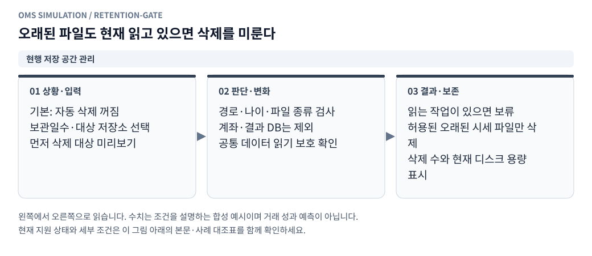

# 서버 저장 공간과 시세 파일 보관 기간

[그림으로 보는 문서 안내](visual_guide.ko.md)

대시보드 상단 공통 영역의 **서버 PC 저장 공간 · 자동 정리**에서 서버 디스크 용량과 정리 설정을 확인한다. 브라우저를 띄운 PC의 디스크를 읽는 기능이 아니다. 기본값은 **7일 보관·자동 삭제 꺼짐**이며 이 변경을 설치하는 것만으로 원본 파일이 삭제되지는 않는다.

## 화면 사용

1. 접힌 요약에서 남은 공간과 전체 공간을 확인한다. 펼치면 사용률과 저장 위치를 표시한다. 시스템·기본 시세·전용 수집·계좌/결과가 같은 파일시스템이면 한 행으로 묶는다. 없는 데이터 폴더는 가장 가까운 상위 폴더의 디스크를 표시한다.
2. 보관 기간을 1~3650일로 입력하고 기본 시세 저장소, 전용 수집 저장소 중 대상을 고른다.
3. **삭제 대상 미리보기**로 현재 입력값의 후보 수와 파일 크기 합계, 최대 50개 경로를 확인한다. 미리보기는 설정을 저장하거나 파일을 삭제하지 않는다.
4. 자동 삭제 체크박스를 켜고 **설정 저장**을 누르면 백그라운드에서 정리를 시작하고 이후 10분마다 반복한다. 서버가 꺼져 있으면 실행하지 않으며, 재시작하면 저장한 설정을 읽는다. 체크를 끄고 저장하면 다음 삭제 배치부터 중단한다.
5. 정리 상태에서 삭제 수·파일 크기, 건너뛴 수, 오류, 보류 사유를 확인한다. 용량은 기본 60초마다, 작업 중 상태는 2초마다 갱신하며 수동 새로고침도 제공한다. 숨겨진 브라우저 탭에서는 자동 조회를 미룬다.

후보 용량·삭제 용량은 파일의 논리 크기 합계다. 파일시스템 압축, 열린 파일, 다른 프로그램의 쓰기 등에 따라 실제 남은 공간 증가량과 다를 수 있으므로 디스크 측정값을 별도로 표시한다.

## 정리 대상과 나이 기준

| 저장소 | 서버 설정 | 허용 데이터 |
|---|---|---|
| 기본 시세 | `DASHBOARD_DATA_ROOT`, 기본 `/data` | `ob`, `tick`, `funding`, `fx` |
| 전용 수집 | `DASHBOARD_COLLECTOR_DATA_ROOT`, 기본 `data/market` | `ob_1s`, `candles_1m` |

대상은 파일 탐색기에서 사용하는 정규 레이아웃의 `.parquet`, `.parquet.gz` 일반 파일이다. 시간별 파일은 `거래소/종류/종목/YYYY/MM/DD/HH.parquet[.gz]`, 분봉은 `거래소/candles_1m/종목/YYYY/MM/DD.parquet[.gz]`만 허용한다. UTC 파일 구간 종료 시각이 기준 시각 이하여야 하고, 마지막 수정 시각도 기준 시각보다 과거여야 한다. 기준 시각은 `현재 시각 − 보관 일수 × 24시간`이다. 따라서 과거 데이터를 최근에 보완해 쓴 파일은 바로 지워지지 않는다.

계좌·매매 결과·괴리 집계 DB, 로그인 설정, 코드, 임시 파일, 로그, 임의 확장자와 디렉터리는 정리하지 않는다. 상태 디렉터리가 시세 루트 아래 있어도 제외한다. 심볼릭 링크·하드 링크도 제외한다. 삭제한 원본은 휴지통으로 이동하지 않으며, 저장한 결과가 남아 있어도 원본이 없는 구간의 재조회·재시뮬레이션은 할 수 없다.

## 객체 책임과 동시 작업

<!-- diagram: retention-gate -->

**그림 읽기 · 현행 저장 공간 관리:** 파일 구간 종료와 마지막 수정 시각이 모두 기준보다 오래돼야 한다. 브라우저 PC가 아니라 서버 PC의 디스크를 표시한다. [수정용 Mermaid 원본](figures/retention-gate.mmd).

- `RetentionPolicy`: 설정 검증. 임의 경로를 API에서 받지 않고 서버에 선언된 두 저장소만 선택한다.
- `MarketFileRetention`: 파일 내용 대신 디렉터리·파일 메타데이터만 읽어 후보를 찾는다. 한 번에 최대 20만 항목·1,000개 후보·약 5초 범위로 탐색하며, 제한에 도달하면 일부 결과임을 표시한다. 자동 정리는 다음 주기에 탐색 위치를 이어가므로 최근 파일·빈 폴더가 많아도 앞부분만 반복 확인하지 않는다. 탐색 위치는 메모리에서만 유지하고 열린 디렉터리 수는 레이아웃 깊이로 제한한다. 한 바퀴가 끝나면 새 탐색을 시작하며, 설정이나 보호할 수집 종류가 바뀌면 다음 탐색에서 위치를 초기화한다. 미리보기는 별도 일회성 탐색이다. 삭제는 열린 디렉터리 디스크립터를 기준으로 수행하고 경로 중간 심볼릭 링크를 따라가지 않는다. 직전 파일의 장치·inode·크기·수정 시각이 후보와 같을 때만 삭제한다.
- `RetentionService`: 설정을 `STATE_DIR/retention.json`에 임시 파일·fsync·원자적 교체로 저장하고 한 개의 백그라운드 작업을 관리한다. 잘못된 설정 파일을 읽으면 자동 삭제를 끄고 화면에 알린다. `retention.lock`은 같은 상태 디렉터리를 사용하는 정리 작업의 중복 실행을 막는다. 최근 작업 상세는 메모리에 보관하며 재시작 후에는 비워진다.
- `DataAccessGate`: 기존 API 조회와 분석·백테스트·CSV 생성·괴리 집계·리플레이 작업에 읽기 사용권을 부여한다. 읽기 작업끼리는 병렬 실행한다. 정리기는 최대 50개 삭제 배치의 배타 사용권을 즉시 얻을 수 있을 때만 삭제하고, 사용 중이면 다음 정리 주기로 미룬다. 일시정지한 리플레이도 읽기 사용권을 유지한다. 시장 이벤트마다 잠금을 새로 잡지 않는다.

전용 수집 파일은 기존 수집기 잠금도 확인한다. 실행 중인 1초 호가 수집기가 `.usdt-orderbook.lock`을 보유하면 `ob_1s` 전체를 건너뛰고, 분봉 보완 작업이 `.usdt-candles-1m.lock`을 보유하면 `candles_1m`을 건너뛴다. 이 경우 다른 종류의 후보는 계속 확인한다. 수집기가 계속 실행 중이면 해당 종류의 자동 삭제도 계속 보류된다.

현재 배포 방식인 한 개 Waitress 프로세스 안에서 데이터 읽기와 정리를 조율한다. 별도 프로세스의 임의 스크립트·다른 상태 디렉터리를 사용하는 대시보드·기존 외부 정리 작업까지 통합 관리하는 기능은 아니다. 그런 도구를 병행하는 운영에서는 데이터 사용 기간과 삭제 정책을 별도로 맞춰야 한다. 이 옵션은 기존 외부 정리 작업의 설정을 변경하지 않는다.

탐색 제한에 걸리면 전체 후보 수가 아닌 이번 배치의 후보 수를 표시한다. 권한 오류나 설정 변경·수집 중 파일은 강제로 처리하지 않고 상태에 표시한다. 삭제된 뒤의 실제 용량은 다시 측정한다. 빈 상위 폴더는 남긴다.

## API와 검증

| API | 동작 |
|---|---|
| `GET /api/storage` | 용량·저장 설정·작업 진행 여부·최근 결과 |
| `POST /api/storage/policy` | `{enabled: boolean, days: integer, scopes: ["legacy", "collector"]}` 저장 |
| `POST /api/storage/preview` | 같은 형태의 입력으로 비동기 미리보기 요청, 202 반환 |

모든 API는 로그인 정책을 적용하고 POST에는 기존 CSRF·출처 검사를 적용한다. 범위 이외의 키·경로·타입은 거절한다. 이미 확인/정리 중이면 추가 미리보기를 거절하고 기존 작업의 상태를 보여준다.

`tests/test_retention.py`는 기본 꺼짐, 미리보기 무변경, 데이터/수정 시각 조건, 허용 형식·저장소, 링크·경로 교체, 상태 보존, 읽기 작업과 수집기 잠금, 후보 수 제한, 설정 영속성·손상, 설정 변경 시 중단, 실제 백그라운드 실행, 용량 및 로그인·CSRF를 검증한다. 삭제 테스트는 임시 디렉터리에서만 실행한다. 운영 데이터에 정리를 켜거나 실제 파일을 삭제하는 방식으로 검증하지 않는다.

파일 탐색의 배치 간 이어보기까지 포함해 전체 Python 테스트 463개와 프런트엔드 JavaScript 구문 검사, 화면 ID 중복 검사를 통과했다.

## 후속 선택 사항

현재는 일 단위의 한 가지 보관 기간을 두 저장소에 적용한다. 시간 단위 설정, 거래소·종목·데이터 종류별 기간, 최소 남은 용량 기준, 삭제 이력의 영구 감사 기록, 외부 프로세스와의 통합 잠금은 별도 확장 항목이다. 임의의 값을 결정해야 하는 경우 우선 기본 꺼짐을 유지하고 이 문서의 선택 사항으로 남긴다.
