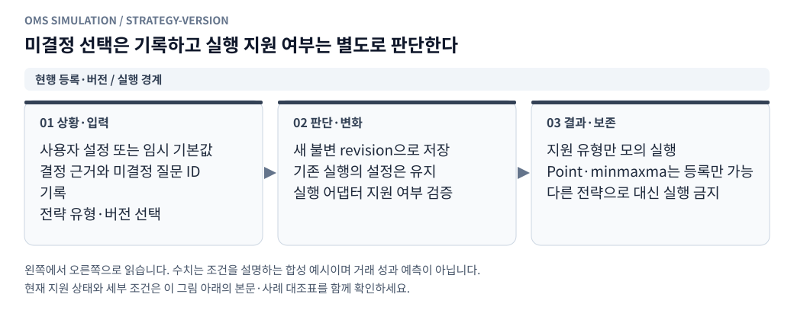

# 전략 등록 — 나중에 답할 미결정 사항

[그림으로 보는 문서 안내](visual_guide.ko.md)

작성일: 2026-10-26 KST

사용자 지침에 따라 답변을 기다리지 않고 가능한 작업을 진행했다. 아래 ‘현재 적용’은 임시 선택이며 확정 답변으로 간주하지 않는다. 원하는 기준을 **나중에 답변** 칸에 적거나 항목 ID와 함께 알려주면 변경할 수 있다. 변경은 새 전략 버전으로 남기고 이전 실행 결과는 보존한다.

## 확정된 요구사항

<!-- diagram: strategy-version -->

**그림 읽기 · 현행 등록·버전 / 실행 경계:** 사용자가 나중에 답하면 새 버전에 반영한다. 등록 가능하다는 사실과 해당 전략의 모의 체결 실행 가능 여부는 다르다. [수정용 Mermaid 원본](figures/strategy-version.mmd).

- 모의거래마다 새 계좌를 만들고 계좌별 결과를 저장한다.
- Point와 일반 단일 거래소 메이커를 전략 유형으로 등록할 수 있어야 한다.
- `point_st`는 기존 Point와 별도인 **minmaxma 전략**으로 등록한다.
- 이론가 미실현손익은 **전략이 계산해 제공한 이론가**를 입력받아 계산한다.
- 확인이 필요한 선택은 임시값으로 진행하고 미결정 사항으로 남긴다.

## Q-001 · 단일 메이커가 출력할 이론가

- 결정할 내용: 단일 메이커 이론가를 중간가, 수량 가중 microprice, 외부 참조가격, 별도 사용자 공식 중 어떤 것으로 할지.
- 현재 적용: 최우선 매수·매도호가의 산술 중간가 `(bid + ask) / 2`. 전략 등록 설정의 `theory_mode=midprice`다. 원하지 않으면 등록 화면에서 `none`(미제공)으로 바꿀 수 있다.
- 적용 이유: 현재 단일 메이커는 외부 가격 모델 없이 자기 거래소의 최우선 호가를 사용한다.
- 상태: **임시 기본값으로 실행 가능**.
- 나중에 답변:

## Q-002 · Point 전략의 이론가 출력식

- 결정할 내용: 원시 기준가격 `OKX microprice × 빗썸 USDT microprice`, 기준 조정 후 중심가격, 매수/매도 한계가와 구분한 별도 모델 중 어떤 값을 평가 이론가로 할지.
- 현재 적용: Point 프로필은 등록·버전 보관하며 이론가는 아직 출력하지 않는다. 실행기에서 임의로 7일 평균이나 중간가로 대체하지 않는다.
- 상태: **답변 기록 가능 / Point 실행 어댑터 연결 전 정의 필요**. 다른 전략 등록과 단일 메이커 실행은 계속 사용할 수 있다.
- 나중에 답변:

## Q-003 · 향후 사용자 전략 등록 범위

- 결정할 내용: 추가 전략을 설정 가능한 기본 유형으로 늘릴지, 별도 전략 코드를 등록하는 인터페이스도 제공할지.
- 현재 적용: 검증된 기본 유형(Point·단일 거래소 메이커)에 이름·설명을 붙이고 설정을 바꿔 여러 전략으로 등록한다. 수정은 불변 버전으로 보관한다.
- 상태: **기본 유형을 통한 등록 구현 완료**, 임의 코드 등록은 포함하지 않음.
- 나중에 답변:

## 선택 가능한 현재 설정

매매 방향, 호가 지연 한도, 메이커 이론가 제공 여부, Point 기준 조정·버퍼·가격 수수료 보정·원화 유보액·보유 한도·헤지 수량·허용 노출·담보 활용률·호가 평가 주기·헤지 방식은 추가 질문 없이 전략 관리 화면에서 바꿀 수 있다.

Point의 기본 숫자는 기존 문서와 고정 커밋의 코드 기본값을 바탕으로 등록했다. 원래 실제 거래 계좌의 운영 설정을 읽거나 적용한 것은 아니다. Point 실행에는 아직 과거 기준가격·원본 신호 브리지·OKX 선물 원장과 헤지 체결 연결이 필요하다.

## Q-004 · minmaxma 원본 프로필과 참조 거래소

- 결정할 내용: `point_st`의 어떤 버전과 기준 거래소를 이후 실행 연결의 기준으로 사용할지.
- 현재 적용: 조기 return이 남은 오래된 Tsystem2 파일 대신, 고정 커밋 `d7dcd97a35fa32b56813d16b92ee53e1604d5c06`의 유지보수된 `Tsystem2_point_st2_sim/sys_v2/strategy/point_st.js`를 등록 기준으로 선택했다. `signal_mode=original`, 참고 가격은 1호가 microprice다.
- 기준 거래소 기본값은 원본 Binance이며, 사용자가 등록 화면에서 OKX를 선택하면 참조 변경 변형으로 기록한다. 빗썸을 포함해 최대 두 거래소이고 참조 거래소에는 주문하지 않는다.
- 상태: **등록 기본값 적용**, 원본 실행기 연결 전.
- 나중에 답변:

## Q-005 · minmaxma의 원화 평가 이론가

- 결정할 내용: minmaxma가 계좌에 출력할 KRW 이론가를 MA 환산값, 별도 가격 모델, 미제공 중 무엇으로 할지.
- 현재 적용: 전략 이론가 출력 계약은 유지하고, 원화 이론가 정의 전에는 미제공으로 둔다. USDT 기준가격·MA를 원화 가격으로 그대로 사용하지 않는다.
- 상태: **정의 미결정 / 임의 평가가격 미사용**. 전략 등록·설정 저장은 진행했다.
- 나중에 답변:

## Q-006 · 핑 관측값과 차단·재개 기준

- 결정할 내용: 실제 RTT를 수집할지, 시세 시간차를 계속 사용할지, 절대 상한·급증·복구 기준을 얼마로 둘지.
- 현재 적용: 저장 호가의 `desktopTime − serverTime`을 사용한다. 500ms 초과 또는 직전 대비 250ms 이상 증가 시 차단하고, 200ms 이하 정상 호가가 1000ms간 이어진 후 재개한다. 누락·음수·호가 갱신 지연도 차단한다. RTT라고 표시하지 않는다.
- 상태: **빗썸 메이커 실행 적용 / 전략별 수정 가능**. 실제 RTT 수집과 관측값에 따른 전송 지연 자동 변화는 미구현.
- 나중에 답변:

## Q-007 · 핑 급등 시 기존 주문

- 결정할 내용: 기존 주문을 유지할지 취소 요청할지.
- 현재 적용: 자동·수동 미체결 주문에 취소 요청한다. 이미 전송한 주문의 도착과 취소 확인 전 체결은 허용하며 잔고 예약을 조기에 풀지 않는다. `keep`으로 바꾸면 신규만 차단하고 기존 주문은 유지한다.
- 상태: **메이커 실행 적용 / 전략별 수정 가능**.
- 나중에 답변:

## Q-008 · 헤지 단계 지연과 핑 차단 예외

- 결정할 내용: 체결 통지·판단·전송·응답 지연, 전체 완료 제한, 핑 장애 시 헤지 예외 또는 재시도 정책.
- 현재 적용: 통지 20ms, 판단 0ms, 전송 20ms, 응답 20ms, 완료 제한 1000ms. 계획상 도착 40ms와 응답 60ms를 표시한다. 첫 체결·전체 완료는 실제 체결 사건이 있어야 기록한다.
- 잠정 정책: 헤지도 신규 주문 차단 대상이고 미헤지 수량·경과 시간을 숨기지 않는다. 시간 초과로 체결을 만들어내거나 자동 시장가로 바꾸지 않는다.
- 상태: **Point 설정·측정 모듈 준비 완료 / OKX 헤지 실행 연결 전**. 재시도·묶음 헤지·원체결별 배분·경로별 보호 판정은 연결 시 추가 필요.
- 나중에 답변:

## Q-009 · 외부 잔량 취소 위치와 난수 모형

- 결정할 내용: 취소가 앞·뒤에서 발생하는 비율, 취소 덩어리 크기, 호가/틱 도착 지연 보정 및 관측 공백 처리.
- 현재 적용: 틱 소진을 제외한 순감소를 취소로 추정한다. 기본은 앞·뒤 외부 잔량 비례, 앞쪽 가중치 1, 취소량 32분할, 시드 1이다. 내 주문이 여러 개면 한 공유 큐에서만 차감한다. 이 값들은 계좌의 체결 모형 입력에서 수정한다.
- 관측 공백: 5호가 밖이나 수량 누락을 전량 취소로 단정하지 않는다. 큐 미확인 상태로 체결 추정을 보류하고 재관측 물량을 보수적으로 내 주문 앞에 배치한다.
- 한계: 수신 순서상 두 호가 사이의 틱을 후속 호가가 반영했다고 가정한다. 유실·지연 틱, 동시 취소와 추가의 총량, 실제 개별 주문 위치는 집계 데이터만으로 알 수 없다.
- 상태: **빗썸 메이커 실행·설정·화면·저장 적용**. 보수 모형 및 다른 난수 시드로 비교 가능.
- 나중에 답변:

## Q-010 · 확장 지정가 프로필과 미지원 실행 경계

- 결정할 내용: 과거 시점 거래소 규격·STP 검사 순서, 접수 전 취소 정책, 종료 상태, 미관측 깊이 처리, 향후 native 정정/OKX/통지 연결 범위.
- 현재 적용: 현물 합성 프로필의 GTC·IOC·FOK·Post-only·GTD와 STP 3모드, 취소 확인 후 재주문, 멱등 ID, 역할별 수수료를 구현했다. 충돌 가격은 STP 우선, 같은 ms는 내부 예약 사건 우선이다.
- UI 신규 기본값: 접수 후 취소 지연 시작, 종료 시 마지막 상태·예약 보존. API 생략값은 이전 호환을 위해 즉시 취소 전송·종료 시 알려진 잔량 취소다. 계좌별 입력에 실제 선택값을 고정한다.
- 불확실성: 관측 깊이로 판정 불가인 잔량은 확정 체결과 분리해 예약을 유지하고 신규 주문을 보류한다. 미확인 잔량의 자동 재해석·가짜 체결은 하지 않는다.
- 상태: **현물 지정가 주요 분기 실행 연결 / 142개 사례 상태 대조표 작성**. OKX 선물·헤지·지연 통지·native 정정·조건부 주문 등의 부분/미지원 항목은 [상세 대조표](limit_execution_coverage.ko.md)에 명시했다.
- 나중에 답변:

## Q-011 · 실제 주문·체결 자료의 입력 형식과 범위

- 결정할 내용: 빗썸/OKX 내보내기 파일 또는 자체 주문 로그 중 어떤 자료를 사용할지, 미체결 주문·취소 요청/응답·수신 시각도 포함되는지.
- 현재 설계: 정규화 CSV/JSONL과 필드 매핑으로 시작한다. 실제 원본을 받은 뒤 거래소별 변환기를 추가한다. 체결 목록만 있으면 제한적 대조만 제공하고 체결률·큐 보정을 완료했다고 표시하지 않는다.
- 상태: **후속 계획·입력 계약 작성 / 수입 기능 미구현**.
- 나중에 답변:

## Q-012 · 실제 기록 비교 지표와 보정 검증 구간

- 결정할 내용: 주 비교 창, 최소 표본·커버리지, 보정 대상과 허용 오차, 시간 구간 분할.
- 현재 설계: 누적 체결량·미체결/취소 상태·대기시간·가격/비용을 우선 비교한다. 초기 창은 제출 후 1초·10초·60초·종료 시점, 학습/선택/최종 평가 구간은 시간순 60/20/20이다. 주문 생애가 구간 경계를 넘으면 부분체결을 양쪽에 나누지 않고 경계 표본으로 격리하며, 미관측을 미체결 0으로 쓰지 않는다.
- 파라미터 후보: 취소 앞쪽 가중치·분할 수, 현재 지연/취소 정책, 지원되는 수수료. 실제 취소 위치나 거래소 도착 시각은 기록에 없으면 확정값으로 복원하지 않는다. 난수 시드를 수익에 맞춰 선택하지 않는다.
- 상태: **잠정 설계 / 자료 규모와 관측 수준에 따라 확정 필요**.
- 나중에 답변:

## Q-013 · 보정 프로필 적용과 반복 피드백

- 결정할 내용: 후보 선택 방식, 자동 적용 여부, 새 자료 평가 주기와 이전 버전 선택 기준.
- 현재 설계: 먼저 보정 후보와 분리 평가 보고서를 만든다. 선택한 후보는 불변 프로필로 저장하고 새 모의계좌에 적용한다. 기존 전략·진행 실행·과거 결과는 덮어쓰지 않는다. 자동 운영 적용이나 정기 실행은 추가하지 않는다.
- 상태: **후속 버전 관리·화면 흐름 설계 / 실행 미구현**. 세부 계약은 [실제 체결 피드백 계획](real_execution_feedback.ko.md)에 있다.
- 나중에 답변:

## Q-014 · 빗썸 체결 사실의 OKX 헤지 로직 전달 지연

- 결정할 내용: 체결 수신기와 OKX 헤지 로직의 프로세스·서버 배치, 추가 전달 구간의 대표 지연 및 향후 변동 분포.
- 현재 가정: `hedge_fill_notice_ms`는 빗썸 체결부터 통지 수신까지, `hedge_signal_transfer_ms`는 그 수신부터 OKX 헤지 로직 전달까지다. 추가 전달 기본값은 0ms이며 기존 전체 통지 지연과 중복 합산하지 않는다. 사용자가 0~60000ms로 설정할 수 있다.
- 예시: 통지 20ms + 추가 전달 30ms이면 헤지 로직은 체결 후 50ms에 알게 된다. 판단 0ms + 주문 전송 20ms이면 OKX 주문 도착은 70ms다. 실제 통지가 늦으면 이후 단계도 밀린다.
- 상태: **전략 버전 저장·미리보기·지연 계획·추적 계약 구현 / Point·OKX 실행 어댑터 미연결**. 확률 지연·유실·중복 메시지·재시도는 후속 설계이며 현재 지원한다고 간주하지 않는다.
- 나중에 답변:
