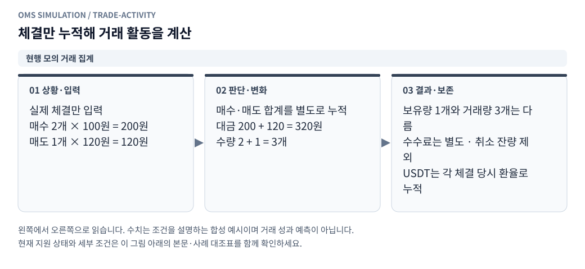

# 모의투자 거래대금·체결 수량·평균 체결가

리플레이와 실시간 모의계좌의 **누적 거래 활동**에서 계좌 시작 이후 전체 체결을 확인한다. 금액은 기존 KRW/USDT 표시 선택을 따르고, 종목별 표의 수량은 해당 코인의 수량이다.

## 계산과 표시

<!-- diagram: trade-activity -->

**그림 읽기 · 현행 모의 거래 집계:** 매수 2개를 100원에 체결하고 1개를 120원에 매도했다면 누적 거래대금은 320원이다. 남은 보유량은 1개지만 누적 체결 수량은 3개이며, 수수료는 거래대금과 별도 표시한다. [수정용 Mermaid 원본](figures/trade-activity.mmd).

| 지표 | 기준 |
|---|---|
| 누적 거래대금 | 모든 확정 부분체결의 `실제 체결 가격 × 체결 수량` 합계 |
| 매수·매도 거래대금 | 매수·매도를 각각 합산. 누적 거래대금은 두 값의 합 |
| 누적 수수료 | 실제 모의 정산에서 부과한 체결별 수수료의 합 |
| 매수·매도 체결 건수 | 각 부분체결을 한 건으로 계산. 고유 주문 개수와 다름 |
| 종목별 매수·매도 수량 | 해당 거래소·종목에서 실제 체결된 수량의 합 |
| 종목별 누적 체결 수량 | 매수 수량 + 매도 수량. 현재 보유량이나 순매수량이 아님 |
| 매수·매도 평균 체결가 | 해당 방향 거래대금 / 해당 방향 체결 수량. 수수료 제외 VWAP |

거래대금은 수수료를 포함하지 않는 양방향 총액이다. 매도 금액에서 매수 금액을 빼는 순거래대금이 아니다. 지정가 주문이 여러 호가에서 체결되면 각 실제 체결 가격을 사용하며 한도가격으로 대체하지 않는다.

초기 보유 코인·초기 현금, 미체결 주문·예약, 취소·거절·FOK 실패, 내 주문이 체결되지 않은 외부 틱은 거래대금에 포함하지 않는다. 부분체결 후 취소하면 이미 체결한 부분만 집계한다. 초기 코인 매도는 실제 체결이므로 매도 거래대금에 포함한다.

BTC 수량과 다른 코인 수량을 더해 계좌 전체 코인 거래량처럼 표시하지 않는다. 거래소·종목별로 수량·평균 가격을 나누고 계좌 전체에서는 공통 통화의 금액과 체결 건수만 합산한다. 평균 체결가는 포지션의 평균 취득원가와 달라 수수료 및 이후 매도에 의한 원가 배분을 포함하지 않는다. 거래량을 시장 전체 거래량 또는 체결률로 해석하지 않는다.

## USDT와 결측

USDT 거래대금은 각 체결에서 `KRW 체결 대금 / 체결 당시 KRW/USDT 환율`을 구해 누적한다. USDT 수수료도 같은 체결 환율을 사용한다. 현재 환율로 누적 원화 거래대금 전체를 나누지 않는다. [환율 근거·신선도 규칙](pnl_currency.ko.md)을 그대로 따른다.

한 방향의 체결 환율이 하나라도 없으면 그 방향의 USDT 대금·평균가와 전체 USDT 대금은 미평가다. 다른 방향이나 다른 종목의 알려진 금액은 계속 표시한다. 원화 거래대금·코인 수량·건수는 계산할 수 있다. 이후 환율이 돌아와도 과거 환율을 임의 채우지 않는다. 체결이 아예 없는 계좌는 대금·수수료·건수 0이며 평균 체결가는 값이 없다.

## 보관·기존 결과·내보내기

- 리플레이의 실행별 `TradingActivity`가 확정 체결 때만 누적한다. 스냅샷, 체결 순간 보고서, 전체 결과 JSON과 계좌별 결과 목록에 `activity`를 저장한다. 목록에서도 선택 통화의 누적 거래대금을 확인할 수 있다.
- 실시간 계좌는 `paper_activity_state`에 Decimal 문자열 합계와 마지막 원본 주문 행 번호를 저장한다. 체결·원화 정산·USDT 상태·거래 집계·보고서가 같은 트랜잭션에서 커밋된다. 동일 주문 ID 재요청은 재집계하지 않는다.
- 기존 실시간 계좌는 첫 조회 또는 다음 체결 때 저장된 전체 `paper_orders`와 체결 당시 환율 기록으로 합계를 만든다. 이후에는 마지막 행 이후의 새 체결만 읽는다. 최근 100건 화면 페이지를 합산하는 방식이 아니며 재시작 뒤에도 전체 누적값을 유지한다.
- 현재 손익·환율 조회, 화면 통화 전환과 페이지 이동은 거래량을 늘리지 않는다. 계좌 초기화 시 거래 집계도 함께 초기화한다.
- 기존 리플레이 결과에 집계 필드가 없으면 `—`로 표시하며 새 실행부터 저장한다. 기존 체결 보고서의 누적 집계를 소급 작성하지 않는다. 기존 실시간 계좌의 현재 합계를 복원해도 이미 고정한 과거 보고서는 바꾸지 않는다.
- 두 체결 표에 **이번 거래대금**을 추가했다. KRW는 저장된 체결 가격·수량으로, USDT는 저장된 환산 체결 금액으로 표시한다.
- CSV는 기존 열을 유지하고 `fill_notional_krw`, `fill_notional_usdt`, `activity_krw_*`, `activity_usdt_*`를 추가한다. 누적값은 해당 체결 직후 상태이며 오래된 보고서에 없던 누적값은 빈칸이다. 종목별 전체 집계는 스냅샷·결과 JSON의 `activity.KRW.markets`, `activity.USDT.markets`에 있다.

## 모듈과 검증

`paper_trading/activity.py`는 `ExecutedTrade` 불변 입력, 방향별 `SideTotals`, 종목별 `MarketActivity`, 계좌별 `TradingActivity`를 소유한다. 주문 생성·취소·실제 시세 조회나 원장 정산은 하지 않는다. 내부 합계는 Decimal이며 저장 직렬화와 보고용 숫자 변환을 분리한다.

공개 `activity`에는 `KRW`와 `USDT`가 있다. 각 통화에 `turnover`, `buy_turnover`, `sell_turnover`, `fees_paid`, `fill_count`, `buy_fill_count`, `sell_fill_count`, `status`, `markets`를 둔다. 각 시장에는 위 집계와 함께 `exchange`, `ticker`, `buy_quantity`, `sell_quantity`, `traded_quantity`, `buy_vwap`, `sell_vwap`가 있다. 상태 `missing_historical_fx`는 해당 통화의 대금에 결측이 있음을 뜻한다.

검증은 `tests/test_trade_activity.py`의 실제 체결가·가중 평균·환율 변동·복수 종목·100건 초과·재시작·재시도·마이그레이션·저장 롤백·취소/FOK/초기 잔고 제외와 기존 API의 CSV 검증을 따른다.

## 나중에 답할 쿼리

| ID | 현재 적용 | 나중에 답변 |
|---|---|---|
| ACT-Q01 | 거래대금은 매수+매도의 수수료 제외 총액. 수수료는 별도 지표 | |
| ACT-Q02 | 건수는 부분체결 수. 고유 주문 수·maker/taker 비중·시간별 거래대금 차트는 이번 범위에 포함하지 않음 | |
