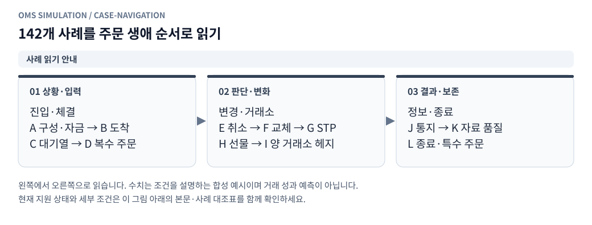

# 그림으로 보는 모의거래 설계와 알고리즘

기존 지정가 **142개 사례 모두에 개별 설명 그림**을 추가했다. 관련 제안서·전략·알고리즘·운영 문서 17개에도 핵심 개념도 37종을 배치했다. SVG는 문서에서 바로 보고 확대할 수 있으며, 사례 문서의 접힌 영역과 개념도 `.mmd` 파일에는 수정용 Mermaid 원본이 있다.

## 먼저 읽을 그림

위 그림은 진입·체결(A~D), 변경·거래소(E~I), 정보·종료(J~L) 순서다. 하나의 주문이 여러 사례를 순서대로 경험할 수 있다.

1. [같은 주문의 GTC·IOC·Post-only 차이](figures/tif-comparison.svg)
2. [대기열 125개 틱의 배분](figures/queue-budget.svg)
3. [취소 지연 중 부분체결](figures/cancel-race.svg)
4. [앞·뒤 취소 확률](figures/cancel-probability.svg)
5. [체결 당시 환율로 USDT 손익 계산](figures/usdt-cost.svg)

## 지정가 사례별 그림

기존 [설계 사례표](point2_limit_fill_cases.ko.md)와 [현재 실행 대조표](limit_execution_coverage.ko.md)의 사례 ID를 눌러 해당 그림으로 직접 이동할 수도 있다. 각 그림에는 상황·판단·결과, 읽는 순서, 원래 처리 제안, 현재 지원 상태를 붙였다.

| 분류 | 설명 문서 | 사례 수 |
|---|---|---|
| A | [접수·규격·자금](illustrated/limit-a.ko.md) | 10 |
| B | [도착 가격·즉시 체결](illustrated/limit-b.ko.md) | 12 |
| C | [대기열·외부 취소](illustrated/limit-c.ko.md) | 18 |
| D | [복수 가격·복수 주문](illustrated/limit-d.ko.md) | 12 |
| E | [취소·체결 경합](illustrated/limit-e.ko.md) | 12 |
| F | [정정·교체·재주문](illustrated/limit-f.ko.md) | 12 |
| G | [자기체결 방지](illustrated/limit-g.ko.md) | 10 |
| H | [OKX 선물·담보](illustrated/limit-h.ko.md) | 12 |
| I | [두 거래소·헤지](illustrated/limit-i.ko.md) | 12 |
| J | [ACK·체결·계좌 통지](illustrated/limit-j.ko.md) | 10 |
| K | [자료·깊이·불확실성](illustrated/limit-k.ko.md) | 12 |
| L | [종료·확장·지원 경계](illustrated/limit-l.ko.md) | 10 |

## 제안서·전략·알고리즘의 그림

| 문서 | 그림으로 설명하는 내용 |
|---|---|
| [전체 구상](point2_replay_design.ko.md) | 시장→가상 실행→결과, 배속, 사건 순서, 소진 부채, 큐, 통지·헤지 |
| [모듈 상세 명세](point2_replay_modules.ko.md) | 준비·도메인·운영 계층, 주문·원장·관측 상태와 저장 경계 |
| [가상계좌](point2_virtual_accounts.ko.md) | 새 계좌 생성, 계좌별 격리, 체결 정산·결과 보관 |
| [단일 메이커](bithumb_simple_mm.ko.md) | 가용 자산별 양방향 주문, 취소 확인 후 재호가 |
| [minmaxma](minmaxma_strategy.ko.md) | microprice→min/max/MA→신호, 시간 가중 MA 수치 예시 |
| [헤지 지연·핑 보호](execution_latency_controls.ko.md) | 도착·응답·완료의 차이, 시간차 급등 차단·복구 |
| [확률 취소](queue_cancellation_model.ko.md) | 틱으로 설명된 감소 제외, 공유 FIFO, 앞·뒤 취소 추첨 |
| [거래 활동 집계](trade_activity.ko.md) | 전체 체결의 대금·수량·평균가, 수수료 분리 |
| [KRW·USDT 손익](pnl_currency.ko.md) | 체결 환율 원가, 현금 환산손익, 미래 환율 차단 |
| [실제 체결 피드백](real_execution_feedback.ko.md) | 실제 주문 재생과 전략 재실행 구분, 대사·검증·버전 |
| [객체 구조](replay_architecture.ko.md) | 전략·주문·원장 책임, FOK 계획의 원자성, commit 후 공개 |
| [성능 구조](replay_performance.ko.md) | 변경 없는 입력 캐시, 저장된 JSON 재사용 |
| [저장 공간 관리](storage_retention.ko.md) | 미리보기→보관 기준→읽기 보호→삭제 |
| [미결정 쿼리](strategy_registration_queries.ko.md) | 임시 기본값→새 버전→지원되는 전략만 실행 |
| [공통 종목 괴리 분석](../oms_client/analysis/README.md) | 1초 표본→시간별 합계·표본수→3일·7일 관측 평균 |

## 지원 상태를 읽는 방법

**그림이 있다는 것은 실행 구현 완료라는 뜻이 아니다.** 사례 대조표의 현재 분류는 실행·차단 연결 62개, 모형 가정 16개, 부분 지원 17개, 미지원 47개다. 특히 OKX 선물 원장·헤지·지연 통지, Point/minmaxma 실행, 실제 기록 피드백은 그림에서 설계 또는 미연결로 구분한다. 이 작업은 그림·설명을 추가하며 지원 상태를 변경하지 않는다.

초기 제안서와 현행 구현의 차이는 그림 설명에 적었다. 예를 들어 현행 동시각 순서는 **내부 예약 사건→시장 틱→호가**이며 초기 시장 우선 제안과 다르다. 종료는 preserve/cancel 설정을 따르고, Post-only 교차는 현행 거절이다. 상세 계산·제약은 [현행 실행 문서](limit_execution_coverage.ko.md)를 기준으로 한다.

## 전체 개념도 원본

| 그림 | Mermaid 원본 |
|---|---|
| [한 주문의 수량은 어디로 가는가](figures/limit-lifecycle.svg) | [원본](figures/limit-lifecycle.mmd) |
| [같은 매수 7개도 주문 조건에 따라 결과가 달라진다](figures/tif-comparison.svg) | [원본](figures/tif-comparison.mmd) |
| [142개 사례를 주문 생애 순서로 읽기](figures/case-navigation.svg) | [원본](figures/case-navigation.mmd) |
| [전체 제안: 시장 자료와 가상 체결을 분리한다](figures/design-system.svg) | [원본](figures/design-system.mmd) |
| [실제 재생 속도와 사건의 가상 시각은 다르다](figures/clock-pacing.svg) | [원본](figures/clock-pacing.mmd) |
| [동일 밀리초 사건의 현행 처리 순서](figures/time-order.svg) | [원본](figures/time-order.mmd) |
| [반대 틱 125개의 배분](figures/queue-budget.svg) | [원본](figures/queue-budget.mmd) |
| [원본 호가가 반복돼도 내 소비량은 되살아나지 않는다](figures/depth-debt.svg) | [원본](figures/depth-debt.mmd) |
| [잔량 100에서 70으로 줄었을 때](figures/cancel-inference.svg) | [원본](figures/cancel-inference.mmd) |
| [앞 30 · 뒤 70: 취소는 어느 쪽에서 빠질까](figures/cancel-probability.svg) | [원본](figures/cancel-probability.mmd) |
| [취소 버튼을 누른 시각과 취소 효력은 다르다](figures/cancel-race.svg) | [원본](figures/cancel-race.mmd) |
| [실험마다 새 가상계좌를 만든다](figures/account-isolation.svg) | [원본](figures/account-isolation.mmd) |
| [한 번의 부분체결이 계좌와 보고서에 반영되는 순서](figures/account-settlement.svg) | [원본](figures/account-settlement.mmd) |
| [단일 메이커는 보유한 자산만 양쪽에 낸다](figures/mm-quotes.svg) | [원본](figures/mm-quotes.mmd) |
| [호가가 바뀌면 해당 방향 주문만 교체한다](figures/mm-requote.svg) | [원본](figures/mm-requote.mmd) |
| [minmaxma: 저점 반등 또는 고점 하락과 MA를 함께 본다](figures/minmaxma-signal.svg) | [원본](figures/minmaxma-signal.mmd) |
| [ma_ms는 봉 개수가 아니라 시간 상수다](figures/minmaxma-ma.svg) | [원본](figures/minmaxma-ma.mmd) |
| [헤지 도착·응답·완료는 서로 다른 시각이다](figures/hedge-latency.svg) | [원본](figures/hedge-latency.mmd) |
| [시세 시간차가 튀면 신규 주문을 막는다](figures/ping-guard.svg) | [원본](figures/ping-guard.mmd) |
| [헤지 주문을 냈어도 아직 헤지된 것은 아니다](figures/hedge-exposure.svg) | [원본](figures/hedge-exposure.mmd) |
| [가상 거래소의 실제 상태와 전략이 아는 상태](figures/truth-observed.svg) | [원본](figures/truth-observed.mmd) |
| [객체가 상태를 바꾸는 경계를 분리한다](figures/execution-boundaries.svg) | [원본](figures/execution-boundaries.mmd) |
| [FOK는 일부를 먼저 체결하고 실패하면 되돌리는 방식이 아니다](figures/fok-atomic.svg) | [원본](figures/fok-atomic.mmd) |
| [체결 당시 환율로 매수 원가와 매도 대금을 따로 환산](figures/usdt-cost.svg) | [원본](figures/usdt-cost.mmd) |
| [매매 수익과 원화 현금의 환산손익을 합쳐 계좌 변화를 본다](figures/usdt-equity.svg) | [원본](figures/usdt-equity.mmd) |
| [과거 체결에는 그 시각까지 관측한 환율만 사용](figures/fx-causality.svg) | [원본](figures/fx-causality.mmd) |
| [실제 체결 피드백에는 서로 다른 두 실험이 필요하다](figures/feedback-paths.svg) | [원본](figures/feedback-paths.mmd) |
| [실제 기록을 학습 전에 대사한다](figures/feedback-quality.svg) | [원본](figures/feedback-quality.mmd) |
| [오래된 파일도 현재 읽고 있으면 삭제를 미룬다](figures/retention-gate.svg) | [원본](figures/retention-gate.mmd) |
| [캐시가 빨라져도 바뀐 주문은 다시 반영한다](figures/performance-cache.svg) | [원본](figures/performance-cache.mmd) |
| [화면은 저장에 성공한 스냅샷을 읽는다](figures/committed-snapshot.svg) | [원본](figures/committed-snapshot.mmd) |
| [미결정 선택은 기록하고 실행 지원 여부는 별도로 판단한다](figures/strategy-version.svg) | [원본](figures/strategy-version.mmd) |
| [5호가 밖의 내 주문은 별도 영역에 둔다](figures/orderbook-overlay.svg) | [원본](figures/orderbook-overlay.mmd) |
| [모듈 제안서를 데이터 흐름으로 읽기](figures/module-pipeline.svg) | [원본](figures/module-pipeline.mmd) |
| [Point 가격: 해외 기준가격과 USDT 환율에서 매수·매도 한계가로](figures/point-pricing.svg) | [원본](figures/point-pricing.mmd) |
| [공통 종목 괴리: 1초 표본에서 시간별 누적과 3일·7일 평균으로](figures/premium-hourly.svg) | [원본](figures/premium-hourly.mmd) |
| [체결만 누적해 거래 활동을 계산](figures/trade-activity.svg) | [원본](figures/trade-activity.mmd) |

수정·재생성·검증 방법은 [그림 제작 안내](figures/README.md)를 참고한다.
