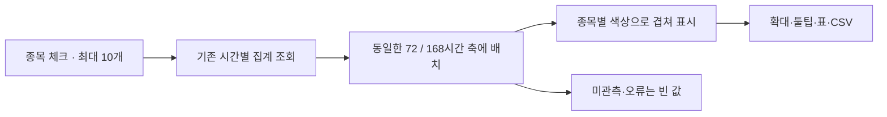

# 분석 화면

`controller.js`는 분석 소스 카드·수식·조건, 과거 및 실시간 실행, 조합·이력 복원, 결과 차트·CSV를 담당합니다. 계산과 저장은 서버 API에 위임합니다.

`premiums.js`는 별도 `전체 공통 종목 괴리 평균` 패널입니다. 수식 입력 조건과 독립적으로 저장된 빗썸·OKX 교집합 전체의 3일·7일 평균, 유효 초 충족률, 오류 시간 수를 조회합니다. 패널을 펼칠 때 조회를 시작하고 집계 중에는 3초, 그 외에는 15초 간격으로 진행률을 갱신합니다. 종목 검색·시간별 차트와 168시간 표·CSV·자동 누적 설정을 제공합니다. 자동 집계는 브라우저가 아닌 서버에서 수행합니다. 시간별 차트의 드래그 확대와 더블클릭 해제는 개별 종목에 적용하며 일반 조합 차트와 독립적입니다.

같은 패널의 **여러 종목 괴리율 비교**는 종목 행의 체크박스로 최대 10개를 선택하여 시간 평균을 한 차트에 표시합니다. 최초에는 목록 앞 3개를 선택하며, 검색해도 선택한 종목을 유지합니다. 선택한 종목 이름을 누르면 제외하고, 전체 선택 해제도 가능합니다. 최근 3일(72시간)·7일(168시간)을 전환하며 범례 색상·공통 툴팁·드래그 확대·확대 해제를 제공합니다. 아래 표는 시간별 값과 유효 초를 보여주고 비교 CSV에는 종목별 값·표본 수·상태를 모두 담습니다. 일반 조합 수식 및 단일 종목 상세 차트와 독립적입니다.

`PremiumComparison`은 선택·요청 순서·비교 차트 상태를 소유합니다. 기존 시간별 집계 API만 읽으며 원본 재계산이나 새 서버 API가 필요하지 않습니다. 한 조회당 최대 10종목 × 168개 시간이며 동시에 최대 3개 비교 요청을 보냅니다(별도 단일 종목 상세 요청 제외). 진행 중 선택이 바뀌면 다음 대기 요청을 최신 선택으로 교체하고 이전 응답은 버립니다. 비교 결과는 현재 화면만 보유하며 선택 변경 시 지우고, 요청 사이의 무제한 캐시를 두지 않습니다. 패널을 닫으면 대기 조회·타이머를 취소하고 진행 응답을 무효화합니다.

기준 시각은 요약 API가 반환한 완료 시간으로 고정합니다. 모든 선을 동일한 `[기준−3/7일, 기준)`의 정각 축에 맞추며 누락·집계 오류·요청 실패는 `null`로 남깁니다. 한 종목의 조회 실패로 다른 종목을 숨기지 않습니다. 관측된 0과 음수 괴리는 보존하고, 관측이 없는 시간을 0으로 채우거나 이전 값으로 보간하지 않습니다. 한 시간 평균은 종목마다 유효 초가 다를 수 있으며, 차트 선을 다시 평균해 3일·7일 평균을 만들지 않습니다. 해당 누적 평균은 기존 표의 표본 수 가중 집계를 사용합니다. 개별 API 읽기는 DB 전체의 동시 스냅샷을 보장하지 않으므로 집계 진행 중 종목별 갱신 상태는 다를 수 있습니다.

기간·초기 선택·동시 비교 수는 이번 구현의 기본값입니다. 다른 분석 지표나 임의 과거 기간의 다중 비교, 선택 목록의 영구 저장은 별도 요구사항으로 확장할 수 있습니다.

후속 질의 `MULTI-001`: 괴리율 외에 가격 수익률·desk−server 시간차도 같은 선택 목록으로 비교할지, 임의 조회 기간과 선택 목록 저장이 필요한지 확인할 예정입니다. 현재 기본값은 저장된 공통 종목의 괴리율, 최근 3일·7일, 화면 내 선택 유지이며 답변 전에도 이 범위는 사용할 수 있습니다. 나중에 답변: ______

소스 목록은 동적 ID 배열로 관리합니다. `+ 데이터 추가`는 A~Z의 빈 이름을 사용하고, 삭제는 최소 한 개를 남기며 수식에 쓰인 ID를 보호합니다. 소스를 추가·삭제하면 기존 요청과 실시간 세션을 무효화합니다. 저장 조건은 ID와 종류·종목·가격 옵션을 함께 복원하며 다른 ID로 자동 재배정하지 않습니다.

기본 상대가·비율 프리셋의 A~D 자동 연동과 사용자가 추가한 소스는 구분합니다. E 이후 카드도 가격 기준·유동성호가·펀딩·분봉 옵션, 저장 범위·차트·표·CSV에서 같은 경로로 처리합니다.

공통 저장 범위는 참조 ID·종류·거래소·종목으로 요청을 구분합니다. 같은 자료의 진행 중인 요청은 공유하며, 카탈로그 갱신 전 응답은 새 캐시에 쓰지 않습니다. 날짜·단위처럼 원천 범위를 바꾸지 않는 설정은 진행 중인 범위 조회를 취소하지 않습니다.

`desk − server 시간차` 차트는 분석에 쓰인 소스들의 `desktopTime - serverTime`을 ms로 비교합니다. 가격 차트와 공통 시간축·표시 표본·커서·확대 범위를 사용합니다. 마지막 값 모드는 가격과 같은 원본 행의 시간차이며, 평균 모드는 구간 내 유효한 시각 쌍의 차이를 평균합니다. 펀딩도 동일한 시간차 집계 규칙을 따릅니다(기존 펀딩 시각 메타데이터는 마지막 관측 기준). 차트 표본 축소가 적용되면 시간차의 모든 극값을 보여주지는 않습니다. 표와 CSV에는 소스별 `timestamp_delta_ms`가 포함됩니다.

음수는 보존하고 시각 누락·잘못된 단위·측정 불가 값은 빈 값으로 표시합니다. LS 호가, 수집기가 서버 시각을 만든 OKX/Hyperliquid 펀딩, 1분봉은 측정 불가 사유를 표시합니다. 이전 저장 결과에 시간차가 없으면 재실행을 안내합니다. 실시간 모드는 같은 호가의 `receivedAt - ts`를 사용하며 폴링 시각에서 빼지 않습니다. USDT 1초 저장 호가는 실제 채택 시각까지의 호가 경과 시간을 포함하므로 실시간 수신 시간차와 의미가 다릅니다. 시간차는 장비 시계 차이를 포함하며 RTT가 아닙니다.
