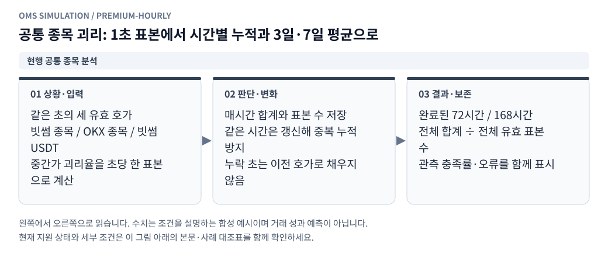

# 가격·펀딩비율 조합과 분석

이 폴더는 원천 호가와 저장된 펀딩비율을 조합하고 과거 통계·실시간 가격 통계를 계산하는 부분입니다.

- `history.py`: 가격·펀딩 소스별 조회, 공통 관측 구간 정렬, 분석 기본 조건, 통계·상관관계와 전체 결과 구성. 가격은 중간가, 펀딩비율은 원값×100의 `%` 값을 수식에 넣습니다.
- `formulas.py`: 허용된 AST만 사용하는 조합식 검증과 MA·EMA·DIFF·RET·ZSCORE·ABS 계산.
- `live.py`: 공개 시세를 이용한 실시간 분석 세션, 표본 수집과 세션 종료 관리.
- `sampling.py`: 전체 통계 계산이 끝난 결과에서 차트 표시용 표본 선택.
- `sources.py`: A~Z 최대 26개 소스의 이름·중복·개수와 과거 조회의 총 구간 예산 검증.
- `premiums.py`: 저장된 빗썸·OKX 공통 종목 전체의 시간별 괴리 영구 집계와 매시간 증분 갱신.

과거·실시간 분석과 API·저장 조합은 같은 소스 ID 규칙을 사용합니다. 과거 조회는 수식이 참조한 ID 수 × 요청 구간 수를 최대 1,000,000으로 제한하고, 동일한 원천·가격 조건은 한 번만 읽습니다. 수식에 없는 카드는 파일 읽기·실시간 구독·출력 예산에서 제외합니다. CSV와 통계는 추가한 ID도 유지합니다.

원천 데이터 조회·WebSocket 연결은 `../market_data/`에 위임합니다. 새 분석 함수는 `formulas.py`, 과거 분석 지표는 `history.py`에 추가합니다. Flask 요청·로그인과 가상 체결은 이 폴더의 책임에 포함되지 않습니다.

펀딩비율은 과거 분석에서 지원하며 실시간 가격 소스로 잘못 구독하지 않도록 거부합니다. 누락 구간을 이전 값으로 채우지 않습니다. 펀딩 평균값의 관측 시각·정산 잔여 초는 마지막 관측 메타데이터이고, 실제 계좌 정산이나 정산 주기 환산을 수행하지 않습니다.

## 전체 공통 종목 괴리 누적

<!-- diagram: premium-hourly -->

**그림 읽기 · 현행 공통 종목 분석:** 시간 평균의 단순 평균이 아니다. 예를 들어 1% 표본 3,600개와 3% 표본 1,800개의 합성 평균은 약 1.6667%이며 2%가 아니다. 괴리율은 거래 수익률이 아니다. [수정용 Mermaid 원본](../../docs/figures/premium-hourly.mmd).

계산식은 `(빗썸 중간가 / (OKX USDT 무기한 중간가 × 빗썸 USDT 중간가) - 1) × 100`입니다. 원천별 `desktopTime` 기준 1초 구간의 마지막 유효 매수·매도 호가를 선택하고 중간가를 계산합니다. 세 소스 모두 존재하는 동일 초만 사용하며 이전 호가를 이월하지 않습니다. 같은 초 안에서도 각 거래소의 원본 수신 시각은 다를 수 있습니다. 이는 중간가 괴리율이며 수수료 반영 매매 수익률이 아닙니다.

원본 틱 개수로 가중하지 않고 유효 초마다 한 표본을 부여합니다. 시간별로 괴리율 합계, 표본 수, 최솟값·최댓값을 저장합니다. 3일·7일은 완료 시간 기준 직전 72·168시간이며 `sum(hour.total) / sum(hour.samples)`로 계산합니다. 시간 평균들의 단순 평균이나 가격 평균들의 비율을 사용하지 않습니다. `충족률 = 유효 초 수 / 기간 전체 초 수 × 100`이며 100% 미만은 관측분 평균입니다. 7일과 1주일은 하나의 기간입니다.

대상은 로컬 호가 카탈로그의 대문자 종목 코드 교집합이며 26개 수식 소스 제한과 별개입니다. 실시간 상장 목록이나 다른 코드 간 매핑을 조회하지 않습니다. 별칭·배수 종목을 임의 환산하지 않으며 동일 코드가 같은 자산·가격 단위를 의미한다는 기존 수집기 계약을 따릅니다. FX는 빗썸 USDT 실제 호가를 사용하고 기존 소스 우선순위에 따라 전용 1초 호가가 있으면 이를 선택합니다. FX가 없는 과거 구간을 분봉이나 BTC 환율로 채우지 않습니다.

서버 시작 시 별도 스레드가 최근 7일을 확인하고 정시 2분 후부터 새로 완료된 시간을 확인합니다(최대 30초 폴링 지연). 자동 설정은 영구 저장되며 기본값은 켜짐입니다. 끄면 이후 자동 작업을 시작하지 않고 진행 중 작업은 완료합니다. 웹 화면을 닫아도 서버가 실행 중이면 계속 누적합니다. 서버 종료 중에는 집계하지 않으며 재시작 시 최근 7일 내 누락분을 보충합니다. 테스트 앱은 스레드를 자동 시작하지 않습니다.

파일 경로·크기·mtime, 소스 종류와 계산 프로파일로 시간별 fingerprint를 만들고 변경된 시간만 재계산합니다. 같은 날짜의 필요한 가격 구간을 함께 읽고 USDT 시리즈를 재사용합니다. 집계 중 파일 변경은 오류 처리 후 다음 갱신에서 재시도합니다. 최근 7일 내 후행 기록·수정 파일도 갱신하며 7일 이전 수정은 자동 소급하지 않습니다. 프로파일은 `bithumb_okx_usdt_mid_last_1s_v1`이며 향후 계산 규칙 변경 시 새 프로파일이 필요합니다.

파일 잠금으로 웹 프로세스·CLI의 중복 집계를 막고 `(profile,ticker,hour_ms)` 키에 교체 저장하므로 재실행해도 표본이 중복되지 않습니다. 중단 시 커밋된 시간은 유지되고 같은 시간대도 재개할 수 있습니다. 원본 보존 기간 만료로 파일이 없어져도 기존 유효 집계를 지우지 않습니다. 읽기 실패 시 기존 수치는 진단용으로 보존하되 오류 시간은 평균에서 제외합니다. 충족률과 오류는 UI에서 확인할 수 있습니다.

저장소 루트에서 `python aggregate_premiums.py --once`는 한 번 최근 7일을 보충합니다. `--once` 없이 실행하면 동일한 자동 누적 루프를 유지합니다. `--state-dir` / `DASHBOARD_STATE_DIR`와 시장 데이터 환경변수는 웹 서버와 같게 지정해야 합니다. 저장 결과는 웹 API와 공유됩니다.
