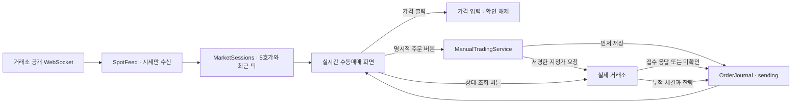
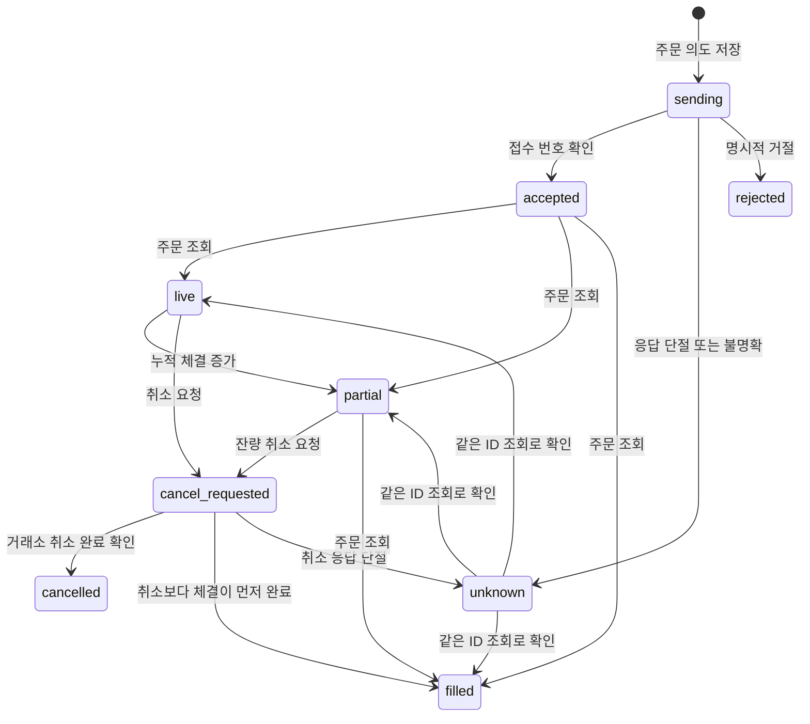

# 실시간 수동 현물 매매

`실시간 수동매매` 탭에서 빗썸 KRW 현물과 OKX 글로벌 USDT 현물의 공개 5호가·체결 틱을 보면서 직접 지정가 매수·매도·취소를 요청한다. 시작 상태는 시세 보기다. 키 등록이나 화면 진입 자체로 주문하지 않으며, 사용자가 주문마다 **실제 계좌로 주문**을 선택하고 전송해야 실제 거래소로 요청한다. 기존 가상계좌·전략 실행·과거 오더북 시뮬레이터와 별도 서비스 및 장부를 사용한다.

## 사용 순서

1. `requirements.txt` 의존성을 설치하고 변경된 서버를 시작한다. 이미 실행 중인 서버에는 재시작 후 반영된다. 구버전 서버에서는 새 화면만 재시작 안내로 비활성화하며 기존 탭은 유지한다. 이번 작업에서는 운영 서버를 재시작하지 않았다.
2. **실시간 수동매매 → 거래소·종목 → 호가·틱 연결**을 선택한다. 종목 기본값은 BTC이며 바꿀 수 있다. 공개 시세만 볼 때는 키가 필요 없다.
3. **API 키 등록·관리**에서 거래소, 이름, API Key, Secret을 입력한다. OKX는 Passphrase도 필요하다. 거래소당 하나, 최대 두 거래소의 키를 등록한다.
4. **잔고 조회·연결 확인**으로 해당 키의 실제 잔고를 확인한다. 이 작업은 주문하지 않는다. 주문용 키는 해당 거래소의 현물 거래 권한이 필요하며 출금 기능은 구현하지 않는다.
5. 계좌·매수/매도·가격·수량을 입력한다. 호가 가격을 누르면 가격 입력란만 채워진다. **실제 계좌로 주문**을 선택한 뒤 전송한다. 가격·수량 변경 및 전송 시 체크가 해제된다.
6. 내 주문 목록의 **상태 조회**로 거래소가 보고한 누적 체결·잔량을 확인하고, **취소 요청**으로 취소를 접수한다. 주문 접수나 취소 접수 응답만으로 체결·취소 완료를 표시하지 않는다.

현재는 일반 지정가 GTC만 전송한다. 시장가·IOC·FOK·post-only·정정·파생상품·마진·자동 헷지는 이 창에 연결하지 않았다. 지정가는 반대 호가와 교차하면 즉시 체결될 수 있어 메이커 전용 주문이 아니다. 시장별 최소 금액·호가 단위·잔고 검증은 거래소 응답을 반영하며 임의 반올림이나 수량 보정을 하지 않는다.

## 화면 및 갱신

- 서버가 거래소 공개 WebSocket을 계속 수신하고 브라우저는 활성 탭에서 1초마다 저장된 최신 상태를 읽는다. 탭을 벗어나면 화면 조회를 멈춘다. 거래소별 마지막 구독 하나씩, 총 두 개를 유지한다.
- 호가는 양쪽 5단계, 틱은 서버에서 최근 300개·화면에서 최근 100개를 유지한다. 거래 ID 중복 검사 캐시는 2,048개로 제한한다. 시장 원본 틱 전체를 이 모듈에서 영구 보관하지 않는다.
- 내 주문은 별도 열에 표시한다. 공개 호가의 가격 범위를 벗어난 내 주문은 호가창 위에 별도 표로 표시한다. 실제 공개 잔량에 내 주문을 더하지 않는다.
- 내 주문 잔량은 마지막 **거래소 주문 조회** 기준이다. 공개 틱으로 내 체결을 추정하지 않는다. 아직 조회하지 않은 접수 주문은 `확인 대기`로 표시한다.
- 최근 100건 외에도 모든 미종결 주문을 목록에 남겨 오래된 주문을 조회·취소할 수 있게 한다. 장부는 재시작 후에도 유지된다.
- 개인 주문·잔고는 사용자 버튼으로 REST 조회한다. 공개 호가·틱처럼 개인 체결을 실시간 스트리밍하는 기능은 아직 없다. 주문 표의 `최근 확인` 시각과 상태를 함께 읽어야 한다.



## 전송·복구 규칙

`LimitOrderIntent`는 불변 값 객체이고 금액·수량은 `Decimal`로 정규화한다. DB·HTTP 경계에서는 정확한 숫자 문자열을 사용하며, 호가 정렬도 JavaScript 부동소수점 변환 없이 수행한다.

새 주문 전에 다음 조건을 검사한다.

- 로그인과 CSRF 검증, 명시적인 `confirm_live: true`.
- 등록된 계좌와 선택 거래소 일치, 잔고 조회로 키 연결 확인 완료.
- 선택 종목의 유효한 양방향 호가 및 연결 상태. 거래소 타임스탬프와 서버 수신 시각 모두 2초 이내여야 하며 거래소 시각의 미래 편차도 1초 이내여야 한다. 이 조건은 시세 신선도 검사이며 별도의 ICMP 핑 또는 주문 REST RTT 측정은 아니다.
- 미확인 접수 주문이 같은 키에 없어야 한다. 시세 지연은 신규 주문만 차단하고 기존 주문의 상태 조회·취소를 막지 않는다.

주문 요청 ID를 브라우저가 생성하고 SQLite 트랜잭션으로 `sending`을 기록한 뒤 딱 한 번 REST 요청한다. 같은 키·ID·내용으로 재요청하면 저장 결과만 반환한다. 같은 ID의 가격이나 수량 변경은 거부한다. 타임아웃·5xx·리다이렉트·불명확한 거래소 응답은 `unknown`이며 자동 재시도하지 않는다. 서버가 꺼지면서 `sending`이 남아도 재시작 시 재전송하지 않는다.



동시 변경 요청은 앱 단위로 한 개만 처리한다. 누적 체결 감소와 종결 상태의 미체결 복귀는 거부하고 이전 장부를 보존한다. 조회 실패나 취소 실패를 체결 완료로 대체하지 않는다. 취소 요청 뒤 실제 상태가 아직 미체결이면 이후 조회에서 미체결로 표시될 수 있다.

전송 전 입력 검증 실패는 `order_not_submitted: true`를 반환해 입력 수정이 가능하다. 네트워크 오류에는 이 표시를 붙이지 않는다. 브라우저가 응답을 잃으면 같은 ID·내용으로만 다시 요청할 수 있다. 거래소에서 주문을 찾지 못했다는 응답만으로 불명확한 접수를 자동 확정 거절하지 않는다. 이런 주문은 거래소 웹/앱과 이후 상태 조회로 확인하며, 현재 임의로 상태를 확정하거나 차단을 해제하는 버튼은 없다.

## 키와 장부 보관

| 파일 (`STATE_DIR/manual_trading/`) | 내용 |
|---|---|
| `credentials.sqlite3` | 키 이름·마스킹·확인 시각 및 Fernet으로 암호화한 API Key/Secret/Passphrase |
| `master.key` | 서버 측 복호화 키, 파일 권한 `0600` |
| `orders.sqlite3` | 주문 의도와 마지막 조회 결과, 키 원문 미포함 |

디렉터리는 `0700`, DB 파일은 `0600`으로 제한한다. 키 조회 API는 마스킹된 메타데이터만 반환한다. 브라우저 입력은 등록 시도 후 지우며 localStorage/sessionStorage에 보관하지 않는다. HTTPS 고정 거래소 호스트로만 서명된 요청을 보내고 리다이렉트를 따라가지 않는다. raw 거래소 오류·키·서명을 응답이나 로그에 출력하지 않는다.

암호화 키가 DB와 같은 서버에 있는 로컬 암호화 방식이다. 서버 접근 권한 자체를 얻은 공격자를 방어하는 외부 KMS는 아니다. 복구 시 DB와 원래 `master.key`를 함께 복원해야 한다. 암호화된 자격증명이 남았는데 키 파일이 없으면 새 키를 생성해 덮어쓰지 않고 열기를 실패시킨다. 미종결·미확인 주문이 있는 계좌의 키 삭제를 차단한다. 키 삭제 후에도 주문 장부는 보존하며, 거래소 자체의 키 폐기는 거래소에서 수행한다.

원격 PC에서 키를 입력할 때는 기존 HTTPS 접속을 사용한다. 이 기능이 HTTP 자체를 암호화하지는 않는다. 상태 파일은 기존 `.state/` Git 제외 정책을 따르며 시세 파일 자동 삭제 대상에 넣지 않는다.

## 책임과 API

| 모듈 | 책임 |
|---|---|
| `models.py` | 불변 주문 의도와 타입이 있는 보고 값 |
| `vault.py` | 암호화 저장·마스킹·키 수명 |
| `market.py` | 현물 공개 구독, 시각 검증, 제한된 캐시·재연결 |
| `exchange.py` | JWT/HMAC 서명, 고정 호스트 REST, 현물 주문·취소·조회 변환 |
| `journal.py` | 전송 전 영속화, 동일 요청 중복 방지, 누적 체결 보존 |
| `service.py` | 전송 조건과 서비스 조합, 응답 불확실성 처리 |
| `api/routes/manual_trading.py` | 인증된 HTTP 경계, 단일 변경 요청 처리 |
| `frontend/features/manual_trading/controller.js` | 시세·주문 표시, 명시적 입력, 요청 ID 유지 |

| API | 역할 |
|---|---|
| `GET /api/manual?exchange=bithumb` | 마스킹 키·공개 시세·저장 주문 읽기; 거래소 개인 API 호출 없음 |
| `POST /api/manual/market` | `{exchange,ticker}` 공개 구독 |
| `POST /api/manual/keys` | 키 등록 |
| `POST /api/manual/keys/{id}/verify` | 실제 잔고 조회·연결 확인 |
| `DELETE /api/manual/keys/{id}` | 미종결 주문이 없는 키 삭제 |
| `POST /api/manual/orders` | 명시적인 실제 지정가 의도 전송 |
| `POST /api/manual/orders/{key}/{client}/refresh` | 거래소 주문 상태 조회 |
| `POST /api/manual/orders/{key}/{client}/cancel` | 거래소 취소 접수 |

계정은 기존 대시보드 관리자 로그인에 귀속된다. 여러 독립 사용자의 키 분리나 서버 다중 워커 운영은 이번 범위에 넣지 않았다. 분석용 OKX SWAP 피드와 분리한 현물 피드라 수량에 선물 계약 승수를 적용하지 않는다. `session.capabilities.manual_spot_orders=true`가 새 기능을 나타내며 기존 OMS 자동 주문 capability는 여전히 false다.

## 기본값 및 후속 질문

작업을 멈추지 않고 아래 기본값으로 구현했다. 나중에 답을 기입하면 된다.

| ID | 현재 기본값 | 후속 결정 / 답변 |
|---|---|---|
| MANUAL-001 | 빗썸 KRW 현물·OKX 글로벌 USDT 현물 | OKX 지역별 엔드포인트 또는 데모 계정을 추가할지: ___ |
| MANUAL-002 | 공개 시세는 실시간, 개인 주문·잔고는 버튼 조회 | 개인 체결 WebSocket과 자동 잔고 갱신을 추가할지: ___ |
| MANUAL-003 | 지정가 GTC만 제공 | 시장가·IOC·FOK·post-only·정정의 우선순위: ___ |
| MANUAL-004 | 거래소당 키 1개, 종목 구독 1개 | 복수 계좌·동시 여러 종목·다중 사용자 필요 여부: ___ |
| MANUAL-005 | 이 창의 주문 의도와 마지막 누적 체결 상태 보존 | 체결별 영구 원장·실제 손익/환율·외부 체결 가져오기와 시뮬레이터 보정 연결: ___ |
| MANUAL-006 | 공개 틱은 제한된 메모리 캐시 | 실시간 수동 매매 시점의 원본 호가·틱을 별도 녹화할지: ___ |
| MANUAL-007 | 2초 시세 신선도 검사, 불명확한 접수는 신규 주문 차단 | REST 왕복 시간 기반 차단과 운영자 확인을 거친 미확인 주문 해제 절차: ___ |

## 검증 및 참고

서명 고정 입력, 암호화 저장, 인증·CSRF·정적 파일 접근, 중복 주문, 서버 재시작 후 미확인 복구, 누적 체결 역행, 100건을 넘긴 미체결 주문 보존, 불명확한 HTTP/거래소 응답, 시세 신선도와 DOM 입력 흐름을 가짜 시세·가짜 브로커로 검증한다. 실제 API 키나 실제 주문을 사용한 통합 검증은 수행하지 않았다.

```bash
/home/minsung1/dev/.venv/bin/python -m unittest discover -s tests -p test_manual_trading.py
npm run check --prefix frontend
# jsdom 설치 경로를 지정하거나 tests에서 import 가능한 jsdom을 준비한다.
OMS_JSDOM_MODULE=/tmp/midprice-dom-qa/node_modules/jsdom/lib/api.js node tests/frontend/manual_trading.mjs
```

빗썸은 공개 WebSocket과 JWT 인증 REST를 사용하며 주문 생성 `/v2/orders`, 취소 `/v2/order`, 개별 조회 `/v1/order`의 해당 필드를 적용했다. [빗썸 WebSocket 기본 정보](https://apidocs.bithumb.com/reference/기본-정보), [JWT 인증](https://apidocs.bithumb.com/docs/인증-토큰-생성하기), [주문 요청](https://apidocs.bithumb.com/reference/주문-요청), [취소 접수](https://apidocs.bithumb.com/reference/주문-취소-접수), [개별 주문 조회](https://apidocs.bithumb.com/v2.1.0/reference/개별-주문-조회).

OKX는 글로벌 공개 `books5`·`trades`, 서명 REST 및 `tdMode=cash`, `ordType=limit` 현물 주문을 사용한다. 실제 계정이 지역별 주소를 요구하면 현재 글로벌 연결에 대신 입력하지 말고 MANUAL-001로 확장해야 한다. [OKX V5 공식 API 문서](https://www.okx.com/docs-v5/en/). 문서 확인일: 2026-10-27.
