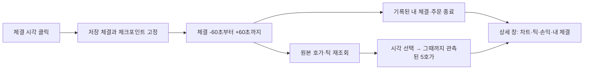

# 과거 호가·틱 시뮬레이션

화면에서는 별도 기능으로 분리하지 않고 **모의투자 → 사용할 시세: 과거 데이터**로 제공합니다. 기존 계좌·결과·API와 체결 규칙은 그대로 유지하며 실시간 시세 방식도 같은 모의투자 탭에서 선택합니다.

빗썸 단일 현물 종목의 최우선 매수/매도 MM을 실제 저장 원본으로 실행한다. 각 실행은 독립적인 원화·코인 가상계좌를 만들며 실주문을 전송하지 않는다. 기존 `paper_trading` 실시간 모의계좌와 장부를 공유하지 않는다. 선택 거래소는 빗썸, 또는 빗썸+OKX의 최대 두 개다. 현재 OKX는 참조 호가·틱만 제공한다.

## 모듈과 데이터 흐름

| 모듈 | 책임 |
|---|---|
| `source.py` | 원본 Parquet·압축 틱 조회, 양쪽 최대 5호가, 수량 단위 환산, 안정적인 시간 정렬, 입력 파일 확인 |
| `clock.py` | 실제 단조 시계 → 재생 시각, 1~32배속, 정지·재개, 속도 변경 시 연속성 |
| `configuration.py` | 초기조건 검증·정규화, 기본값 적용 |
| `orders.py` | 주문 상태 전이, ID·재시도·교체·완료 관리, 주문 스냅샷 |
| `ledger.py` | Decimal 잔고·예약·원가·실현손익 정산, 역할별 수수료 정책 |
| `scheduler.py` | 가상 도착·취소·만료 이벤트, 같은 시각 등록 순서 보장 |
| `strategy_view.py` | 변경되지 않은 불변 전략 주문 입력 재사용, 실행별 캐시 수명 관리 |
| `limit_execution.py` | 부작용 없는 지정가 도착 계획, 관측 호가 소진 부채 |
| `engine.py` | 객체 실행 순서 조율, FIFO 추정 대기열, 틱 매칭, MM 호출, 체결별 평가·보고 |
| `service.py` | 실행 worker, 모드 전환, 일시정지, 사용자 명령 순서, 계산 묶음·스냅샷 갱신, 종료 |
| `store.py` | `.state/replays.sqlite3`: 실행 스냅샷·불변 체결 보고·명령의 원자적 저장 |
| `../strategies/simple_mm.py` | 가용 잔고와 현재 외부 호가에서 최우선 지정가 의도 계산 |
| `../api/routes/replays.py` | 로그인·CSRF가 적용된 생성/제어/조회/CSV API |
| `../../frontend/features/replay/controller.js` | 실행 입력, 제어, 원본 호가·틱, 내 주문, 계좌·손익, 저장 이력 |

데이터 흐름은 `원본 스트림 → 가상 시각의 도착 이벤트 → 시장 이벤트 → 체결/원장 → 전략 의도 → 예약/도착 예약 → 고정 스냅샷 → DB/UI`다. HTTP 조회나 화면 렌더링에서 체결을 계산하지 않는다.

주문·계좌·시간·체결 계획의 상태 소유와 유지보수 규칙은 [객체 구조 문서](../../docs/replay_architecture.ko.md)에 정리했다. 실행기는 작은 객체의 조합으로 구성하고, 외부 JSON과 저장 계약은 내부 객체와 구분한다.

핵심 실행·원본 읽기·저장/조회·화면의 성능 개선과 재현 가능한 측정 방법은 [성능 문서](../../docs/replay_performance.ko.md)에 정리했다. 이벤트 생략이나 수수료 정밀도 축소 없이 중복 계산과 복사를 줄인다.

## 재생 모드와 시간

- **빠른 일괄 실행**: 원본 순서를 유지하고 시간 대기만 생략한다. 재생 가능한 이벤트를 모두 처리하여 결과를 만든다.
- **1×**: 원본 `desktopTime` 1초를 실제 단조 시계의 1초에 대응한다. 원본 로딩 시간은 재생 시간에 포함하지 않는다.
- **2~32×**: 원본 32초를 최대 실제 1초에 진행한다. 정수 배속을 1 단위로 설정한다.
- **일시정지/재개**: 시장 이벤트와 주문 도착/취소 시각을 함께 멈춘다. 정지 상태의 주문 명령은 잔고를 예약하지만 도착 지연은 재개해야 흐른다.
- **실행 중 변경**: 배속 변경 시 현재 가상 목표 시각을 유지한다. 빠른 실행과 배속 재생 사이를 전환하면 현재 계산 시각에 다시 기준을 맞춘다. 일시정지는 모드 변경으로 해제되지 않는다.

250개 이하의 이벤트 묶음마다 제어 잠금을 양보한다. 대기 구간에서도 주문 도착·취소·시세 노후 타이머를 처리한다. worker는 약 100ms마다 상태를 저장하고 화면은 약 250ms마다 조회한다. 고배속에서 화면이 모든 틱을 개별 프레임으로 보여 주지는 않지만 계산 이벤트는 생략하지 않는다. 화면에는 최근 100개 틱과 처리 지연 `lag_ms`를 표시한다. 처리량이 부족하면 목표 시각보다 늦을 수 있다.

같은 초기조건·원본·**같은 가상 시각의 사용자 명령**이면 배속에 관계없이 동일한 체결과 손익을 만든다. 사용자가 실제 시간을 보고 수동 개입하면 명령의 가상 시각이 달라질 수 있다.

## 입력 원본과 정렬

기간은 `[시작, 종료)`이며 최대 7일이다. 시작 전 `max(5초, 전략 호가 지연 한도)`의 원본을 준비하고, 시작 시각보다 미래가 아닌 전략 호가 지연 한도(기본 1초) 이내의 유효한 빗썸 호가로 초기 원가·자산을 확정한다. 해당 호가가 없으면 실패 처리하며 미래 첫 가격으로 시작 잔고를 소급 평가하지 않는다.

계좌 생성 화면에서 **모의투자 시작 일시·종료 일시**를 한국 시간(KST)으로 입력한다. 선택한 양 끝 날짜·시간과 총 재생 초를 실행 전에 표시하고, 누락·역전·동일 시각·7일 초과는 거절한다. 브라우저의 현지 시간대와 관계없이 KST로 해석한다. 종목의 저장 범위를 조회해도 직접 입력한 기간은 유지하며, 두 입력이 모두 비어 있을 때 또는 사용자가 ‘최근 완료 구간 1분’을 눌렀을 때만 추천 기간을 채운다. 조회 중 입력을 수정했다면 늦게 도착한 응답으로 덮어쓰지 않는다.

계좌 정보·저장 이력에는 연도를 포함한 요청 시작·종료 시각을 함께 표시한다. 결과 JSON의 `initial_config.start_ms/end_ms`에 최초 요청 기간을 고정한다. 중간에 중지한 경우 요청 종료 시각과 실제 도달한 `virtual_time_ms`는 다르며, 실행 상태로 완료 여부를 구분한다. 같은 초기조건을 복사하면 기간도 복사하고 새 계좌를 만들기 전에 변경할 수 있다. 저장 범위의 양 끝이 존재해도 구간 전체 데이터가 연속적임을 보장하지는 않는다.

`desktopTime`으로 진행하며 `serverTime`은 표시·근거와 시세 시간차 주문 보호에 사용한다. 같은 밀리초는 **시장 틱 → 호가**, 같은 종류는 거래소·파일 순서·물리 행 순번으로 정렬한다. 이는 재현을 위한 고정 규칙이며 실제 거래소 내부 순서를 복원했다는 뜻이 아니다. 동일한 값의 별도 원본 행은 삭제하지 않는다. 주문 활성화와 동일 밀리초의 틱으로는 신규 주문의 대기열을 소진하거나 체결하지 않는다.

기존 호가의 `bN_q/aN_q`는 저장된 가격×수량이므로 가격으로 나눠 코인 수량으로 변환한다. 저장 시 반올림된 대금에서 역산한 수량은 근사치다. 전용 `orderbook_1s`의 `bid_size/ask_size`는 코인 수량 그대로 사용한다. 유효하지 않은 가격·교차 호가·0수량 틱은 제외하고 제외 건수를 표시한다. 누락된 개별 호가 수량은 0으로 대체하지 않는다. 틱의 빗썸 양수 수량은 공격적 매수, 음수는 공격적 매도다. OKX 방향은 이 실행기에서 검증하지 않아 미확인으로 표시하고 빗썸 매칭에 사용하지 않는다.

실행 전 원본 경로·파일 크기·수정 시각을 보관하고 종료 시 다시 확인한다. 파일 변경 시 성공 결과로 표시하지 않는다. 내용 해시와 데이터 복제본을 보관하는 완전한 아카이브 기능은 없다. 기본 UI는 진행 중인 시간 파일을 피하도록 최근 완료 시간의 마지막 1분을 선택한다.

## MM·복수 주문·부분체결

초기 원화는 기본 100만원, 코인은 기본 0이며 둘 다 입력받는다. 종목은 사용자가 지정한다. 초기 코인은 시작 최우선 매수호가를 원가로 편입하며 가짜 매수 체결을 만들지 않는다.

MM은 가용 원화를 최우선 매수호가에, 가용 코인을 최우선 매도호가에 배치한다. 동일 가격 주문은 유지하고 가격이 바뀌면 취소 지연이 끝난 후 새 주문을 낸다. 수동 주문은 MM이 취소하지 않지만 잔고와 자전거래 검사는 함께 적용한다. MM 중지 버튼은 자동 주문을 취소 요청한다. 수동으로 양쪽 여러 가격에 최대 100개의 동시 주문을 낼 수 있다.

매수는 전체 잔여 매수 대금과 수수료를 예약하고 매도는 코인을 예약한다. 접수 중·취소 중에도 예약을 유지한다. 취소 확정 전 체결이 가능하다. 주문 도착 시 반대 시장 호가와 교차하거나 내 반대 주문과 교차하면 거절하는 **maker 전용** 모형이다. 이 설명은 자동 MM의 Post-only 정책이다. 수동 주문은 이제 GTC/IOC/FOK/GTD 및 taker 체결을 지원한다. 시장가·선물·OKX 주문 실행은 아직 지원하지 않는다. 자세한 조건과 불확실 상태는 아래 확장 지정가 절을 따른다.

각 `(방향, 가격)`에 외부 대기 물량과 내 주문을 FIFO로 둔다. 해당 가격에서 관측한 외부 물량을 먼저 소진해야 내 주문이 체결된다. 한 틱의 절대 수량은 매칭 가능한 여러 주문·가격 전체가 공유하며 중복 사용하지 않는다. 가격 우선, 같은 가격에서는 내 주문 도착 순서를 따른다. 부분체결은 설정한 코인 수량 단위로 내림한다.

**기존 보수 모형(`conservative`)**에서는 동일 호가 스냅샷이 반복됐다고 이미 소진한 외부 물량을 복원하지 않는다. 호가 수량 감소만으로 앞선 대기 물량을 줄이지 않는다. 신규 주문의 큐를 산정할 때는 틱으로 이미 소진한 양과 이후 스냅샷에 반영된 감소를 중복 차감하지 않는다. 보이지 않는 가격에 처음 배치한 주문은 **대기열 미확인**이며, 해당 가격 수량이 관측될 때까지 체결을 추정하지 않는다. 한 번 확인한 큐가 5호가 밖으로 나간 경우는 마지막 추정 상태를 이어간다.

이 방식은 시장별 주문 ID를 추적하는 L3 재현이 아니다. 공개 틱에 대입하는 제한적인 반사실 실험이므로 실제 대기 순위·취소량·숨은 유동성·시장 충격을 복원하지 못한다. 전체 [지정가 경우의 수 설계](../../docs/point2_limit_fill_cases.ko.md)의 모든 모형을 구현한 것은 아니다.

## 호가창과 틱 UI

1. 기록된 매도 최대 5호가를 높은 가격부터, 매수 최대 5호가를 높은 가격부터 보여 준다.
2. 시장 수량과 내 주문 잔량은 별도 열이다. 같은 가격에 내 주문 여러 개가 있으면 각 잔량과 접수/취소 상태를 함께 표시한다.
3. 내 가격이 해당 방향의 관측 가격 범위 안이지만 실제 시장 행에 없으면 **내 가격** 행을 끼워 넣고 시장 수량은 빈 값으로 표시한다.
4. 해당 방향의 관측 가격 범위 밖 주문은 **호가창 맨 위 ‘5호가 밖 · 내 주문’ 영역**에 전부 표시한다. 시장 5호가를 대체하지 않는다. 접수 중 주문도 포함한다.
5. 호가·원본 틱·가상 주문·계좌는 같은 저장 스냅샷에 해당한다. 틱은 시장에서 발생한 거래이고, 모의 체결은 아래 별도 거래·손익 표에서 확인한다.

배속과 빠른 실행은 실행 중 변경할 수 있다. 탭을 나가거나 브라우저를 닫아도 서버 재생은 계속된다. 다시 들어오면 최근 실행을 복원하고 현재 상태를 조회한다.

## 손익과 저장

현금·보유량·예약·원가 계산은 Decimal, 표시·JSON 보고 수치는 float다. 매우 작은 값이나 큰 금액의 보고서에서는 표시 정밀도에 한계가 있다. 매수 수수료는 보유 원가에 편입하고 매도 수수료는 매도 순대금에서 차감한다. 부분체결 수수료는 주문 누적 체결 대금에 대한 올림 수수료의 증가분이므로 부분체결 횟수에 따라 예약 수수료가 초과 소진되지 않는다.

- 시장 미실현손익 = 보유량 × (현재 유효 최우선 매수호가 − 평균 원가)
- 실현손익 = 매도 순대금 − 매도 수량의 평균 원가
- 시장 총손익 = 누적 실현손익 + 시장 미실현손익
- 이론가 미실현손익 = 보유량 × (전략이 제공한 유효한 이론가 − 평균 원가)

전략에서 지정한 호가 지연 한도보다 오래된 시장 호가는 평가에 사용하지 않는다. 이론가는 **선택한 전략의 TheoryOutput**을 입력받는다. 기본 메이커는 최우선 호가 중간가를 계산하며 등록 설정에서 미제공으로 바꿀 수 있다. 계좌 평가기는 자체 가격을 만들거나 현재 7일 평균을 과거에 대입하지 않는다. 이론가 미제공·미래 시각·만료 시 관련 평가액과 손익은 빈 값이다. 두 미실현손익을 합산하지 않는다. [전략 이론가 계약](../strategies/README.md)을 참고한다.

각 부분체결 직후 이번/누적 실현손익, 시장·이론가 미실현손익, 총손익, 계좌·포지션, 원본 틱 ID를 고정한다. 다음 가격으로 과거 체결 보고를 다시 계산하지 않는다. SQLite 한 트랜잭션에 신규 체결·명령·계좌 스냅샷을 함께 저장한다. UI는 저장 성공한 상태만 받는다. 체결 고유 키는 `(run_id, sequence)`다. CSV는 다운로드 시작 시점까지의 체결을 역순으로 내보낸다.

완료·사용자 중지는 가상 거래소를 종료하고 남은 주문을 취소하여 예약을 해제한다. 보유 코인을 강제 매도하지 않는다. 서버 재시작은 실행을 자동 재개하지 않고 마지막 저장 상태에 `interrupted`를 붙인다. 해당 상태의 주문은 당시 기록이며 새 실행으로 이어서 체결하지 않는다. 실패·중단 결과를 완료된 성과와 혼동하지 않는다.

## API 계약

모든 API는 기존 세션 로그인이 필요하고 POST는 CSRF 검증을 적용한다.

| API | 내용 |
|---|---|
| `GET /api/replays` | 계좌별 결과 20개와 `next_before` 커서, `?before=N`으로 이전 계좌 조회 |
| `POST /api/replays` | 독립 가상계좌로 새 실행, 201 |
| `GET /api/replays/<id>` | 같은 시각의 계좌·주문·호가·최근 100틱/체결·오류·진행 |
| `POST /api/replays/<id>/control` | 아래 명령 적용 |
| `GET /api/replays/<id>/fills?before=N` | N 미만의 체결 100개, `next_before` 커서 |
| `GET /api/replays/<id>/result.json` | 계좌 식별자·초기조건·저장 상태·손익·전체 체결 결과 파일 |
| `GET /api/replays/<id>/fills.csv` | 요청 시점까지 전체 체결·고정 손익 CSV |

생성 입력 예시:

```json
{
  "strategy_id": "builtin_single_maker", "strategy_revision": 1, "account_name": "BTC MM 첫 실험", "ticker": "BTC", "start": "2026-10-26T12:00:00+09:00", "end": "2026-10-26T12:01:00+09:00",
  "initial_krw": "1000000", "initial_coin": "0", "fee_bps": "5",
  "quantity_step": "0.00000001", "min_notional": "5000", "latency_ms": 20,
  "speed": 1, "fast": false, "include_okx": false, "auto_mm": true, "theory_price": null
}
```

금액·수량은 십진 문자열로 보낸다. 수수료·최소금액·수량단위는 거래소의 현행 규정 조회값이 아닌 사용자가 검토·수정할 모형 입력이다. 지연은 0~10000ms, 배속은 정수 1~32다. 수동 주문에도 동일 수수료·규격·지연을 적용한다.

제어 예시:

```json
{"action":"pause"}
{"action":"play"}
{"action":"pace","speed":32,"fast":false}
{"action":"pace","speed":1,"fast":true}
{"action":"auto_mm","enabled":false}
{"action":"order","side":"buy","price":"100","quantity":"10"}
{"action":"cancel","order_id":"O00000001"}
{"action":"stop"}
```

모든 성공 명령은 가상 시각과 순번을 DB에 보존한다. 로딩 중에는 중지 요청만 허용한다. 종료된 실행은 변경하지 않고 같은 입력으로 새 실행을 만든다. 하나의 서버에서 동시 활성 실행은 하나다. 한 실행의 원본은 최대 500만 이벤트, 스트림당 256개 파일, 총 주문·체결은 각각 10만 건이다. 결과 보관은 자동 삭제하지 않는다.

## 체결 한 건의 전후 1분 상세

재생 화면의 **체결 순간의 거래·손익 → 체결 시각** 버튼을 누르면 별도 대화상자를 연다. 과거 체결 100건 페이지에서도 같은 동작을 지원한다. 선택 체결의 실현·미실현·이론가 미실현손익은 저장값을 현재 선택한 KRW/USDT 표시 통화로 보여주고, 해당 체결의 지정가·체결 후 잔량·체결 직전 외부 앞/뒤 대기 수량을 표시한다. 이전 기록에 값이 없으면 `—`다.

창의 구성은 다음과 같다.

- 체결 시각 기준 앞 60초·뒤 60초의 최우선 매수·매도호가 차트와 선택 체결 점.
- 1초 간격 시점 슬라이더, 선택 체결 시점으로 돌아가기, 드래그 확대·확대 해제.
- 선택 시각까지의 마지막 원본 5호가와 원본 시각·경과 시간. 원본이 오래되면 표시하고 차트 선에서는 제외한다.
- 빗썸/선택한 OKX 원본 틱과 체결 근거 `source_tick` 일치 행 강조. OKX 틱 방향은 추정하지 않는다.
- 주변 내 모의 체결과 저장된 주문 종료·취소·거절. 다른 내 체결의 시각을 누르면 그 건을 중심으로 다시 조회한다.



`ReplayStore.fill_context()`는 SQLite 읽기 트랜잭션 하나에서 선택 체결·실행 체크포인트·주변 기록을 고정한다. 대상 체결은 `(run_id, sequence)`로 지정하고 해당 계좌에 없으면 404다. 시간 범위는 밀리초 단위 `[체결−60000, 체결+60001)`로 양쪽 60초 경계의 사건을 포함한다. 진행·일시정지 중에는 종료 경계를 저장 가상 시각+1ms로 제한하여 아직 재생하지 않은 미래를 보여주지 않는다. 이후 구간은 재생이 진행된 후 ‘다시 조회’로 확인한다. 완료·중단된 실행은 실행 기간 밖의 원본도 참고용으로 읽을 수 있지만 그 구간에 모의 체결을 만들지는 않는다.

`FillContextService`는 조회만 담당하며 실행 엔진·원장·속도·일시정지 상태를 변경하지 않는다. `ContextMarketReader`는 `ReplaySource.open_context_stream()`으로 기존 원본 해석을 재사용한다. 체결·주문 조회에는 계좌+시각 표현식 인덱스를 사용한다. 한 상세 요청은 최대 2거래소 × 호가/틱 4개 스트림, 스트림당 파일 8개·원본 사건 10만 개로 제한한다. 초과 스트림은 일부를 완전한 자료처럼 표시하지 않고 조회 불가 사유를 남긴다. HTTP 상세 조회는 서버에서 동시에 1건만 실행하며 초과 요청은 429와 재시도 안내를 반환한다. 기존 시뮬레이션은 계속 진행한다.

호가는 시작 전 최대 5초를 준비하여 각 1초 지점과 정확한 선택 체결 시각까지 관측한 마지막 행을 표시한다. 선택한 밀리초의 마지막 호가이므로 **같은 밀리초 안에서 체결 직전의 호가라고 확정하지 않는다.** 원본 호가에는 모의 주문에 의한 잔량 차감이 포함되지 않으며, 당시 전체 미체결 주문·대기열 변화는 재구성하지 않는다. 체결 보고에 저장된 선택 주문의 대기열 값과 원본 시장 호가를 구분한다.

틱은 거래소당 체결 시각에 가까운 최대 1,000건을 유지하고, 일치하는 근거 틱이 있으면 반드시 포함한다. 전체 유효 틱 수와 표시 한도를 알리고 100건씩 화면에 표시한다. 동일 값의 틱을 중복으로 판단하여 없애지 않는다. 내 체결은 선택 건과 가까운 최대 1,000건, 주문 종료는 최대 200건이며 한도를 넘으면 안내한다. 내 체결도 100건씩 표시한다. 재조회 결과는 열린 창에만 두며 계좌 결과를 덮어쓰거나 별도 무제한 캐시를 만들지 않는다. 다른 체결 선택·닫기·화면 이동 시 브라우저 요청을 취소하고 늦게 돌아온 응답을 무시한다.

호가·틱 원본은 영구 복사본이 아니다. 저장된 실행 manifest와 경로·크기·수정 시각이 다르면 해당 스트림은 숨기고, 원본 삭제·조회 오류가 있어도 저장된 체결과 손익은 남긴다. 실행 당시 목록 밖의 파일은 동일성 미확인으로 표시한다. 조회 전후 원본 변경도 검사하며, 자동 파일 정리와 동시에 읽기가 충돌하지 않도록 데이터 읽기 보호를 사용한다. 크기·수정 시각 일치는 내용 해시 검증은 아니다.

검증: `tests/test_fill_context.py`는 진행 시각 제한·경계·계좌 격리·읽기 무변경·정확한 체결 보존·한도·시각 인덱스 사용·미래 호가 금지·중복 틱·원본 변경/삭제·동시 조회 제한을 검사한다. 화면 검증은 클릭 진입·팝업·시점 선택·거래소 전환·페이지·다른 체결로 이동·닫기·늦은 응답·서버 오류 후 재시도를 포함한다.

후속 질의 `FILL-CONTEXT-001`: 조회 범위를 ±1분 외에 ±5분 등으로 바꿀지, 체결 순간 전체 미체결 주문 스냅샷을 추가 저장할지, 상세 원본을 계좌와 함께 별도 보존할지 추후 결정한다. 현재는 ±1분·저장 기록+남은 원본 조회이며, 답변 없이 이 범위로 구현했다. 나중에 답변: ______

## 검증

`tests/test_replay.py`는 시계 연속성·정지, 1×/32×/빠른 실행의 결과 동일성, 큐·부분체결·취소 경쟁·단일 틱 예산·동일 밀리초, 초기 코인·수수료·원장 대사, 원본 행 순서, 저장 원자성·재시작, 인증·CSRF·API·CSV를 검증한다. 실제 빗썸 BTC 1분 원본과 빗썸+OKX 두 거래소 입력도 별도 실행 확인했다.


## 실행마다 새 계좌 생성과 결과 보관

화면 흐름은 **계좌 이름·초기 원화/코인·실행조건 입력 → 계좌 생성 후 모의거래 시작 → 계좌별 결과 자동 저장 → 이전 결과 조회 또는 새 계좌로 재실험**이다. 이름은 선택 입력이고 공백만 입력하면 자동 이름을 부여한다. 최대 80자이며 줄바꿈을 허용하지 않는다. 같은 이름을 사용해도 고유 계좌 번호는 다르다.

`POST /api/replays`마다 `virtual_account.id=va_<run_id>`인 새 계좌를 만든다. 현재 빗썸 모의계좌와 실행은 1:1이다. SQLite `accounts` 테이블은 계좌 식별자·이름·생성 시각·초기 원화/코인·종목·선택 거래소를 별도 불변 메타데이터로 보관한다. 계좌 메타데이터와 최초 실행 스냅샷은 같은 트랜잭션으로 생성하고, 이후 현재 잔고·예약·원가·손익은 해당 실행의 스냅샷에만 반영한다. 기존 계좌를 초기화해서 다음 실험에 재사용하지 않는다.

실행 중 저장 스냅샷 및 체결을 주기적으로 기록하고 종료 시 최종 상태를 저장한다. 완료/중지/실패/서버 중단 상태를 구분하여 보관하며 중간 결과를 완료 성과로 표시하지 않는다. 기존 실행의 계좌 이름·초기 자산을 덮어쓰는 변경은 저장 계층에서 거절한다.

계좌별 저장 결과 표에 계좌 이름, 종목과 기간 시작, 실행 상태, 초기 원화·코인, 체결 수, 평가액, 실현·미실현·총손익을 표시한다. 20개 이후도 이전 계좌 더 보기로 조회한다. 생성 순번 기반 페이지이므로 진행 중 계좌가 갱신되거나 새 계좌가 추가되어도 이전 페이지에서 계좌가 중복되거나 빠지지 않는다. 기록은 자동 삭제하지 않는다.

**같은 초기조건으로 새 계좌 준비**는 선택 실행의 `initial_config`를 입력란에 복사한다. 최종잔고를 초기잔고로 가져오지 않는다. 사용자가 시작 버튼을 눌러야 별도 계좌와 실행이 생성되며, 이전 계좌·거래·결과는 그대로 남는다.

**계좌·매매 결과 다운로드**는 `result.json`을 내보낸다. 하나의 저장 스냅샷을 기준으로 계좌 식별자, 원래 초기조건, 현재 실행 설정, 계좌·포지션·손익, 원본 근거, 상태, **최근 100건 제한 없는 전체 체결**을 포함한다. 다운로드 중 새 체결이 생겨도 시작 시점의 체결 순번까지만 내보낸다. 체결 CSV도 계속 제공한다.

기존 버전의 실행은 서버 시작 시 계좌 레코드를 연결하고 원래 거래내역과 손익을 유지한다. 과거 계좌 생성 시각은 알 수 없으므로 `created_at_ms=null`, `legacy_imported=true`이며 기존 마지막 저장 시각만 별도 보존한다. 재시작해도 같은 계좌 번호와 결과로 조회된다.

## 등록 전략 선택

전략 관리에서 등록한 ID·버전을 선택해 실행한다. 서비스는 등록 상태와 실행 지원을 확인한 뒤 전체 전략 설정을 초기조건·결과에 고정한다. 현재 메이커 유형은 실행 가능하고 Point 유형은 등록·편집 가능하나 실행 연결이 필요하다. 자세한 등록·버전·이론가 계약은 [전략 모듈 문서](../strategies/README.md)에 있다.

## 시세 지연 보호와 헤지 시간

`order_guard.py`는 빗썸 호가의 `desktopTime − serverTime`으로 신규 주문을 차단하고 정상 구간 확인 후 재개한다. 기본값은 500ms 초과 또는 직전 대비 250ms 이상 증가 시 차단, 200ms 이하가 1초간 이어지면 재개다. 자동·수동 주문에 적용하고 기존 주문에는 취소를 요청한다. 이미 보낸 주문은 취소 확인 전 체결될 수 있다. 현재 상태·최근 전환 기록과 체결 당시 보호 상태를 결과 JSON에 보관한다. 네트워크 RTT 측정값은 아니다.

`hedge_timing.py`는 Point의 현물 체결 통지·판단·전송·응답 지연과 실제 체결 시간 기록 계약이다. Point/OKX 실행 연결은 아직 없으므로 메이커의 `hedge_timing`은 null이다. [지연·보호 상세 문서](../../docs/execution_latency_controls.ko.md)에 설정값, 복구 조건, 저장 범위, 구버전 처리 및 한계를 정리했다.

## 확률적 외부 주문 취소

신규 실행은 `queue_cancel_mode=probabilistic`을 기본으로 사용한다. 틱으로 설명되지 않는 호가 순감소를 취소로 추정해 공유 큐의 외부 물량에서만 차감한다. 기본 확률은 앞·뒤 외부 잔량에 비례하며 앞쪽 가중치·분할 수·시드를 계좌 입력에서 바꿀 수 있다. 신규 외부 물량은 뒤에 추가한다. 취소만으로 체결을 만들지 않는다.

확률 모형에서 5호가 밖·수량 누락은 큐 미확인으로 처리하고, 다시 나타나면 외부 물량을 앞에 배치한다. 과거 보수 모형과 경계 규칙이 다르다. 결과에는 현재 모형, 최근 취소 배분, 주문별 외부 앞·뒤 잔량·확률, 체결 직전 큐를 저장한다. 같은 시드·원본·명령은 1×/32×/빠른 모드에서 동일하다. [수식·설정·한계 상세](../../docs/queue_cancellation_model.ko.md)를 참고한다.

## 확장 지정가와 전체 사례 대조

`limit_execution.py`는 GTC·IOC·FOK·Post-only·GTD의 순수 도착 계획과 공유 소진 부채를 관리한다. `engine.py`는 계획을 원장·역할별 수수료·STP·취소/교체/만료와 연결한다. API와 UI에서 조건을 선택하고 maker/taker 체결 및 종료 수량을 조회한다. UI 신규 계좌의 종료 기본값은 상태/예약 보존이며 API 생략값은 이전 호환을 위해 취소다. `execution_unknown`은 어느 정책에서도 임의 취소·체결하지 않는다.

전체 사례 142개의 실행/가정/부분/미지원 구분, 정확한 수식과 타이브레이크, 저장 계약은 [지정가 실행 범위](../../docs/limit_execution_coverage.ko.md)에 있다. `GET /api/replays/capabilities`도 동일한 목록을 반환한다. 주문 종료 이력은 전체 결과 JSON의 `closed_orders`, 진행·미확인 주문은 `orders`, 종료 직전 상태는 `end_orders`에 보관한다.

## 후속 계획: 실제 주문·체결 피드백

실제 체결내역을 나중에 입력하여 체결 모형을 개선하는 기능을 계획한다. 실제 주문·취소 의도를 같은 시장 데이터에서 재생하는 비교와, 보정 프로필을 사용해 전략을 다시 실행하는 평가를 구분한다. 체결 목록만 있으면 미체결 주문의 분모·취소 시각을 알 수 없으므로 가능한 비교 범위를 명시한다.

현재 계좌 초기조건·전략/엔진 버전·난수 시드·전체 주문/체결 결과를 기준선으로 활용하되, 실제 기록·비교 결과·보정 프로필은 별도 보관한다. 기존 원장이나 진행 중 실행을 덮어쓰지 않는다. **아직 업로드·비교·보정 기능을 구현한 것은 아니다.** 입력 필드, 모듈, 시간 정렬, 지표, 검증 구간과 단계별 완료 조건은 [실제 체결 피드백 계획](../../docs/real_execution_feedback.ko.md)을 따른다.

## 체결 당시 환율과 USDT 손익

`source.py`는 `fx.py:AsOfFxQuotes`로 빗썸 USDT 참조 원본을 별도로 순차 소비한다. 이 참조는 시장 이벤트 순서·전략 실행·체결 예산을 바꾸지 않는다. 엔진은 공통 `paper_trading.currency.UsdtLedger`에 초기 원가와 체결별 환율을 기록하고, 체크포인트·체결·계좌 목록에 `usdt` 평가를 저장한다. 현재 환율로 과거 체결 원가를 다시 계산하지 않는다. 원본이 없거나 지연되면 원화 결과를 유지하고 관련 USDT 값은 null이다. [계산 수식·현금 환산손익·CSV·소스 정책](../../docs/pnl_currency.ko.md)을 참고한다.

## 거래 활동 집계

공통 `paper_trading/activity.py`가 확정 체결만 Decimal로 누적하고 `activity.KRW/USDT`에 거래대금·수수료·건수 및 거래소·종목별 수량·VWAP를 제공한다. USDT는 각 체결 당시 환율로 계산한다. [계산·저장·기존 결과 처리](../../docs/trade_activity.ko.md)를 참고한다.
